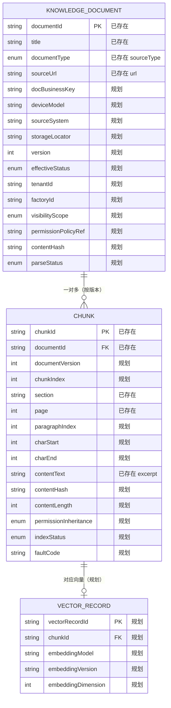

# D25 数据模型初稿（Data Model Draft v1）

> 初稿性质：用于评审与后续落地，不自动建表、不生成生产代码。
> 字段状态：【已存在】=现有代码/语料可定位；【规划】=本轮新设计、暂无实现。完整字段见两份 schema 字典。

## 1. 实体关系图（ER）

## 2. 实体职责初稿

### 2.1 KnowledgeDocument（知识文档）
- 定位：原始资料的业务身份载体，管来源、版本、权限、生命周期；不直接参与向量检索。
- 已存在字段：documentId、title、documentType（源名 sourceType）、sourceUrl（源名 url）。
- 规划字段：业务键、设备型号/系列、来源系统/存储定位、版本/生效失效时间、租户/工厂/可见范围/策略引用、内容哈希/解析状态、生命周期时间戳、受控扩展。
- 规则：内容变更按 contentHash 生成新版本，旧 Chunk/向量/缓存按版本失效并可追溯。

### 2.2 Chunk（检索片段）
- 定位：从文档切分的检索单元，保持父子关联、定位与检索元数据。
- 已存在字段：chunkId、documentId、title、sourceType、section、page、contentText（源名 excerpt）、url。
- 规划字段：documentVersion、chunkIndex、paragraphIndex、字符偏移、contentHash/contentLength、向量与索引状态、业务标签、权限继承。
- 规则：permissionInheritance 固定 INHERIT_FROM_DOCUMENT，默认拒绝，切分不得扩大父文档范围。

### 2.3 VectorRecord（向量记录，规划）
- 定位：承载 Chunk 的向量与 Embedding 元数据，依赖向量库；未接入前不实例化、不填虚构模型/维度。
- 与 Chunk 关系：重嵌入只重建向量、不改文本；以 embeddingModel/version 区分。

## 3. 与现有持久化表的关系

- 现有表：`chat_session`、`chat_message`、`prompt_template`（schema-*.sql），均为会话/消息/模板，**不含知识/Chunk 表**。
- 本轮不新增物理表；KnowledgeDocument/Chunk 目前仅 classpath JSON 教学形态（CorpusDocument/CorpusChunk）。
- 后续若落库，需单独设计 DDL、索引与迁移并获授权，不得把本初稿当作已建表。

## 4. 关键索引与约束（初稿建议）

| 对象 | 建议索引/约束 | 状态 |
|---|---|---|
| KnowledgeDocument | documentId 唯一；(documentId,version) 唯一；tenantId/factoryId/effectiveStatus 过滤索引 | 规划 |
| Chunk | chunkId 唯一；(documentId,documentVersion,chunkIndex) 唯一；contentHash 去重 | 规划 |
| VectorRecord | vectorRecordId 唯一；chunkId 外键关联 | 规划 |
| 通用 | 元数据过滤与向量检索取交集；存储定位用对象 key，禁本机绝对路径 | 规则 |

## 5. 隐私与安全约束

- 仅持久化治理必需的最小数据，不存无关个人敏感信息；文件名/摘要含个人信息需脱敏。
- 权限字段是策略输入而非裁决；真正鉴权由独立模块在证据暴露前完成。
- 密钥/连接串不入库、不进 DTO；供应商类型只存在于基础设施层。
