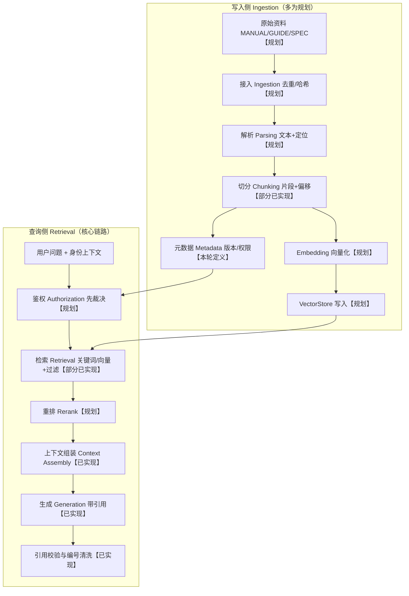
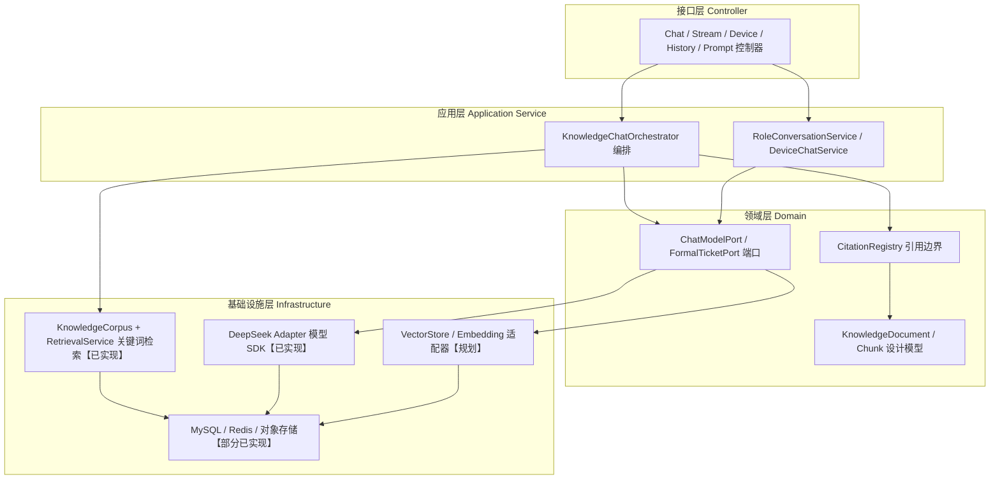
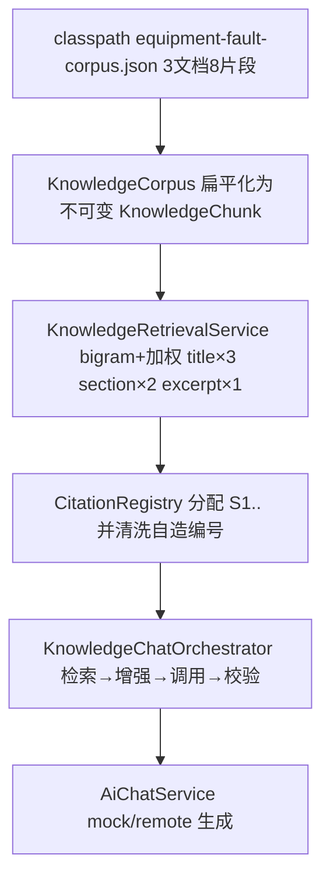

# D25 RAG 架构图（目标态与当前态）

> Typora 兼容 Mermaid：`graph TD`、`subgraph`、节点文本双引号包裹，无特殊 HTML。
> 图例：标【已实现】=代码可定位；标【规划】=本轮只定义、未接依赖。

## 1. 目标态 RAG 总体架构（写入侧 + 查询侧）

## 2. 分层架构与依赖方向

## 3. 当前态最小可用链路（真实存在，非向量）

## 4. 关键约束（图对应规则）

- 依赖方向只能自上而下：Controller → 应用 → 领域 → 基础设施；供应商 SDK/向量对象/连接串/本机路径不进入领域与 DTO。
- 鉴权在证据暴露前完成；Chunk 强制继承父文档权限、默认拒绝，切分不得扩大访问范围。
- 元数据过滤与向量检索结果取交集；无命中返回空，不强行生成。
