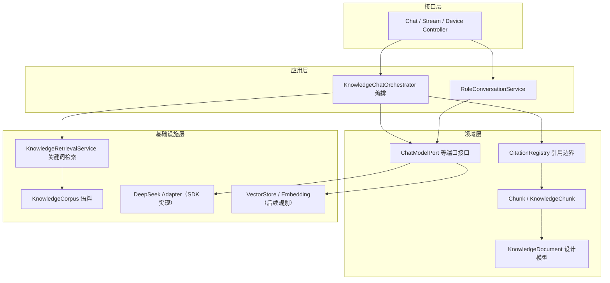

# D25 RAG 模块边界与依赖关系（设计）

> 不要求机械拆成独立 Maven 模块；本文件界定逻辑职责、输入输出、依赖与本轮状态，并明确分层依赖方向。
> 状态取值：已有（当前代码可定位）/ 本轮定义（设计产物）/ 后续规划（依赖未引入的能力）。

## 1. 十项逻辑职责边界表

| # | 职责 | 输入 | 输出 | 依赖 | 本轮状态 | 现有/目标定位 |
|---|---|---|---|---|---|---|
| 1 | Knowledge Ingestion 知识接入 | 原始文件/外部系统事件 | 原始资料 + 接入记录 | 文件/对象存储、来源系统 | 后续规划 | 现无上传，仅 classpath 夹具 |
| 2 | Parsing 文档解析 | 原始文档 | 结构化文本+定位、解析状态 | 文档解析器 | 后续规划 | 现仅 JSON 预结构化 |
| 3 | Chunking 切分与定位 | 解析文本+切分策略 | 带定位的 Chunk 集合 | 切分器 | 部分已有 | CorpusChunk 预切分；真实切分后续 |
| 4 | Metadata 元数据/版本/权限 | 文档/Chunk 事实 | 元数据字典、版本与权限关联 | 鉴权/组织数据 | 本轮定义 | 两份 schema 字典 |
| 5 | Embedding 向量生成 | Chunk 文本 | 向量+模型/维度元数据 | Embedding 模型 | 后续规划 | 未引入，不虚构 |
| 6 | Vector Store 向量存储 | 向量+元数据 | 写入/删除/相似度查询 | 向量数据库 | 后续规划 | 未引入 |
| 7 | Retrieval 召回/过滤/重排 | 用户问题+过滤条件 | 有序候选 Chunk | 检索/重排能力 | 部分已有 | KnowledgeRetrievalService（关键词）；向量/重排后续 |
| 8 | Context Assembly 上下文构造 | 候选 Chunk+权限裁决 | 证据块、引用注册表 | 引用编号 | 已有 | CitationRegistry.contextBlock |
| 9 | RAG Generation 证据生成 | 增强后请求 | 带引用的回答 | ChatModel | 已有 | KnowledgeChatOrchestrator + AiChatService |
| 10 | Evaluation 评测 | 固定问题集+运行结果 | 评测记录与指标 | 评测数据集 | 本轮定义 | D25-rag-evaluation-dataset.yaml |

## 2. 分层依赖方向

依赖方向只能自上而下，禁止反向依赖与跨层穿透：

```text
Controller（接口层）
  → Application Service（应用服务/编排：用例编排、事务、权限触发）
    → Domain Model（领域模型：KnowledgeDocument/Chunk/端口接口、业务规则）
      → Infrastructure Adapter（基础设施：向量库、Embedding、存储、模型 SDK 实现）
```

- Controller：只做协议适配与参数校验，不写检索/生成规则。现有 ChatController/ChatStreamController/DeviceChatController。
- 应用服务：编排检索→鉴权→上下文→生成→引用校验。现有 KnowledgeChatOrchestrator、RoleConversationService。
- 领域模型：承载 KnowledgeDocument/Chunk 语义与端口接口（如现有 ChatModelPort、FormalTicketPort）。
- 基础设施：实现端口，封装 DeepSeek SDK、未来向量库与 Embedding 供应商。

## 3. 依赖关系图（Typora 兼容）



## 4. 供应商隔离规则

- 向量数据库、Embedding、模型 SDK 的具体类型与调用只存在于基础设施层；领域模型与业务接口只依赖端口抽象。
- 禁止把供应商客户端、向量对象、连接串或本机绝对路径泄漏到领域模型、DTO 或 Citation 结构。
- 现有 `ChatModelPort` 已示范该模式；新增 VectorStore/Embedding 端口沿用同一隔离方式。
- 替换供应商时只改基础设施实现与配置，上层用例、引用契约与评测数据集保持不变。

## 5. 本轮边界声明（不做什么）

- 不接入向量库/Embedding/解析器，不实现完整导入—切分—向量化—检索—重排—生成链路。
- 不因本设计自动建表、生成生产代码或新增依赖；如后续必须落地，需单独说明范围、风险并获授权。
- 无真实 RAG 运行前，评测数据集只固定问题与期望，不填写命中率/Recall/MRR 等虚构数值。
