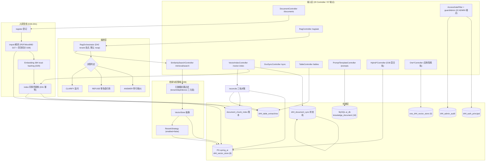
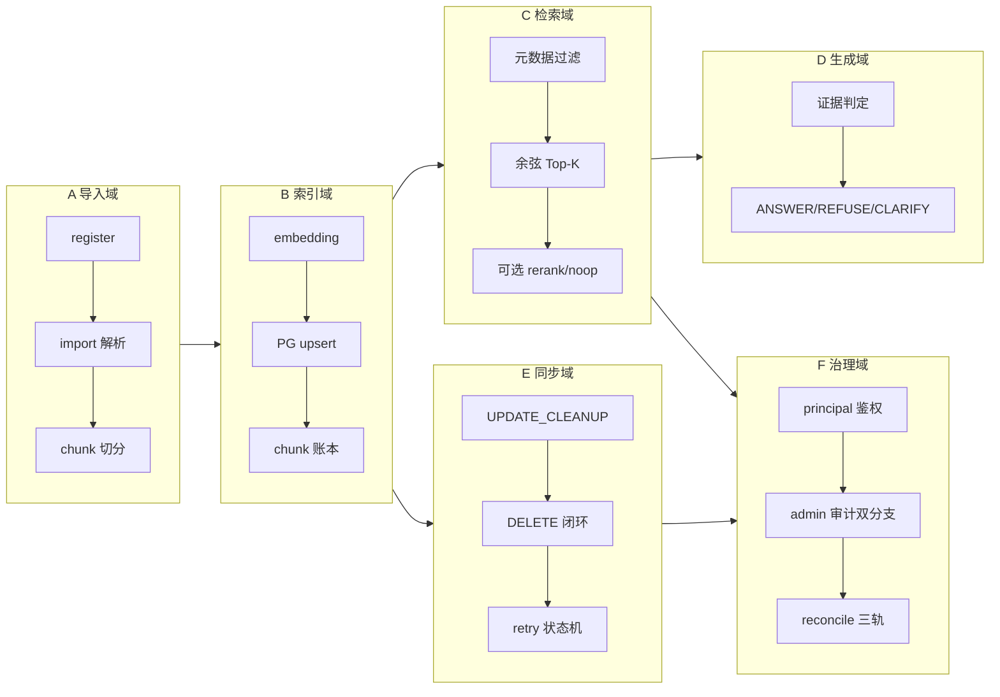
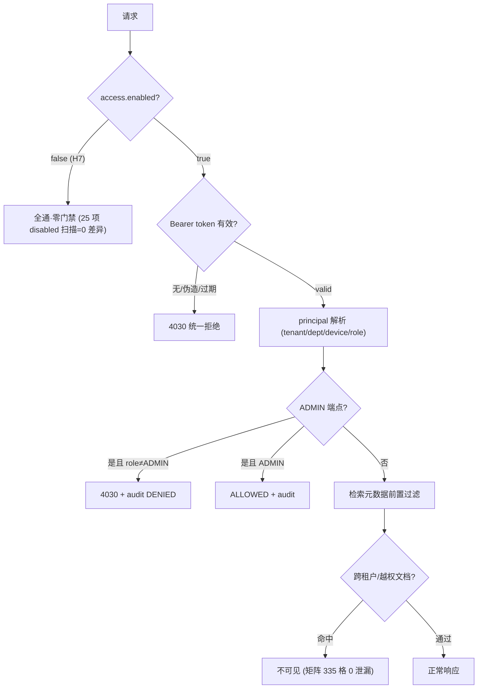
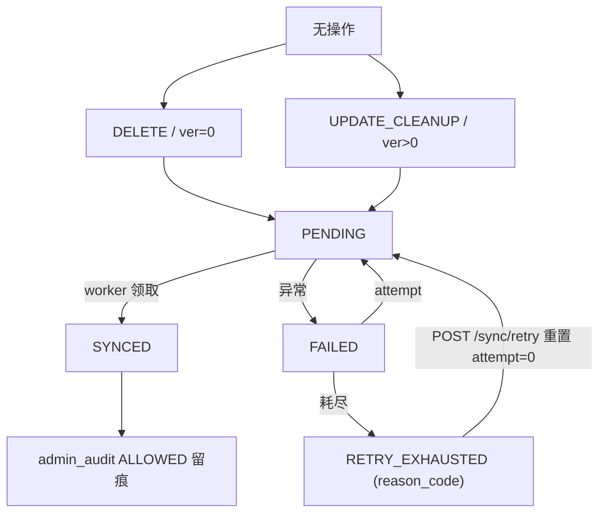

# D44 架构图（答辩四件套·架构说明）

> Typora 0.11.18 兼容：graph TD / subgraph ID [标题] / 节点双引号；节点与连线全部对应源码实扫（20 控制器、57 端点、六域包结构 com.zl.d44.*）。

## 1. RAG 端到端全景（主链+双存储+权限+同步）

## 2. 六域分解图（生命周期×权限×同步）

## 3. 权限代数（enabled 态，C08 实证 335 格 LEAK=0）

## 4. 同步状态机（d44_document_sync，KP4 冻结口径）

