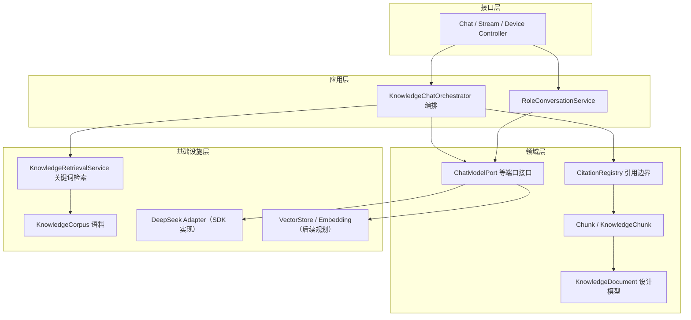
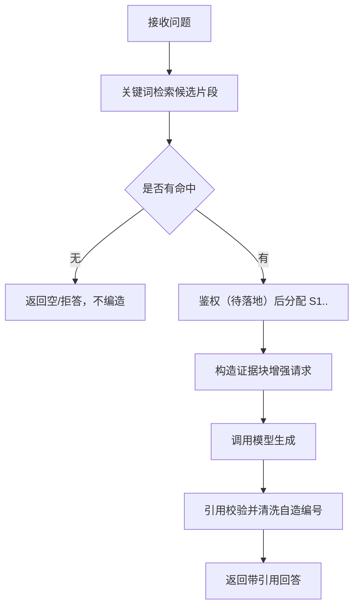

# D25 RAG 架构与评测实践指南

> 面向后续真实 RAG 落地的工程指南。本文件只描述当前已存在能力与已完成设计，
> 明确区分“已实现”与“规划项”，不虚构模型、向量、故障码或权限。

## 1. 概述

RAG（Retrieval-Augmented Generation，检索增强生成）通过先检索受控知识、再让模型基于证据生成，
降低模型幻觉与越权风险。D25 本轮只完成**架构定义与评测基线**：
- 定义 KnowledgeDocument / Chunk 元数据与模块边界；
- 固定 22 条起步评测问题与期望证据，作为后续实现的可重复基线。

当前项目已存在的是**最小关键词检索 + 引用注册表**，不是向量 RAG。

## 2. 架构

### 2.1 分层与职责



依赖方向：Controller → 应用服务 → 领域模型 → 基础设施适配器，禁止反向依赖。

### 2.2 十项逻辑职责

| 职责 | 状态 | 说明 |
|---|---|---|
| Ingestion 接入 | 后续规划 | 现无上传，仅 classpath 夹具 |
| Parsing 解析 | 后续规划 | 现仅 JSON 预结构化 |
| Chunking 切分 | 部分已有 | CorpusChunk 预切分；真实切分后续 |
| Metadata 元数据 | 本轮定义 | 两份字段字典 |
| Embedding 向量生成 | 后续规划 | 未引入，不虚构模型/维度 |
| VectorStore 向量存储 | 后续规划 | 未引入 |
| Retrieval 召回/重排 | 部分已有 | 关键词检索；向量/重排后续 |
| Context Assembly 上下文 | 已有 | CitationRegistry 构造证据块 |
| RAG Generation 生成 | 已有 | Orchestrator + AiChatService |
| Evaluation 评测 | 本轮定义 | 固定数据集 |

## 3. 原理

### 3.1 五个概念不混淆
原始文档（业务身份）→ Chunk（检索单元）→ Embedding（向量表示）→ 检索结果（候选片段）→ 模型回答（生成文本）。
向量相似度只解决“找得近”，不解决“是否有权看”；权限是独立裁决。

### 3.2 现有检索原理（已实现）
`KnowledgeRetrievalService` 对问题做 bigram 与关键词匹配，按字段加权：title×3、section×2、excerpt×1；
无命中返回空列表，不强行生成。`CitationRegistry` 为每个命中片段分配请求级 S1.. 编号，
并清洗模型自造编号，保证引用可回溯到真实片段。

### 3.3 权限与不可信数据
- Chunk 强制 `INHERIT_FROM_DOCUMENT`，默认拒绝；鉴权在证据暴露前完成。
- 文档/片段中的指令性文字（如提示注入）按不可信数据处理，不执行，只作为普通文本。

## 4. 代码（当前已存在，不新增）

| 类 | 作用 |
|---|---|
| KnowledgeChunk | 8 字段 record：documentId/chunkId/title/sourceType/section/page/excerpt/url |
| KnowledgeCorpus | 启动从 equipment-fault-corpus.json 扁平化为不可变片段 |
| KnowledgeRetrievalService | 关键词加权检索，无命中返回空 |
| CitationRegistry | 请求级引用编号与自造编号清洗 |
| KnowledgeChatOrchestrator | 检索→增强→调用→引用校验 |
| ChatModelPort | 模型端口抽象，隔离供应商 SDK |

## 5. 流程

### 5.1 一次带证据问答（当前链路）


### 5.2 评测执行流程（后续落地）
固定问题 → 运行 RAG 得到决策与证据 → 对照 expectedDecision/expectedAnswerPoints/expectedEvidence →
按统一口径计算指标 → 记录结果；问题文本不得随版本随意改写。

## 6. 配置

- 现有配置项：`app.ai.knowledge.maxSources=3`、`app.ai.knowledge.corpus-location=knowledge/equipment-fault-corpus.json`。
- 密钥/模式通过环境变量注入（AI_MODE、AI_API_KEY），禁止硬编码与提交。
- 存储定位使用对象存储 key，禁止写入本机绝对路径；供应商连接串不进入领域与 DTO。

## 7. 评测数据集与验证

### 7.1 数据集结构
22 条用例，每条含 caseId、category、question、userContext、expectedDecision、expectedAnswerPoints、
expectedEvidence、forbiddenClaims、acceptanceCriteria、sourceStatus 共 10 个固定字段。
分布：answerable 7、fault-code 4、unanswerable 4、permission 4、boundary 3。

### 7.2 已执行验证
- 脚本校验：`python docs/temp_docs/D25/validate_dataset.py` → 通过（ID 唯一、必填齐全、枚举合法、覆盖完整）。
- 构建测试：`mvn clean test` → Tests run: 123，0 失败/错误/跳过，BUILD SUCCESS。

### 7.3 指标口径（待真实运行）
命中率、Recall、MRR 等仅在真实 RAG 运行后计算；当前不填数值，避免把格式/构建通过误报为端到端通过。

## 8. 注意事项

- 规划字段（向量/版本/权限治理等）在对应能力实现前保持空或默认，禁止回填虚构值。
- 故障码缺失用例（E-4077、ALM-51）必须 abstain/clarify，不跨设备套用。
- 权限用例主体为测试夹具，真实角色/租户映射待业务确认。
- 后续接入向量库/Embedding 属新增能力，需单独评估范围、风险并获授权。

## 9. 层级树

```text
RAG 能力地图
├─ 已实现
│  ├─ 语料加载（3 文档 8 片段）
│  ├─ 关键词加权检索
│  ├─ 引用注册与清洗
│  └─ 证据增强生成
├─ 本轮定义
│  ├─ KnowledgeDocument 字典
│  ├─ Chunk 字典
│  ├─ 模块边界与分层
│  └─ 22 条评测基线
└─ 后续规划
   ├─ 解析/切分/Embedding/向量库
   ├─ 独立鉴权与权限裁决
   └─ 指标化端到端评测
```

## 10. 官方文档溯源

- 《Spring AI Reference – RAG | 检索增强生成》：<https://docs.spring.io/spring-ai/reference/1.1/api/rag.html>
- 《Spring AI Reference – Vector Databases | 向量数据库》：<https://docs.spring.io/spring-ai/reference/1.1/api/vectordbs.html>
- 《Spring AI Reference – Document ETL Pipeline | 文档处理管线》：<https://docs.spring.io/spring-ai/reference/1.1/api/etl/etl-pipeline.html>
- 《Spring AI Reference – Metadata Filters | 元数据过滤》：<https://docs.spring.io/spring-ai/reference/1.1/api/filters.html>
