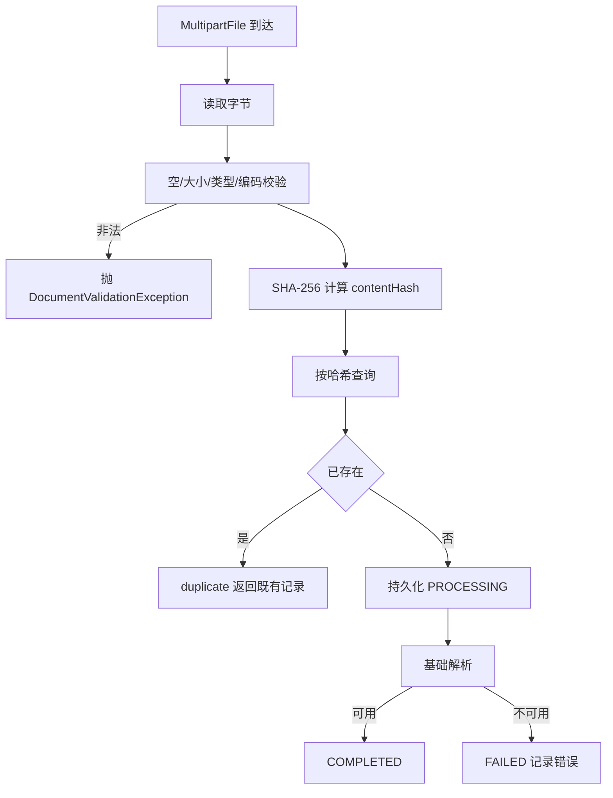

# D26 文档导入与基础解析技术原理及操作实践指南

> 适用模块：D26_DIABP（`com.zl.d26`）
> 技术基线：JDK 21、Spring Boot 3.5.16、Spring AI 1.1.8、MyBatis-Plus 3.5.17
> 阅读路径：是什么 → 为什么 → 底层原理 → 核心代码 → 执行流程 → 配置 → 操作实践 → 常见问题 → 工程实践。

## 一、是什么

文档导入入口接收浏览器或客户端以 `multipart/form-data` 提交的文件，在服务端完成：

1. 文件读取与大小、类型、编码校验；
2. 基于原始字节 SHA-256 的 contentHash 计算与重复识别；
3. PENDING→PROCESSING→COMPLETED/FAILED 状态流转；
4. 最小基础解析（UTF-8 解码 + 可用性判断）。

登记入口只写元数据、不接触文件字节，与导入入口职责分离。

## 二、为什么这样设计

- **服务端校验**：前端校验可被绕过，安全边界必须在服务端；且不能只看扩展名，需要结合内容类型与真实解码。
- **内容哈希去重**：文件名可任意更改，相同字节内容应识别为同一文档，避免重复处理。
- **状态机显式落库**：异常必须收敛到 FAILED，禁止吞异常伪造成功，也不允许长期停留 PROCESSING。
- **DB 唯一约束兜底**：应用层“先查后插”在并发下存在竞态，唯一约束是最终一致性保证。
- **最小解析**：本轮目标是导入入口，不提前耦合 Chunk/Embedding，保持确定性与可测试。

## 三、底层原理

### 3.1 Multipart 文件处理

Spring MVC 使用 `StandardServletMultipartResolver` 将 `multipart/form-data` 解析为 `MultipartFile`。容器先按 `spring.servlet.multipart.*` 限制大小，超限抛 `MaxUploadSizeExceededException`；通过后控制器再调用 `getBytes()` 读取字节。

参考：《Spring Boot Reference - WebServletUploading Files》
https://docs.spring.io/spring-boot/3.5/how-to/web-client.html#howto.webclient.multipart

### 3.2 UTF-8 严格解码

使用 `CharsetDecoder` 并将 malformedInput 与 unmappableCharacter 都设为 `CodingErrorAction.REPORT`，遇到非法字节抛 `CharacterCodingException`，从而识别“非法编码”，而不是用替换字符静默吞掉。

### 3.3 SHA-256 内容哈希

`MessageDigest.getInstance("SHA-256")` 对原始字节摘要，输出 64 位小写十六进制。算法确定性保证：相同字节恒得相同哈希，不同内容哈希不同。

### 3.4 状态机与事务

- 登记方法与导入方法标注 `@Transactional`，写操作在事务内完成。
- 导入为同步处理：先持久化 PROCESSING，再解析，最后按结果更新终态。
- 并发插入触发 `DuplicateKeyException` 时，在异常到达事务拦截器前于方法内捕获，回查既有记录并按重复响应返回，既有行不受影响。

### 3.5 唯一约束

InnoDB 对 `content_hash` 建唯一索引；登记态无文件时该列为 NULL，多个 NULL 不冲突。唯一约束在数据库层兜底，应用层即使并发也无法插入第二行相同哈希。

## 四、核心代码

### 4.1 服务端校验（FileUploadValidator）

```java
public byte[] validate(MultipartFile file) {
    if (file == null) {
        throw new DocumentValidationException("上传文件缺失");
    }
    byte[] bytes = readBytes(file);
    validateNotEmpty(bytes, file);
    validateSize(bytes);
    validateType(file);
    validateEncoding(bytes);
    return bytes;
}
```

严格解码关键片段：

```java
CharsetDecoder decoder = Charset.forName(properties.getCharset()).newDecoder()
        .onMalformedInput(CodingErrorAction.REPORT)
        .onUnmappableCharacter(CodingErrorAction.REPORT);
try {
    decoder.decode(ByteBuffer.wrap(bytes));
} catch (CharacterCodingException e) {
    throw new DocumentValidationException("文件编码非法，要求 UTF-8 编码");
}
```

### 4.2 哈希（Sha256ContentHasher）

```java
MessageDigest digest = MessageDigest.getInstance("SHA-256");
byte[] digestBytes = digest.digest(content);
// 逐字节转小写十六进制
```

### 4.3 状态机与失败收敛（DocumentImportService）

```java
DocumentImportView concurrent = persistProcessing(doc);
if (concurrent != null) {
    return concurrent;
}
try {
    parser.parse(bytes);
    doc.setStatus(DocumentStatus.COMPLETED);
} catch (DocumentParseException e) {
    markFailed(doc, "PARSE_FAILED", e.getMessage());
} catch (RuntimeException e) {
    markFailed(doc, "PROCESSING_FAILED", "文档处理失败，请稍后重试");
}
doc.setUpdatedAt(LocalDateTime.now());
mapper.updateById(converter.toPO(doc));
```

### 4.4 唯一约束兜底（DDL）

```sql
UNIQUE KEY `uk_content_hash` (`content_hash`),
UNIQUE KEY `uk_document_id` (`document_id`)
```

## 五、执行流程



## 六、配置说明

| 配置项 | 默认值 | 含义 |
|---|---|---|
| spring.servlet.multipart.max-file-size | 10MB | 容器单文件上限 |
| spring.servlet.multipart.max-request-size | 12MB | 容器总请求上限 |
| app.ai.document.max-file-size-bytes | 2097152 | 业务大小上限（字节） |
| app.ai.document.charset | UTF-8 | 解码字符集 |
| app.ai.document.allowed-extensions | txt, md | 扩展名白名单 |
| app.ai.document.allowed-content-types | text/plain, text/markdown | 内容类型白名单 |

均支持环境变量覆盖；配置文件不写真实密钥。

## 七、操作实践

### 7.1 登记文档

```bash
curl -X POST http://localhost:8080/api/v1/documents/register \
  -H "Content-Type: application/json" \
  -d '{"source":"manual","title":"设备手册"}'
```

### 7.2 导入新文件

```bash
curl -X POST http://localhost:8080/api/v1/documents/import \
  -F "file=@note.txt;type=text/plain" \
  -F "source=manual" \
  -F "title=设备手册"
```

### 7.3 为已登记文档导入文件

```bash
curl -X POST http://localhost:8080/api/v1/documents/import \
  -F "file=@note.txt;type=text/plain" \
  -F "documentId=已登记的ID"
```

### 7.4 查询与列表

```bash
curl http://localhost:8080/api/v1/documents
curl http://localhost:8080/api/v1/documents/{documentId}
```

统一响应结构：`{"code":200,"msg":"success","data":{...}}`，HTTP 状态恒为 200，业务结果看 code。

## 八、常见问题

1. **上传即报大小超限**：先确认是否触发容器 multipart 限制，再核对业务 `max-file-size-bytes`。
2. **报编码非法**：源文件不是 UTF-8（常见 GBK 保存），需另存为 UTF-8 后上传。
3. **报不支持类型**：扩展名或内容类型不在白名单；本轮仅开放 txt/md。
4. **重复导入返回 duplicate**：相同内容已存在，系统不重复处理，属预期行为。
5. **状态为 FAILED**：查看 errorCode/errorMessage，修正后可对同一文档重新导入。

## 九、工程实践与注意事项

- 校验组件使用真实字节单测，避免“Mock 成功”掩盖真实校验缺陷。
- 业务限制与容器限制应分层运维，默认容器更宽、业务更严，便于在服务内给出确定性提示。
- 真实部署前先执行 `db/schema-knowledge-document.sql`，再做端到端上传验证。
- 本轮未做端到端真实库上传与鉴权，文档如实标注，不把规划能力描述为已实现。
- 后续迭代再在同一文档行上扩展 Chunk、Embedding 与 VectorStore，本轮不提前接线。
