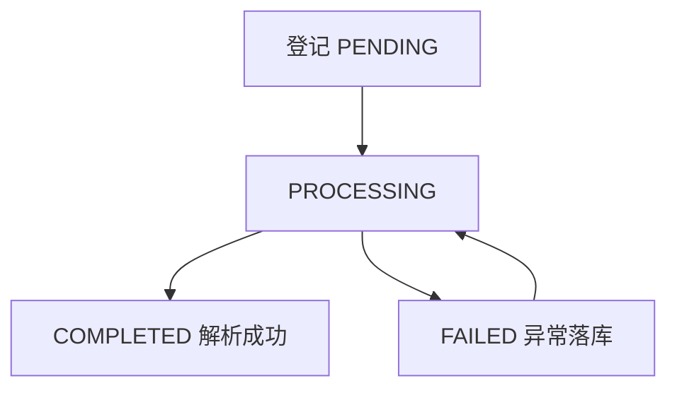
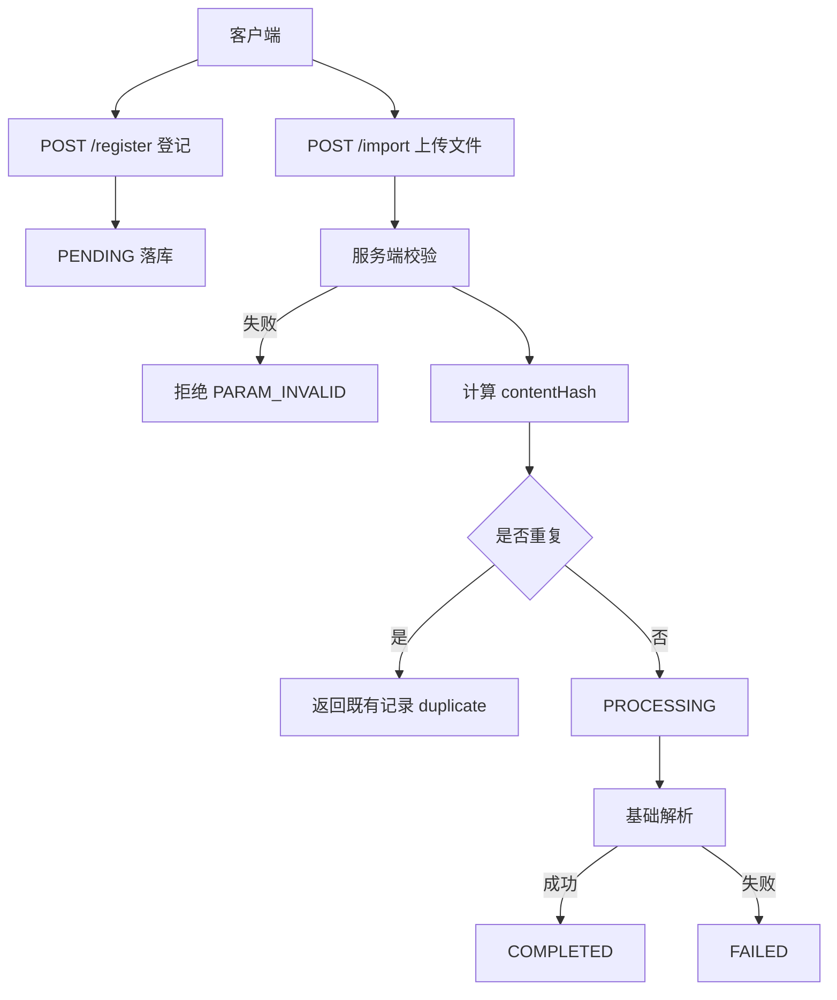

# D26 文档登记与导入功能实现全量说明

> 迭代：Day 26：文档导入与基础解析
> 物理包：`com.zl.d26`｜模块：`D26_DIABP`｜端口：8080
> 本文记录本轮迭代的全量信息与操作，所有结论以本地实际代码、配置与真实构建结果为依据。

## 一、迭代概述

本轮在 D25 已确定的 KnowledgeDocument Schema 基础上，落地**知识文档登记**与**文件导入入口**两个最小可用能力：

- 登记：只写元数据，生成文档标识，状态为 PENDING。
- 导入：接收 MultipartFile，服务端执行大小、类型、编码、读取与基础解析校验，驱动状态机，并基于 contentHash 识别重复导入。

本轮不实现 Embedding、VectorStore、Chunk 切分、RAG 检索问答、Agent/Tool/MCP，不做无关重构。

## 二、范围与边界

| 类别 | 内容 |
|---|---|
| 本轮实现 | 文档登记入口、文件导入入口、状态机、服务端校验、contentHash 去重、DDL、自动化测试 |
| 明确不做 | Embedding、VectorStore、Chunk、RAG 问答、Agent、Tool、MCP |
| 改动方式 | 纯新增 + 两处既有文件最小增量，未删除任何文件 |
| 鉴权 | 当前无认证鉴权，不假设权限已强制；X-Dev-User 仅归属标识 |

## 三、核心字段与 Schema 落地

字段体系对齐 D25 KnowledgeDocument 字典，不另起字段体系：

| 字段 | 含义 | D25 字典对应 |
|---|---|---|
| documentId | 文档业务标识，服务端生成（UUID 去横线） | documentId |
| source | 文档来源 | sourceSystem（以 source 列承载，注明映射） |
| title | 文档标题，安全截断 | title |
| version | 文档版本，从 1 开始 | version |
| status | 导入处理状态 | 处理态（PENDING/PROCESSING/COMPLETED/FAILED） |
| updatedAt | 状态更新时间 | updatedAt |
| contentHash | 原始字节 SHA-256，用于去重 | contentHash |
| contentLength | 原始字节长度 | storageMetadata.contentLength |
| errorCode/errorMessage | 失败错误码与安全摘要 | failureInfo |

## 四、架构与组件

```
D26_DIABP
└── src/main/java/com/zl/d26
    ├── common（Result/ResultCode/GlobalExceptionHandler，复用）
    └── document
        ├── config/DocumentImportProperties
        ├── controller/DocumentController
        ├── service/DocumentRegistrationService、DocumentImportService
        ├── model/KnowledgeDocument、DocumentStatus
        ├── po/KnowledgeDocumentPO
        ├── mapper/KnowledgeDocumentMapper
        ├── dto/DocumentRegisterRequest、DocumentView、DocumentImportView
        ├── support/FileUploadValidator、BasicDocumentParser、
        │         Sha256ContentHasher、DocumentConverter
        └── exception/DocumentValidationException、DocumentParseException
```

分层职责：

- Controller：协议入口，统一返回 `Result<T>`，不直接暴露 PO。
- Service：登记与导入职责分离，承载状态机与事务边界。
- Support：校验、解析、哈希、转换为独立可测组件。
- Mapper/PO：沿用 MyBatis-Plus BaseMapper 范式，不写 XML。

## 五、状态机



- 登记即 PENDING；导入开始进入 PROCESSING。
- 解析成功落 COMPLETED；任何异常都收敛到 FAILED，记录 errorCode 与 errorMessage。
- 不允许长期停留 PROCESSING，不吞异常、不伪造成功。
- FAILED 文档允许重新导入同一内容进行重试（同一文档行，contentHash 唯一约束不冲突）。

## 六、服务端校验

校验全部在服务端执行，不依赖前端、不仅看扩展名：

| 校验项 | 规则 | 失败结果 |
|---|---|---|
| 空文件 | isEmpty 或零字节 | 拒绝 |
| 大小 | 业务可配上限，默认 2MB | 拒绝 |
| 类型 | 扩展名白名单 + 内容类型共同判断 | 拒绝 |
| 编码 | UTF-8 严格解码，非法字节拒绝 | 拒绝 |
| 读取 | getBytes 异常 | 拒绝 |
| 基础解析 | 解码后须含可用文字 | 落 FAILED |

容器 multipart 限制（默认 10MB）为第一道防线，业务限制（默认 2MB）为第二道、独立可配。

## 七、重复导入策略

- 对原始字节计算 SHA-256 得到 contentHash，判断基于内容而非文件名。
- 表上 `uk_content_hash` 唯一约束兜底；应用层先查后插，并发下由唯一约束保证。
- 命中重复：不创建第二行、不进入第二次处理流程，返回既有记录并标记 duplicate=true。

## 八、关键流程



## 九、配置

`application.yml` 关键新增：

```yaml
spring:
  servlet:
    multipart:
      max-file-size: 10MB
      max-request-size: 12MB
app:
  ai:
    document:
      max-file-size-bytes: 2097152
      charset: UTF-8
      allowed-extensions: [txt, md]
      allowed-content-types: [text/plain, text/markdown]
```

所有限制支持环境变量覆盖，配置文件不含密钥。

## 十、验证结果（真实执行）

| 指标 | 真实值 |
|---|---|
| 命令 | `mvn clean test` |
| 构建结果 | BUILD SUCCESS |
| 总测试 | 153，Failures 0，Errors 0，Skipped 0 |
| 新增测试 | 30（6 个测试类） |
| 原始日志 | logs/D26/01-compile.log、02-test.log |
| Surefire | docs/evidence/D26/surefire-reports |

## 十一、操作记录

1. 扫描 D26 骨架，生成目录树与基线。
2. 输出方案设计结论，确定字段、状态机、校验与重复策略。
3. 新增 DDL、配置、模型、PO、Mapper、服务、控制器与测试。
4. 真实执行编译与全量测试，一次编译错误（测试重载歧义）已定位修复。
5. 归档证据、日志与 Surefire 报告，编写两份正式文档。

## 十二、风险与注意事项

- 本轮为单元/切片测试，真实 MySQL 端到端上传需先执行 DDL 后验证，本文不虚报端到端结果。
- 业务限制与容器限制需保持一致的运维口径，避免容器先于业务拒绝。
- contentHash 唯一约束意味着相同内容恒为同一文档，这是预期去重语义。
- 未做 git commit/push，是否提交由用户决定。

## 十三、交付物清单

- 正式文档：本文与《D26-文档导入与基础解析技术原理及操作实践指南》。
- 证据：docs/evidence/D26（设计、清单、测试摘要、状态、Surefire 副本）。
- 日志：logs/D26；临时文件：docs/temp_docs/D26（未自动删除）。
