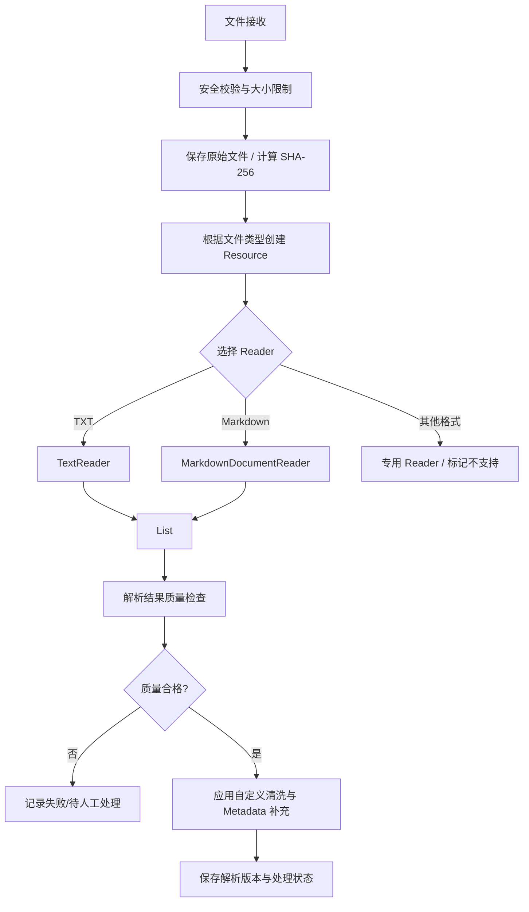

# M3 知识笔记：Spring AI 文档导入与基础解析

> **技术基线**：JDK 21、Spring Boot 3.5.x、Spring AI 1.1.8。  
> **范围**：`Document`、`DocumentReader`、`TextReader`、`MarkdownDocumentReader`、Markdown/TXT 清洗、解析质量与失败处理。  
> **边界**：本笔记不展开 Chunking、Embedding、Vector Store、Reranking 和 RAG 生成；Reader 输出 `Document` 不代表文档质量已经合格。

---

## 1. 文档导入与解析在 RAG 中的位置

RAG 的前置工作不是“直接把文件交给模型”，而是先将文件变成可检查、可追溯的文本数据对象。Spring AI 把这类数据处理纳入 ETL（Extract、Transform、Load）思路：Reader 负责提取，后续组件可以再变换，最终由存储端接收。本阶段只做到 **Reader → Document → 清洗/质量检查**，不进入后续检索与生成。

### 1.1 文档导入流程



### 1.2 核心组件职责

| 组件 | 输入 | 输出 | 主要职责 | 不负责什么 |
|---|---|---|---|---|
| 原始文件存储 | 上传字节 | 原始文件标识、路径、哈希 | 保存可回溯原件 | 不解释文档语义 |
| Spring `Resource` | 资源定位信息 | 可读资源抽象 | 统一访问 classpath、文件系统、字节数组等 | 不负责解析文件格式 |
| `DocumentReader` | `Resource` 或资源定位 | `List<Document>` | 从外部资源提取 Document | 不保证内容完整、正确、适合检索 |
| `Document` | 文本或媒体内容 + Metadata | 标准化数据对象 | 承载内容、ID、来源等元数据 | 不等于原始文件 |
| 自定义 Cleaner | Document 文本 | 清洗后的 Document | 规范化换行、空白、控制字符等 | 不是 Spring AI 内置 Reader 能力 |
| 质量检查器 | Document 列表 | 质量报告/通过或失败 | 检查空内容、字符数、结构、来源等 | 不修复所有语义错误 |

**关键区分**：解析是“能否从文件提取内容”；清洗是“如何规范文本”；质量检查是“提取结果是否值得继续处理”。三者不能互相替代。

---

## 2. Spring AI `Document` 核心原理

### 2.1 定义与设计目的

`org.springframework.ai.document.Document` 是 Spring AI ETL 流程中的基础数据对象，封装内容、唯一 ID 和 Metadata。1.1.8 中，一个 Document **只能承载文本内容或媒体内容之一，不能同时设置两者**。文本文档通过 `getText()` 访问，媒体文档通过 `getMedia()` 访问。  
参考：Document | 文档对象：[完整 Javadoc](https://docs.spring.io/spring-ai/docs/1.1.8/api/org/springframework/ai/document/Document.html)

### 2.2 核心属性

| 属性 | API | 作用 | 工程注意事项 |
|---|---|---|---|
| ID | `getId()` | 区分 Document | 默认通过 `RandomIdGenerator` 生成；重新导入时随机 ID 不保证幂等 |
| 文本 | `getText()` | 存放解析后的文本 | 媒体 Document 的 `getText()` 为 `null` |
| 媒体 | `getMedia()` | 存放 `Media` 内容 | 文本与媒体二选一 |
| Metadata | `getMetadata()` | 来源、文件名、编码、业务标签等 | 不应放大段原文或复杂嵌套对象；优先使用简单值 |
| Score | `getScore()` | 关联相关性/相似度分数 | 通常由检索或排序阶段使用，不是原始文件属性 |

`Document` 的主要字段是 `final`，但 Metadata 返回的是 Map；不要把它理解为深度不可变对象。需要变更文本或 Metadata 时，更清晰的做法是使用 `mutate()` 创建新的 Document 对象。

### 2.3 创建、读取、修改

```java
import org.springframework.ai.document.Document;

import java.util.Map;

// 方式一：构造器
Document doc1 = new Document(
        "设备主轴出现 E101 过载报警。",
        Map.of("source", "fault-manual.txt", "fileId", "F-1001")
);

// 方式二：Builder
Document doc2 = Document.builder()
        .id("manual:F-1001:0")
        .text("设备主轴出现 E101 过载报警。")
        .metadata("source", "fault-manual.txt")
        .metadata("fileId", "F-1001")
        .metadata("charset", "UTF-8")
        .build();

String text = doc2.getText();
String source = (String) doc2.getMetadata().get("source");

// 修改文本时复制已有 ID、Metadata、Score，再覆盖文本
Document cleaned = doc2.mutate()
        .text("设备主轴出现 E101 过载报警。")
        .metadata("cleaningVersion", "m3-v1")
        .build();
```

**Metadata 设计原则**：

- 记录稳定、可检索、可审计的属性：`fileId`、`source`、`originalName`、`mimeType`、`sha256`、`charset`、`parserVersion`、`tenantId`、`page` 等。
- Document Metadata 的值应采用简单类型（例如 String、Integer、Float、Boolean）；不要把整个业务对象、数组或大段 JSON 塞进去。
- 避免写入本机绝对路径、访问令牌、用户隐私或密钥。对外部来源使用经过安全处理的逻辑标识。
- `Document.id` 与 `fileId` 不是同一概念：一个原始文件可以产生多个 Document；一个文件 ID 用于标识原件，Document ID 用于标识解析产物。

### 2.4 Document、原始文件与解析文本的关系

```text
原始文件 bytes
  ├─ 原件存储：保留原始字节、文件名、上传者、SHA-256、版本
  └─ Reader 解析
       └─ Document
            ├─ id：解析产物标识
            ├─ text/media：本次提取内容
            └─ metadata：fileId、source、charset、parserVersion 等
```

**不要只保存 Document 而丢弃原始文件。** Reader 可能丢失排版、图片、表格单元格关系、链接目标、页眉页脚或代码块上下文。保留原件才能在解析策略升级后重新处理，也能对照原文定位解析缺陷。

---

## 3. `DocumentReader` 接口与工作机制

### 3.1 接口定义

Spring AI 1.1.8 的 `DocumentReader` 位于 `org.springframework.ai.document`，继承 `Supplier<List<Document>>`：

```java
public interface DocumentReader extends Supplier<List<Document>> {
    default List<Document> read() {
        return get();
    }
}
```

- `get()`：来自 `Supplier`，由具体 Reader 实现，执行读取并返回 `List<Document>`。
- `read()`：Spring AI 提供的默认便利方法，内部直接调用 `get()`。
- 两者不是两个不同的解析阶段；在 1.1.8 中调用 `read()` 与 `get()` 最终执行同一读取逻辑。

参考：DocumentReader | 文档读取器接口：[完整 Javadoc](https://docs.spring.io/spring-ai/docs/1.1.8/api/org/springframework/ai/document/DocumentReader.html)

### 3.2 Reader 与 Spring `Resource`

`Resource` 是 Spring Core 的资源抽象。它让 Reader 不必直接绑定 `File`，可以接收不同资源实现，例如：

```java
import org.springframework.core.io.ClassPathResource;
import org.springframework.core.io.FileSystemResource;
import org.springframework.core.io.ByteArrayResource;
import org.springframework.core.io.Resource;

Resource classpath = new ClassPathResource("knowledge/fault.txt");
Resource localFile = new FileSystemResource("./uploads/fault.txt");
Resource memory = new ByteArrayResource("故障说明".getBytes(java.nio.charset.StandardCharsets.UTF_8));
```

Resource 是“如何访问数据”的抽象，不等于 Reader，也不负责把 DOCX、Markdown、TXT 解析成 Document。  
参考：Resources | Spring 资源抽象：[完整文档](https://docs.spring.io/spring-framework/reference/core/resources.html)

### 3.3 Reader 解析粒度与后续处理的区别

- `TextReader`：一个文本资源默认生成一个 Document，内容是整个文件文本。
- `MarkdownDocumentReader`：按标题、段落、水平分隔线及代码/引用配置将 Markdown 内容组织成多个 Document。
- Reader 的输出粒度受具体实现影响；它不是统一的“每个 Reader 都一文件一 Document”。
- Reader 不负责后续 Token 切分，也不负责判断切分后的语义质量。本阶段只确认输出 Document 的数量、内容与 Metadata。

### 3.4 如何选择 Reader

| 文件类别 | 可考虑的 Reader | 适用边界 |
|---|---|---|
| TXT | `TextReader` | 纯文本、字符集可明确确定；整份文本读入内存 |
| Markdown | `MarkdownDocumentReader` | 需要按标题/段落/代码/引用等 Markdown 元素提取文本 |
| PDF | `PagePdfDocumentReader` / `ParagraphPdfDocumentReader` | 页面或目录段落提取；扫描件仍可能需要 OCR |
| DOC、DOCX、PPT、HTML 等 | `TikaDocumentReader` | 依赖相应 Reader 与解析库；提取文本不代表完整保留版式 |
| HTML | `JsoupDocumentReader` | 需要按 CSS selector 选择页面内容 |

本阶段只实践 TXT、Markdown。其他 Reader 只理解它们是“按文件类型选择不同提取策略”，不展开实现。

---

## 4. TXT：`TextReader`

### 4.1 1.1.8 真实行为

`TextReader` 位于 `org.springframework.ai.reader`，构造器支持 `TextReader(Resource)` 和 `TextReader(String resourceUrl)`。它实现 `DocumentReader`，并提供：

- `setCharset(Charset)` / `getCharset()`：设置或读取字符集。
- `getCustomMetadata()`：向所有输出 Document 添加自定义 Metadata。
- `get()` / `read()`：读取文本并返回 `List<Document>`。
- 默认字符集为 UTF-8。
- 元数据常量 `CHARSET_METADATA` 的值为 `charset`，`SOURCE_METADATA` 的值为 `source`。
- 一个资源的文本内容整体读入，返回包含一个 Document 的 List；空文件也会返回一个文本为空的 Document，而不是空 List。

以上行为均可在 v1.1.8 源码和官方 Javadoc 中核对。  
参考：TextReader | TXT 文本读取器：[完整 Javadoc](https://docs.spring.io/spring-ai/docs/1.1.8/api/org/springframework/ai/reader/TextReader.html)

### 4.2 UTF-8 与 GBK 示例

```java
import org.springframework.ai.document.Document;
import org.springframework.ai.reader.TextReader;
import org.springframework.core.io.FileSystemResource;
import org.springframework.core.io.Resource;

import java.nio.charset.Charset;
import java.nio.charset.StandardCharsets;
import java.util.List;

public class TxtImportExample {

    public List<Document> readUtf8(java.nio.file.Path path, String fileId) {
        Resource resource = new FileSystemResource(path);
        TextReader reader = new TextReader(resource);
        // UTF-8 是 TextReader 的默认值；此处显式设置便于代码审查
        reader.setCharset(StandardCharsets.UTF_8);
        reader.getCustomMetadata().put("fileId", fileId);
        reader.getCustomMetadata().put("format", "txt");
        return reader.read();
    }

    public List<Document> readGbk(java.nio.file.Path path, String fileId) {
        Resource resource = new FileSystemResource(path);
        TextReader reader = new TextReader(resource);
        reader.setCharset(Charset.forName("GBK"));
        reader.getCustomMetadata().put("fileId", fileId);
        reader.getCustomMetadata().put("format", "txt");
        return reader.get();
    }
}
```

**注意**：不能因为文件名是 `.txt` 就推断编码。上传时应优先由可信来源提供编码信息；未知编码先进入检测/人工处理，不要盲目尝试一组编码后选择“看起来像中文”的结果。

### 4.3 Metadata 示例

对 `TextReader` 输出的 Document，预期可以检查：

```java
Document document = new TextReader(resource).read().get(0);

String text = document.getText();
Object source = document.getMetadata().get(TextReader.SOURCE_METADATA);
Object charset = document.getMetadata().get(TextReader.CHARSET_METADATA);
```

对于常见文件资源，`source` 尝试使用文件名；取不到文件名时再退回 URI、URL 或 Resource 描述。`charset` 为实际配置字符集名称，如 `UTF-8` 或 `GBK`。自定义 Metadata 会与这两个字段一起写入输出 Document。

### 4.4 TXT 的常见问题

| 现象 | 可能原因 | 处理建议 |
|---|---|---|
| 中文乱码 | 解码 Charset 与文件实际编码不一致 | 明确编码后调用 `setCharset`；重新读取原始字节，不要在乱码字符串上继续清洗 |
| 空文本 | 空文件或内容只有空白 | Reader 会返回一个空 Document；质量检查应拒绝或标记为空内容 |
| 超大文本 | `TextReader` 将整个资源复制到一个 String | 导入前设置字节大小上限；大文件改用受控的流式/分段解析策略，不要直接将整文件送入内存 |
| 重复读取报错 | 某些 Resource（例如一次性 InputStreamResource）底层流不可重复读取 | 对一次性流只读取一次；重试时重新创建可读 Resource |
| 资源流生命周期 | v1.1.8 `TextReader.get()` 源码调用 `resource.getInputStream()` 后交给 `StreamUtils.copyToString`，没有显式 `try-with-resources` | 高频/长时间导入应特别检查流关闭行为；可用受控自定义 Reader 在 `try-with-resources` 中读取，或升级前后做文件句柄回归验证 |
| 读取异常 | 文件不存在、权限不足、I/O 异常 | 捕获异常并记录 fileId、异常分类、Trace/任务 ID；不记录密钥或敏感正文 |

---

## 5. Markdown：`MarkdownDocumentReader`

### 5.1 依赖与基本使用

Markdown Reader 是单独的模块，不应因为引入了某个模型 Starter 就假设它一定在 classpath。使用 Spring AI BOM 管理版本，Markdown Reader 的坐标为：

```xml
<dependencyManagement>
    <dependencies>
        <dependency>
            <groupId>org.springframework.ai</groupId>
            <artifactId>spring-ai-bom</artifactId>
            <version>1.1.8</version>
            <type>pom</type>
            <scope>import</scope>
        </dependency>
    </dependencies>
</dependencyManagement>

<dependencies>
    <!-- Document、DocumentReader、TextReader 所在的基础模块 -->
    <dependency>
        <groupId>org.springframework.ai</groupId>
        <artifactId>spring-ai-commons</artifactId>
    </dependency>

    <!-- 单独引入 Markdown Reader；版本由 Spring AI BOM 管理 -->
    <dependency>
        <groupId>org.springframework.ai</groupId>
        <artifactId>spring-ai-markdown-document-reader</artifactId>
    </dependency>
</dependencies>
```

`spring-ai-markdown-document-reader` 不是 Starter。已有依赖若已传递引入 `spring-ai-commons`，一般无需重复声明，但在需要直接使用 `Document`/`TextReader` 的模块中显式声明直接依赖更清晰。  
参考：Spring AI 1.1.8 `spring-ai-markdown-document-reader` POM | Markdown Reader 模块依赖定义：[源码](https://github.com/spring-projects/spring-ai/blob/v1.1.8/document-readers/markdown-reader/pom.xml)

```java
import org.springframework.ai.document.Document;
import org.springframework.ai.reader.markdown.MarkdownDocumentReader;
import org.springframework.ai.reader.markdown.config.MarkdownDocumentReaderConfig;
import org.springframework.core.io.ClassPathResource;

import java.util.List;

public class MarkdownImportExample {

    public List<Document> readMarkdown() {
        MarkdownDocumentReaderConfig config = MarkdownDocumentReaderConfig.builder()
                .withHorizontalRuleCreateDocument(true)
                .withIncludeCodeBlock(true)
                .withIncludeBlockquote(true)
                .withAdditionalMetadata("sourceType", "knowledge-manual")
                .withAdditionalMetadata("parserVersion", "spring-ai-1.1.8")
                .build();

        MarkdownDocumentReader reader = new MarkdownDocumentReader(
                new ClassPathResource("knowledge/fault-manual.md"), config);
        return reader.read();
    }
}
```

Reader 的构造方式包括 `Resource`、`List<Resource>` 和资源路径模式字符串；工程中优先先完成文件类型/路径安全校验，再构造 Resource。不要把用户输入的 URL 或资源表达式直接交给 Reader。

### 5.2 配置项与默认值

`MarkdownDocumentReaderConfig` 1.1.8 的主要配置项如下：

| 配置方法 | 默认值 | 作用 |
|---|---:|---|
| `withHorizontalRuleCreateDocument(boolean)` | `false` | 水平分隔线是否触发 Document 分段 |
| `withIncludeCodeBlock(boolean)` | `false` | 是否将围栏代码块并入周围文本；默认 `false` 时代码块会独立输出 |
| `withIncludeBlockquote(boolean)` | `false` | 是否将引用块并入周围文本；默认 `false` 时引用块会独立输出 |
| `withAdditionalMetadata(String, Object)` | 无 | 给 Reader 输出的 Document 增加统一 Metadata |
| `withAdditionalMetadata(Map<String,Object>)` | 空 Map | 批量增加统一 Metadata |

参考：MarkdownDocumentReaderConfig.Builder | Markdown Reader 配置构造器：[完整 Javadoc](https://docs.spring.io/spring-ai/docs/1.1.8/api/org/springframework/ai/reader/markdown/config/MarkdownDocumentReaderConfig.Builder.html)

### 5.3 1.1.8 的实际解析行为

不要仅根据“Markdown Reader”这个名字推断它会保留完整 Markdown 源码。1.1.8 源码使用 CommonMark `Parser` 解析 AST，再通过 Visitor 累积文本和 Metadata。典型行为：

| Markdown 元素 | 1.1.8 处理结果 | 风险/注意点 |
|---|---|---|
| 标题 `#` 至 `######` | 形成分段边界；标题级别写入 `category=header_N`，标题文字写入 `title` Metadata | **标题通常不进入 `Document.text`**；下游只使用 text 时可能丢失标题上下文 |
| 普通段落 | 提取为文本内容 | 多段文本会按 Reader 的 visitor 规则组织，不保证还原原始排版 |
| 软换行/硬换行 | Visitor 将换行转换为空格 | 原始换行结构会被压平 |
| 列表项 | 列表项换行转换为空格，提取文本 | 项目符号、编号和层级不保证保留；复杂嵌套列表要对照原文验证 |
| 行内代码 | 代码字面值进入文本，Metadata `category=code_inline` | 行内代码的结构不等于完整 Markdown 源码 |
| 围栏代码块 | 单独 Document 时 Metadata 包含 `category=code_block`、`lang`；启用 `withIncludeCodeBlock(true)` 后可并入周围文本 | 对代码知识库通常应保留代码；不要用普通文本空白规则破坏缩进 |
| 引用块 | 默认单独 Document，Metadata `category=blockquote`；开启 `withIncludeBlockquote(true)` 可并入周围文本 | 引用与普通段落混合时，需确认来源和语义边界 |
| 水平分隔线 `---` | 默认不分段；开启 `withHorizontalRuleCreateDocument(true)` 后在分隔线处 flush 当前内容 | 分隔线自身不是独立 Document |
| GFM 表格 | 默认 parser 使用 CommonMark `Parser.builder().build()`，未配置 GFM Table 扩展 | 不会生成结构化表格行/列；管道符文本可能保留但换行可能压平。需对照原文验证 |
| Markdown 链接 | Reader 不提供链接目标独立 Metadata 字段 | 不要假设链接目标 URL 一定会进入 Document.text；保留原始 Markdown 以便溯源 |

以上分段和 Metadata 行为可从 v1.1.8 源码及项目自带测试直接核对。  
参考：MarkdownDocumentReader | Markdown 文档读取器：[源码](https://github.com/spring-projects/spring-ai/blob/v1.1.8/document-readers/markdown-reader/src/main/java/org/springframework/ai/reader/markdown/MarkdownDocumentReader.java)；MarkdownDocumentReaderTest | Markdown 文档读取器测试：[源码](https://github.com/spring-projects/spring-ai/blob/v1.1.8/document-readers/markdown-reader/src/test/java/org/springframework/ai/reader/markdown/MarkdownDocumentReaderTest.java)

### 5.4 重要字符集边界

与 `TextReader.setCharset(...)` 不同，1.1.8 的 `MarkdownDocumentReaderConfig` 没有 Charset 配置项；源码用 `new InputStreamReader(input)` 读取 Markdown，因而使用 JVM 默认 Charset。JDK 18+ 默认 Charset 为 UTF-8，所以正常 JDK 21 环境通常按 UTF-8 解码；但如果运行时设置兼容模式，默认 Charset 可能改变。对于 GBK 等非 UTF-8 Markdown，先在导入层按已知编码解码，再转换为 UTF-8 资源，或采用能显式指定 Charset 的自定义读取实现，不能假设 Markdown Reader 会自动识别编码。  
参考：JEP 400: UTF-8 by Default | JEP 400：默认使用 UTF-8：[完整文档](https://openjdk.org/jeps/400)；InputStreamReader (Java SE 21) | Java 21 字节流到字符流解码器：[完整 Javadoc](https://docs.oracle.com/en/java/javase/21/docs/api/java.base/java/io/InputStreamReader.html)

### 5.5 Markdown 使用建议

1. 对技术文档，建议 `withIncludeCodeBlock(true)`，否则代码块被拆成单独 Document，虽然没有丢弃代码，但上下文可能被分离。
2. 是否开启引用合并取决于内容用途：规范/警告引用可能希望独立，教程内的补充说明可能希望合并。
3. 需要把标题纳入下游文本时，自行将 `title` Metadata 前置到 text，不要假设 Reader 已经这样做。
4. 表格、链接目标、复杂列表和 HTML 内嵌内容要有专门验收样例；Reader 的文本抽取不是完整 Markdown 渲染器。
5. 保留原始 Markdown；当提取文本与原文有差异时，以原始文件为审计基准。

---

## 6. Markdown、TXT 文档清洗

### 6.1 清洗原则

清洗不是“删除特殊字符”。对 Java/Spring 技术文档，下列内容可能是语义的一部分，不能随意删除或改写：

- 标题标记、列表编号、表格竖线、链接地址、引用标记。
- 代码块中的空格、缩进、换行、引号、尖括号、反斜杠。
- 配置键、路径、异常类名、SQL、JSON、YAML、命令参数。
- `C++`、`<T>`、`a < b` 等符号。

本练习采用保守策略：统一换行；移除文件开头 BOM 和 NUL 等无效控制字符；普通文本行去掉尾随空白；将连续空白行压缩为一个空白行；Markdown 围栏代码块内部不折叠空白、不改缩进。**不自动剥除 HTML、链接目标、表格结构，也不擅自做 Unicode 兼容归一化。**

### 6.2 Java 清洗工具（独立示例，非 Spring AI 内置能力）

```java
package example.document;

import java.util.ArrayList;
import java.util.List;
import java.util.regex.Matcher;
import java.util.regex.Pattern;

/** M3 练习代码：保守清洗 TXT / Markdown，不属于 Spring AI API。 */
public final class TextCleaner {

    private static final Pattern FENCE = Pattern.compile("^ {0,3}(`{3,}|~{3,})(.*)$");

    private TextCleaner() {
    }

    public static String cleanText(String input) {
        return cleanLines(input, false);
    }

    public static String cleanMarkdown(String input) {
        return cleanLines(input, true);
    }

    private static String cleanLines(String input, boolean markdown) {
        if (input == null) {
            throw new IllegalArgumentException("input must not be null");
        }

        String normalized = input.startsWith("\uFEFF") ? input.substring(1) : input;
        normalized = normalized.replace("\r\n", "\n").replace('\r', '\n');

        String[] lines = normalized.split("\n", -1);
        List<String> output = new ArrayList<>(lines.length);
        boolean inFence = false;
        char fenceChar = 0;
        int fenceLength = 0;
        int blankLines = 0;

        for (String originalLine : lines) {
            String line = removeInvalidControls(originalLine);

            if (markdown) {
                Matcher matcher = FENCE.matcher(line);
                if (inFence) {
                    // 围栏代码内部保留缩进、尾随空格和空白行，只做换行规范化与无效控制字符处理。
                    output.add(line);
                    if (matcher.matches()) {
                        String marker = matcher.group(1);
                        String tail = matcher.group(2);
                        if (marker.charAt(0) == fenceChar
                                && marker.length() >= fenceLength
                                && tail.isBlank()) {
                            inFence = false;
                            fenceChar = 0;
                            fenceLength = 0;
                        }
                    }
                    blankLines = 0;
                    continue;
                }
                if (matcher.matches()) {
                    String marker = matcher.group(1);
                    inFence = true;
                    fenceChar = marker.charAt(0);
                    fenceLength = marker.length();
                    output.add(line);
                    blankLines = 0;
                    continue;
                }
            }

            String cleanedLine = markdown
                    ? trimTrailingMarkdownWhitespace(line)
                    : line.stripTrailing();

            if (cleanedLine.isBlank()) {
                // 最多保留一个空白行，保留段落边界。
                if (blankLines == 0 && !output.isEmpty()) {
                    output.add("");
                }
                blankLines++;
            }
            else {
                output.add(cleanedLine);
                blankLines = 0;
            }
        }

        // 去掉文件末尾的空白行，保证结果稳定。
        while (!output.isEmpty() && output.get(output.size() - 1).isEmpty()) {
            output.remove(output.size() - 1);
        }
        return String.join("\n", output);
    }

    private static String trimTrailingMarkdownWhitespace(String line) {
        // ATX 标题行的尾随空格不承担硬换行语义，直接清理。
        if (line.stripLeading().matches("#{1,6}\\s+.*")) {
            return line.stripTrailing();
        }
        int end = line.length();
        while (end > 0) {
            char ch = line.charAt(end - 1);
            if (ch == ' ' || ch == '\t') {
                end--;
            }
            else {
                break;
            }
        }
        int trailingSpaces = line.length() - end;
        // Markdown 允许用两个尾随空格表示硬换行；保留该语义标记。
        if (trailingSpaces >= 2 && line.substring(end).chars().allMatch(ch -> ch == ' ')) {
            return line.substring(0, end) + "  ";
        }
        return line.substring(0, end);
    }

    private static String removeInvalidControls(String line) {
        StringBuilder result = new StringBuilder(line.length());
        for (int i = 0; i < line.length(); i++) {
            char ch = line.charAt(i);
            if (ch == '\t' || !Character.isISOControl(ch)) {
                result.append(ch);
            }
        }
        return result.toString();
    }
}
```

**实现边界**：该 Cleaner 是教学用的基础方案。生产环境还要考虑 Unicode 正规化策略、HTML 清理策略、文件编码声明、保留 Markdown 硬换行的规则、极端长行与最大字符数。不要对代码块内容执行普通文本的空白折叠。

### 6.3 清洗前后对比

**原始 Markdown（示例）**：

> 示例中的 `\uFEFF` 用可见转义写法表示文件开头的 U+FEFF BOM 字符；真实文件应包含该字符本身。

````markdown
\uFEFF# 故障码 E101   


设备出现过载。   

```java
String message = "E101 过载";   
```

> 先断电检查。
````

**按上述 Cleaner 处理后的预期内容**：

````markdown
# 故障码 E101

设备出现过载。  

```java
String message = "E101 过载";   
```

> 先断电检查。
````

变化：去除开头 BOM、多余空白行、普通段落尾随空格；代码块中的字符串内容和尾随空格保留。注意：清洗不会自动补全 Reader 丢失的标题/列表结构；那是解析结果的结构恢复问题，不能由空白清洗解决。

### 6.4 将清洗结果写回 Document

```java
import org.springframework.ai.document.Document;

public final class DocumentCleaner {

    private DocumentCleaner() {
    }

    public static Document cleanMarkdownDocument(Document source) {
        if (!source.isText()) {
            return source;
        }
        return source.mutate()
                .text(TextCleaner.cleanMarkdown(source.getText()))
                .metadata("cleaningVersion", "m3-v1")
                .build();
    }
}
```

`mutate()` 会保留原 Document ID、Metadata 和 Score，再通过 Builder 修改文本；这比重新 new 一个 Document 后忘记拷贝来源字段更安全。若清洗产物与原解析产物都需要留存，应分别存储原始解析版本与清洗版本，不要用同一份文本覆盖所有历史。

### 6.5 清洗幂等性

同一版本 Cleaner 应满足：

```java
String once = TextCleaner.cleanMarkdown(input);
String twice = TextCleaner.cleanMarkdown(once);
assert once.equals(twice);
```

若第二次清洗仍持续删除内容、改变缩进或折叠更多空行，说明清洗规则不是幂等的，或者第一遍输出并未满足其自身规范。

---

## 7. 解析失败与工程处理

### 7.1 格式校验、读取和解析是不同环节

| 阶段 | 示例失败 | 处理方式 |
|---|---|---|
| 文件接收 | 超过上传大小、文件名非法 | 接收阶段拒绝；不要进入 Reader |
| 文件类型校验 | 扩展名与 MIME/文件签名不符 | 拒绝或进入隔离区；不能只信扩展名 |
| Resource 加载 | 文件不存在、路径越界、权限不足 | 记录安全事件/文件状态；修复路径或权限 |
| 字符集解码 | GBK 按 UTF-8 解码、替换字符异常 | 确认编码后重新从原始字节读取 |
| Reader 解析 | I/O 异常、资源损坏、不支持格式 | 分类记录；可恢复的存储异常有限重试 |
| 结果质量检查 | Document 列表为空、文本全空、标题丢失 | 标记质量失败；进入人工处理或调整 Reader |
| 清洗 | 错误删除代码、链接或表格语义 | 清洗前后对照测试；回滚到原始解析内容 |

### 7.2 1.1.8 Reader 异常边界

- `TextReader.get()` 在 I/O 异常时将 `IOException` 包装为 `RuntimeException`；调用方应沿 `getCause()` 检查根因，不应只根据最外层异常名做分类。
- **源码观察：** v1.1.8 `TextReader.get()` 未显式使用 `try-with-resources` 关闭其创建的 InputStream；不要凭 `StreamUtils.copyToString` 的名字假设它会替调用方关闭流。高频文件导入建议增加文件句柄/重复读取回归验证，必要时在应用侧使用明确关闭资源的自定义 Reader。
- `MarkdownDocumentReader.get()` 对每个资源使用 `try-with-resources`；资源读取异常包装为 `RuntimeException`，资源 pattern 解析异常也会包装为运行时异常。
- Reader 返回空文本 Document 不等于 Reader 抛错。空内容应由质量检查识别。
- Reader 不自动提供“单文件解析状态表”或“失败任务重试策略”；这些属于应用层导入任务管理。
- `MarkdownDocumentReader` 支持 Resource 列表，但为了隔离单文件故障，工程中更建议逐文件执行 Reader，成功/失败分别记录，避免一个资源异常影响整个批次结果交付。

### 7.3 解析任务状态与幂等

建议应用层为每个原始文件维护以下状态（这是业务设计，不是 Spring AI 内置状态）：

```text
RECEIVED -> VALIDATING -> PARSING -> QUALITY_CHECKING -> SUCCEEDED
                 |            |                |
                 +----------> FAILED <---------+
                              |
                       RETRYABLE_FAILED
```

建议记录：

- `fileId`、租户/归属 ID、原始文件名、文件类型、字节数、SHA-256。
- Reader 名称、Spring AI 版本、解析配置版本、清洗规则版本。
- 开始/结束时间、输出 Document 数量、文本字符数、空 Document 数量。
- 失败阶段、错误分类、异常类型、重试次数、Trace/任务 ID。

**幂等键建议**：`tenantId + sha256 + parserVersion + cleaningVersion`。是否把文件名纳入幂等键由业务规则决定：同一内容不同名称可能应视为同一内容，也可能必须保留为两个来源。

### 7.4 重试边界

| 情况 | 是否建议重试 | 原因 |
|---|---|---|
| 临时对象存储/网络 I/O 超时 | 有限重试 | 可能是暂时性故障；使用最大次数、退避和总 Deadline |
| 文件不存在、无权限 | 不自动重试 | 属于输入或权限问题 |
| 不支持格式、文件签名不匹配 | 不自动重试 | 重试不会改变文件格式 |
| 编码选择错误 | 不盲目重试 | 应确定真实编码，再重新从原始字节解析 |
| 文件损坏/无法解析 | 通常不重试 | 应标记失败或人工修复 |
| 空文件/空文本 | 不重试 | 这是内容质量问题，不是瞬态错误 |
| 清洗器规则异常 | 先修代码/配置 | 不要重复执行同一个确定性错误操作 |

### 7.5 文档质量检查

推荐至少做以下检查：

1. 原始字节数是否在允许范围内。
2. Reader 是否返回预期数量的 Document。
3. 文本 Document 的 `getText()` 是否为 null、空串或纯空白。
4. 总字符数、空 Document 比例是否合理。
5. 是否出现大量 `\uFFFD`（解码替换字符）或其他异常控制字符。
6. 标题 Metadata（如 `category=header_1`、`title`）是否合理。
7. 代码块、表格、链接、列表等关键结构是否在抽样文档中保留预期语义。
8. `source`、`fileId`、`sha256`、`parserVersion` 等溯源 Metadata 是否存在。
9. 清洗前后内容长度变化是否异常；对大量删减应报警，而不是直接通过。

解析质量通过 ≠ 文档事实正确；质量检查只能发现可观测问题，不能证明内容没有幻觉、过期或语义错误。

---

## 8. 实践练习与验收标准

以下测试为最小练习设计。测试代码需要放入已有 Spring Boot/JUnit 5 模块中执行；不需要新建完整应用。

### 8.1 TXT Reader 测试

```java
import org.junit.jupiter.api.Test;
import org.springframework.ai.document.Document;
import org.springframework.ai.reader.TextReader;
import org.springframework.core.io.ByteArrayResource;

import java.nio.charset.Charset;
import java.nio.charset.StandardCharsets;

import static org.assertj.core.api.Assertions.assertThat;

class TextReaderPracticeTest {

    @Test
    void utf8Text_shouldReadOneDocumentAndMetadata() {
        String source = "设备主轴出现 E101 过载报警。";
        TextReader reader = new TextReader(
                new ByteArrayResource(source.getBytes(StandardCharsets.UTF_8)));
        reader.getCustomMetadata().put("fileId", "F-UTF8-01");

        var documents = reader.read();

        assertThat(documents).hasSize(1);
        Document document = documents.get(0);
        assertThat(document.getText()).isEqualTo(source);
        assertThat(document.getMetadata())
                .containsEntry("charset", "UTF-8")
                .containsEntry("fileId", "F-UTF8-01")
                .containsKey("source");
    }

    @Test
    void gbkText_shouldDecodeWhenCharsetIsExplicit() {
        String source = "主轴过载故障";
        TextReader reader = new TextReader(
                new ByteArrayResource(source.getBytes(Charset.forName("GBK"))));
        reader.setCharset(Charset.forName("GBK"));

        Document document = reader.read().get(0);

        assertThat(document.getText()).isEqualTo(source);
        assertThat(document.getMetadata()).containsEntry("charset", "GBK");
    }

    @Test
    void emptyFile_shouldReturnOneEmptyDocument_thenQualityGateRejectsIt() {
        TextReader reader = new TextReader(new ByteArrayResource(new byte[0]));

        var documents = reader.read();

        assertThat(documents).hasSize(1);
        assertThat(documents.get(0).getText()).isEmpty();
        // 由应用层质量规则拒绝；不是 TextReader 自动抛异常。
    }
}
```

### 8.2 Markdown Reader 测试

```java
import org.junit.jupiter.api.Test;
import org.junit.jupiter.api.io.TempDir;
import org.springframework.ai.document.Document;
import org.springframework.ai.reader.markdown.MarkdownDocumentReader;
import org.springframework.ai.reader.markdown.config.MarkdownDocumentReaderConfig;
import org.springframework.core.io.FileSystemResource;

import java.nio.charset.StandardCharsets;
import java.nio.file.Files;
import java.nio.file.Path;
import java.util.List;
import java.util.Map;

import static org.assertj.core.api.Assertions.assertThat;

class MarkdownReaderPracticeTest {

    @TempDir
    Path tempDir;

    @Test
    void headingsCodeAndBlockquote_shouldProduceExpectedDocuments() throws Exception {
        String markdown = """
                # 设备故障手册

                本文说明主轴故障处理。

                ## E101 过载

                检查负载和驱动器参数。

                ```java
                int retry = 3;
                    > 断电后再检查电气连接。
            """;
        Path file = tempDir.resolve("fault.md");
        Files.writeString(file, markdown, StandardCharsets.UTF_8);

        MarkdownDocumentReaderConfig config = MarkdownDocumentReaderConfig.builder()
                .withIncludeCodeBlock(false)
                .withIncludeBlockquote(false)
                .withAdditionalMetadata("fileId", "F-MD-01")
                .build();
        List<Document> documents = new MarkdownDocumentReader(
                new FileSystemResource(file), config).read();

        assertThat(documents).isNotEmpty();
        assertThat(documents).anySatisfy(doc -> {
            assertThat(doc.getMetadata())
                    .containsEntry("category", "header_1")
                    .containsEntry("title", "设备故障手册")
                    .containsEntry("fileId", "F-MD-01");
            // 标题文本在 title Metadata；不要假设它自动包含在 getText()。
            assertThat(doc.getText()).contains("本文说明主轴故障处理。");
        });
        assertThat(documents).anySatisfy(doc -> {
            assertThat(doc.getMetadata())
                    .containsEntry("category", "code_block")
                    .containsEntry("lang", "java");
            assertThat(doc.getText()).contains("int retry = 3;");
        });
        assertThat(documents).anySatisfy(doc -> {
            assertThat(doc.getMetadata()).containsEntry("category", "blockquote");
            assertThat(doc.getText()).contains("断电后再检查电气连接。");
        });
    }
}    
```


### 8.3 清洗与幂等测试

```java
import org.junit.jupiter.api.Test;

import static org.assertj.core.api.Assertions.assertThat;

class TextCleanerTest {

    @Test
    void markdown_shouldNormalizeBomNewlinesAndBlankLinesButPreserveCode() {
        String input = "\uFEFF# E101   \r\n\r\n\r\n设备过载。   \r\n\r\n"
                + "```java\r\nString message = \"E101 过载\";   \r\n```\r\n";

        String cleaned = TextCleaner.cleanMarkdown(input);

        assertThat(cleaned).startsWith("# E101\n\n设备过载。\n\n```java\n");
        assertThat(cleaned).contains("String message = \"E101 过载\";   \n```");
        assertThat(cleaned).doesNotStartWith("\uFEFF");
    }

    @Test
    void cleaner_shouldBeIdempotent() {
        String input = "\uFEFF标题   \r\n\r\n\r\n正文\t \r\n";
        String once = TextCleaner.cleanText(input);
        String twice = TextCleaner.cleanText(once);
        assertThat(twice).isEqualTo(once);
    }

    @Test
    void plainText_shouldPreserveLeadingIndentationAndParagraphMeaning() {
        String input = "  配置项 A\r\n\r\n\r\n  配置项 B   \r\n";
        assertThat(TextCleaner.cleanText(input)).isEqualTo("  配置项 A\n\n  配置项 B");
    }
}
```

### 8.4 质量验收表

| 验收项 | 通过标准 | 失败处理 |
|---|---|---|
| TXT UTF-8 | 文本与原始预期一致；Metadata 有 `charset=UTF-8`、`source` | 检查字节、编码和资源路径 |
| TXT GBK | 显式 GBK 后中文准确；Metadata 为 `GBK` | 不要使用 UTF-8 继续清洗乱码文本 |
| TXT 空文件 | 确认得到 1 个空 Document，并由质量规则拒绝 | 记录 `EMPTY_CONTENT`，不进入后续流程 |
| Markdown 标题 | 标题级别与 `title` Metadata 正确，段落文本可追溯 | 必要时补标题到 text；保留原件 |
| Markdown 代码块 | 代码内容不丢失；`category=code_block`、`lang` 符合预期 | 调整 Reader 配置或自定义解析策略 |
| Markdown 引用块 | 引用文本可追溯，分离/合并符合配置 | 调整 `withIncludeBlockquote` |
| Markdown 表格 | 原文与输出抽样核验，不假设行列结构保留 | 保存原 Markdown；必要时自定义表格提取 |
| 清洗前后 | 代码、标识符、表格管道符、标题和业务语义保留 | 失败样例加入回归测试 |
| 幂等性 | `clean(clean(text)) == clean(text)` | 修复规则并增加回归测试 |
| 异常处理 | 失败阶段、错误类型、文件 ID、任务 ID 可追溯 | 不静默吞异常，不生成假 Document |

### 8.5 测试执行记录

- 本次核验了 Spring AI **v1.1.8 标签源码**中的 Reader、配置、依赖和上游测试用例。
- 本次可用运行环境为 OpenJDK 21；当前执行环境没有安装 Maven（`mvn` 命令不可用），因此没有执行上述 Spring AI/JUnit 测试，也不能声称构建或测试通过。
- 请在目标项目中执行：

```bash
mvn -q -Dtest=TextReaderPracticeTest,MarkdownReaderPracticeTest,TextCleanerTest test
```

- 预期验收：TXT UTF-8/GBK、空文件语义、Markdown 标题/代码/引用 Metadata、清洗前后差异和幂等性断言全部通过。若断言结果不同，先检查测试夹具与真实 Reader 输出，再调整练习逻辑；不要通过降低断言来掩盖内容丢失。

---

## 9. 必须记住的工程结论

1. `Document` 是解析后的标准数据对象，不是原始文件的替身；必须保留原件和哈希。
2. `DocumentReader.read()` 是对 `get()` 的默认转发；具体读取行为由 Reader 实现决定。
3. `TextReader` 默认 UTF-8、一个文本资源生成一个 Document；空文件仍生成一个空文本 Document。
4. Markdown Reader 会按标题/段落/配置边界输出 Documents；标题主要进入 `title/category` Metadata，不能默认认为标题已拼进 `getText()`。
5. Markdown Reader 默认把代码块和引用块拆开；是否合并应根据检索用途和上下文语义决定。
6. Markdown Reader 没有显式 Charset 配置；非 UTF-8 文档应先解码并转换为 UTF-8 资源。
7. 列表、换行、表格、链接和 HTML 的原始结构不保证完整保留；必须通过原文对照和回归测试验证。
8. 清洗要幂等、保守；代码、参数、表格、链接、标题和业务语义优先于“看起来整齐”。
9. 解析失败、空内容和质量不合格是不同状态；Reader 本身不提供完整导入任务状态管理。

---

## 参考资料

### Spring AI 1.1.8 官方 API 与源码

- Document | 文档对象：[https://docs.spring.io/spring-ai/docs/1.1.8/api/org/springframework/ai/document/Document.html](https://docs.spring.io/spring-ai/docs/1.1.8/api/org/springframework/ai/document/Document.html)
- Document.Builder | 文档对象构造器：[https://docs.spring.io/spring-ai/docs/1.1.8/api/org/springframework/ai/document/Document.Builder.html](https://docs.spring.io/spring-ai/docs/1.1.8/api/org/springframework/ai/document/Document.Builder.html)
- DocumentReader | 文档读取器接口：[https://docs.spring.io/spring-ai/docs/1.1.8/api/org/springframework/ai/document/DocumentReader.html](https://docs.spring.io/spring-ai/docs/1.1.8/api/org/springframework/ai/document/DocumentReader.html)
- TextReader | TXT 文本读取器：[https://docs.spring.io/spring-ai/docs/1.1.8/api/org/springframework/ai/reader/TextReader.html](https://docs.spring.io/spring-ai/docs/1.1.8/api/org/springframework/ai/reader/TextReader.html)
- MarkdownDocumentReader | Markdown 文档读取器：[https://docs.spring.io/spring-ai/docs/1.1.8/api/org/springframework/ai/reader/markdown/MarkdownDocumentReader.html](https://docs.spring.io/spring-ai/docs/1.1.8/api/org/springframework/ai/reader/markdown/MarkdownDocumentReader.html)
- MarkdownDocumentReaderConfig | Markdown 文档读取配置：[https://docs.spring.io/spring-ai/docs/1.1.8/api/org/springframework/ai/reader/markdown/config/MarkdownDocumentReaderConfig.html](https://docs.spring.io/spring-ai/docs/1.1.8/api/org/springframework/ai/reader/markdown/config/MarkdownDocumentReaderConfig.html)
- MarkdownDocumentReaderConfig.Builder | Markdown 文档读取配置构造器：[https://docs.spring.io/spring-ai/docs/1.1.8/api/org/springframework/ai/reader/markdown/config/MarkdownDocumentReaderConfig.Builder.html](https://docs.spring.io/spring-ai/docs/1.1.8/api/org/springframework/ai/reader/markdown/config/MarkdownDocumentReaderConfig.Builder.html)
- TextReader source | TXT Reader 1.1.8 源码：[https://github.com/spring-projects/spring-ai/blob/v1.1.8/spring-ai-commons/src/main/java/org/springframework/ai/reader/TextReader.java](https://github.com/spring-projects/spring-ai/blob/v1.1.8/spring-ai-commons/src/main/java/org/springframework/ai/reader/TextReader.java)
- MarkdownDocumentReader source | Markdown Reader 1.1.8 源码：[https://github.com/spring-projects/spring-ai/blob/v1.1.8/document-readers/markdown-reader/src/main/java/org/springframework/ai/reader/markdown/MarkdownDocumentReader.java](https://github.com/spring-projects/spring-ai/blob/v1.1.8/document-readers/markdown-reader/src/main/java/org/springframework/ai/reader/markdown/MarkdownDocumentReader.java)
- MarkdownDocumentReaderConfig source | Markdown Reader 配置 1.1.8 源码：[https://github.com/spring-projects/spring-ai/blob/v1.1.8/document-readers/markdown-reader/src/main/java/org/springframework/ai/reader/markdown/config/MarkdownDocumentReaderConfig.java](https://github.com/spring-projects/spring-ai/blob/v1.1.8/document-readers/markdown-reader/src/main/java/org/springframework/ai/reader/markdown/config/MarkdownDocumentReaderConfig.java)
- MarkdownDocumentReaderTest source | Markdown Reader 1.1.8 测试源码：[https://github.com/spring-projects/spring-ai/blob/v1.1.8/document-readers/markdown-reader/src/test/java/org/springframework/ai/reader/markdown/MarkdownDocumentReaderTest.java](https://github.com/spring-projects/spring-ai/blob/v1.1.8/document-readers/markdown-reader/src/test/java/org/springframework/ai/reader/markdown/MarkdownDocumentReaderTest.java)
- Spring AI ETL Pipeline | Spring AI 文档 ETL 流程：[https://docs.spring.io/spring-ai/reference/1.1/api/etl-pipeline.html](https://docs.spring.io/spring-ai/reference/1.1/api/etl-pipeline.html)

### Spring Framework 与 JDK

- Resources | Spring 资源抽象：[https://docs.spring.io/spring-framework/reference/core/resources.html](https://docs.spring.io/spring-framework/reference/core/resources.html)
- InputStreamReader (Java SE 21) | Java 21 字节流到字符流解码器：[https://docs.oracle.com/en/java/javase/21/docs/api/java.base/java/io/InputStreamReader.html](https://docs.oracle.com/en/java/javase/21/docs/api/java.base/java/io/InputStreamReader.html)
- JEP 400: UTF-8 by Default | JEP 400：默认使用 UTF-8：[https://openjdk.org/jeps/400](https://openjdk.org/jeps/400)
- JDK 21 Migration Guide | JDK 21 迁移指南：[https://docs.oracle.com/en/java/javase/21/migrate/preparing-migration.html](https://docs.oracle.com/en/java/javase/21/migrate/preparing-migration.html)
