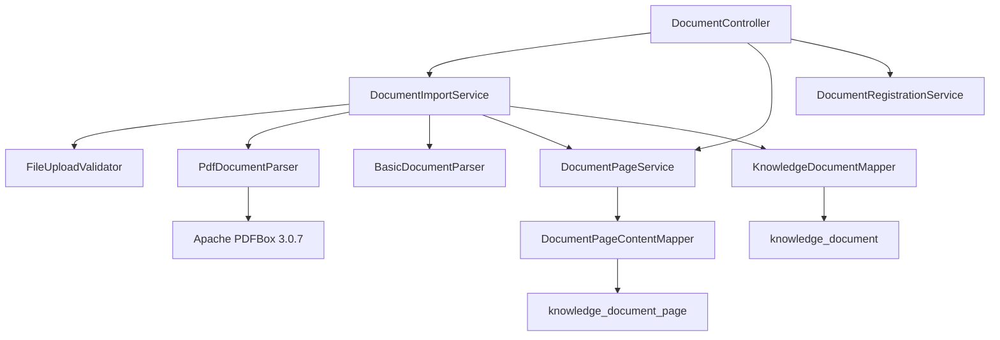
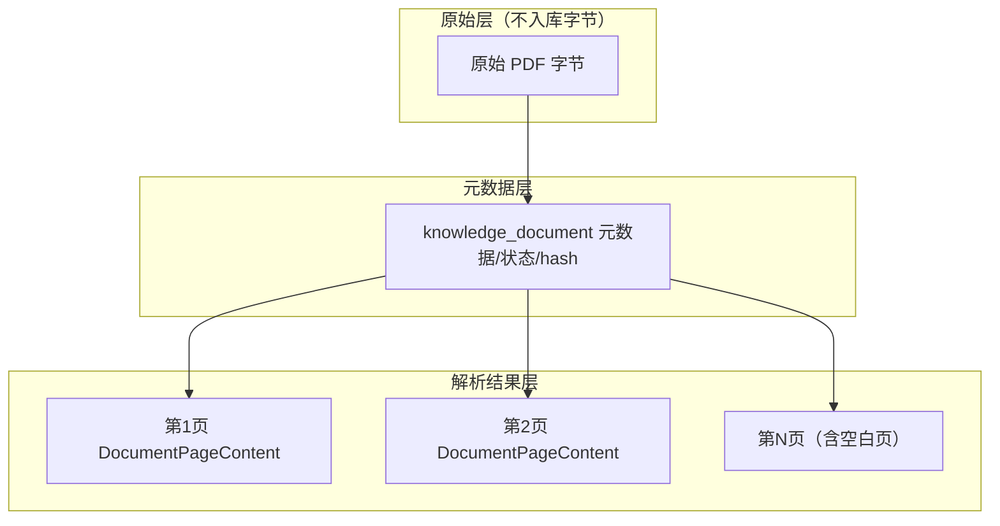
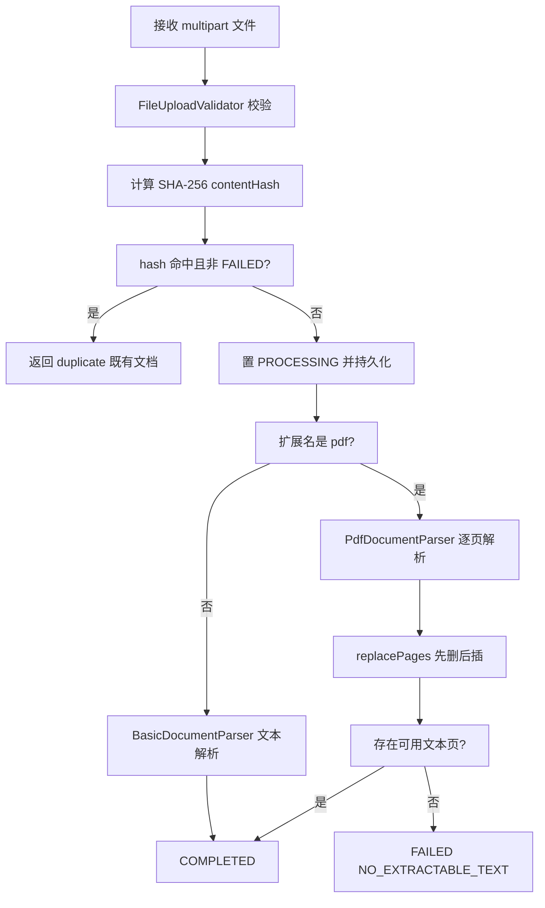
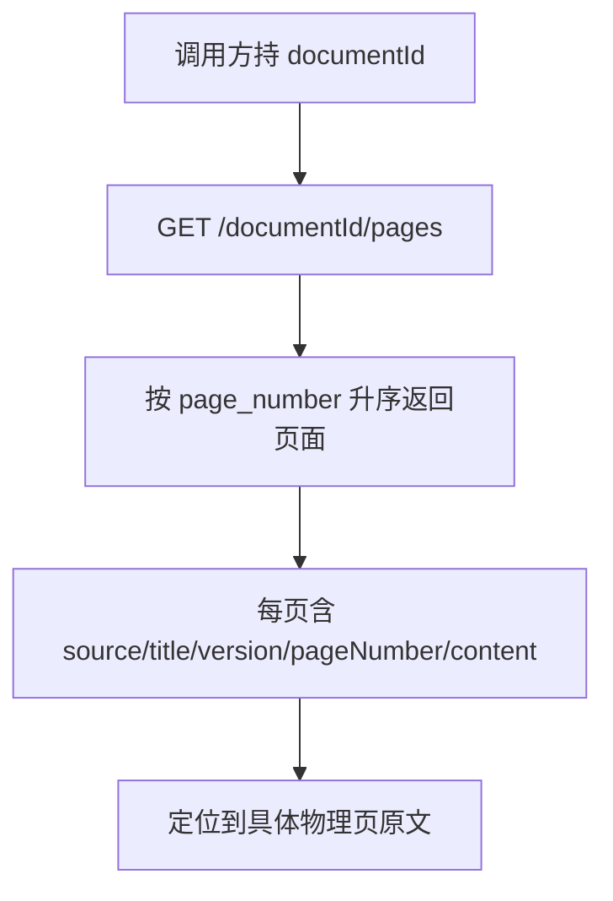

# D27-PDF 解析与来源定位功能实现全量说明

> 迭代名称：Day 27：PDF Word 解析与来源元数据
> 工程：M3-Java / D27（聚合）/ D27_PDF_WORD（唯一模块）
> 物理包：com.zl.d27　端口：8080　技术基线：JDK21、Spring Boot 3.5.16、Spring AI 1.1.8、Maven 3.9.16
> 文档定位：面向项目交付，全量说明本轮「做了什么、怎么设计、如何验证、边界在哪」。

---

## 1. 概述

D27 在 D26 已完成的文档登记/导入入口、状态机、服务端校验与 contentHash 去重基础上，新增 PDF 真实文本解析与「原始文档 → 解析结果」的可追溯来源定位。

核心能力：

1. **真实 PDF 文本提取**：基于 Apache PDFBox 3.0.7，逐物理页提取，保留物理页面边界与从 1 开始的页码，不依赖 Mock。
2. **来源元数据追溯**：每条页面结果携带 documentId、source、title、version、pageNumber、content、updatedAt，可从提取文本反查到原始文档与具体物理页。
3. **原始对象与解析对象分离**：原始 PDF 字节不入库，`knowledge_document` 存元数据，`knowledge_document_page` 存页面文本，二者是不同对象。
4. **异常与边界场景覆盖**：解析异常、空文本、空白页、损坏 PDF、不支持格式、扫描型 PDF、中英文混合等。
5. **Word 作为可选扩展**：Apache POI 5.5.1 已在 classpath，本轮给出扩展设计，不强制接线。

明确不做：OCR 体系、Embedding、VectorStore、Chunk 智能切分、向量检索、RAG 问答、Agent/Tool/MCP，以及无关重构。页面级文本是「物理页提取结果」，**不是 RAG Chunk**。

---

## 2. 需求范围与边界

### 2.1 在范围内

| 类别 | 内容 |
| --- | --- |
| 解析 | PDF 真实文本提取，物理页面边界，1-based 页码 |
| 来源定位 | documentId/source/title/version/pageNumber/content/updatedAt |
| 存储 | 新增 knowledge_document_page 表，页面行与原始文档分离 |
| 校验 | 白名单扩展 pdf/application/pdf，二进制 PDF 跳过文本编码检查 |
| 服务 | 按扩展名路由，FAILED 重试，重新解析先删后插 |
| 接口 | 新增 GET /{documentId}/pages、GET /{documentId}/pages/{pageNumber} |
| 验证 | 真实佳能手册解析 + 168 单测全通过 |

### 2.2 不在范围内（边界）

- 不实现 OCR：扫描型 PDF 只识别「无可用文本」并给出需要 OCR 的明确结论，不做图像文字识别。
- 不实现 Embedding、VectorStore、向量检索、RAG 问答。
- 不做 Chunk 智能切分：页面（Page）是物理边界，Chunk 是语义/检索边界，二者不混用。
- 不引入新依赖、不升级框架、不改动 D26 既有表结构与无关业务代码。

---

## 3. 技术基线与依赖事实

依赖版本来自真实 `pom.xml` 与 `mvn dependency:tree`，非记忆推断：

| 组件 | 版本 | 来源 |
| --- | --- | --- |
| spring-boot-starter-parent | 3.5.16 | 父 POM |
| Spring AI | 1.1.8 | BOM import |
| Apache PDFBox | 3.0.7（pdfbox/pdfbox-io/fontbox） | spring-ai-pdf-document-reader 传递 |
| Apache Tika | 3.3.1 | spring-ai-tika-document-reader |
| Apache POI | 5.5.1（poi/poi-ooxml 等） | Tika microsoft 模块传递（Word 能力） |
| MyBatis-Plus | 3.5.17 | 直接依赖 |
| MySQL Connector/J | 8.0.33 | 直接依赖（relocation 仅警告） |

关键兼容性事实（设计核心）：

- PDFBox 3.x 用 `org.apache.pdfbox.Loader.loadPDF(byte[])` 加载，**不是** 2.x 的 `PDDocument.load()`。
- 文本提取用 `org.apache.pdfbox.text.PDFTextStripper`，`setStartPage/setEndPage` 为 **1-based**。
- `PDDocument` 实现 `Closeable`，使用 try-with-resources 确保资源释放。

---

## 4. 总体架构

### 4.1 分层结构（层级树）

```text
D27_PDF_WORD
└─ com.zl.d27
   ├─ controller
   │  └─ DocumentController            # 登记/导入/查询 + 页面来源定位端点
   ├─ service
   │  ├─ DocumentRegistrationService   # D26 文档登记
   │  ├─ DocumentImportService         # 校验/去重/状态机/类型路由
   │  └─ DocumentPageService           # 页面替换写入与来源定位查询
   ├─ support
   │  ├─ FileUploadValidator           # 服务端校验（扩展 PDF）
   │  ├─ BasicDocumentParser           # 文本解析（txt/md）
   │  ├─ PdfDocumentParser             # PDFBox 3.0.7 逐页解析
   │  ├─ Sha256ContentHasher           # contentHash
   │  └─ DocumentConverter             # PO/领域/视图转换（含页面转换）
   ├─ model
   │  ├─ KnowledgeDocument
   │  └─ DocumentPageContent           # 页面级领域模型
   ├─ po
   │  ├─ KnowledgeDocumentPO
   │  └─ DocumentPageContentPO         # 页面表 PO
   ├─ mapper
   │  ├─ KnowledgeDocumentMapper
   │  └─ DocumentPageContentMapper     # 页面 Mapper
   └─ dto
      ├─ DocumentView / DocumentImportView
      └─ DocumentPageView              # 页面对外视图
```

### 4.2 组件关系（Mermaid）



### 4.3 原始对象与解析对象分离



---

## 5. 数据模型设计

### 5.1 新增表 knowledge_document_page

| 字段 | 类型 | 说明 |
| --- | --- | --- |
| id | BIGINT AUTO_INCREMENT | 代理主键 |
| document_id | VARCHAR(64) | 关联 knowledge_document.document_id |
| source | VARCHAR(64) | 文档来源（保留元数据） |
| title | VARCHAR(200) | 文档标题（保留元数据） |
| version | INT | 文档版本 |
| page_number | INT | 物理页序号，**从 1 开始** |
| content | MEDIUMTEXT | 该页提取文本 |
| content_length | INT | 该页文本字符长度 |
| blank | TINYINT | 1 空白，0 含可用文字 |
| created_at / updated_at | DATETIME | 创建/更新时间 |

约束：

- 主键 `id`。
- 唯一键 `uk_doc_page(document_id, page_number)`：同一文档物理页不重复。
- 普通索引 `idx_document_id`：按文档查询页面。

### 5.2 页码口径（重要）

- `page_number` 是**物理页序号**（PDF 物理页从 1 开始计数），由解析循环序号生成，**不读取 PDF 内部可能缺失/错乱的页码标签**，因此不存在「页码丢失」导致定位失败。
- 物理页码与「印刷页码」（封面、目录、正文分别编号）明确区分，不混用。
- 空白页也保留一行（blank=1），保证物理页定位连续、不丢页。

### 5.3 与 knowledge_document 的关系

`knowledge_document`（D26）存文档级元数据、状态、contentHash、contentLength 与错误信息；`knowledge_document_page`（D27）通过 document_id 关联，存页面级文本。两表均不存原始 PDF 字节。

---

## 6. 核心代码实现

### 6.1 PDF 解析器 PdfDocumentParser

职责：只解析，不写库、不做 OCR、不做 Chunk。

```java
public List<DocumentPageContent> parse(byte[] bytes) {
    if (bytes == null || bytes.length == 0) {
        throw new DocumentParseException("解析失败：PDF 文档无内容");
    }
    try (PDDocument document = Loader.loadPDF(bytes)) {
        int pageCount = document.getNumberOfPages();
        if (pageCount <= 0) {
            throw new DocumentParseException("解析失败：PDF 不包含有效页面");
        }
        List<DocumentPageContent> pages = new ArrayList<>(pageCount);
        for (int page = 1; page <= pageCount; page++) {
            PDFTextStripper stripper = new PDFTextStripper();
            stripper.setStartPage(page);
            stripper.setEndPage(page);
            stripper.setSortByPosition(true);
            String text = stripper.getText(document);
            pages.add(buildPage(page, text));
        }
        return pages;
    } catch (IOException e) {
        throw new DocumentParseException("PDF 解析失败：文件损坏或格式非法");
    }
}
```

要点：

- 逐页设置相同的 start/end，物理页文本互不串页，保证页面边界。
- `setSortByPosition(true)` 按坐标排序，尽量还原阅读顺序。
- 空白判定：`text.chars().anyMatch(Character::isLetterOrDigit)`，无任何字母/数字/表意文字则 blank=true。

### 6.2 页面服务 DocumentPageService

- `replacePages(pages)`：按 document_id 先 `delete` 旧行，再逐条 `insert`，在导入服务的同一事务内执行。
- `listPages(documentId)`：按 page_number 升序返回。
- `getPage(documentId, pageNumber)`：返回单页。

### 6.3 导入服务类型路由与状态机

```java
if (isPdf(file)) {
    handlePdf(bytes, doc, now);
} else {
    handleText(bytes, doc);
}
```

PDF 处理规则：

- 解析成功且至少一页含可用文字 → COMPLETED。
- 全部页面均无可用文字（纯扫描/空文本）→ FAILED，错误码 `NO_EXTRACTABLE_TEXT`，提示需要 OCR；页面行仍保留定位。
- 解析器抛 DocumentParseException（损坏/非法）→ FAILED，错误码 `PARSE_FAILED`。
- 未预期 RuntimeException → FAILED，错误码 `PROCESSING_FAILED`。

FAILED 重试：contentHash 命中且既有状态为 FAILED 时，不按重复短路，复用同一文档行重新解析；其余状态命中重复直接返回 duplicate。

### 6.4 校验器扩展

- 白名单默认加 `pdf` 与 `application/pdf`。
- `validateType` 返回扩展名；`validate` 内仅对非 PDF（文本）执行 UTF-8 严格解码，PDF 二进制跳过该检查，避免把合法二进制误判为编码错误。

### 6.5 转换器扩展

DocumentConverter 新增 `toPageDomain / toPagePO / toPageView`，PO 的 blank（0/1）与领域/视图的 Boolean 互转，PO 不暴露给 Controller。

---

## 7. 导入与来源定位流程

### 7.1 导入流程（Mermaid）



### 7.2 来源定位查询



---

## 8. 配置说明

### 8.1 application.yml（document.import 相关）

```yaml
document:
  import:
    max-file-size-bytes: 2097152        # 业务上限 2MB
    charset: UTF-8
    title-max-length: 200
    allowed-extensions:
      - txt
      - md
      - pdf
    allowed-content-types:
      - text/plain
      - text/markdown
      - application/pdf
```

容器层：multipart max-file-size 10MB、max-request-size 12MB（先于业务 2MB 限制的外层兜底）。

### 8.2 配置类默认值

DocumentImportProperties 的 allowedExtensions 默认 `txt/md/pdf`，allowedContentTypes 默认 `text/plain/text/markdown/application/pdf`，与 yml 一致。

---

## 9. 接口清单（base：/api/v1/documents）

| 方法 | 路径 | 说明 |
| --- | --- | --- |
| POST | /register | 文档登记（D26） |
| POST | /import | multipart 导入（file + 可选 documentId/source/title） |
| GET | /{documentId} | 文档详情（D26） |
| GET | / | 文档列表（D26） |
| GET | /{documentId}/pages | **新增**：按物理页码顺序列页面 |
| GET | /{documentId}/pages/{pageNumber} | **新增**：单页来源定位 |

统一协议：HTTP 恒 200，业务看 `Result.code`（SUCCESS 200、PARAM_INVALID 4001、SYSTEM_ERROR 5000 等）。

页面视图字段：documentId、source、title、version、pageNumber、content、contentLength、blank、updatedAt。

---

## 10. 验证结果（真实执行）

### 10.1 编译

- 命令：`mvn -f D27/pom.xml clean compile`
- 结果：BUILD SUCCESS，131 个主源文件编译通过（仅既有 deprecation/relocation 警告）。
- 日志：logs/D27/01-compile.log。

### 10.2 全量单元测试

- 命令：`mvn -f D27/pom.xml clean test`
- 结果：**Tests run: 168, Failures: 0, Errors: 0, Skipped: 0 — BUILD SUCCESS**。
- document 包 45 个测试；含真实 PDF（PDFBox 生成）与真实字体中英文混合测试。
- 证据：docs/evidence/D27/surefire-reports、D27-test-summary.md。

### 10.3 真实佳能手册解析（非 Mock）

| 指标 | 实测值 |
| --- | --- |
| 文件字节数 | 1,509,800（1.44MB） |
| 物理页总数 | 11 |
| 空白页数 | 0 |
| 提取文本字符数 | 9,304 |
| 英文字母 / 数字 | 7,177 / 157 |
| 解析耗时 | 904 ms |

完整逐页摘要与首页/正文原文见 docs/evidence/D27/D27-real-pdf-verify.md。

诚实说明：该素材实际为纯英文手册（中日韩表意文字 0）；中文/混合能力由真实嵌入 simhei.ttf 的单测验证。

---

## 11. 注意事项与诚实缺口

1. **真实 MySQL 端到端 HTTP 上传未执行**：需先在 `ai_db` 执行 `schema-knowledge-document.sql` 与 `schema-document-page.sql`，再启动应用验证。
2. **当前无鉴权**：`X-Dev-User` 仅作归属标识，不应假设权限已被强制；生产化需补认证与授权。
3. **扫描型 PDF 不做 OCR**：仅返回 FAILED/NO_EXTRACTABLE_TEXT 并保留页面定位，OCR 属后续迭代。
4. **页面文本不等于 Chunk**：页面是物理边界，后续检索切分需独立设计，禁止直接等同。
5. **真实模型 remote 无 AI_API_KEY 未验证**：与本任务解析能力无关。
6. 未执行任何 git commit/push；临时文件与日志按要求保留，不自动删除。

---

## 12. 记忆简语

- **PDFBox 3.x 加载记 `Loader.loadPDF`，页码 1 起、逐页设起止不串页。**
- **原始 PDF 不入库，元数据进 document、页面文本进 page，靠 documentId 关联。**
- **空白页保留行、扫描件标 NO_EXTRACTABLE_TEXT，FAILED 可重试、先删后插。**
- **Page 是物理页，不是 Chunk；OCR/Embedding/检索本轮不碰。**
