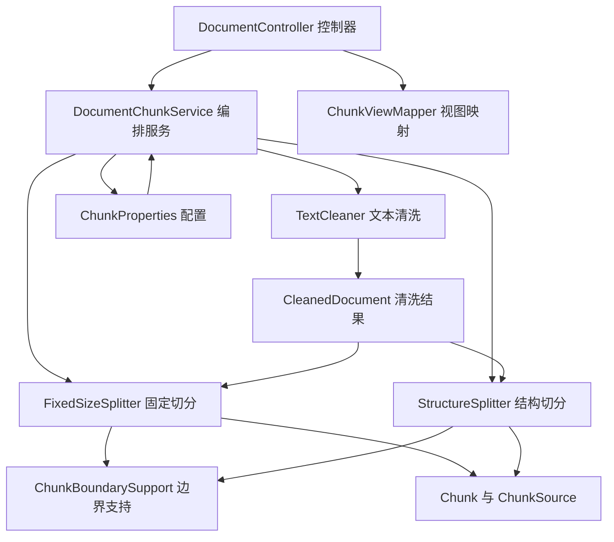

# D28 文本清洗与 Chunk 切分功能实现全量说明

> 迭代名称：Day 28 文本清洗与切分策略
> 工程根：`E:\AI\project\AI-Learning-one\M3-Java`
> 模块：`D28\D28_TCASS`（artifactId `D28_TCASS`，物理包 `com.zl.d28`，端口 8080）
> 技术基线：JDK 21、Spring Boot 3.5.16、Spring AI 1.1.8、PDFBox 3.0.7、Maven 3.9.16
> 长度口径：**UTF-16 code unit（字符长度，非 Token）**

---

## 1. 迭代概述

D27 已实现基于 PDFBox 3.0.7 的逐物理页 PDF 解析，产出 `DocumentPageContent`（含 documentId、
source、title、version、pageNumber、content、contentLength、blank）。D28 在此基础上，建立**独立、
可配置、可测试**的文本清洗与 Chunk 切分能力，不改动 D27 的解析逻辑。

本迭代交付四类能力：

1. 文本清洗/规范化：统一换行、归一异常空白、折叠空行，保留结构与来源，不简单删换行、不无差别压空白。
2. 可配置 Chunk 切分：固定长度策略与标题/段落结构策略，Chunk Size/Overlap/最小最大长度均可配置。
3. Chunk 元数据与来源定位：documentId、title、pageNumber、paragraphIndex、chunkIndex、version、content，
   支持跨页/跨段多来源。
4. 两种策略真实运行对比：数量、长度、分布、Overlap、语义完整度、来源、空块。

**硬边界**：本迭代不实现 Embedding、VectorStore、向量索引、RAG 检索问答、Agent、Tool、MCP，
不做无关重构；所有字符数均不宣称 Token 数。

---

## 2. 任务书需求映射

| 任务书要求 | 实现位置 | 状态 |
|---|---|---|
| 文本清洗与规范化 | `clean\TextCleaner` | 已完成 |
| 可配置切分组件 | `config\ChunkProperties`、`split\*` | 已完成 |
| 固定长度切分 | `split\FixedSizeSplitter` | 已完成 |
| 标题/段落切分 | `split\StructureSplitter` | 已完成 |
| 元数据与来源定位 | `model\Chunk`、`ChunkSource`、`support\ChunkBoundarySupport` | 已完成 |
| 效果对比 | `model\ChunkStats`、`ChunkComparison`、`service\DocumentChunkService` | 已完成 |

任务书列出的 16 个边界场景（空文本、仅空白、极短/连续短段落、超长段落/单句、中文、中英混合、
特殊字符、Overlap=0/>0/越界、多页、跨页、多版本、极短尾段）均有对应单元测试，详见第 12 节。

---

## 3. 整体架构与模块边界

### 3.1 分层与依赖方向



### 3.2 三类对象分离

- **原始提取文本**：D27 的 `DocumentPageContent`，按物理页承载，未做规范化。
- **清洗后规范文本**：`CleanedDocument.joinedText`，是两种切分策略的唯一输入。
- **清洗来源元数据**：`TextBlock`（结构块）与 `CleanedPage`（逐页摘要），用于来源定位。

### 3.3 模块边界

- 清洗与切分只依赖 `document` 包的页面模型，不反向依赖控制器、持久化或对话模块。
- 控制器只依赖 `dto` 视图与 `service`，不直接暴露领域对象。
- 未新增依赖：PDFBox 3.0.7 经 `spring-ai-pdf-document-reader` 已在 classpath。

---

## 4. 数据模型全量说明

| 模型 | 关键字段 | 说明 |
|---|---|---|
| `BlockType` | HEADING / PARAGRAPH / LIST_ITEM | 结构块类型枚举 |
| `ChunkStrategy` | FIXED_SIZE / STRUCTURE | 切分策略枚举 |
| `TextBlock` | paragraphIndex、pageNumber、type、text、length、globalStart、globalEnd | 清洗后的结构块，paragraphIndex 全局从 0 开始 |
| `ChunkSource` | pageNumber（可空）、paragraphIndex（可空）、globalStart、globalEnd | 单段来源，支持跨页/跨段多来源 |
| `Chunk` | documentId、title、version、strategy、chunkIndex、content、length、codePointCount、globalStart、globalEnd、sources | Chunk 主体，含定位聚合方法 |
| `CleanedPage` | pageNumber、originalLength、cleanedLength、blank | 单页清洗摘要 |
| `CleanedDocument` | joinedText、blocks、pages、cleanedLength | 清洗结果承载 |
| `ChunkStats` | chunkCount、min/max/avg、lengthDistribution、emptyChunkCount、uncoveredChars、duplicatedChars、crossPageChunkCount、midWordBoundaryCount | 单策略统计 |
| `ChunkComparison` | fixedSizeStats、structureStats | 两策略对比 |
| `ChunkResult` | cleaned、fixedChunks、structureChunks、comparison | 完整处理结果 |
| `ChunkContext` | documentId、title、version（record） | 文档上下文，访问器为 `documentId()` 等 |

### 4.1 Chunk 定位聚合方法

`Chunk` 提供现算的定位能力：`getPageNumbers()`、`getFirstPageNumber()`、`getLastPageNumber()`、
`getParagraphIndices()`、`hasPageLocation()`、`hasParagraphLocation()`、`isCrossPage()`。

- `chunkIndex` 从 0 开始，按发射顺序连续编号。
- Chunk 身份命名空间：`documentId + version + strategy + chunkIndex`。
- `length` 与 `codePointCount` 由内容现算，避免外部传入不一致。

---

## 5. 文本清洗功能

### 5.1 清洗规则

1. **换行统一**：`\r\n`、`\r`、U+2028、U+2029 统一归一为 `\n`。
2. **行内水平空白归一**：空格、Tab、NBSP（U+00A0）、全角空格（U+3000）等连续序列归一为单个普通空格。
3. **空行折叠**：连续空行至多保留一个，空行不产生结构块。
4. **结构识别**：识别标题、列表项、段落，分别标记 `BlockType`。
5. **逐行成块**：每个非空行产生一个结构块，不做换行续接启发式，保证可预测、不吞换行。

### 5.2 标题识别（启发式）

- Markdown 风格 `#` 前缀；
- `Chapter`、`APPENDIX`、`Part` 等章节词；
- 编号形式如 `1.`、`1.2`；
- 短行且全大写。

识别不到时降级按段落处理，并以页面边界兜底。

### 5.3 清洗边界原则

- **不删除所有换行**：换行是结构信息，短块合并交给 `StructureSplitter` 按长度处理。
- **不无差别压空白**：仅归一“行内水平空白”，保留换行与结构。
- **不丢句读**：真实 PDF 句末标点清洗前后守恒（167 = 167）。

---

## 6. 固定长度切分功能（FIXED_SIZE）

### 6.1 硬游标算法

- 步长 `step = chunkSize - overlap`，游标每次确定前进，最多 `ceil(n / step)` 次迭代，杜绝窗口不前进。
- 硬切点附近用 `ChunkBoundarySupport.chooseEnd`：在 `boundaryTolerance` 容差内优先选择换行、再空格，
  找不到才硬切。
- 无间隙钳制：`contentEnd >= min(hardStart + step, n)`，保证不漏覆盖。
- 末尾不足 `minChunkSize` 且非唯一块时，并入上一块。

### 6.2 Overlap 行为

- 语义边界调整使相邻块实际重叠落在 **[0, overlap]** 区间；仅当切点正好在硬切点时才等于配置值。
- `overlap = 0` 时严格不重叠。
- 配置校验强制 `overlap < chunkSize`，否则启动快速失败。

---

## 7. 标题/段落结构切分功能（STRUCTURE）

1. 顺序累积结构块，标题开新块且与正文同块。
2. 短段落只要不超过 `maxChunkSize` 即合并；`mergeShortBlocks` 控制是否合并。
3. 单个结构块超过 `maxChunkSize` 时，按边界二次切分（内部不重叠）。
4. 极短最后一段保留，不产生空块。
5. 非末尾块在其 `globalEnd` 后紧跟 `\n` 时，将该换行包含进块，保证覆盖统计无遗漏。

---

## 8. 元数据与来源定位

- `ChunkBoundarySupport.resolveSources` 依据 `[start, end)` 区间，从全部结构块中解析出覆盖的
  `ChunkSource` 列表，自动处理跨页、跨段。
- 代理对保护：
  - `roundEndForSurrogate`：切点落在高/低代理间则向后包含整对；
  - `roundStartForSurrogate`：起点落在悬空低代理则跳过。
- 切点不切代理对（surrogate pair），同时输出 Unicode 码点数对照。

---

## 9. 对比统计

`ChunkStats` 现算：数量、最小/最大/平均长度、长度分布桶（边界 0/100/250/500/1000/2000/∞）、
空块、相邻重叠、逐位置覆盖（uncovered/duplicated）、跨页块、有页码/段落定位数、句中截断计数。
`ChunkComparison` 用同一份清洗文本跑两种策略，保证对比口径一致。

---

## 10. REST API

统一返回 `Result<T>`（code/msg/data，HTTP 恒 200，业务看 code）。

| 方法 | 路径 | 说明 |
|---|---|---|
| GET | `/api/v1/documents/{documentId}/chunks?strategy=FIXED_SIZE` | 按策略返回 Chunk 视图（默认固定长度） |
| GET | `/api/v1/documents/{documentId}/chunks/comparison` | 返回两策略对比统计 |

`strategy` 取值 `FIXED_SIZE` 或 `STRUCTURE`。控制器通过 `ChunkViewMapper` 输出 `ChunkView`，
不暴露领域对象。

---

## 11. 配置项（`app.ai.chunk`）

| 配置项 | 默认值 | 环境变量 | 约束 |
|---|---|---|---|
| chunk-size | 500 | CHUNK_SIZE | 1..100000 |
| chunk-overlap | 100 | CHUNK_OVERLAP | ≥0 且严格 < chunk-size |
| min-chunk-size | 50 | CHUNK_MIN_SIZE | 1..chunk-size |
| max-chunk-size | 1000 | CHUNK_MAX_SIZE | ≥ chunk-size |
| boundary-tolerance | 100 | CHUNK_BOUNDARY_TOLERANCE | 0..chunk-size |
| merge-short-blocks | true | CHUNK_MERGE_SHORT | 布尔 |
| length-unit | UTF16_CODE_UNIT | 不允许覆盖 | 改为 TOKEN 等会被拒绝 |

`ChunkProperties.validate()` 在 `@PostConstruct` 阶段执行，非法配置启动即失败（fail-fast）。

---

## 12. 真实运行结果（佳能手册）

真实 PDF：`docs\proj_docs\D27-佳能用户手册-DB-测试素材.pdf`（1509800 字节，11 物理页，0 空白，
纯英文）。通过真实组件运行（runner 见 `docs\temp_docs\D28\D28EvidenceRunner.java`）。

| 指标 | 固定长度 FIXED_SIZE | 结构 STRUCTURE |
|---|---|---|
| Chunk 数量 | 23 | 13 |
| 最小长度 | 352 | 200 |
| 最大长度 | 495 | 984 |
| 平均长度 | 457.74 | 704.00 |
| 空块数量 | 0 | 0 |
| 未覆盖字符 | 0 | 0 |
| 重复/重叠字符 | 1376 | 0 |
| 跨页块数 | 9 | 9 |
| 句中截断计数 | 11 | 0 |

清洗总量：清洗前 9304 字符、清洗后 9152、151 结构块（6 标题/34 列表项/111 段落），
句末标点守恒 167 = 167。

### 边界场景处理结论

- 极短段落：结构策略在 `maxChunkSize` 内合并，极短尾段保留，不产生空块。
- 超长段落：固定策略硬切并尽量贴语义边界；结构策略二次切分，句中截断为 0。
- 空文本/仅空白：不产生块与空 Chunk；中文/特殊字符：长度与码点分别现算，代理对不被切断。

---

## 13. 注意事项与硬边界

- 字符长度是 **UTF-16 code unit**，与模型 Token 无固定换算关系，**禁止把字符数当 Token 数**。
- 页面 `Page` 不等于 `Chunk`：一个物理页可产生多个 Chunk，一个 Chunk 也可跨页。
- 本迭代不实现 Embedding/VectorStore/向量检索/RAG 问答/Agent/Tool/MCP。
- 真实 MySQL 端到端 HTTP 上传未做（需先在 ai_db 执行 DDL）；当前无鉴权，X-Dev-User 仅归属标识。
- 扫描件仅识别并提示需 OCR，不实现 OCR。
- 未执行任何 git commit/push；`temp_docs`、`logs` 未自动删除，交由用户处理。

---

## 14. 记忆简语

- 清洗：**换行统一、空白归一、空行折叠、逐行成块、不删换行**。
- 固定切分：**硬游标、步长定前进、容差贴边界、尾短并入、重叠有上限**。
- 结构切分：**标题开块、短段合并、超长再切、极短保留、换行不漏**。
- 口径：**字符是 UTF-16，不是 Token；页面不是 Chunk**。

---

## 15. 层级树

```text
D28 文本清洗与切分
├─ 清洗 TextCleaner
│  ├─ 换行统一 \r\n/\r/U+2028/U+2029 -> \n
│  ├─ 行内空白归一（空格/Tab/NBSP/全角）
│  ├─ 空行折叠
│  └─ 结构识别（标题/列表/段落）
├─ 切分
│  ├─ 固定长度 FixedSizeSplitter（硬游标 + Overlap + 边界）
│  └─ 结构 StructureSplitter（标题开块 + 短段合并 + 二次切分）
├─ 元数据
│  ├─ Chunk（documentId/title/version/chunkIndex/全局偏移）
│  ├─ ChunkSource（页码/段落可空，多来源）
│  └─ 代理对保护 + 码点数
└─ 对比 ChunkStats / ChunkComparison（数量/长度/覆盖/空块/跨页）
```

---

## 16. 官方文档溯源

- 《Spring Boot Reference Documentation | Spring Boot 参考文档》（配置属性绑定、@ConfigurationProperties）：
  https://docs.spring.io/spring-boot/docs/3.5.16/reference/html/
- 《Spring AI Reference Documentation | Spring AI 参考文档》（文档与切分相关概念，版本 1.1.8）：
  https://docs.spring.io/spring-ai/reference/1.1/
- 《Apache PDFBox 3.0 Documentation | PDFBox 文档》：
  https://pdfbox.apache.org/3.0/
- 《Java 21 API Specification | Java 21 接口规范》（String、Character、代理对）：
  https://docs.oracle.com/en/java/javase/21/docs/api/
