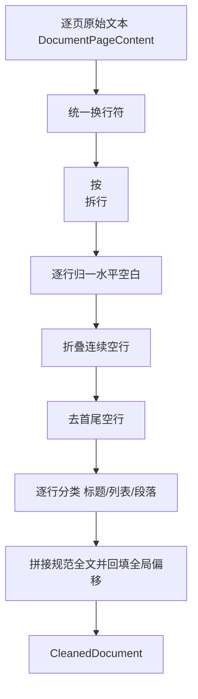
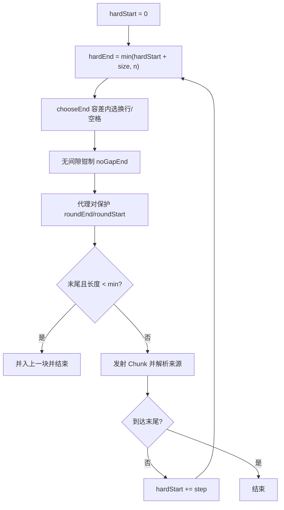

# D28 文本清洗与 Chunk 切分技术原理及操作实践指南

> 适用读者：需要理解 D28 清洗/切分底层原理、并在本地复现与扩展的开发者。
> 模块：`D28\D28_TCASS`，物理包 `com.zl.d28.document.chunk`
> 技术基线：JDK 21、Spring Boot 3.5.16、Spring AI 1.1.8、PDFBox 3.0.7、Maven 3.9.16

---

## 1. 核心概念与长度口径

### 1.1 三种长度单位

| 口径 | 对应 API | 含义 | 本项目用途 |
|---|---|---|---|
| UTF-16 code unit | `String.length()`、`substring()` | Java 字符串原生单位，一个 char 即一个单元 | **唯一长度口径** |
| Unicode code point | `String.codePointCount()` | 真实字符数，含 emoji 等增补字符 | 对照输出 |
| Token | 模型分词器决定 | 送入模型的计费/上下文单位，与字符无固定换算 | **不实现、不宣称** |

关键事实：增补平面字符（如部分 emoji）由两个 UTF-16 单元（高代理 + 低代理，即 surrogate pair）
表示。因此切分必须做代理对保护，否则会切出半个字符。

### 1.2 Page 与 Chunk 的区别

- Page（`DocumentPageContent`）是 PDF 物理页提取结果，是输入。
- Chunk 是清洗后按策略切出的语义/长度单元，是输出。
- 一个 Page 可产生多个 Chunk；一个 Chunk 也可跨多个 Page，二者不是一一对应。

---

## 2. 文本清洗技术原理

### 2.1 处理流程



### 2.2 换行统一

```java
String normalized = raw.replace("\r\n", "\n")
        .replace("\r", "\n")
        .replace("\u2028", "\n")
        .replace("\u2029", "\n");
```

### 2.3 行内空白归一

`normalizeHorizontalWhitespace` 用 `pendingSpace` 状态机：把 `Character.isWhitespace` 或
`Character.isSpaceChar` 识别到的连续水平空白（空格、Tab、NBSP U+00A0、全角 U+3000 等）
归一为单个普通空格，并去除行首/行尾空白；换行不在此处理，因此结构换行被保留。

### 2.4 为什么逐行成块、不做续接启发式

换行续接（把“被换行打断的同一句话”拼回）依赖启发式判断，容易对单字母行、普通相邻行产生过激合并，
吞掉换行、把不同条目错误拼接。因此本项目让每个非空行成为一个结构块，短块合并交给
`StructureSplitter` 按确定的长度规则处理，行为可预测、来源可追溯。

---

## 3. 固定长度切分技术原理

### 3.1 硬游标主循环



核心步长：`step = chunkSize - overlap`。游标每次固定前进 `step`，从机制上保证窗口必然推进、
迭代次数有上界（`ceil(n / step)`），避免“窗口不前进产生垃圾块”。

### 3.2 语义边界与无间隙钳制

```java
int contentEnd = support.chooseEnd(text, hardStart, hardEnd, tolerance);
int noGapEnd = Math.min(hardStart + step, n);
contentEnd = Math.max(contentEnd, noGapEnd);
contentEnd = Math.min(contentEnd, hardEnd);
```

- `chooseEnd` 在 `[hardEnd - tolerance, hardEnd)` 内反向扫描，先换行后空格，找到则在该位置断。
- 无间隙钳制保证 `contentEnd` 至少到达下一个硬起点，杜绝任何位置漏覆盖。
- 语义边界把切点提前，使相邻块实际重叠落在 **[0, overlap]**；overlap=0 时严格不重叠。

### 3.3 尾块合并

最后一块若长度小于 `minChunkSize` 且非唯一块，调用 `mergeIntoPrevious` 并入上一块，
并重算内容、长度、码点数与来源，避免产生过短碎片。

---

## 4. 结构切分技术原理

1. 顺序累积 `TextBlock`：遇到标题先 flush 再开新块，标题与后续正文同块。
2. 累积长度将超过 `maxChunkSize` 时 flush，短段落在上限内合并。
3. 单个 block 超过 `maxChunkSize` 时调用 `splitOversized` 按边界二次切分（内部不重叠）。
4. 非末尾块在 `globalEnd` 处若紧跟 `\n`，则 `end + 1` 包含该换行，保证覆盖统计无遗漏。
5. 极短最后一段保留，不产生空块。

---

## 5. 代理对保护与来源解析

### 5.1 代理对保护

```java
public int roundEndForSurrogate(String text, int end) {
    if (end > 0 && end < text.length()) {
        char before = text.charAt(end - 1);
        char at = text.charAt(end);
        if (Character.isHighSurrogate(before) && Character.isLowSurrogate(at)) {
            return end + 1;
        }
    }
    return end;
}
```

`roundStartForSurrogate` 则在起点落在悬空低代理时跳过它，与上一块的 end 保护配对，保证整对不被切断。

### 5.2 来源解析

`resolveSources(blocks, start, end)` 遍历与区间相交的结构块，按交集生成 `ChunkSource`：
跨页、跨段全部保留；`pageNumber`、`paragraphIndex` 在无法对应时允许为空。

---

## 6. 配置实践

### 6.1 配置绑定与校验

`ChunkProperties` 绑定 `app.ai.chunk`，`validate()` 在 `@PostConstruct` 阶段 fail-fast：

- chunkSize ∈ [1, 100000]；
- chunkOverlap ≥ 0 且严格 < chunkSize；
- minChunkSize ∈ [1, chunkSize]，maxChunkSize ≥ chunkSize；
- boundaryTolerance ∈ [0, chunkSize]；
- lengthUnit 必须为 `UTF16_CODE_UNIT`，改成 TOKEN 等会被拒绝。

### 6.2 多环境配置

开发默认值写在 `application.yml`，生产通过环境变量覆盖，无需改代码：

```bash
# Linux/macOS 示例
export CHUNK_SIZE=800
export CHUNK_OVERLAP=120
export CHUNK_MIN_SIZE=80
export CHUNK_MAX_SIZE=1600
```

```powershell
# PowerShell 示例
$env:CHUNK_SIZE="800"; $env:CHUNK_OVERLAP="120"
```

---

## 7. 操作实践

### 7.1 编译

```powershell
$env:JAVA_HOME="D:\SoftwareInstall\JDK\JDK21"
& "D:\SoftwareInstall\Apache\Maven\apache-maven-3.9.16\bin\mvn.cmd" `
  -f "E:\AI\project\AI-Learning-one\M3-Java\D28\pom.xml" clean compile
```

### 7.2 全量测试

```powershell
& "D:\SoftwareInstall\Apache\Maven\apache-maven-3.9.16\bin\mvn.cmd" `
  -f "E:\AI\project\AI-Learning-one\M3-Java\D28\pom.xml" clean test
```

### 7.3 真实 PDF 取证（独立 runner）

取证器 `docs\temp_docs\D28\D28EvidenceRunner.java` 直接驱动真实组件，不依赖 Web 容器：

1. 先用 `maven dependency:build-classpath` 生成依赖 classpath（已存 `classpath.txt`）；
2. `javac -encoding UTF-8 -cp "target/classes;<依赖>" D28EvidenceRunner.java`；
3. `java -Dfile.encoding=UTF-8 -cp ".;target/classes;<依赖>" D28EvidenceRunner`。

运行后在 `docs\evidence\D28` 生成清洗对照、两策略全量 Chunk、对比与元数据校验文件。

### 7.4 HTTP 调用（启动应用后）

```bash
# 固定长度（默认）
curl "http://localhost:8080/api/v1/documents/doc-canon-b000ayfp6a/chunks"
# 结构策略
curl "http://localhost:8080/api/v1/documents/doc-canon-b000ayfp6a/chunks?strategy=STRUCTURE"
# 两策略对比
curl "http://localhost:8080/api/v1/documents/doc-canon-b000ayfp6a/chunks/comparison"
```

返回统一 `Result` 包装，HTTP 恒 200，业务成功看 `code=200`。

---

## 8. 验证与结果解读

真实佳能手册（11 页）实测：

| 指标 | FIXED_SIZE | STRUCTURE | 解读 |
|---|---|---|---|
| 数量 | 23 | 13 | 结构策略块更少、更聚合 |
| 长度区间 | 352–495 | 200–984 | 固定块长度更均匀 |
| 重叠字符 | 1376 | 0 | 固定策略 Overlap 生效，结构策略不重叠 |
| 未覆盖 | 0 | 0 | 两者均无字符丢失 |
| 句中截断 | 11 | 0 | 结构策略更贴合段落语义 |
| 空块 | 0 | 0 | 无空块 |

选型建议：需要均匀长度、保留上下文衔接（Overlap）选固定长度；需要语义完整、减少句中截断选结构策略。

---

## 9. 常见问题与排查

| 现象 | 根因 | 处理 |
|---|---|---|
| 启动报 overlap 非法 | overlap ≥ chunkSize | 调小 overlap 或调大 size |
| 出现长度/内容不一致 | 外部传入 length | 长度由内容现算，勿手工设置 |
| emoji 被切成两半 | 未做代理对保护 | 已由 roundEnd/roundStart 处理，测试覆盖 |
| 覆盖统计出现未覆盖 | 块间分隔换行未计入 | 非末尾块包含紧跟的 `\n`，已修复 |
| 误把字符当 Token | 口径混淆 | 仅输出 UTF-16 长度与码点数，Token 待后续分词器 |
| 中文控制台乱码 | 原生进程编码 | 结果写 UTF-8 文件，控制台仅打 ASCII 摘要 |

---

## 10. 工程注意事项

- 最小改动：未改 POM、未新增依赖、未动 D27 解析与无关模块。
- 本迭代不实现 Embedding/VectorStore/向量检索/RAG 问答/Agent/Tool/MCP。
- 真实 MySQL 端到端上传未做（需先执行 DDL）；当前无鉴权；扫描件不实现 OCR。
- 未执行 git commit/push；`temp_docs`、`logs` 不自动删除，交由用户决定。

---

## 11. 记忆简语

- **口径先行**：UTF-16 是字符，Token 是模型单位，二者不换算；Page 不是 Chunk。
- **清洗**：换行统一、空白归一、空行折叠、逐行成块。
- **硬游标**：步长定前进、容差贴边界、钳制不漏、尾短并入。
- **结构切**：标题开块、短段合并、超长再切、换行不漏。

---

## 12. 层级树

```text
D28 技术原理与实践
├─ 口径
│  ├─ UTF-16 code unit（length/substring）
│  ├─ Unicode code point（对照）
│  └─ Token（不实现）
├─ 清洗 TextCleaner
│  ├─ normalizeToLines（换行/空行）
│  ├─ normalizeHorizontalWhitespace（状态机）
│  └─ classify（标题/列表/段落）
├─ 固定切分 FixedSizeSplitter
│  ├─ step = size - overlap
│  ├─ chooseEnd + 无间隙钳制
│  └─ mergeIntoPrevious
├─ 结构切分 StructureSplitter
│  ├─ flush / splitOversized
│  └─ 换行包含
└─ 支撑 ChunkBoundarySupport
   ├─ chooseEnd
   ├─ roundEnd/roundStartForSurrogate
   └─ resolveSources
```

---

## 13. 官方文档溯源

- 《Spring Boot Reference Documentation | Spring Boot 参考文档》（3.5.16，配置绑定与校验）：
  https://docs.spring.io/spring-boot/docs/3.5.16/reference/html/
- 《Spring AI Reference Documentation | Spring AI 参考文档》（1.1.8，文档与切分概念）：
  https://docs.spring.io/spring-ai/reference/1.1/
- 《Apache PDFBox 3.0 Documentation | PDFBox 文档》：
  https://pdfbox.apache.org/3.0/
- 《Java 21 API Specification | Java 21 接口规范》（String、Character、Character 代理对）：
  https://docs.oracle.com/en/java/javase/21/docs/api/
