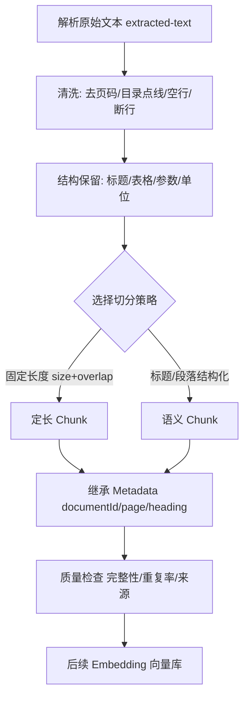

# D28 知识笔记：RAG 文本清洗与 Chunk 切分策略（Spring AI 1.1.8）

> 学习阶段：M3（RAG 数据预处理·切分）
> 技术基线：JDK 21、Spring Boot 3.5.x、Spring AI **1.1.8**
> 实验对象：与 D27 同一份公开手册——佳能 PIXMA MP500 中文用户指南（清洗后正文 93,478 字符）。
> 口径：Spring AI `TokenTextSplitter` 配置按 1.1.8 官方参考文档核验；切分实验为本机真实运行（vm 无 JDK/jtokkit，用**字符数作 token 数的确定性代理**，Java 等价实现见第 8 节）。

---

## 1. 文本清洗在 RAG 中的位置

解析出的原始文本**不能直接切分**：PDF/Word 抽取结果里混着页眉页脚、目录点线、页码、断行、脚注、双栏交错。若带着噪声切分，噪声会进入每个 Chunk，污染 Embedding 与检索。



清洗要点：空白/换行规范化、乱码与重复段落处理、**保留标题/段落/列表/表格/代码块**、识别页眉页脚页码噪声、**保护设备型号/参数/单位**、幂等、清洗前后对比。

---

## 2. Chunk 基础概念

- **Chunk**：送给 Embedding 的最小文本单元。整篇文档直接当一个 Chunk 会导致：Embedding 截断、向量居中、检索精度低。
- **Chunk vs Document**：Document 是 Reader 产出的整文档；Chunk 是对 Document 再切分后的子单元，**一个 Document → 多个 Chunk**。
- **ID 关系**：`documentId` 来自原文档；每个 Chunk 有自己的 `chunkId`，并继承 `documentId + 页码 + 章节标题`，从而能从 Chunk 反查原文。
- **粒度权衡**：Chunk 太小→上下文不足、召回零散；太大→向量不聚焦、超 Embedding 长度。**不是越小越好**。

---

## 3. 固定长度切分

### 原理
按固定字符/Token 数滑动窗口切，相邻窗口用 **Overlap** 重叠一段，避免边界语义被切断。

### 关键参数
- **Chunk Size**：目标长度（Spring AI 用 Token；本实验用字符代理）。
- **Overlap**：相邻 Chunk 重叠长度。作用=减少边界信息丢失；代价=重复内容、存储与 Embedding 成本上升。
- **按字符 vs 按 Token**：字符数 ≠ Token 数（中文约 1 字≈1~2 token，英文单词多 token，代码/参数更碎）。

### 优缺点
✅ 实现简单、长度可控、覆盖率稳定；❌ 会从句中/表格中间砍断（实测样例见第 9 节）。适合结构松散、以流畅段落为主的文本。

---

## 4. 标题/段落结构化切分

### 原理
按标题层级、空行段落、句子边界切分，把标题与其下属正文绑定成一个 Chunk；超长块再按句界二次切分；过小块合并。

### 要点
- 标题与正文关联（实测样例把 `[重要事项]` 这类标题带进 Chunk 首行）。
- **保护表格/列表/代码块/操作步骤**不被拆散。
- 章节之间隔离；超长章节二次切分；过短 Chunk 合并。
- 难点：PDF 抽文本没有标题语义，需靠“短行、无句末标点”等启发式识别标题——易过切（实测 484 块、最小 11 字）。

---

## 5. Chunk Size、Overlap 与 Token 限制（Spring AI 1.1.8 实测配置）

`TokenTextSplitter` 继承 `TextSplitter`（抽象基类），是 `DocumentTransformer`（`Function<List<Document>,List<Document>>`），用 `jtokkit` 的 **CL100K_BASE** 编码按 Token 切分。builder 参数（官方参考文档）：

| 参数 | 默认 | 含义 |
|---|---|---|
| `chunkSize` | 800 | 每块目标 Token 数 |
| `minChunkSizeChars` | 350 | 超长块在此之后才找句界断开 |
| `minChunkLengthToEmbed` | 5 | 短于此的块丢弃 |
| `maxNumChunks` | 10000 | 单文档最多产出块数 |
| `keepSeparator` | true | 是否保留换行分隔符 |
| `encodingType` | CL100K_BASE | 可换 P50K/O200K_BASE |
| `punctuationMarks` | `. ? ! \n` | 句界字符；中文可加 `。？！；` |

行为要点：**仅当 Token 数超过 chunkSize 时**才在标点处找断点；小于等于 chunkSize 的文本整块返回，不硬切。原 Document 的 metadata 会复制到每个派生 Chunk。

```java
List<Document> docs = textReader.get();
List<Document> chunks = TokenTextSplitter.builder()
        .withChunkSize(800)
        .withMinChunkSizeChars(350)
        .withPunctuationMarks(List.of('.', '?', '!', '\n', '。', '？', '！'))
        .build()
        .apply(docs);
```

必须区分三个长度：**字符数 < Token 数 < 模型上下文窗口**；Embedding 模型输入长度限制决定 chunkSize 上限；Top-K Chunk 拼起来才接近 LLM 上下文窗口。

---

## 6. 语义边界与递归切分

- **语义边界**：完整句子 ≠ 完整语义单元（“若……则……”跨句、“见表 X”跨段）。
- **递归字符切分**：按 `[\n\n, \n, 。, ，, ' ']` 优先级依次尝试，先在大边界切，超长再在小边界切，尽量不破坏段落——Spring AI TokenTextSplitter 的句界断点即此思想。
- **语义切分**（按嵌入相似度合并/拆分）效果好但成本高、不确定；本阶段不展开。
- **选型**：手册/制度类结构文档→标题段落切分；聊天/网页松散文本→固定+递归切分。

---

## 7. Metadata 继承与来源追溯

Chunk 数据结构与 metadata 示例：

```json
{
  "chunkId": "mp500-ug_p143_#03",
  "documentId": "mp500-ug-chs",
  "filename": "mp500_ug_chs.pdf",
  "heading": "通用规格",
  "pageNumber": [143, 143],
  "parser": "pypdf/PagePdfDocumentReader",
  "chunkIndex": 3,
  "text": "电源供应 AC 110-120V、50/60Hz ... 重量 9.6 千克"
}
```

要点：Chunk 继承 documentId/filename/页码/章节；`chunkId` 唯一且含定位信息；重切分旧 Chunk 需按 documentId 版本清理，避免脏召回。

---

## 8. 两种切分策略的 Java 实践（JDK21 等价实现）

> vm 无 JDK，以下为可在 JDK21 直接编译的纯 Java 等价算法（不依赖 Spring 容器）；本次数值由 Python 对同一输入跑出。

```java
// 固定长度切分（字符代理；Spring AI 真实按 Token）
static List<String> fixedSplit(String text, int size, int overlap) {
    var out = new java.util.ArrayList<String>();
    int n = text.length();
    for (int i = 0; i < n;) {
        int end = Math.min(i + size, n);
        out.add(text.substring(i, end));
        if (end >= n) break;
        i += size - overlap;
    }
    return out;
}
// 结构化切分：短行视为标题，标题带正文成块，超长按句界二次切
// （标题启发式 + 中文句末标点 re.split，逻辑同本次实验脚本）
```

---

## 9. 实验结果与质量对比（真实运行）

输入同一份清洗后正文：**93,478 字符**。

| 对比维度 | 固定长度(size=500, overlap=100) | 标题/段落(max=600) |
|---|---|---|
| Chunk 数量 | **234** | **484** |
| 平均长度(字符) | **499.1** | **191.4** |
| 最大长度 | 500 | 615 |
| 最小长度 | 278 | **11（过碎）** |
| 产出总字符 | 116,778 | 92,615 |
| 相对原文重复率 | **约 +25%（overlap 所致）** | 约 0 |
| 语义完整性 | ❌ 句中/表格被砍断 | ✅ 标题带正文，较完整 |
| 标题保留 | ❌ 无 | ✅ 标题进 Chunk |
| 表格/参数完整性 | ❌ 易从中间截断 | ⚠️ 整段保留但仍靠启发式 |
| 内容重复 | 高（overlap） | 低 |
| 适用场景 | 松散流畅文本 | 手册/制度等结构文档 |

### 3 组原文↔Chunk 对照样例

**样例 1｜固定切分从句中砍断**（chunk[40]）：
> ……选择装入纸张的页尺寸。将本机连接到计 **/ 算机使用时**……
（“计算机”被窗口边界劈成“计/算机”，句子跨 Chunk 断裂。）

**样例 2｜固定切分 overlap 带来重复**（chunk[90] 以“× 15 cm/4\" × 6\"。”开头）：
> 这是上一 Chunk 尾部重叠的页尺寸脚注，说明 overlap 会让相邻块重复同一段参数说明。

**样例 3｜结构化切分标题绑定正文**（chunk，len=135）：
> `[重要事项]` 表示有关操作的警告和限制……将本机连接到 Windows 操作系统时，请阅读此内容。
（标题“重要事项”与解释正文同块，语义完整；但平均仅 191 字、最小 11 字，说明 PDF 无标题语义时启发式切分易过碎，需合并短块。）

---

## 10. 工程选型原则与核心总结

1. 先清洗再切分；清洗要幂等且保护参数/表格/单位。
2. 中文手册优先**结构化切分 + 超长二次切分 + 短块合并**；松散文本用**固定长度 + overlap**。
3. chunkSize 由 Embedding 模型 Token 上限反推，overlap 取 chunkSize 的 10%~20%，不是越大越好。
4. 字符数 ≠ Token 数；生产用 `TokenTextSplitter`（CL100K_BASE），中文补 `。？！；` 句界。
5. 每个 Chunk 继承 documentId/页码/标题，保证可溯源；重切分要清旧 Chunk。
6. 质量不能只数块数：要看语义完整性、来源完整性、重复率。

---

## 参考资料

- ETL Pipeline (TextSplitter / TokenTextSplitter) | Spring AI ETL 流水线：[https://docs.spring.io/spring-ai/reference/api/etl-pipeline.html](https://docs.spring.io/spring-ai/reference/api/etl-pipeline.html)
- Class PagePdfDocumentReader | 分页 PDF 读取器：[https://docs.spring.io/spring-ai/docs/1.1.8/api/org/springframework/ai/reader/pdf/PagePdfDocumentReader.html](https://docs.spring.io/spring-ai/docs/1.1.8/api/org/springframework/ai/reader/pdf/PagePdfDocumentReader.html)
- Canon PIXMA MP500 用户指南 | 佳能中国：[https://www.canon.com.cn/supports/download/simsdetail/0900266001.html](https://www.canon.com.cn/supports/download/simsdetail/0900266001.html)

---

## 边界声明

- 本次切分数值由 Python 在 vm 上对真实清洗后原文运行（字符代理）；Spring AI `TokenTextSplitter` 按 Token 切分，实际 Token 数与字符数存在偏差，生产应以 jtokkit 实测为准。
- vm 无 JDK，Java 实现为等价算法交付代码，未在本机编译运行；Windows/JDK21 恢复后可编译复核。
- 不扩展 Embedding、向量库、Rerank、Agent。

> （注：部分内容由豆包 AI 生成）