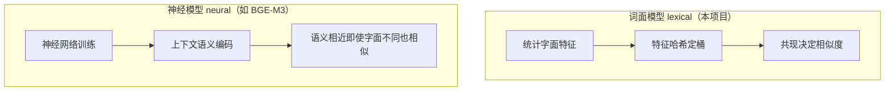
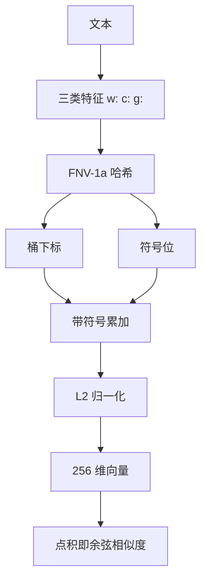
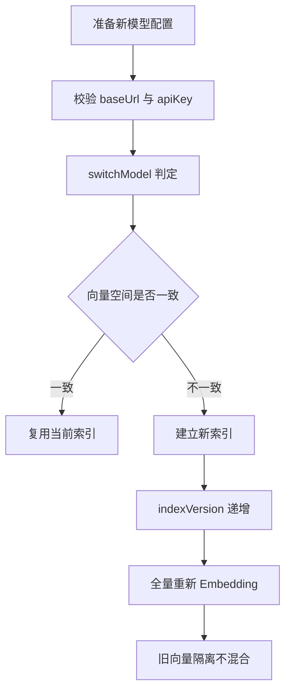

# D29 Embedding 技术原理与模型选择操作实践指南

> 迭代：Day 29：Embedding 原理与模型选择
> 模块：D29_EBD（物理包 com.zl.d29）
> 文档定位：以“是什么 → 为什么 → 底层原理 → 模型选择 → 操作实践 → 常见误区”为主线的实践指南，
> 配合《D29-Embedding模型接入与向量化功能实现全量说明》使用。

---

## 1. 是什么：Embedding 的基本概念

Embedding（嵌入/向量化）是把离散文本映射为连续、稠密数值向量的技术：

- 输入：一段文本（在本项目中是 D28 产出的 Chunk）。
- 输出：固定长度的 `float[]`，例如本项目默认 256 维。
- 语义：向量在空间中的方向与距离，用来度量文本之间的接近程度。

它与 ChatModel（聊天模型）有本质区别：

| 维度 | ChatModel 聊天模型 | EmbeddingModel 嵌入模型 |
|---|---|---|
| 目标 | 生成文本回答 | 输出数值向量 |
| 输出 | 字符串/消息流 | float[] |
| 用途 | 对话、推理、生成 | 相似度计算、检索、聚类 |
| 调用抽象 | ChatModel | EmbeddingModel |

关键认知：**聊天模型不能当 Embedding 用**。DeepSeek 官方只有聊天与 Search/Fetch，没有 Embedding 端点。

---

## 2. 为什么：向量化解决什么问题

文本是离散符号，计算机无法直接计算“两句话有多接近”。向量化后：

1. 把“文本接近程度”转化为“向量空间距离”，可计算、可排序。
2. 为后续 RAG 检索提供统一表示：按相似度从候选中找最相关内容（本迭代不实现检索）。
3. 固定维度输出便于批量处理、索引与计量，且每条向量可追溯到具体模型。

---

## 3. 底层原理

### 3.1 向量空间与距离度量

本项目 `DistanceMetric` 提供三种度量：

- COSINE（余弦相似度，默认）：衡量方向夹角，对向量长度不敏感，范围 `[-1, 1]`，越接近 1 越相似。
- DOT_PRODUCT（点积）：同时受方向与模长影响。
- EUCLIDEAN（欧氏距离）：空间直线距离，值越小越相似。

### 3.2 L2 归一化

L2 模长为各维平方和开根号。归一化让模长为 1：

- 归一化后，余弦相似度等价于点积，计算更简单。
- 消除文本长度对模长的影响，使比较聚焦方向。

### 3.3 词面模型与神经模型的差异



- 词面模型只刻画字符/词的字面共现，不理解同义、改写与隐含语义。
- 神经模型通过训练得到语义空间，能识别“电脑/计算机”这类零字面重叠的近义关系。

### 3.4 特征哈希（Feature Hashing）原理

- 用 32 位 FNV-1a 把任意特征字符串哈希为整数，再映射到固定维度桶。
- 同时输出符号位（+1/-1）做带符号累加，降低碰撞的系统性偏差。
- 优点：维度固定、无需维护词表、确定性、可复现；代价：存在哈希碰撞，且无语义泛化。

### 3.5 完整计算原理流程



---

## 4. 模型选择方法论

### 4.1 选择维度

选型不要只看“谁更强”，应按以下维度结合环境约束：

1. 维度 dimensions：决定向量大小与索引成本；维度必须与索引一致。
2. 费用：云端按 token 计费，本地模型零费用但需自备算力。
3. 部署方式：云端 API 需网络与密钥；本地推理需运行环境（如 Ollama/推理服务）。
4. 上下文长度与多语言：如 BGE-M3 支持 8192 序列、170+ 语言。
5. 可调用性：环境无网络/无密钥/无推理环境时，云端与本地神经模型都不可用。

### 4.2 候选对比（官方数据，价格查询日期 2026-11-12）

| 模型 | 维度 | 费用 | 序列/特点 | 当前可调用 |
|---|---|---|---|---|
| text-embedding-3-small | 1536 | $0.02/1M token | 性价比高 | 否 |
| text-embedding-3-large | 3072 | $0.13/1M token | 高维高精度 | 否 |
| text-embedding-ada-002 | 1536 | $0.10/1M token | 上一代 | 否 |
| BAAI/bge-m3 | 1024 | 免费 | 8192 序列、170+ 语言、568M 参数 | 否 |
| **本地哈希词面模型** | 256 | 免费 | 零网络零密钥，确定性 | **是** |

### 4.3 本项目决策

环境取证显示：无 OpenAI 密钥、OpenAI 网络不可达、无 Ollama、DeepSeek 无 Embedding 端点。
因此唯一真实可调用的是本地哈希词面模型。该结论基于环境事实，而非模型偏好；
未来补齐密钥/网络或本地推理环境后，可在配置层切换，上层服务与校验逻辑无需改动。

---

## 5. 操作实践

### 5.1 编译与测试

```text
# 设置 JDK21
set JAVA_HOME=D:\SoftwareInstall\JDK\JDK21
# 真实编译与测试
D:\SoftwareInstall\Apache\Maven\apache-maven-3.9.16\bin\mvn.cmd -f D29\pom.xml clean test
```

预期：BUILD SUCCESS，Tests run: 266, Failures: 0, Errors: 0, Skipped: 0。

### 5.2 启动应用

```text
mvn -f D29\D29_EBD\pom.xml spring-boot:run
```

端口 8080。本地模型默认启用，无需配置任何密钥。

### 5.3 查看模型元数据

```text
GET http://localhost:8080/api/v1/embeddings/model
```

返回 provider、model、modelVersion、dimensions、vectorSpaceId、indexVersion、distanceMetric。

### 5.4 索引兼容性检查

```text
POST http://localhost:8080/api/v1/embeddings/index/compatibility
Content-Type: application/json

{
  "provider": "openai",
  "model": "text-embedding-3-small",
  "modelVersion": "v1",
  "dimensions": 256
}
```

同维度但 vectorSpaceId 不同，返回 MODEL_SPACE_MISMATCH，默认隔离。

### 5.5 切换模型的正确操作



操作要点：切换到不同向量空间必须新建索引或全量重新 Embedding，禁止把新旧向量混入同一索引。

### 5.6 复现真实证据

独立证据生成器位于 docs/temp_docs/D29/D29EvidenceRunner.java：

```text
# 1. 生成运行时 classpath
mvn -f D29\D29_EBD\pom.xml dependency:build-classpath "-Dmdep.outputFile=docs\temp_docs\D29\classpath.txt"
# 2. 编译（-proc:none 关闭注解处理提示）
javac -encoding UTF-8 -proc:none -cp "<target\classes;classpath>" -d docs\temp_docs\D29 D29EvidenceRunner.java
# 3. 运行
java -Dfile.encoding=UTF-8 -cp "docs\temp_docs\D29;<target\classes;classpath>" D29EvidenceRunner
```

输出写入 docs/evidence/D29，控制台仅打印 ASCII 摘要，避免原生进程中文乱码。

---

## 6. 常见误区与避坑

### 6.1 字符数不等于 Token 数

- 本项目长度口径是 UTF-16 code unit（`String.length`），是字符数。
- 未引入 Tokenizer，不能把字符数写成 Token；云端计价按 token，需以官方 Tokenizer 为准。

### 6.2 同维度不等于兼容

- 维度只是第一道硬校验；即使都是 256 维，不同模型 vectorSpaceId 不同也必须隔离。
- 权威标识是 `vectorSpaceId = provider|model|modelVersion|dimensions`。

### 6.3 词面模型的语义盲区

- 零字面重叠同义词“电脑/计算机”实测 cosine = 0.0000，这是词面模型的固有局限，不是故障。
- 字面重叠对会得到较高相似度（实测 0.8685），说明它主要反映字面共现。

### 6.4 超长文本禁止静默截断

- 超长直接拒绝并提示重新切分，避免悄悄丢内容、丢来源；应由 Chunk 层重新切分后再嵌入。

### 6.5 重试不是万能

- 仅临时故障（限流、上游 5xx、建连失败）可重试；鉴权、参数、模型不存在等永久错误快速失败。
- 重试有硬上限（默认 3，最大 5），未归类异常保守不重试。

### 6.6 证据要区分真实与受控

- 真实：本地模型真实嵌入与相似度。
- 受控：重试故障注入、异模型元数据、切换均为测试桩/元数据，不声称真实接入第二模型。

---

## 7. 验收清单

| 检查项 | 结果 |
|---|---|
| 选定真实可调用模型并记录模型/维度/费用/密钥边界 | 已完成（本地哈希词面，256 维，免费，零密钥） |
| 复用 Spring AI EmbeddingModel 抽象 | 已完成（extends AbstractEmbeddingModel） |
| 维度一致、非空、无 NaN/Infinity、L2 归一化 | 已完成（模长 1.000000） |
| 空文本/超长/异常处理 | 已完成（fail-closed，不静默截断） |
| 临时故障有限重试并区分永久错误 | 已完成（受控证据，上限 3） |
| vectorSpaceId 与索引兼容性 | 已完成（异维拒绝、同维异空间隔离） |
| 真实编译测试 | 已完成（266 全绿） |
| 未越界实现 VectorStore/RAG/Rerank/Agent/Tool/MCP | 已确认未实现 |

---

## 8. 官方溯源与参考

| 资料 | 链接 |
|---|---|
| 《OpenAI Pricing | OpenAI 定价》 | https://openai.com/api/pricing/ |
| 《New embedding models and API updates | OpenAI 新嵌入模型》 | https://openai.com/index/new-embedding-models-and-api-updates/ |
| 《BAAI/bge-m3 | BGE-M3 模型卡》 | https://hf.co/BAAI/bge-m3 |
| 《DeepSeek API Docs | DeepSeek 官方文档》 | https://api-docs.deepseek.com/zh-cn/ |
| 《Spring AI API | Spring AI 参考》 | https://docs.spring.io/spring-ai/reference/ |
| 《Spring Boot Reference | Spring Boot 参考文档》 | https://docs.spring.io/spring-boot/docs/3.5.16/reference/html/ |

---

## 9. 记忆简语

**选型先看能不能调，再看维度费用与部署；词面靠共现、神经靠语义；
归一化后点积即余弦；同维未必兼容，空间 ID 才权威；切换必重建，重试只救临时故障。**
