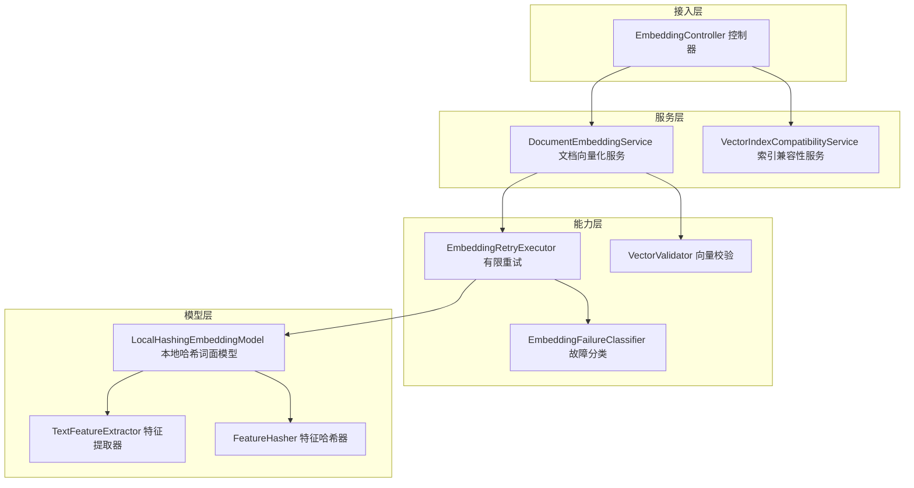
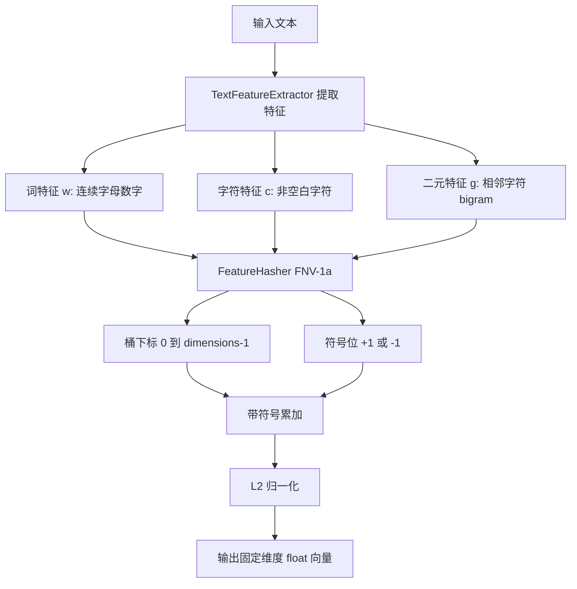
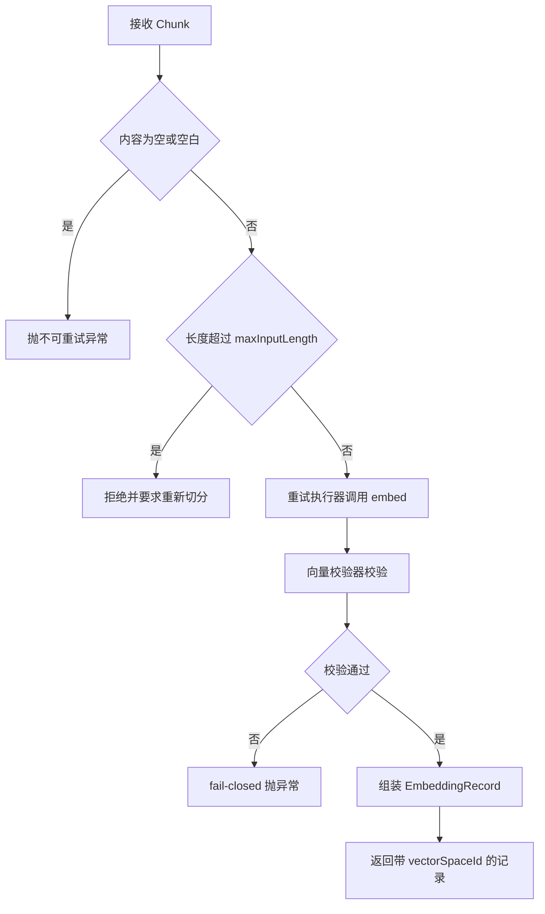
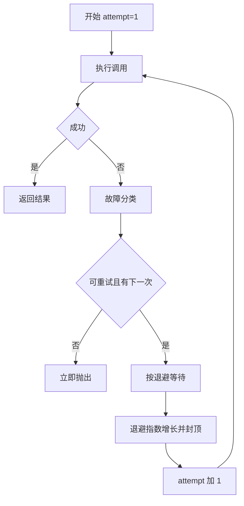
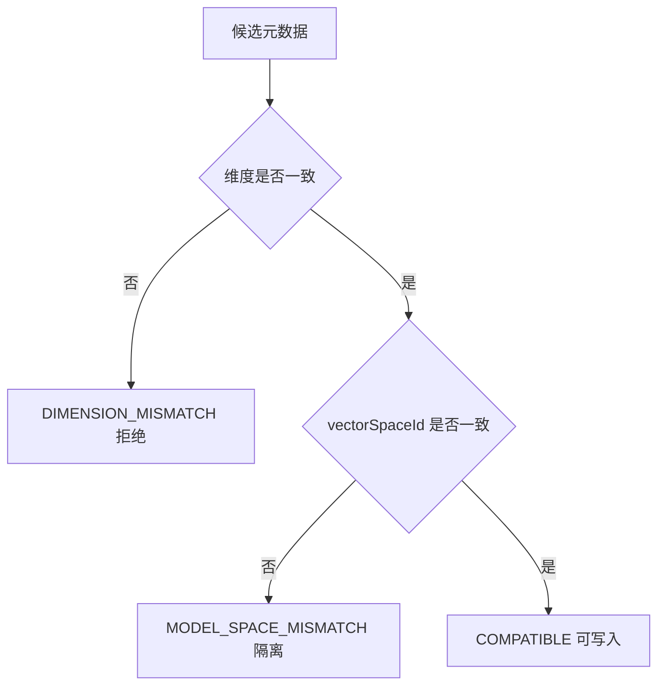

# D29 Embedding 模型接入与向量化功能实现全量说明

> 迭代：Day 29：Embedding 原理与模型选择
> 模块：D29_EBD（物理包 com.zl.d29）
> 技术基线：JDK 21、Spring Boot 3.5.16、Spring AI 1.1.8、Maven 3.9.16
> 文档定位：面向工程实现的全量说明，覆盖背景、架构、原理、代码、流程、配置、接口、验证与边界。

---

## 1. 文档概述

### 1.1 背景

D28 已交付文本清洗与可配置 Chunk 切分能力，把原始文档处理为顺序稳定、带元数据的 Chunk。
D29 在此基础上建立独立的 Embedding（嵌入/向量化）工程能力：把 Chunk 文本通过真实可调用的
`EmbeddingModel` 转换为固定维度的 `float[]` 向量，并保证向量可校验、调用可重试、模型可切换、
空间可追溯，且不混用不兼容向量。

### 1.2 目标

1. 选定当前环境真实可调用的 EmbeddingModel，记录模型、维度、费用与密钥边界。
2. 提供文本→向量调用组件，复用 Spring AI `EmbeddingModel` 抽象。
3. 提供向量结果校验：维度一致、非空、无 NaN/Infinity、L2 归一化。
4. 处理空文本、超长文本与调用异常；超长拒绝，不静默截断。
5. 对临时故障做有限重试，区分永久错误，重试次数有硬上限。
6. 维护模型元数据与 `vectorSpaceId`，做索引兼容性校验：异维度拒绝、同维度异模型默认隔离。

### 1.3 硬边界（本迭代不做）

- 不实现完整 VectorStore、向量数据库、RAG 检索问答、混合检索、Rerank。
- 不实现 Agent、Tool、MCP；不做与本任务无关的重构。
- 字符数（UTF-16 code unit）不得宣称 Token 数；不引入 Tokenizer。
- 不把聊天模型能力等同于 Embedding 能力；不把 Page 等同于 Chunk。

---

## 2. 环境取证与模型选定

### 2.1 环境事实

| 取证项 | 结果 |
|---|---|
| 模型 starter | 仅 spring-ai-starter-model-deepseek（聊天），无 embedding starter |
| 密钥 | 仅 DeepSeek 体系密钥（AI_API_KEY/DEEPSEEK_API_KEY），无 OpenAI 等密钥 |
| 网络 | api.deepseek.com:443 可达；api.openai.com 不可达；本机无 Ollama |
| DeepSeek 官方能力 | 仅聊天模型与 Search/Fetch，官方无 Embedding 端点 |

第三方 SEO 站点所谓“DeepSeek Embeddings”非官方口径，不予采信。

### 2.2 候选模型对比（官方数据，价格查询日期 2026-11-12）

| 模型 | 维度 | 费用 | 调用方式 | 当前可调用 |
|---|---|---|---|---|
| OpenAI text-embedding-3-small | 1536 | $0.02/1M token | 云端 API | 否 |
| OpenAI text-embedding-3-large | 3072 | $0.13/1M token | 云端 API | 否 |
| OpenAI text-embedding-ada-002 | 1536 | $0.10/1M token | 云端 API | 否 |
| BAAI/bge-m3 | 1024 | 免费（约 2.27GB、568M 参数） | 本地推理 | 否（无推理环境） |
| **本地哈希词面模型** | 256（可配） | 免费 | 本地 JVM | **是** |

### 2.3 选定结论

当前环境唯一真实可调用方案为纯 JVM 本地哈希词面模型 `LocalHashingEmbeddingModel`：
继承 Spring AI `AbstractEmbeddingModel`，真实计算 `float[]`（非 Mock），零网络、零密钥、零费用。

诚实定位：该模型是词面/字面向量（lexical），不是 BGE-M3 类神经语义模型；
零字面重叠的同义词（如“电脑”与“计算机”）余弦相似度为 0，详见第 9 章证据。

---

## 3. 整体架构与物理包结构

### 3.1 分层架构



### 3.2 物理包层级树

```
com.zl.d29.document.embedding
├── config
│   ├── EmbeddingProperties        # app.ai.embedding 配置与启动校验
│   └── EmbeddingConfiguration     # 装配 EmbeddingModel Bean
├── controller
│   └── EmbeddingController        # 模型元数据/向量化/兼容性入口
├── dto
│   ├── CompatibilityCheckRequest  # 兼容性检查请求体
│   ├── CompatibilityDecisionView  # 兼容性结论视图
│   ├── EmbeddingModelMetadataView # 模型元数据视图
│   ├── EmbeddingRecordView        # 向量记录视图（预览，不 dump 全量）
│   └── EmbeddingViewMapper        # 领域模型到视图映射
├── local
│   ├── TextFeatureExtractor       # 词/字符/bigram 特征提取
│   ├── FeatureHasher              # FNV-1a 特征哈希（桶+符号）
│   └── LocalHashingEmbeddingModel # 本地哈希词面模型（真实计算）
├── model
│   ├── DistanceMetric             # 距离度量枚举
│   ├── EmbeddingModelMetadata     # 向量空间/索引元数据
│   ├── EmbeddingRecord            # 单 Chunk 向量记录
│   └── CompatibilityDecision      # 兼容性结论枚举
├── service
│   ├── DocumentEmbeddingService   # Chunk 批量向量化
│   └── VectorIndexCompatibilityService # 索引兼容性与模型切换
└── support
    ├── EmbeddingServiceException  # 统一异常（可重试标识）
    ├── EmbeddingFailureClassifier # 临时/永久故障分类
    ├── EmbeddingRetryExecutor     # 有限重试（指数退避）
    └── VectorValidator            # 维度/非空/NaN/Infinity 校验
```

主源 21 个；测试 8 个（7 个 Test 类 + 1 个受控 Stub）。

---

## 4. 核心技术原理

### 4.1 向量化链路

文本经三类特征提取后，用带符号特征哈希映射到固定维度桶，累加后做 L2 归一化：



### 4.2 三类特征（TextFeatureExtractor）

- 词特征 `w:`：连续字母/数字序列，统一小写，适配英文与数字。
- 字符特征 `c:`：每个非空白字符，统一小写，适配中文等无空格语言。
- 二元特征 `g:`：相邻非空白字符的 bigram，刻画局部顺序。

### 4.3 带符号特征哈希（FeatureHasher）

- 采用 32 位 FNV-1a 哈希，分布稳定、无外部依赖。
- 桶下标：哈希对维度取模，结果落在 `[0, dimensions)`。
- 符号位：取哈希最高位，输出 `+1/-1`。带符号累加可降低哈希碰撞造成的系统性偏差。

### 4.4 L2 归一化与余弦相似度

- 向量各维平方和开根号得 L2 模长，再逐维除以模长，使模长为 1。
- L2 归一化后，两向量余弦相似度（Cosine Similarity）等价于点积，范围 `[-1, 1]`。
- 默认距离度量为 COSINE；无特征（空文本）时保持零向量，但空文本在服务层已被提前拒绝。

### 4.5 确定性与可复现

算法不依赖随机数与外部状态，同一文本任意两次嵌入结果完全相等；
模型版本固定时，跨进程结果一致，便于回归与追溯。

---

## 5. 核心组件详解

### 5.1 config：配置与装配

**EmbeddingProperties**（命名空间 `app.ai.embedding`）

- 承载 provider/model/modelVersion/dimensions/maxInputLength/distanceMetric 与重试退避参数。
- `@PostConstruct validate()` 启动校验：维度、长度、重试次数、退避、度量自洽；
  云端 provider 强制要求 baseUrl 与 apiKey，本地不要求。非法配置 fail-fast。
- `vectorSpaceId()` 输出当前配置的向量空间标识。

**EmbeddingConfiguration**

- 以 `@ConditionalOnMissingBean(EmbeddingModel.class)` 与 `enabled` 开关装配本地模型。
- 抽象与具体模型解耦，后续接入云端只需扩展此处并通过配置切换，不影响上层。

### 5.2 local：本地模型

- `LocalHashingEmbeddingModel` 继承 `AbstractEmbeddingModel`，实现 `call(EmbeddingRequest)`
  与 `embed(Document)`，覆写 `dimensions()`；构造时同步父类维度缓存。
- `call` 逐条嵌入并组装带 `EmbeddingResponseMetadata` 的 `EmbeddingResponse`。
- 单条嵌入：特征哈希累加 → L2 归一化。

### 5.3 service：向量化与兼容性

**DocumentEmbeddingService**

- `embedChunks(List<Chunk>)`：空列表拒绝；逐条 `embedOne`，顺序与输入一致。
- `embedOne`：空/空白拒绝；超长拒绝（不静默截断、不丢来源）；
  经重试执行器调用、经校验器校验，再组装带 `vectorSpaceId` 的 `EmbeddingRecord`。

**VectorIndexCompatibilityService**

- `check`：异维度 → DIMENSION_MISMATCH；同维度异 vectorSpaceId → MODEL_SPACE_MISMATCH；
  两者一致 → COMPATIBLE。
- `assertWritable`：不兼容即抛永久异常。
- `switchModel`：不同向量空间建立新索引，`indexVersion` 递增，旧向量不混合；
  向量空间完全一致时无需切换。

### 5.4 support：异常、分类、重试、校验

- `EmbeddingServiceException`：统一异常，携带 `retryable` 标识；
  静态工厂 `recoverable`（可重试）与 `nonRetryable`（不可重试）。
- `EmbeddingFailureClassifier`：TransientAiException 可重试、NonTransientAiException 不可重试、
  EmbeddingServiceException 看标识、未归类异常保守不重试。
- `EmbeddingRetryExecutor`：指数退避、次数硬上限；`Sleeper` 可注入，生产构造器加 `@Autowired`
  解决双构造器歧义；中断时恢复中断标志并快速失败。
- `VectorValidator`：null/空/维度不符/NaN/Infinity 全部 fail-closed；提供批量校验。

---

## 6. 关键流程

### 6.1 单条 Chunk 向量化流程



### 6.2 有限重试流程



### 6.3 索引兼容性判定流程



---

## 7. 配置说明

### 7.1 配置项与默认值

| 配置项（app.ai.embedding.*） | 默认值 | 说明 |
|---|---|---|
| provider | local | 模型提供方 |
| model | local-hashing-embedding | 模型名称 |
| modelVersion | local-v1 | 模型版本/部署标识 |
| dimensions | 256 | 向量维度 |
| maxInputLength | 8192 | 最大输入长度（UTF-16 字符，非 Token） |
| distanceMetric | COSINE | 距离度量 |
| enabled | true | 是否启用 |
| maxAttempts | 3 | 最大尝试次数（含首次，1..5） |
| initialBackoffMs | 200 | 首次退避毫秒 |
| backoffMultiplier | 2.0 | 退避倍率 |
| maxBackoffMs | 5000 | 单次退避上限 |
| baseUrl | 空 | 云端地址（本地为空） |
| apiKey | 空 | 云端密钥（环境变量注入） |

当前 application.yml 未显式列出 embedding 段，组件使用上述内置默认值；
需要覆盖时在 `app.ai.embedding` 下配置或用环境变量注入。

### 7.2 密钥边界

- 本地模型零密钥；云端模型必须通过环境变量注入 apiKey，禁止硬编码或写入日志/文档。
- 对外响应不回显堆栈、报文、请求头与密钥；日志与文档只输出脱敏占位。

### 7.3 长度口径（重要）

- 长度统一为 UTF-16 code unit（`String.length`/`substring`），是字符数，不是 Token 数。
- 未引入 Tokenizer，任何文档/日志不得把字符数表述为 Token。

---

## 8. HTTP 接口说明

统一返回 `Result<T>`（code/msg/data），HTTP 恒 200，业务结果看 code。

| 方法 | 路径 | 说明 |
|---|---|---|
| GET | /api/v1/embeddings/model | 当前模型与向量空间元数据 |
| POST | /api/v1/documents/{documentId}/embeddings?strategy=FIXED_SIZE | 对文档 Chunk 真实向量化 |
| POST | /api/v1/embeddings/index/compatibility | 索引兼容性检查（fail-closed） |

业务码：SUCCESS 200、PARAM_INVALID 4001、AI_CONFIG_ERROR 5001、AI_UNAVAILABLE 5002、
SYSTEM_ERROR 5000。向量记录视图仅给维度、模长与预览，不输出全量向量数值。

---

## 9. 验证结果

### 9.1 编译与测试（真实执行）

- 命令：`mvn -f D29/pom.xml clean test`
- 结果：BUILD SUCCESS。
- 汇总：**Tests run: 266, Failures: 0, Errors: 0, Skipped: 0**。
- 测试类 41 个（基线 34 + 新增 7），Surefire 报告 41 份（txt/xml 各 41）。

### 9.2 真实调用证据（真实，非 Mock）

- 真实嵌入中文/英文/中英混合/长短文本，维度均为 256，L2 模长 1.000000，无 NaN/Infinity。
- 字面重叠对 `spring ai embedding model` 与 `spring ai embedding vector`：cosine = 0.8685。
- 零字面重叠同义词 `电脑` 与 `计算机`：cosine = 0.0000；同文本自身 cosine = 1.0000。
- 同一文本两次嵌入完全相等，确定性成立。

### 9.3 受控模拟证据（明确标注）

- 重试的故障注入、异模型元数据、模型切换均由测试桩/元数据驱动，非真实第二模型或云端调用。
- 重试：临时故障第 3 次恢复成功；永久故障仅 1 次快速失败；临时故障达上限 3 后停止。
- 兼容性：同空间 COMPATIBLE、异维度 DIMENSION_MISMATCH、同维度异空间 MODEL_SPACE_MISMATCH。
- 切换：indexVersion 由 1 递增到 2，旧向量不混合。

### 9.4 证据与日志位置

- 证据：docs/evidence/D29（D29-01..11，含归档 surefire-reports）。
- 日志：logs/D29/01-compile.log、logs/D29/02-test.log。
- 临时取证：docs/temp_docs/D29（D29EvidenceRunner，保留不自动删除）。

---

## 10. 注意事项与诚实缺口

### 10.1 工程注意事项

- 维度相同不等于兼容：必须同时校验 vectorSpaceId，否则同维度异模型向量默认隔离。
- 超长文本禁止静默截断：拒绝并由调用方重新切分，保证来源可追溯。
- 未归类异常保守不重试，避免盲目/无限重试放大故障。
- 归档 surefire 时注意递归复制可能产生嵌套目录，归档后需核对文件计数。

### 10.2 诚实缺口（沿用 D27/D28）

- 真实 MySQL 端到端 HTTP 上传未做（需先在 ai_db 执行 DDL）。
- 当前无鉴权，X-Dev-User 仅归属标识，非生产鉴权。
- 真实聊天模型 remote 未在本任务验证；云端模型切换仅验证逻辑，未真实接入 OpenAI。
- 扫描件只提示需 OCR，不实现 OCR。

### 10.3 版本控制

- 仅执行 git status/diff 复核，未 commit、未 push、未 reset/clean。

---

## 11. 官方溯源

| 资料 | 链接 |
|---|---|
| 《OpenAI Pricing | OpenAI 定价》 | https://openai.com/api/pricing/ |
| 《New embedding models and API updates | OpenAI 新嵌入模型》 | https://openai.com/index/new-embedding-models-and-api-updates/ |
| 《BAAI/bge-m3 | BGE-M3 模型卡》 | https://hf.co/BAAI/bge-m3 |
| 《DeepSeek API Docs | DeepSeek 官方文档》 | https://api-docs.deepseek.com/zh-cn/ |
| 《Spring AI API | Spring AI 参考》 | https://docs.spring.io/spring-ai/reference/ |
| 《Spring Boot Reference | Spring Boot 参考文档》 | https://docs.spring.io/spring-boot/docs/3.5.16/reference/html/ |

---

## 12. 记忆简语与知识树

记忆简语：**特征三兄弟（词、字、双字），哈希定桶又定号，累加归一模长一，余弦点积看方向；
异维先挡、同维异空间隔离，切换必重建、版本往上加。**

```
Embedding 工程
├── 选型
│   ├── 云端神经（OpenAI/BGE 远程，当前不可用）
│   └── 本地词面（哈希模型，真实可调用）
├── 计算
│   ├── 特征提取（w/c/g）
│   ├── 特征哈希（FNV-1a 桶+符号）
│   └── L2 归一化
├── 质量
│   ├── 向量校验（非空/维度/有限值）
│   ├── 异常分类（临时/永久）
│   └── 有限重试（退避+上限）
└── 兼容
    ├── 维度硬校验
    ├── vectorSpaceId 权威标识
    └── 切换递增 indexVersion
```
