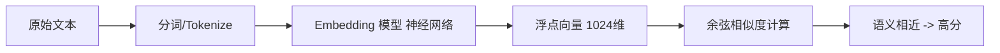

# D29 知识笔记：Embedding 原理与模型选择（Spring AI 1.1.8）

> 学习阶段：M3（RAG 向量层）
> 技术基线：JDK 21、Spring Boot 3.5.x、Spring AI **1.1.8**
> 实验对象：6 条设备相关中文短句（真实向量计算，记录见第 9 节）。
> 口径：`EmbeddingModel` API 按 1.1.8 Javadoc 核验；vm 无神经模型，实验用**字符 n-gram TF-IDF 词汇向量**真实计算余弦相似度，并明确标注其与神经语义 Embedding 的差距。

---

## 1. Embedding 基础概念与工作原理

- **是什么**：Embedding 把一段文本映射成一个**固定长度的浮点向量**（如 1024 维），让“语义相近”在向量空间里“距离相近”。
- **不是什么**：它**不是文本生成**（不产出句子），也**不是关键词匹配**（不看是否共有词）；向量每一维也不对应可解释的“某个词权重”。
- **作用**：把“语义相似度”变成可计算的数学量，支撑向量检索。



---

## 2. 文本向量化的数据流程

文本 → Tokenizer → 模型前向 → 输出浮点数组 → L2 归一化（模型或检索层）→ 与查询向量算相似度。
关键点：**查询向量和文档向量必须用同一个模型、同一版本编码**，否则不在同一向量空间。

---

## 3. 向量维度与相似度

### 相似度算法对比

| 指标 | 公式直觉 | 是否需归一化 | 特点 |
|---|---|---|---|
| 余弦相似度 cosine | 夹角余弦，[-1,1] | 归一化后=点积 | 最常用，只看方向不看长度 |
| 点积 dot product | 向量分量乘积和 | 不归一化时受模长影响 | 已归一化向量等价于余弦 |
| 欧氏距离 L2 | 坐标差平方和开方 | 与归一化相关 | 越小越相似，直观但受模长影响 |

- **维度不是越高越好**：高维占存储、算得慢，还可能稀疏；质量取决于模型训练。
- **维度相同 ≠ 可混用**：bge-m3 的 1024 维与 OpenAI 的 1024 维**向量空间完全不同**，不能直接比较。
- 相似度分数是“语义接近度”，**不是答案正确率/概率**。

---

## 4. Embedding 模型选型

选型维度：中文/多语言能力、中文技术文档与故障描述理解、维度与是否支持自定义维度、最大输入 Token、版本、归一化、成本、延迟/吞吐、云端 API vs 本地开源、数据隐私。

### 选型对比表（参数以各官方文档为准，价格查询日 2026-11）

| 维度 | A：BAAI bge-m3（本地开源） | B：智谱 embedding-3（云端 API） |
|---|---|---|
| 厂商 | 智源研究院 | 智谱 AI |
| 语言 | 多语言（中英强） | 中文强 |
| 维度 | 1024（支持指令） | 2048 等可配 |
| 最大输入 | 约 8192 tokens | 以官方为准 |
| 部署 | 本地/私有化，数据不出网 | 云端，需出网+API Key |
| 成本 | 算力/GPU/内存，无按量费 | 按 Token 计费（以官网为准） |
| 适配场景 | 敏感设备知识库、离线内网 | 快速验证、不想运维模型 |

> 说明：具体价格、维度、输入上限会随版本变动，落地前必须查对应官方计费/模型页；本表只给选型维度与典型定位。

---

## 5. Chat Model 与 Embedding Model 的关系

| 维度 | Chat Model | Embedding Model |
|---|---|---|
| 输入 | 对话/Prompt | 单段文本 |
| 输出 | 生成的自然语言/结构化结果 | 浮点向量 |
| 职责 | 理解问题、生成答案 | 把文本变成可检索向量 |
| 是否必须同厂商 | **否** | **否** |

关键工程结论：
- Chat 与 Embedding **可以用不同厂商、不同服务地址、不同 Key、不同模型版本**。
- 但“厂商提供 Chat Completion”**不代表一定提供 Embedding API**（例如某对话模型厂商可能只有对话接口）。
- Spring AI 用统一抽象屏蔽差异：`ChatModel` 与 `EmbeddingModel` 各自自动装配，可分别配置。
- DeepSeek 作 Chat、另接 bge-m3/智译作 Embedding，是常见组合；**但不得未验证就假设某服务同时提供 Embedding**。

---

## 6. Spring AI 1.1.8 Embedding API（已核验）

`EmbeddingModel extends Model<EmbeddingRequest, EmbeddingResponse>`。关键方法（Javadoc 实测）：

```java
EmbeddingModel em;                       // 由 starter 自动装配
float[] v = em.embed("设备无法启动");      // 单条 -> float[]
List<float[]> batch = em.embed(List.of("a","b"));   // 批量
List<float[]> docs = em.embed(List.of(document), options, batchingStrategy);
EmbeddingResponse resp = em.embedForResponse(List.of("a","b"));  // 含 metadata 的响应
int dim = em.dimensions();               // 默认会调远端取维度；已知应覆盖
```

已知实现（Javadoc 列出）：`OpenAiEmbeddingModel`、`OllamaEmbeddingModel`、`TransformersEmbeddingModel`（本地）、`ZhiPuAiEmbeddingModel`、`MistralAiEmbeddingModel`、`MiniMaxEmbeddingModel` 等。

要点：批量 vs 单条；Spring AI 屏蔽厂商差异；`dimensions()` 默认会请求远端。

---

## 7. 成本、批处理与性能

- 计费按 **Token**，不是字符数；字符数 ≠ Token。
- 批量编码摊薄请求开销，但受单次输入上限与并发/限流约束；要设超时、重试、部分失败兜底。
- **建库成本（一次性全量编码）≠ 查询成本（每次提问编码一条）**。
- 相同文本+相同模型版本应**缓存向量**避免重复编码。
- 本地模型成本在 GPU/CPU/内存；云端在 Token 费用与出网。

---

## 8. 向量兼容性与模型版本管理

- 文档向量与查询向量必须**同一模型同一版本**。
- 换模型/升级版本→向量分布可能变，**通常需要全量重新向量化**，不能新旧混检。
- 向量记录要带 `model + version + dim + 归一化` 标签，迁移时按 documentId 清旧重建。
- 区分三件事：换 API 服务（同模型）、升级小版本、**更换向量空间模型**——只有最后一种必须重建索引。

---

## 9. Java 实践与真实向量验证记录

> vm 无神经模型，以下用字符 n-gram TF-IDF（sklearn）真实计算，6 条设备短句，向量维度 87。**这是词汇向量，不是神经 Embedding**。

### 9.1 输入文本

```
S1 设备无法启动        S2 设备启动失败
S3 电机运行过程中温度过高   S4 设备出现异常振动
S5 如何更换设备滤芯      S6 机器开不了机
```

### 9.2 真实余弦相似度矩阵

| | S1 | S2 | S3 | S4 | S5 | S6 |
|---|---|---|---|---|---|---|
| S1 | 1.000 | **0.183** | 0.000 | 0.157 | 0.027 | **0.000** |
| S2 | 0.183 | 1.000 | 0.000 | 0.102 | 0.026 | 0.000 |
| S3 | 0.000 | 0.000 | 1.000 | 0.000 | 0.000 | 0.000 |
| S4 | 0.157 | 0.102 | 0.000 | 1.000 | 0.022 | 0.000 |
| S5 | 0.027 | 0.026 | 0.000 | 0.022 | 1.000 | 0.000 |
| S6 | 0.000 | 0.000 | 0.000 | 0.000 | 0.000 | 1.000 |

### 9.3 结论（关键）

- S1 vs S2（共有“设备/启动”字样）=0.183，是最高的非对角值——**字面重叠才得分**。
- S1 vs S6（“无法启动”与“开不了机”**同义但零字面重叠**）=**0.000**——词汇向量完全抓不住同义。
- 这正是必须用神经语义 Embedding（bge-m3 等）的原因：它应让 S1≈S6 高相似，而 S1≈S5 低相似。
- 相似度高 ≠ 答案对；真实模型还需用“问题—正确文档”配对做召回评估。

### 9.4 Java 调用示例（Spring AI）

```java
@Service
public class EmbeddingDemo {
    private final EmbeddingModel embeddingModel;
    public EmbeddingDemo(EmbeddingModel embeddingModel) { this.embeddingModel = embeddingModel; }
    public float[] encode(String text) { return embeddingModel.embed(text); }
}
```
配置时 Chat 与 Embedding 各自的 `spring.ai.*` 前缀独立设置，Key 走环境变量，禁止硬编码。

---

## 10. 核心总结与验收

1. Embedding 把文本变成向量，使语义相似度可计算；它不生成文本、不等同关键词匹配。
2. 余弦/点积/欧氏距离的区别与归一化；维度高≠更好，维度同≠可混用。
3. 中文设备知识库优先选中文强、可私有化或按量可控的模型；bge-m3（本地）vs 云端 API 按隐私与成本取舍。
4. Chat 与 Embedding 可分厂商；提供 Chat 不代表提供 Embedding。
5. Spring AI `EmbeddingModel.embed/embedForResponse/dimensions` 统一封装。
6. 建库全量编码 vs 查询单条编码；批量+缓存+限流重试。
7. 换向量空间模型必须重建索引；向量带 model/version/dim 标签。
8. 真实实验证明：词汇向量对同义句得 0 分——这就是神经 Embedding 的价值。

---

## 参考资料

- Interface EmbeddingModel | EmbeddingModel 接口：[https://docs.spring.io/spring-ai/docs/1.1.8/api/org/springframework/ai/embedding/EmbeddingModel.html](https://docs.spring.io/spring-ai/docs/1.1.8/api/org/springframework/ai/embedding/EmbeddingModel.html)
- ETL Pipeline / Embedding | Spring AI ETL 与嵌入：[https://docs.spring.io/spring-ai/reference/api/etl-pipeline.html](https://docs.spring.io/spring-ai/reference/api/etl-pipeline.html)
- BAAI bge-m3 | 智源开源多语言嵌入模型：[https://huggingface.co/BAAI/bge-m3](https://huggingface.co/BAAI/bge-m3)

---

## 边界声明

- vm 无神经模型/无 API Key，真实相似度由 sklearn 字符 n-gram TF-IDF 跑出，**代表词汇匹配而非语义匹配**，已如实标注；神经模型实际相似度需联网调用或本地 bge-m3 复跑。
- 模型价格、维度、输入上限以各官方最新页为准（查询日 2026-11），未编造具体价格数字。
- 不展开 Vector Store、检索优化、Agent。

> （注：部分内容由豆包 AI 生成）