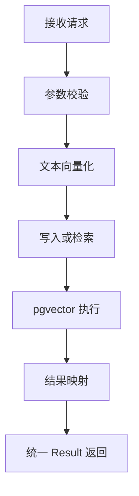

# D30-PostgreSQL-pgvector 技术说明与操作实践指南

> 模块：`D30_postgresqlAndpgvector`，物理包 `com.zl.d30`
> 文档定位：面向复现与运维的技术原理 + 操作实践 + 故障排查指南
> 编写视角：12 年 Java 架构师 + 6 年 AI 工程落地

---

## 一、技术概述

### 1.1 是什么

pgvector 是 PostgreSQL 的开源扩展，为关系库增加 `vector` 类型与相似度检索能力。
Spring AI 通过 `PgVectorStore` 提供与 `VectorStore` 抽象一致的写入、检索接口，底层用 JDBC 操作 pgvector。

### 1.2 为什么这样选

- 已有 PostgreSQL 容器与 pgvector 扩展，无需新增中间件；
- 复用 D29 的 EmbeddingModel，只补持久化，改动最小；
- 关系库 + 向量在同一库内，元数据可用 SQL 关联，便于追溯。

### 1.3 底层原理要点

- 向量列定长声明 `vector(N)`，写入维度必须等于 N，否则报错；
- 余弦距离算子 `<=>`，距离越小越相似；相似度 = 1 - distance；
- HNSW 是近似最近邻索引，配合 `vector_cosine_ops` 加速余弦检索。

---

## 二、环境准备与启动

### 2.1 前置条件

| 项 | 要求 |
| --- | --- |
| Docker / Compose | 24.0.9 / v2.24.7 |
| 容器镜像 | `pgvector/pgvector:pg18` |
| 端口 | 宿主 5432 可达 |
| JDK / Maven | JDK 21 / Maven 3.9.16 |

### 2.2 启动与健康检查

```bash
cd /root/pgvector-stack
docker compose up -d
docker ps
docker exec pgvector-pg18 pg_isready -U postgres -d spring_ai
```

健康输出：

```text
/var/run/postgresql:5432 - accepting connections
```

> 纪律：只有看到 `(healthy)` 与 `accepting connections` 才说明连接层就绪；
> 这一步通过不代表检索通过，检索需另行验证。

### 2.3 扩展验证

```bash
docker exec pgvector-pg18 psql -U postgres -d spring_ai \
  -c "SELECT extname, extversion FROM pg_extension WHERE extname='vector';"
```

```text
 extname | extversion
---------+------------
 vector  | 0.8.7
```

---

## 三、配置实践

### 3.1 独立数据源配置（application.yml）

```yaml
app:
  pgvector:
    enabled: ${PGVECTOR_ENABLED:true}
    host: ${PGVECTOR_HOST:192.168.200.153}
    port: ${PGVECTOR_PORT:5432}
    database: ${PGVECTOR_DATABASE:spring_ai}
    username: ${PGVECTOR_USER:postgres}
    password: ${PGVECTOR_DB_PASSWORD:请通过环境变量注入}
    schema: ${PGVECTOR_SCHEMA:public}
    table: ${PGVECTOR_TABLE:d30_vector_store}
    initialize-schema: ${PGVECTOR_INIT_SCHEMA:true}
```

### 3.2 凭据注入

- 密码统一走环境变量 `PGVECTOR_DB_PASSWORD`，禁止硬编码真实值；
- 本地开发默认值仅为占位，生产环境必须覆盖；
- `application-local.yml.example` 中密码写「请通过环境变量注入」，不写真值。

### 3.3 Embedding 配置

```yaml
app:
  ai:
    embedding:
      provider: local
      model: local-hashing-embedding
      model-version: local-v1
      dimensions: 384
      distance-metric: COSINE
```

---

## 四、核心代码走读

### 4.1 双数据源隔离

```java
@Primary
@Bean(name = "dataSource", destroyMethod = "close")
public HikariDataSource dataSource(DataSourceProperties props) {
    return props.initializeDataSourceBuilder().type(HikariDataSource.class).build();
}

@Bean
public JdbcTemplate pgVectorJdbcTemplate(
        @Qualifier("pgVectorDataSource") DataSource ds) {
    return new JdbcTemplate(ds);
}
```

要点：MySQL 数据源显式 `@Primary`，PG 链路全部 `@Qualifier`，避免多 Bean 时被主候选抢占。

### 4.2 维度一致性断言

```java
int modelDimensions = embeddingModel.dimensions();
if (modelDimensions != dimensions) {
    throw new IllegalStateException("EmbeddingModel 维度与配置维度不一致……禁止创建向量表");
}
```

### 4.3 写入与检索服务

- 写入：空白文本拒绝，元数据清洗为 JSON 可序列化的简单值，再 `vectorStore.add(documents)`；
- 检索：构造 `SearchRequest`（query/topK/threshold），`similaritySearch` 后映射为视图；
- 统计：用专用 JdbcTemplate 执行 `SELECT COUNT(*)`。

### 4.4 调用流程（Typora 兼容 Mermaid）



---

## 五、操作实践（可复现）

### 5.1 构建与测试

```powershell
$env:JAVA_HOME = "D:\SoftwareInstall\JDK\JDK21"
$env:PGVECTOR_DB_PASSWORD = "<你的数据库口令>"   # 密码只经环境变量注入，不写入仓库
& "D:\SoftwareInstall\Apache\Maven\apache-maven-3.9.16\bin\mvn.cmd" clean test
```

真实结果（384 基线）：

```text
Tests run: 287, Failures: 0, Errors: 0, Skipped: 0
BUILD SUCCESS
```

### 5.2 启动应用

```powershell
$env:PGVECTOR_DB_PASSWORD = "<你的数据库口令>"
& mvn.cmd spring-boot:run
```

看到 `Started D30SpringAiApplication` 与 Tomcat 8080 即启动成功。

### 5.3 真实写入

```powershell
$body = @{ items = @(
    @{ text = "postgres pgvector 向量数据库 存储与索引"; metadata = @{ testRun = "demo" } }
) } | ConvertTo-Json
Invoke-RestMethod -Method Post `
  -Uri "http://127.0.0.1:8080/api/v1/vector-store/documents" `
  -ContentType "application/json; charset=utf-8" `
  -Body ([Text.Encoding]::UTF8.GetBytes($body))
```

### 5.4 真实检索

```powershell
$q = @{ query = "pgvector 向量 数据库 索引"; topK = 3; threshold = 0.0 } | ConvertTo-Json
Invoke-RestMethod -Method Post `
  -Uri "http://127.0.0.1:8080/api/v1/vector-store/search" `
  -ContentType "application/json; charset=utf-8" `
  -Body ([Text.Encoding]::UTF8.GetBytes($q))
```

### 5.5 数据清理

```sql
DELETE FROM d30_vector_store WHERE metadata->>'testRun' = 'demo';
```

> 清理务必带标记条件，禁止无条件删除；清理后回读 COUNT 确认。

---

## 六、故障排查（真实根因复盘）

### 6.1 Table does not exist（建表前校验）

- 现象：`Table d30_vector_store does not exist in schema public`；
- 根因：`afterPropertiesSet` 先 validate 后 initialize，全新库开校验即失败；
- 处理：采用 Builder 默认校验关闭，表结构改由 catalog 独立核验。

### 6.2 业务表 relation does not exist（数据源回退）

- 现象：`relation "prompt_template" does not exist`；
- 根因：第二数据源导致 Boot 的 Hikari 自动配置回退，MyBatis 误连 PG；
- 处理：显式声明 `@Primary` MySQL 数据源。

### 6.3 扩展 SQL 发到 MySQL（Bean 抢占）

- 现象：`CREATE EXTENSION vector` 报 MySQL 语法错误；
- 根因：多 JdbcTemplate 下 `@Primary` 候选抢占 PG 参数；
- 处理：JdbcTemplate、Store、Service 全链路加显式 `@Qualifier`。

### 6.4 维度不匹配

- 现象：`expected 384 dimensions, not N`（写入向量长度与 `vector(384)` 列不符）；
- 根因：模型真实输出维度、配置维度、表列维度三者不一致；
- 处理：先核对模型真实维度（`EmbeddingModel.dimensions()`），再同步配置、元数据与表 DDL，禁止只改一侧；
- 本迭代基线为 384：`EmbeddingProperties` 默认 384、`application.yml` `${EMBEDDING_DIMENSIONS:384}`、
  正式表 `vector(384)`，启动期断言不符即抛 `IllegalStateException`；
- 该错误为 fail-closed，不会静默写入，也不会自动截断/补零。

### 6.5 修复停止线

同一根因连续两次修复未解决，停止试错并输出诊断记录，不盲目重试。

---

## 七、PowerShell 实践注意事项

- Markdown 三反引号围栏放在双引号字符串中，末尾反引号会转义闭合引号；
  应使用单引号字符串包裹围栏，如 `'```'`；
- `mvn -D` 参数含逗号、星号时整体加引号；
- 超 15 秒命令自动转后台，用 TaskOutput 等待；
- 原生进程中文易乱码，结果写 UTF-8 文件，控制台只打 ASCII；
- `Copy-Item -Recurse` 进已存在同名目录会嵌套，归档前先确认目标结构。

---

## 八、验证口径与边界

| 结论 | 状态 |
| --- | --- |
| 数据库可连接 | 已通过（真实） |
| 维度 384 六层一致（配置/模型/元数据/vectorSpaceId/DDL/测试） | 已通过（真实回读 + 单测断言） |
| 向量写入与余弦检索 | 已通过（真实端到端，384） |
| 错误维度拒绝 | 已通过（真实异常） |
| 完整 RAG / 混合检索 / Rerank | 未做（边界外） |
| 字符数与 Token | 严格区分，不宣称 Token |

---

## 九、层级树（速记）

```text
vectorstore
├── Properties 配置属性（校验 + jdbcUrl）
├── Configuration 双数据源 + Store 装配
├── Service 写入/检索/统计
├── Controller 三端点
└── dto 四个请求/视图对象
```

记忆简语：**主库 MySQL 不动，PG 独立连接；维度先验后建，余弦 HNSW 排序；连接不等于检索，一切以真实结果为准。**

---

## 十、官方溯源

| 资料 | 链接 |
| --- | --- |
| pgvector 项目（GitHub） | https://github.com/pgvector/pgvector |
| pgvector 使用说明 | https://github.com/pgvector/pgvector#usage |
| PostgreSQL 官方文档 | https://www.postgresql.org/docs/ |
| Spring AI PgVector Store | https://docs.spring.io/spring-ai/reference/api/vectordbs/pgvector.html |
| Spring AI 参考文档 | https://docs.spring.io/spring-ai/reference/ |
| PostgreSQL JDBC 文档 | https://jdbc.postgresql.org/documentation/ |

> 溯源以本环境真实版本为准：pgvector 0.8.7、Spring AI 1.1.8、PostgreSQL JDBC 42.7.11、PostgreSQL 18.7。
