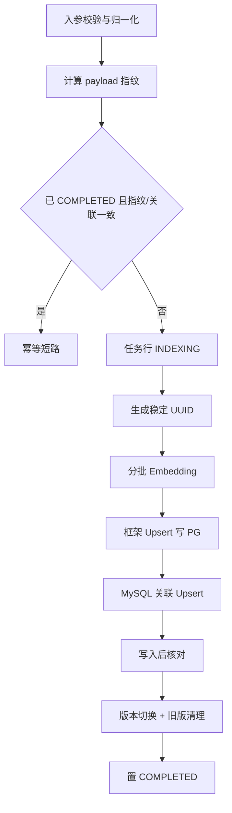

# D31-向量入库更新与幂等技术原理及操作实践指南

> 模块：`D31_VSUAI`，物理包 `com.zl.d31`
> 文档定位：面向复现与运维的技术原理 + 操作实践 + 故障排查指南
> 编写视角：12 年 Java 架构师 + 6 年 AI 工程落地

---

## 一、技术概述

### 1.1 是什么

向量入库幂等，是指文档切分得到 chunks 后，在向量化、持久化、更新、删除、重试、恢复等操作反复执行时，
系统仍保证数据正确：不产生重复行、不丢失旧版本、重试不换 ID、跨系统最终一致。D31 在 Spring AI `PgVectorStore`
之上，补齐稳定 ID、数据库唯一约束、状态机版本切换与核对补偿。

### 1.2 为什么需要它

- 向量写入链路长（切分 → Embedding → PG 写入 → MySQL 关联），任何一步超时/崩溃都可能留下半成品；
- 仅验证「一次写入成功」无法暴露重复、状态机静默失效等问题；
- 生产导入多为批量、可重试任务，幂等是可恢复的前提，而非附加功能。

### 1.3 底层原理要点

- **确定性 ID**：UUID v5 由内容指纹与身份要素经 SHA-1 推导，相同输入恒定输出；
- **数据库级 Upsert**：PG `ON CONFLICT (id) DO UPDATE`、MySQL `ON DUPLICATE KEY UPDATE`，冲突即更新；
- **唯一约束兜底**：DB 约束是并发正确性的最终防线，不依赖 Java 先查后插；
- **先写后切**：新版本确认成功才切换活动指针，旧版本失败不丢；
- **无分布式事务**：各库本地原子，跨系统靠核对补偿最终收敛。

---

## 二、环境准备

### 2.1 前置条件

| 项 | 要求 |
| --- | --- |
| JDK / Maven | JDK 21 / Maven 3.9.16 |
| MySQL | 127.0.0.1:3306，库 ai_db |
| PostgreSQL | 192.168.200.153:5432，库 spring_ai，pgvector 扩展 |
| 向量维度 | 384（唯一基线） |

### 2.2 密码注入（禁止硬编码）

PowerShell 运行测试前在同一命令注入，真实密码不进入 Git：

```powershell
$env:PGVECTOR_DB_PASSWORD='********'
```

未注入时 `PgVectorStoreProperties.validate()` 因密码空白 fail-fast，不静默启动。

### 2.3 初始化 MySQL 表

DDL 文件：`D31_VSUAI/src/main/resources/db/schema-document-vector-index.sql`，对真实 MySQL 执行后，
经 information_schema 核验两张表均 14 列、唯一约束 NON_UNIQUE=0。

---

## 三、稳定 ID 原理与实现

### 3.1 UUID v5 生成规则

名称串：`documentId|version|strategy|chunkIndex|chunkContentHash|splitVersion`，
在固定命名空间下做 SHA-1 并按 RFC4122 拼装，置 version=5、variant=2。

核心代码（`StableChunkIdGenerator`）：

```java
public String generate(Chunk chunk, String chunkContentHash, String splitVersion) {
    String name = String.join("|",
            chunk.getDocumentId(),
            String.valueOf(chunk.getVersion()),
            chunk.getStrategy().name(),
            String.valueOf(chunk.getChunkIndex()),
            chunkContentHash,
            splitVersion);
    return nameUuidV5(NAMESPACE, name).toString();
}
```

### 3.2 为什么 ID 必须是合法 UUID

反编译确认 PgVectorStore 的 `convertIdToPgType` 用 `UUID.fromString`，非法字符串会直接报错；
36 字符标准 UUID 同时满足 MySQL `chunk_id CHAR(36)` 与 PG `id uuid`。

---

## 四、幂等写入执行流程

### 4.1 流程图（Mermaid，Typora 兼容）



### 4.2 框架 Upsert 原文（反编译 spring-ai 1.1.8）

```sql
INSERT INTO d31_vector_store (id, content, metadata, embedding)
VALUES (?, ?, ?::jsonb, ?)
ON CONFLICT (id) DO UPDATE
SET content = ?, metadata = ?::jsonb, embedding = ?;
```

稳定 UUID 冲突时即更新，重复 add 不产生重复行。

### 4.3 主键回写（关键易错点）

自定义 `@Insert` 默认不回写自增主键，会让后续 `updateById` 空转。必须显式声明：

```java
@Options(useGeneratedKeys = true, keyProperty = "id", keyColumn = "id")
@Insert(""" ... ON DUPLICATE KEY UPDATE ... """)
int upsertOnNaturalKey(DocumentVectorIndexPO po);
```

### 4.4 主 JdbcTemplate 隔离

手动定义 `pgVectorJdbcTemplate` 后，Spring Boot 的 JdbcTemplate 自动配置因 `@ConditionalOnMissingBean` 回退，
未限定符的 JdbcTemplate 会被误路由到 PG。需显式补一个绑定 MySQL 的 `@Primary JdbcTemplate`，
保证「未限定即 MySQL」。

---

## 五、版本切换与删除

### 5.1 先写后切（MySQL 本地事务）

```java
@Transactional(rollbackFor = Exception.class)
public void switchVersion(DocumentVectorIndexPO current,
                          List<DocumentVectorIndexPO> olderCompleted,
                          LocalDateTime now) {
    for (DocumentVectorIndexPO older : olderCompleted) {
        older.setStatus(VectorIndexStatus.SUPERSEDED.name());
        indexMapper.updateById(older);
    }
    current.setStatus(VectorIndexStatus.COMPLETED.name());
    indexMapper.updateById(current);
}
```

该事务不含 PG/Embedding 调用，不引入分布式事务。

### 5.2 按文档删除（可重复）

PG `DELETE ... WHERE id=?` 对已不存在的 id 不报错；MySQL 行在 PG 删除成功后于本地事务内清理，
中途失败重试仍然安全。

---

## 六、核对补偿与恢复

### 6.1 四类差异与补偿

| 差异 | 判定 | 补偿 |
| --- | --- | --- |
| 孤儿向量 | PG 有、MySQL 无有效关联 | deleteVectorsByIds |
| 缺失向量 | 关联在、PG 缺 | Outbox 快照重建 |
| 数量不一致 | 关联数 ≠ PG 数 | 分类补偿 |
| 卡住任务 | 超 stuckMinutes 未推进 | recoverStuckTasks |

### 6.2 无快照的处理

写入前崩溃且 `document_chunk_index` 无快照时，置 FAILED、errorCode=NO_SNAPSHOT，
要求重新触发，严禁凭空重建或伪造成功。

### 6.3 定时核对

`VectorIndexSchedulingConfiguration` 仅在 `app.vector-index.reconcile-enabled=true` 时启用，
默认关闭，cron 为每日 02:00；生产按需打开并配告警。

---

## 七、操作实践（HTTP 示例）

### 7.1 直接对 chunks 入库

```bash
curl -X POST http://localhost:8080/api/v1/vector-index/index \
  -H "Content-Type: application/json" \
  -d '{
    "documentId": "doc-demo-001",
    "version": 1,
    "strategy": "STRUCTURE",
    "title": "演示文档",
    "chunks": [
      {"chunkIndex": 0, "content": "向量数据库 pgvector 存储"},
      {"chunkIndex": 1, "content": "java spring 后端 服务"}
    ]
  }'
```

### 7.2 重复执行验证幂等

用相同 body 再发一次，返回 `idempotent=true`，PG 行数不变、ID 集合一致。

### 7.3 删除与核对

```bash
curl -X DELETE http://localhost:8080/api/v1/vector-index/documents/doc-demo-001
curl -X POST   http://localhost:8080/api/v1/vector-index/reconcile \
     -H "Content-Type: application/json" -d '{"dryRun": true}'
```

---

## 八、常见问题与排查

| 现象 | 根因 | 处理 |
| --- | --- | --- |
| 启动报 pgvector.password 必须注入 | 未设 PGVECTOR_DB_PASSWORD | 同命令注入环境变量 |
| 状态一直停在 INDEXING | 自定义 Insert 未回写主键，updateById 空转 | 加 @Options 回写 id |
| MySQL 表 DELETE 报 PG relation 不存在 | 未限定 JdbcTemplate 被路由到 PG | 补 @Primary MySQL JdbcTemplate |
| 重复导入未命中幂等 | 指纹/关联数不一致或状态非 COMPLETED | 核对内容指纹与关联行数 |
| 旧版本向量未清理 | 旧版未置 SUPERSEDED | 检查版本切换事务是否生效 |
| 故障用例没触发 | stub 的方法不在真实调用链 | stub call(EmbeddingRequest)，确认 spy 被 PgVectorStore 持有 |

排查原则：先取完整堆栈与真实库状态，区分直接原因与根因，优先修复根因而非临时绕过。

---

## 九、工程实践清单

1. 任何持久化任务先设计自然键与 DB 唯一约束，再写业务流程；
2. 自定义 Insert 涉及后续按主键更新时，默认检查主键是否回写；
3. 多数据源场景逐一核对每个 JdbcTemplate/事务管理器绑定的数据源；
4. 验收必须覆盖重复、失败、更新、删除、恢复，不能只跑一次 happy path；
5. 故障可 Mock 外部依赖异常，但数据库必须真实，测试后回读验证并清理作用域数据。

---

## 附：记忆简语与层级树

记忆简语：**指纹定 ID，约束防并发，先写后切保更新，可重复删除，快照驱动恢复，核对补偿收敛。**

```text
D31 技术树
├─ 身份层
│  ├─ UUID v5（SHA-1 + 六要素）
│  └─ 自然键 uk_doc_version
├─ 写入层
│  ├─ PG ON CONFLICT
│  ├─ MySQL ON DUPLICATE
│  └─ 主键回写 @Options
├─ 状态层
│  ├─ 状态机 + 阶段
│  ├─ 先写后切
│  └─ 本地事务边界
├─ 恢复层
│  ├─ 卡住扫描/次数上限
│  ├─ 快照重建
│  └─ NO_SNAPSHOT 兜底
└─ 一致性层
   ├─ 四类差异
   ├─ 补偿删除/重建
   └─ 无分布式事务
```
