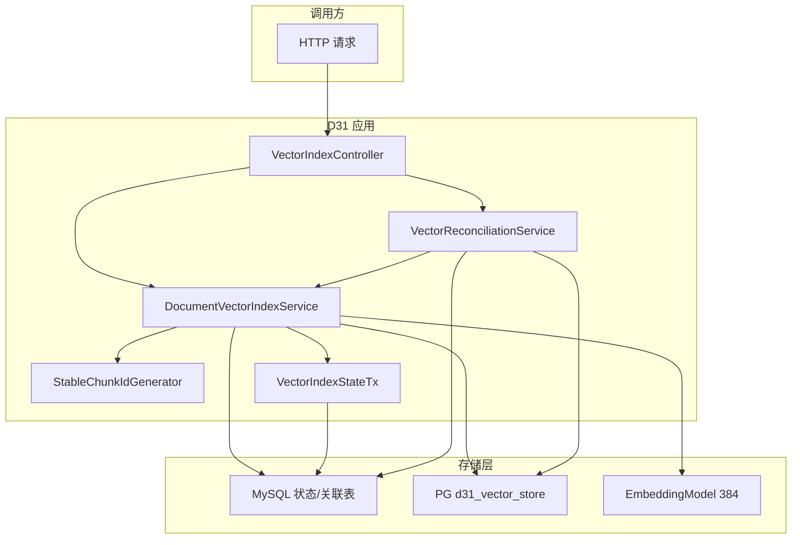
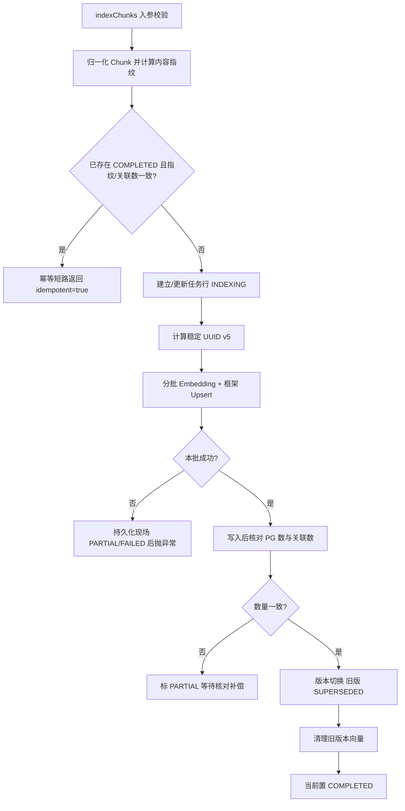

# D31-向量入库更新与幂等项目迭代全量说明

> 迭代名称：Day 31：向量入库、更新与幂等
> 工程模块：`D31_VSUAI`，物理包 `com.zl.d31`
> 文档定位：记录本迭代目标、架构、稳定 ID、幂等、版本切换、删除、恢复与核对补偿的全量交付说明
> 编写视角：12 年 Java 架构师 + 6 年 AI 工程落地

---

## 一、迭代背景与目标

### 1.1 背景

D30 已完成 PostgreSQL + pgvector 接入，向量可真实写入并按余弦相似度检索。但 D30 只验证了「一次写入成功」，
没有解决工程化重复运行下的正确性问题：重复导入会不会产生重复行、文档更新如何切换、失败重试会不会换 ID、
按文档删除是否干净、部分失败后如何恢复、MySQL 与 PG 跨系统不一致如何收敛。D31 正是补齐这部分能力。

### 1.2 核心目标

1. 稳定 document/chunk ID：ID 与来源、标识、顺序、内容指纹、切分版本绑定，失败重试不产生新 ID；
2. 数据库级唯一约束：不能只靠 Java 先查后插，必须用 DB 唯一约束防并发；
3. 重复导入 Upsert 幂等：重复执行不产生重复数据；
4. 文档更新版本切换：先写后切，避免「先删旧、新版本失败全丢」；
5. 按文档删除可重复执行；失败重试与部分失败恢复后数据仍正确；
6. MySQL（原文/状态库）与 PG（向量库）跨系统一致性以核对补偿收敛，不引入分布式事务。

### 1.3 硬边界（明确不做）

- 不引入分布式事务框架，不引入 Milvus/ES/Redis Vector 第二套向量库，不用 PG 替换 MySQL；
- 不 Mock 数据库冒充持久化；可 Mock Embedding 异常但数据库必须真实；
- 字符数 ≠ Token，Page ≠ Chunk，聊天模型 ≠ Embedding；
- 不擅自 git commit/push/reset/clean，不执行破坏性 DROP（旧表对齐待用户拍板）。

---

## 二、需求拆解与验收口径

### 2.1 六种核心场景

| 场景 | 核心问题 | 验收要点 |
| --- | --- | --- |
| 新增 | 首次写入是否正确 | 状态 COMPLETED、行数与 ID 正确 |
| 重复导入 | 重复跑是否产生重复 | 命中幂等、无重复、ID 不变 |
| 更新 | 新旧版本如何切换 | 旧版 SUPERSEDED、新版 COMPLETED、旧向量清理 |
| 删除 | 按文档是否删干净 | 全清且重复删除安全 |
| 失败重试 | 重试是否换 ID | 同 ID 收敛、无重复 |
| 部分失败恢复 | 批中失败后能否收敛 | 恢复后数量齐全、ID 不重复 |

### 2.2 验收口径

采用 PASS/FAIL/BLOCKED/NOT RUN/N/A：失败场景未真实验证不得标 PASS。本迭代六场景在真实数据库上均 **PASS**；
真实 HTTP 端到端上传因旧表冲突标 **BLOCKED**（详见第九章）。

---

## 三、整体架构与职责边界

### 3.1 分层架构

```text
D31_VSUAI
├─ 接入层   VectorIndexController（/api/v1/vector-index）
├─ 编排层   DocumentVectorIndexService（幂等/版本切换/删除/恢复）
│           VectorReconciliationService（跨系统核对补偿）
├─ 支持层   StableChunkIdGenerator / VectorIndexStateTx / VectorIndexException
├─ 数据层   DocumentVectorIndexMapper / DocumentChunkIndexMapper（MySQL）
│           PgVectorStore（PG，框架管理）
└─ 模型层   LocalHashingEmbeddingModel（384 维，真实本地 Embedding）
```

### 3.2 职责边界

| 存储 | 职责 | 访问方式 |
| --- | --- | --- |
| MySQL | 原文/状态/Chunk 关联与 Outbox 快照，权威业务库 | MyBatis-Plus + 主 JdbcTemplate |
| PostgreSQL | 向量本体 vector(384) + HNSW，仅向量存储 | pgVectorJdbcTemplate + PgVectorStore |

两套数据源通过 `@Primary`（MySQL）与 `@Qualifier("pgVectorJdbcTemplate")` 显式隔离。

### 3.3 组件关系图（Mermaid，Typora 兼容）



---

## 四、稳定 ID 与数据模型

### 4.1 稳定 Chunk ID（UUID v5）

`StableChunkIdGenerator` 采用 RFC4122 UUID v5（SHA-1）：

- 固定命名空间 UUID：`0f9f7d52-6b3e-4a1c-9f2d-7c8e5b3a6d41`；
- 名称串：`documentId|version|strategy|chunkIndex|chunkContentHash|splitVersion`；
- 输出 version=5、variant=2 的标准 36 字符 UUID，满足 PG `UUID.fromString` 合法要求。

| 任务书约束 | 设计落点 |
| --- | --- |
| 来源/标识/顺序/指纹/切分版本 | 名称串六要素全部纳入 |
| 失败重试不换 ID | 输入不变 → UUID v5 确定性输出 |
| 不同文档同内容区分 | 名称串含 documentId |
| 切分版本演进 | 名称串含 splitVersion |

### 4.2 两张 MySQL 表

| 表 | 粒度 | 关键唯一约束 |
| --- | --- | --- |
| document_vector_index | 一个文档版本一行（状态机/Outbox 任务） | uk_doc_version(document_id, version) |
| document_chunk_index | 一个 chunk 一行（含 content 快照） | uk_chunk_id(chunk_id)、uk_doc_ver_strat_idx(...) |

`document_chunk_index.content` 为 MEDIUMTEXT，保存 Chunk 文本快照，是缺失向量重建的 Outbox 载荷。

### 4.3 状态机

- 文档级 status：PENDING → INDEXING → COMPLETED；异常分支 PARTIAL/FAILED；旧版本 SUPERSEDED；
- 阶段 stage：SPLIT → EMBED_WRITE → SWITCH → CLEANUP；
- Chunk 行 status：INDEXED/FAILED。

---

## 五、核心编排流程

### 5.1 幂等入库流程（Mermaid）



### 5.2 框架原生 Upsert（不重复造轮子）

反编译 spring-ai 1.1.8 确认写入 SQL：

```sql
INSERT INTO <table> (id, content, metadata, embedding)
VALUES (?, ?, ?::jsonb, ?)
ON CONFLICT (id) DO UPDATE
SET content = ?, metadata = ?::jsonb, embedding = ?;
```

传入确定性 UUID 后，重复 add 即数据库级 Upsert 更新，不产生重复行。删除为 `DELETE ... WHERE id=?`，
重复删除已不存在的 id 不报错。

### 5.3 版本切换：先写后切

新版本向量全部写入并核对通过后，才在 MySQL 本地事务内把旧 COMPLETED 置 SUPERSEDED、当前置 COMPLETED；
随后清理旧版本向量。若新版本在写入阶段失败，旧版本始终保持 COMPLETED，杜绝「先删后失败全丢」。

### 5.4 主键回写缺陷（本轮关键修复）

首次实现中自定义 `@Insert` 未回写自增主键，`task.id` 为空，导致所有 `updateById` 生成
`UPDATE ... WHERE id=NULL` 静默空转，状态停在 INDEXING。修复方式：在 Mapper 方法上加

```java
@Options(useGeneratedKeys = true, keyProperty = "id", keyColumn = "id")
```

该缺陷只在重复/更新/失败场景暴露，单看首次写入无法发现，正是本迭代验收价值所在。

---

## 六、跨系统一致性与核对补偿

### 6.1 四类差异

| 差异 | 判定 | 补偿 |
| --- | --- | --- |
| 孤儿向量 | PG 有、MySQL 无有效关联或任务非活动 | 按稳定 ID 删除 |
| 缺失向量 | 关联存在、PG 无行 | 用 Outbox 快照幂等重建 |
| 数量不一致 | 版本级关联数 ≠ PG 数 | 分类后重建或删除 |
| 卡住任务 | PENDING/INDEXING 超过 stuckMinutes | recoverStuckTasks 恢复 |

### 6.2 恢复策略

- 按 `stuckMinutes`（默认 30）扫描，尊重 `maxAttempts`（默认 5），达上限转人工；
- 有快照则用 `document_chunk_index.content` 幂等重建；无快照置 FAILED（NO_SNAPSHOT），不伪造成功；
- dryRun 只出报告，非 dryRun 才执行补偿，补偿动作复用稳定 ID 与 Upsert，可重复执行。

---

## 七、接口与配置

### 7.1 HTTP 接口（前缀 /api/v1/vector-index）

| 方法 | 路径 | 职责 |
| --- | --- | --- |
| POST | /index | 直接对 chunks 入库 |
| POST | /documents/{id}/index | 从页表切分后入库 |
| DELETE | /documents/{id} | 按文档删除 |
| POST | /reconcile | 核对补偿 |
| POST | /recover | 卡住任务恢复 |
| GET | /documents/{id}/status | 状态查询 |
| GET | /documents/{id}/chunks | 关联查询 |

### 7.2 关键配置

| 配置项 | 默认值 | 说明 |
| --- | --- | --- |
| app.vector-index.default-strategy | STRUCTURE | 默认切分策略 |
| app.vector-index.batch-size | 100 | 分批大小 |
| app.vector-index.max-attempts | 5 | 最大尝试次数 |
| app.vector-index.stuck-minutes | 30 | 卡住判定阈值 |
| app.vector-index.split-version | split-v1 | 切分版本，参与 ID |
| app.vector-index.reconcile-enabled | false | 定时核对默认关闭 |
| app.pgvector.password | 环境变量注入 | 默认空，缺失 fail-fast |

---

## 八、验证与测试

### 8.1 真实结果

```text
mvn clean test
Tests run: 307, Failures: 0, Errors: 0, Skipped: 0
BUILD SUCCESS
```

对比 D30 的 287，本轮新增 20 个测试（集成 11 + 稳定 ID 单元 5 + 配置单元 4），287 + 20 = 307。

### 8.2 故障注入真实性

`@SpyBean EmbeddingModel` 保留真实 384 输出，仅 stub `call(EmbeddingRequest)` 注入异常；
数据库全程真实。部分失败用例真实出现「部分写入」，证明故障发生在真实分批链路而非整体短路。

### 8.3 测试后清洁核验

PG d31_vector_store 总行数 0、d31vi 残留 0；MySQL 两张表 d31vi 残留均 0。

---

## 九、诚实缺口与风险

| 缺口 | 口径 | 说明 |
| --- | --- | --- |
| 真实 HTTP 端到端上传 | BLOCKED | 旧表 knowledge_document/page 为 D25 schema、0 行，与代码冲突待决策 |
| 旧表对齐 | 待拍板 | DROP 重建 / ALTER 迁移 / 不动，确认前不做破坏性操作 |
| 真实远程聊天模型 | NOT RUN | 本迭代不涉及 |
| 扫描件 OCR / 鉴权 | N/A | 仅提示 OCR；X-Dev-User 仅归属标识 |

---

## 十、D32 衔接建议

1. 先就旧表对齐拍板（0 行旧表推荐按模块 DDL 重建，或先 ALTER 非破坏性迁移），打通真实 HTTP 端到端；
2. 生产环境按需打开 reconcile 定时并补告警；
3. 向检索侧 Retriever 与 Agent Workflow 衔接，复用本迭代稳定 ID 与状态机。

---

## 附：记忆简语与层级树

记忆简语：**稳定 ID 靠指纹，重复写入靠约束，更新先写后切，删除可重复，恢复靠快照，一致性靠补偿。**

```text
D31 能力树
├─ 身份
│  ├─ Chunk UUID v5（六要素）
│  └─ 文档/版本自然键
├─ 幂等
│  ├─ 框架 ON CONFLICT Upsert
│  ├─ MySQL 唯一约束
│  └─ 幂等短路
├─ 更新
│  ├─ 先写后切
│  ├─ SUPERSEDED 状态
│  └─ 旧版清理
├─ 删除
│  └─ 可重复、按 ID
├─ 恢复
│  ├─ 卡住扫描
│  ├─ 快照重建
│  └─ 次数上限
└─ 一致性
   ├─ 四类差异
   ├─ 补偿删除/重建
   └─ 无分布式事务
```
