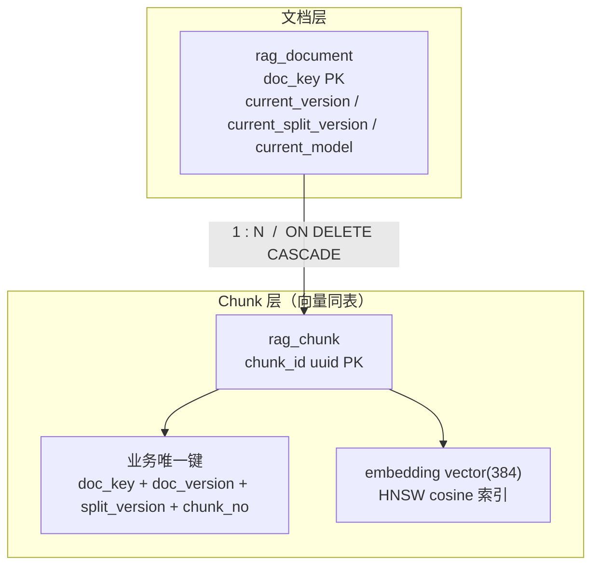
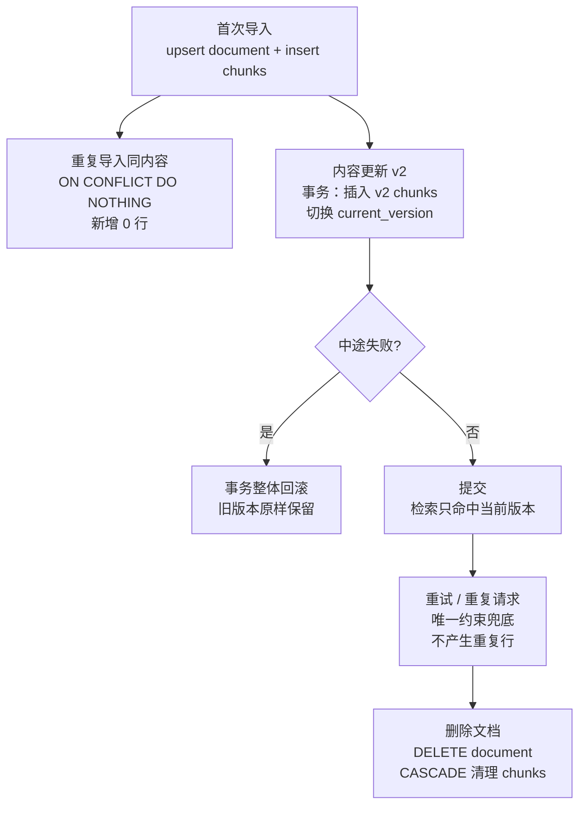

# D31 知识笔记：向量入库、更新与幂等

> 技术基线：JDK 21 / Spring Boot 3.5.16 / Spring AI 1.1.8 / PostgreSQL 18.7 / pgvector 0.8.7
> 向量维度：384（本地 `local-hashing-384`，对齐 `bge-small-zh` 口径）
> 度量：余弦距离 `<=>`；索引：HNSW（`vector_cosine_ops`）
>
> 口径标记：【官方】= Spring AI / PostgreSQL / pgvector 官方文档；【实测】= D30 已在真实环境跑通的事实（可复用）；【原理】= 机制解释；【结论】= 工程判断；【待执行】= 本次受环境限制未跑、附可复跑脚本的验证项，不编造数字。

---

## 1. 核心概念：这一节到底要解决什么

【结论】RAG 入库链路最容易被低估的不是"怎么把向量写进去"，而是**同一篇文档被重复导入、内容更新、任务重试、删除之后，数据库里仍然只有一套正确的有效数据**。错误写法的典型结果：

- 同一篇手册导入 3 次，检索出来 9 份近似 Chunk；
- 手册改版后，旧版本和新版本的 Chunk 同时参与检索，回答引用了已作废条款；
- 删除文档后，向量表里留下一批"查得到内容、找不到来源"的孤儿行；
- 任务失败重试一次，`document` 写了两遍、`chunk` 写了一半，状态永远卡在 PROCESSING。

【原理】这类问题的根因是：**应用层的"先查再插"不是原子的**。两个并发请求都查不到记录，就都会插入。幂等的唯一可靠落点是**数据库约束 + 单事务**，不是业务代码里的 `if (exists) update else insert`。

---

## 2. Insert / Update / Upsert 与幂等

### 2.1 三种写法的本质区别

| 写法 | 语义 | 并发安全性 | 典型问题 |
|---|---|---|---|
| `INSERT` | 有就报错（主键/唯一冲突） | 安全（失败可重试） | 重复请求直接 23505 错误 |
| `UPDATE` | 没有记录时影响 0 行，不报错 | 安全但静默空转 | 新人不知道"没更新"是因为没数据 |
| `INSERT ... ON CONFLICT ...`（UPSERT） | 有冲突时转向更新或什么都不做 | **数据库级原子** | 冲突目标必须有唯一约束/唯一索引兜底 |

【官方】PostgreSQL 的 `ON CONFLICT` 有两种用法：

- `ON CONFLICT (列) DO NOTHING`：冲突就跳过，不报错；
- `ON CONFLICT (列) DO UPDATE SET ...`：冲突就更新该行（可引用 `EXCLUDED` 表示试图写入的新值）。

【原理】`ON CONFLICT` 的工作前提：**冲突列必须有唯一索引/主键**。PostgreSQL 在插入时做唯一性检查，发现冲突后按声明的分支处理；整个过程在单条语句内完成，不存在"两个事务同时查到空"的窗口。它不是"先 SELECT 再 INSERT"的语法糖，而是真正的原子写。

### 2.2 为什么不能靠业务代码判重

```java
// 反例：典型的非幂等写法
if (!chunkMapper.exists(docKey, version, chunkNo)) {
    chunkMapper.insert(...);   // 两个请求同时走到这里 → 插入两行
}
```

【原理】`exists` 和 `insert` 是两条语句、两个时刻。并发下两个事务都可能读到"不存在"，然后双双插入。即使加了应用锁（单机 `synchronized`），多实例部署时锁失效。**数据库唯一约束是最后一道、也是唯一一道不依赖部署形态的防线。**

【实测】D30 已经真实踩过这个坑：在 `chunk_demo` 上做"幂等 upsert"演示时，因为主键是 `gen_random_uuid()` 随机值，`ON CONFLICT (chunk_id) DO NOTHING` 对"同一文档同一片段"完全无效——同一次导入插出了 **2 行**；改成在业务键 `(doc_id, chunk_no)` 上建唯一约束后，两次写入最终只剩 **1 行**。（证据：D30 `evidence/d30_dml_output.log`）

【结论】幂等设计的第一原则：**唯一约束建在"业务身份"上，而不是代理主键上**。

### 2.3 重复请求与任务重试

【结论】消息队列重投、前端重复点击、定时任务补偿——这些都是"同一个逻辑操作执行多次"。幂等的要求是：**执行 N 次的效果 = 执行 1 次**。实现组合：

1. 业务唯一键保证数据层不重复；
2. 导入任务表记录 `task_id`，状态机 `PENDING → PROCESSING → SUCCESS / FAILED`；
3. 重试时同一个 `task_id` 第二次进来直接走 `ON CONFLICT DO NOTHING`，不重复生成 chunk。

---

## 3. RAG 数据标识：Document / Chunk / Vector / Version

### 3.1 五种身份各管什么

| 身份 | 定义 | 谁生成 | 稳定性 |
|---|---|---|---|
| Document Key（业务文档身份） | 一篇原始文档的稳定标识，如 `mp500-qg` | 业务侧（文件路径/物料编码） | 长期稳定，跨版本不变 |
| Document Version | 文档内容版本号，v1/v2/v3 | 内容变了才 +1 | 随内容演进 |
| Split Version（切分策略版本） | 切分算法/参数版本，如 `fixed-500-overlap-100` | 工程侧 | 切分策略改了才 +1 |
| Chunk No | 片段在文档内的序号 | 切分器 | 同一版切分下稳定 |
| Embedding Model | 生成向量的模型及版本，如 `local-hashing-384` | 工程侧 | 换模型/升级才变 |

【原理】为什么要把"文档版本 / 切分版本 / 模型版本"**拆成三个字段**，而不是一个 `updated_at` 时间戳？因为三者的变更原因和重算范围不同：

- 文档内容变了 → 只换 chunk 文本和文档版本；
- 切分策略变了 → 文本可能和上次几乎一样，但 chunk 边界变了，必须按新切分版本整体重建；
- Embedding 模型换了 → 文本一字不改，也要把**整张表**的向量全部重算（不同模型向量空间互不兼容）。

【结论】一个 `updated_at` 表达不了"这次是内容变了还是模型换了"，而这决定了重算范围。

### 3.2 Chunk 与 Vector：同表还是分表

【结论】两种都成立，按规模选：

- **同表**（`rag_chunk.embedding vector(384)`）：小中型知识库首选，一次查询同时拿到文本和向量，事务天然一致。本项目设备手册量级就走这个。
- **分表**（元数据在业务库，向量在专用库）：规模到千万级、需要独立伸缩向量库时才拆；代价是跨库事务消失，要靠 Outbox/对账补偿（§6.3）。

【原理】关键认知：**Chunk ID 和 Vector ID 不是同一个东西，也不天然同生命周期**。即使在同一张表里，`chunk_id`（uuid 主键）是物理行标识，业务身份却是 `(doc_key, doc_version, split_version, chunk_no)`。向量只是 Chunk 的一个列。

### 3.3 数据关系图



---

## 4. 数据模型示例（DDL，可复跑）

完整脚本见 `sql/d31_lifecycle_verify.sql`，核心 DDL：

```sql
CREATE TABLE d31_life.rag_document (
    doc_key               text PRIMARY KEY,
    title                 text    NOT NULL,
    current_version       integer NOT NULL,
    current_split_version integer NOT NULL,
    current_model         text    NOT NULL,
    current_sha           text    NOT NULL,          -- 当前内容 SHA-256
    status                text    NOT NULL DEFAULT 'ACTIVE',
    updated_at            timestamptz NOT NULL DEFAULT now()
);

CREATE TABLE d31_life.rag_chunk (
    chunk_id        uuid PRIMARY KEY DEFAULT gen_random_uuid(),
    doc_key         text    NOT NULL
                    REFERENCES d31_life.rag_document(doc_key) ON DELETE CASCADE,
    doc_version     integer NOT NULL,
    split_version   integer NOT NULL,
    chunk_no        integer NOT NULL,
    content         text    NOT NULL,
    content_sha     text    NOT NULL,
    embedding       vector(384) NOT NULL,
    model           text    NOT NULL,
    UNIQUE (doc_key, doc_version, split_version, chunk_no)
);

CREATE INDEX idx_rag_chunk_hnsw
    ON d31_life.rag_chunk USING hnsw (embedding vector_cosine_ops);
```

【结论】几个设计要点：

1. **`doc_key` 直接当主键**：业务身份即主键，不再套一层 `id bigint`；
2. **外键 `ON DELETE CASCADE`**：删文档自动带走全部 chunk 和向量，杜绝孤儿；
3. **`UNIQUE (doc_key, doc_version, split_version, chunk_no)`**：幂等的物理基础；
4. **`model` 列**：每个向量记录它是哪个模型生成的，换模型时能按它圈定"待重算"数据；
5. **`vector(384)` 带维度**：数据库层强制维度，不允许 384/1536 混存（【实测】D30 已验证插 383/385 维直接报 `ERROR: expected 384 dimensions, not 383`）。

### 4.1 稳定 Chunk ID 怎么来

【结论】不建议让应用层给 chunk 随机 uuid 后再存——那样同一篇文档重切一次，chunk_id 全变，无法做"新旧 chunk 对齐"。稳定 chunk 身份由四元组决定：

```
chunk_biz_id = hash(doc_key + doc_version + split_version + chunk_no)
```

DB 侧 uuid 主键只做物理行标识；业务对账、幂等都走四元组。

---

## 5. 幂等入库与版本更新流程

### 5.1 生命周期全景



### 5.2 首次导入（单事务）

```sql
BEGIN;
INSERT INTO d31_life.rag_document(doc_key, title, current_version, current_split_version, current_model, current_sha)
VALUES ('mp500-qg', 'PIXMA MP500 快速指南', 1, 1, 'local-hashing-384', :sha)
ON CONFLICT (doc_key) DO UPDATE
   SET current_sha = EXCLUDED.current_sha, updated_at = now();

INSERT INTO d31_life.rag_chunk(doc_key, doc_version, split_version, chunk_no, content, content_sha, embedding, model)
VALUES (:biz_chunks)
ON CONFLICT (doc_key, doc_version, split_version, chunk_no) DO NOTHING;
COMMIT;
```

【结论】一个事务包三件事：登记文档版本、写 chunk、写向量。任何一步失败，整组数据不留半成品。

### 5.3 重复导入：为什么 `DO NOTHING` 就够了

同一篇文档重复导，业务四元组完全相同 → 全部命中唯一冲突 → `DO NOTHING` 跳过。**不需要先查 SHA 判断"内容变没变"，重复导入天然是 no-op。**

### 5.4 内容更新到 v2：旧版本怎么处理

【结论】两种策略，按场景选：

| 策略 | 做法 | 优点 | 风险 |
|---|---|---|---|
| **保留历史**（推荐） | v2 chunk 入库，`rag_document.current_version` 切到 2；v1 行保留 | 可回滚、可审计、新旧对比 | 表略大，旧行占向量空间 |
| **物理替换** | 同事务 `DELETE` v1 chunks 再插 v2 | 表最干净 | 出错时旧版本也没了 |

【原理】检索只认"当前版本"的关键是查询条件写死：

```sql
SELECT c.chunk_no, c.content, c.embedding <=> :query_vec AS distance
FROM d31_life.rag_chunk c
JOIN d31_life.rag_document d ON d.doc_key = c.doc_key
WHERE c.doc_key = :doc_key
  AND c.doc_version = d.current_version      -- 只检索当前有效版本
ORDER BY distance LIMIT :k;
```

【结论】v1 的行留在库里但**永远进不了检索结果**，这样即使 v2 有问题，把 `current_version` 改回 1 就完成回滚。这比"删了重导"安全得多。

### 5.5 更新失败的恢复语义

【原理】因为 v2 的写入和指针切换在同一个事务里：

- 向量写失败 → 事务回滚 → v1 纹丝不动，文档继续对外可用；
- 指针切换前进程崩溃 → 事务回滚 → v2 chunks 没落库（或被下次对账标记），v1 继续服务。

【结论】**"旧版本始终可用"是事务天然给的，不需要额外的双写切换逻辑。**

---

## 6. 删除与数据一致性

### 6.1 删除一个文档要碰哪些对象

【结论】一次删除至少涉及：文档记录、chunk 文本、向量列、（分表场景下）独立向量库记录、HNSW 索引条目、可能的缓存。单库同表场景下，一条 `DELETE FROM rag_document WHERE doc_key=?` 靠外键级联全部解决。

### 6.2 四种删除策略

| 策略 | 行为 | 适用 |
|---|---|---|
| 物理删除 + 级联 | `DELETE document` → chunk 自动删除 | 学习/实验库、合规要求真删除 |
| 软删除 | `status='DELETED'`，查询过滤 | 需要审计、可恢复 |
| 事务删除 | 同事务删文档+chunk+索引维护 | 生产默认 |
| 后台清理 | 软删后定时任务物理删 | 大表、删除吞吐敏感 |

【实测】D30 的 DML 实验已验证级联语义方向：`chunk_demo` 里 `DELETE ... WHERE doc_id=?` 后对应行归零，复核总量回到基线。本设计把这层语义显式写进了外键 `ON DELETE CASCADE`。

### 6.3 原文库与向量库分离时怎么办

【原理】一旦元数据在 MySQL、向量在 pgvector（或 Milvus），**一个数据库事务管不住两边**。此时需要最终一致性方案：

- **Outbox 模式**：业务事务里同时写"待同步事件"到 outbox 表，独立进程把事件投递到向量库；
- **补偿/对账任务**：定时比对"业务库有 chunk 但向量库缺向量"、"向量库有行但业务库已删"；
- **软删除 + 延迟清理**：先在业务库标记删除，向量库延迟批量删，期间查询加过滤条件兜住。

【结论】本项目当前是单库（PG 同时存元数据和向量），事务直接管；只有未来拆库时才需要这套补偿机制。笔记先把接口预留好。

---

## 7. Embedding 维度与模型兼容

### 7.1 三方对齐

| 环节 | 值 | 校验 |
|---|---|---|
| Embedding 模型输出 | 384 维 | 【实测】D30 `LocalHashingEmbeddingModel.dimensions()` 返回 384 |
| 数据库列定义 | `vector(384)` | 【实测】`format_type` 返回 `vector(384)` |
| Spring AI `PgVectorStore` 配置 | `.dimensions(384)` | 【官方】Builder 显式指定；模型维度与配置不一致会在建表期直接抛错 |

【实测】D30 配置里这三者是**启动期强校验**：`modelDimensions != dimensions` 时直接 `IllegalStateException("EmbeddingModel 维度与配置维度不一致...禁止创建向量表")`。这是对的做法——维度错位在启动时炸，不要等写数据才炸。

### 7.2 为什么换模型必须全量重算

【原理】不同模型的向量空间是两套坐标系。A 模型输出的 `[0.1, ...]` 和 B 模型输出的 `[0.1, ...]` 在几何上毫无关系，即使维度都是 384。新旧向量混检 = 在同一坐标系里画两套不相干的点，相似度排序无意义。

【结论】换模型的安全迁移步骤：

1. 新模型 `local-hashing-v2-384` 写入**新列或新表**；
2. 后台批量重算全部 chunk；
3. 对账通过后，把 `rag_document.current_model` 切到新模型；
4. 检索查询同时加 `c.model = d.current_model` 过滤；
5. 旧向量确认无引用后再删。

【原理】这也是为什么 chunk 表里必须有 `model` 列——没有它，你根本圈不出"哪些向量是旧模型生成的"。

---

## 8. 重复导入与数据污染：故障清单

【结论】七种典型污染与防线：

| 污染 | 成因 | 防线 |
|---|---|---|
| 重复 Chunk / 重复向量 | 重复导入、任务重试 | 业务唯一键 + `DO NOTHING` |
| 同一文档不同 Chunk ID | 每次重切随机生成 id | 稳定四元组，不用随机 id |
| 新旧版本同时被检索 | 检索没按 `current_version` 过滤 | 查询条件硬编码版本join |
| 删除后孤儿向量 | 只删了文档表 | 外键 `ON DELETE CASCADE` |
| Metadata 与向量不一致 | 改了文本没改向量 | 更新事务里文本+向量一起换 |
| 部分写入失败 | 多步不在一个事务 | 文档+chunk+向量单事务 |
| 并发导入状态覆盖 | 任务状态无唯一约束 | task 表唯一键 + 状态机 |

【原理】对应地，**对账查询**是日常巡检工具（脚本 §H）：

- 孤儿 chunk：`chunk LEFT JOIN document WHERE document IS NULL`；
- 重复业务键：`GROUP BY 四元组 HAVING count(*)>1`；
- 当前版本漂移：`document.current_version` 在 chunk 表里查不到对应行。

---

## 9. 待真实环境执行的验证清单

【待执行】本次受 Windows 开发环境离线限制，以下 8 项未跑通真实输出；脚本 `sql/d31_lifecycle_verify.sql` 已就绪，环境恢复后执行并把输出存 `evidence/`。**下列"期望"是设计预期，不是已测结果。**

| # | 场景 | 期望结果（设计值） |
|---|---|---|
| A | 首次导入 v1（3 chunk） | `rag_chunk` 3 行 |
| B | 同 v1 重复导入 | 仍 3 行，新增 0 |
| C | 更新到 v2 | v1=3（历史）、v2=3（当前），检索只命中 v2 |
| D | 事务中途 `SELECT 1/0` | 整体回滚，`broken-doc` 0 行 |
| E | 手工重复业务键插入 | `duplicate key value violates unique constraint` |
| F | 删除 `mp500-qg` | document / chunk 都 0 行（级联） |
| G | 插入 `[1,2,3]` | `expected 384 dimensions, not 3` |
| H | 三项对账 | orphan=0、duplicate=0、mismatch=0 |

【待执行】另外一组对照实验值得跑：Spring AI `VectorStore.add()` 对**同一文本调用两次**，观察 `d30_vector_store` 行数变化。

【原理】【官方】Spring AI 的 `PgVectorStore.add(List<Document>)` 在客户端为每个 `Document` 生成 UUID 主键后直接 `INSERT`，**没有 upsert 语义**。这意味着框架层是 append-only——这正是 D31 要在业务表上自己做幂等的根本原因。D30 集成测试里也是靠 `DELETE WHERE metadata->>'testRun'=marker` 做清理，反证了框架表本身不去重。

---

## 10. 常见故障与排查

| 现象 | 可能原因 | 排查 |
|---|---|---|
| 重复导入后行数翻倍 | 唯一约束建在了 uuid 主键而不是业务键 | `\d rag_chunk` 看 UNIQUE 列 |
| 报 `duplicate key value` | 并发重试撞了唯一键 | 正常现象，业务侧当幂等成功处理 |
| 报 `expected 384 dimensions, not N` | 模型输出/列定义/配置三方不一致 | 对齐模型 `.dimensions()`、列 typmod、Builder |
| 更新后还检索到旧内容 | 查询没按 `current_version` 过滤 | 检查 SQL join 条件 |
| 删除文档后向量还在 | 没走外键，或分库后只删了一边 | 对账查 orphan |
| 任务永远 PROCESSING | 写库失败但状态没回滚 | 事务边界是否包住状态更新 |
| HNSW 索引不生效 | 排序运算符与 opclass 不匹配 | `<=>` 必须配 `vector_cosine_ops`（D30 已实测对照：错配时 0.209ms→1.122ms） |

---

## 11. 核心结论（验收要点）

1. **幂等的物理基础是业务唯一键 + `ON CONFLICT`，不是应用层 `exists-then-insert`。**
2. **文档版本 / 切分版本 / 模型版本三列分立**，因为重算范围不同。
3. **检索永远绑定 `current_version` + `current_model`**，历史版本留库但不参与排序。
4. **删除靠外键 `ON DELETE CASCADE`**，单库事务兜底；拆库才需要 Outbox/对账。
5. **维度三方对齐要在启动期就强校验**，不要等到写数据。
6. **Spring AI `VectorStore` 是 append-only**，幂等与版本切换是业务层职责。

---

## 附录：官方参考资料

- PostgreSQL INSERT (ON CONFLICT) | PostgreSQL 插入与冲突处理：[https://www.postgresql.org/docs/18/sql-insert.html](https://www.postgresql.org/docs/18/sql-insert.html)
- PostgreSQL Constraints | PostgreSQL 唯一约束与外键约束：[https://www.postgresql.org/docs/18/ddl-constraints.html](https://www.postgresql.org/docs/18/ddl-constraints.html)
- pgvector | pgvector 向量类型与 HNSW 索引：[https://github.com/pgvector/pgvector](https://github.com/pgvector/pgvector)
- Spring AI PgVectorStore | Spring AI PostgreSQL 向量存储配置：[https://docs.spring.io/spring-ai/reference/api/vectordbs/pgvector.html](https://docs.spring.io/spring-ai/reference/api/vectordbs/pgvector.html)
- Spring AI Embeddings | Spring AI 嵌入模型抽象：[https://docs.spring.io/spring-ai/reference/api/embeddings.html](https://docs.spring.io/spring-ai/reference/api/embeddings.html)

> （注：部分内容由豆包 AI 生成）