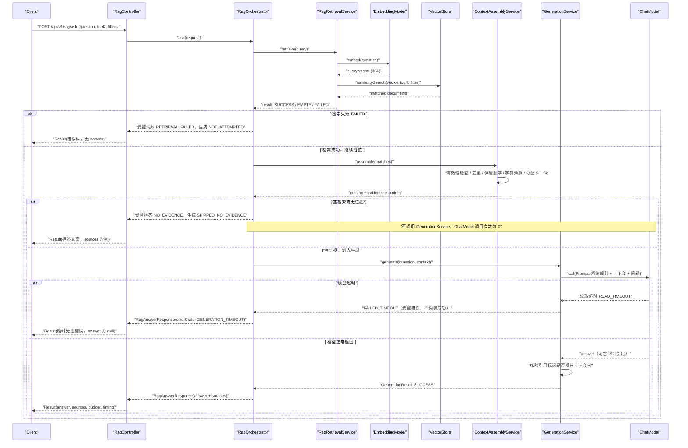

# D33 最小 RAG 闭环时序图

> 参与方：Client、RagController、RagOrchestrator、RagRetrievalService、EmbeddingModel、
> VectorStore、ContextAssemblyService、GenerationService、ChatModel。
> 含三条关键分支：检索失败短路、空检索/无证据跳过模型、模型超时受控失败。
> Typora 兼容标准 Mermaid sequenceDiagram 语法。

