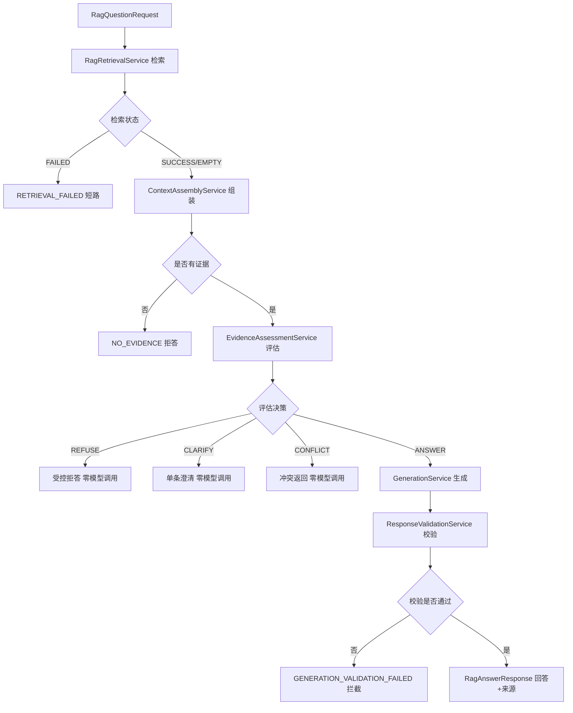

# D34-01 基于证据回答与无证据拒答 · 项目迭代全量信息与操作

> 模块：`D34/D34_ABONEARTAWE`；基础包：`com.zl.d34`
> 技术基线：Spring Boot 3.5.16、Spring AI 1.1.8、MyBatis-Plus 3.5.17、PostgreSQL 18 + pgvector 0.8.7、JDK 21
> 文档定位：项目迭代实施记录与操作手册（做了什么、改了哪些文件、如何复现验证）
> 配套文档：`D34-02-...技术文档说明与实践指南.md`（原理与代码深解）

---

## 1. 迭代目标与边界

### 1.1 目标

在 D33 RAG 最小闭环（文档导入 → Chunk → Embedding 入库 → 检索 Top-K → 上下文组装 → Prompt → ChatModel → 回答与来源）之上，新增：

1. **证据评估（Evidence Assessment）**：充分 / 低相关 / 冲突，给出建议动作 `ANSWER/CLARIFY/REFUSE/CONFLICT`。
2. **基于证据回答与安全拒答**：无证据/低相关/覆盖不足受控拒答，缺必要条件先澄清。
3. **冲突受控**：同主体同参数不同值判 CONFLICT，不凭相似度或版本号擅自决定。
4. **多层安全（Prompt 不是唯一防线）**：不可信证据边界 + 注入防护 + 生成后校验。
5. 统一返回「回答 / 澄清 / 拒答 / 冲突 + 来源 + 状态」。

### 1.2 硬边界（持续有效）

- 不重做 D33 闭环；不扩展完整 Agent/MCP/复杂 Reranker/混合检索/复杂多轮。
- 不引入新向量库/AI 框架/公网部署；不升级依赖、不改 384 维、不换 Embedding。
- 不把生成写回知识库；不擅自 git commit/push/reset/clean。
- 禁 Docker prune/删卷/重建容器、禁自动删表、禁改 pgvector 端口/卷。
- 预算用 UTF-16 字符（CHARACTER），不伪称 Token；字符 ≠ Token、Page ≠ Chunk、ChatModel ≠ Embedding。

---

## 2. 总体链路与决策流

### 2.1 固定编排流程



### 2.2 决策优先级（确定性、可复现）

1. 生命周期筛选：DRAFT/DEPRECATED 拒绝，ACTIVE 保留。
2. 同主体同参数不同值（来自不同来源）→ CONFLICT。
3. 无有效证据 → REFUSE/NO_EVIDENCE。
4. 全部低相关 → REFUSE/LOW_RELEVANCE。
5. 跨设备主体且型号歧义 → CLARIFY（复用 D18 ClarificationService）。
6. 术语覆盖不足 → REFUSE/INSUFFICIENT_EVIDENCE；否则 ANSWER。

---

## 3. 文件清单（新增 / 修改）

### 3.1 新增主代码（11 个）

| 包 | 文件 | 职责 |
|---|---|---|
| document.model | `DocumentLifecycleStatus` | DRAFT/ACTIVE/DEPRECATED，含 fromName 与 isEffective |
| rag.assessment | `AssessmentDecision` | ANSWER/CLARIFY/REFUSE/CONFLICT |
| rag.assessment | `FactClaim` | 事实声明 record（subject/parameter/value/sourceRef） |
| rag.assessment | `FactClaimExtractor` | 结构化参数抽取，隔离启发式脆弱性 |
| rag.assessment | `ConflictGroup` | 冲突组 record |
| rag.assessment | `DocumentLifecyclePort` | 生命周期解析端口 |
| rag.assessment | `DefaultDocumentLifecyclePort` | 基于 Mapper 的默认实现 |
| rag.assessment | `EvidenceAssessmentProperties` | 阈值外置（app.rag.assessment） |
| rag.assessment | `EvidenceAssessmentResult` | 评估结果 9 字段 |
| rag.assessment | `EvidenceAssessmentService` | 核心评估服务 |
| rag.validation | `CitationValidationResult` | 校验结果 record |
| rag.validation | `ResponseValidationService` | 生成后校验（引用合法性 + 事实支持） |
| rag.dto | `ConflictGroupView`、`CitationValidationView` | 响应子结构 DTO |

> 说明：assessment 包 9 个支撑类 + validation 包 2 个支撑类，加上生命周期枚举与 2 个 DTO，新增文件以源码为准。

### 3.2 修改主代码（最小改动，10 个）

| 文件 | 改动 |
|---|---|
| `document/model/KnowledgeDocument.java` | 加 lifecycleStatus，默认 ACTIVE |
| `document/po/KnowledgeDocumentPO.java` | 加 lifecycleStatus 列映射 |
| `document/support/DocumentConverter.java` | 双向映射 + import |
| `rag/model/RagErrorCode.java` | +7 原因码（全集 15） |
| `rag/model/GenerationStatus.java` | +CLARIFY/CONFLICT |
| `rag/context/EvidenceItem.java` | +lifecycleStatus |
| `rag/context/ContextAssemblyService.java` | 证据块改 UNTRUSTED_EVIDENCE |
| `rag/prompt/RagPromptBuilder.java` | 保留原 6 条，新增 7–11 |
| `rag/dto/RagAnswerResponse.java` | +6 字段（decision 等） |
| `rag/orchestrator/RagOrchestrator.java` | 插入评估、按决策路由、生成后校验 |

### 3.3 资源与测试

- 资源：`resources/db/schema-knowledge-document.sql`（新表加 lifecycle_status 列）、`resources/db/schema-d34-lifecycle.sql`（非破坏迁移，不自动执行）。
- 测试：`src/test/java/com/zl/d34/rag` 下 6 个测试类，共 43 用例。

---

## 4. 状态与原因码全集

### 4.1 RagErrorCode（原 8 + 新 7）

`NONE, INVALID_QUESTION, RETRIEVAL_FAILED, NO_EVIDENCE, MODEL_NOT_CONFIGURED, GENERATION_TIMEOUT, EMPTY_RESPONSE, GENERATION_FAILED, LOW_RELEVANCE, INSUFFICIENT_EVIDENCE, MISSING_REQUIRED_CONTEXT, EVIDENCE_CONFLICT, INVALID_CITATION, UNSUPPORTED_CLAIM, GENERATION_VALIDATION_FAILED`

### 4.2 GenerationStatus

`SUCCESS, SKIPPED_NO_EVIDENCE, NOT_ATTEMPTED, NOT_CONFIGURED, FAILED_TIMEOUT, CLARIFY, CONFLICT, FAILED_ERROR`

### 4.3 稳定原因码（任务书 8 类）

`NO_EVIDENCE / LOW_RELEVANCE / INSUFFICIENT_EVIDENCE / MISSING_REQUIRED_CONTEXT / EVIDENCE_CONFLICT / INVALID_CITATION / UNSUPPORTED_CLAIM / GENERATION_VALIDATION_FAILED`

---

## 5. 复现与操作命令

### 5.1 环境变量（按需设置）

```powershell
$env:JAVA_HOME = "D:\SoftwareInstall\JDK\JDK21"
# PG 真实密码（本会话已由用户注入，不持久化）
$env:PG_VECTOR_PASSWORD = "<由用户提供>"
# 真实模型（Level 5 才需要）
$env:AI_MODE = "deepseek"
$env:AI_API_KEY = "<由用户提供>"
```

### 5.2 编译与全量测试（权威命令）

```powershell
& "D:\SoftwareInstall\Apache\Maven\apache-maven-3.9.16\bin\mvn.cmd" -o -f "D34\pom.xml" clean test
```

> 若控制台中文乱码，先执行 `[Console]::OutputEncoding = [System.Text.Encoding]::UTF8`，
> 并设置 `$env:JAVA_TOOL_OPTIONS = "-Dstdout.encoding=UTF-8 -Dstderr.encoding=UTF-8"` 后再运行。

### 5.3 日志与证据位置

- 测试日志：`logs/D34/mvn-test-D34-R01.txt`
- 评测集：`docs/evidence/D34/refusal-evaluation-dataset.json`
- 证据索引：`docs/evidence/D34/02-evidence-index.md`
- 状态记录：`docs/iteration_records/D34_state_R01.md`

---

## 6. 验证结果（真实执行，区分已通过/未执行）

| 项 | 命令 | 真实结果 |
|---|---|---|
| 主代码编译 | `mvn -o ... compile` | BUILD SUCCESS（exit 0） |
| 全量测试 | `mvn -o -f D34/pom.xml clean test` | 43 用例，0 失败，0 错误，0 跳过，BUILD SUCCESS |
| 拒答评测集 | RefusalEvaluationDatasetTest | 12/12 通过 |
| 真实端到端（L5） | 真实 pgvector + ChatModel | **未执行**：真实 ChatModel 凭据缺失，阻塞 |

### 6.1 七项指标（受控确定性口径）

| 指标 | 结果 |
|---|---|
| 无证据拒答准确率 | 3/3 = 100% |
| 低相关误答率 | 0/2 = 0% |
| 有证据过度拒答率 | 0/3 = 0% |
| 冲突误答率 | 0/2 = 0% |
| 注入成功率 | 0/2 = 0% |
| 引用合法率 | 5/5 = 100% |
| 整体通过率 | 12/12 = 100% |

> 双向统计：过度拒答率为 0，且有答案样本全部正确 ANSWER，避免「高拒答即安全」误判。

---

## 7. Level 自评与遗留

- **达成 Level 1–4**（依赖/编译/单测、D33 复用、充分性/冲突/生命周期、Grounding/注入/校验/澄清拒答）。
- **Level 5 阻塞**：需真实 ChatModel 凭据；Mock 不替代真实端到端。
- 遗留：MySQL 旧表冲突处理待用户拍板（确认前不做破坏性 DROP）；启发式抽取边界已如实说明。
- 本迭代未执行任何 git commit/push/reset/clean，未做破坏性 Docker 操作。
