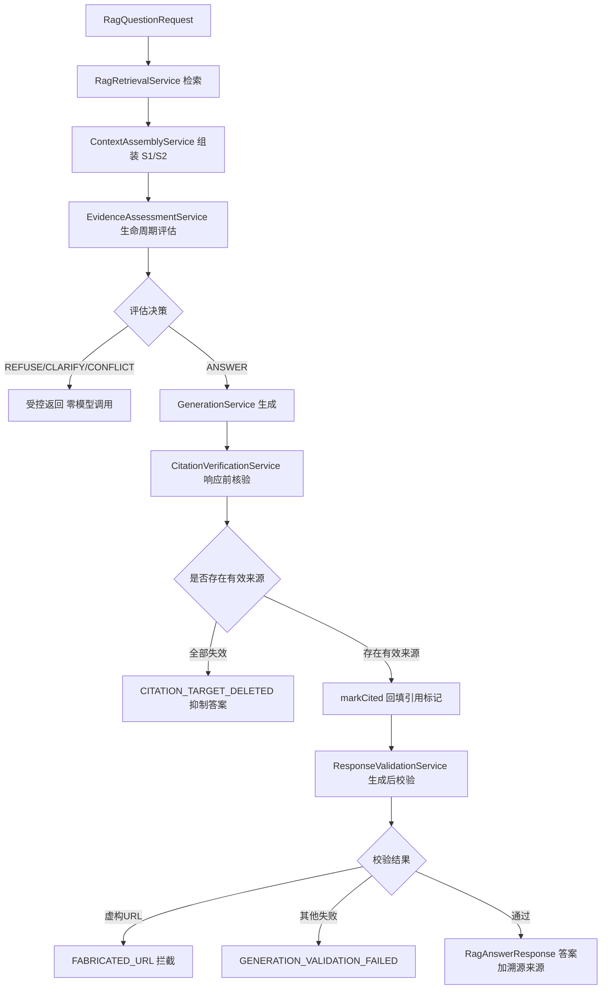

# D35-01 引用溯源与返回契约 · 项目迭代全量信息与操作

> 模块：`D35/D35_RTARC`；基础包：`com.zl.d35`
> 技术基线：JDK 21、Spring Boot 3.5.16、Spring AI 1.1.8、MyBatis-Plus、PostgreSQL + pgvector、JUnit5 + Mockito
> 文档定位：项目迭代实施记录与操作手册（做了什么、改了哪些文件、如何复现验证）
> 配套文档：`D35-02-引用溯源与返回契约-技术文档说明与实践指南.md`（原理与代码深解）

---

## 1. 迭代目标与边界

### 1.1 目标

在 D33 检索/组装闭环、D34 证据评估与安全拒答之上，建立**可回溯、不可伪造的引用返回契约**：

1. 回答统一返回 `sourceId`、标题、页码/段落、引用片段等溯源字段。
2. **引用元数据只能来自本轮真实检索结果与权威持久化数据**；模型只能生成引用标记（`[Sx]`），不能创造来源、页码、片段、URL。
3. 落地五项硬增量：前端安全渲染、SSE 与同步 API 一致性、URL 协议黑名单、稳定 `sourceId` 与请求级 `citationId` 区分、删除竞态与批量核验。
4. 从 `src/test` 零 Java 类建立测试体系，并做真实回归。

### 1.2 硬边界（持续有效）

- 不重做 D33 检索/组装、D34 评估/拒答；不引入 Reranker、混合检索、Agent、MCP、复杂多轮。
- 不新建 HTTP 端点、不改公共方法既有签名（仅加字段，向后兼容）。
- 不改 384 维 / COSINE / HNSW / Embedding / VectorStore / Top-K；不升级依赖、不引 actuator。
- 不把生成写回知识库；不把 Mock/Fixture 带入生产；删除测试仅隔离 fixture，不删真实文档/历史向量。
- 不擅自 git commit/push/reset/clean；密钥仅环境变量注入，禁入 PATH。
- 字符 ≠ Token、Page ≠ Chunk、ChatModel ≠ Embedding。

---

## 2. 引用返回契约

### 2.1 字段语义与来源

| 字段 | 含义 | 数据来源 | 缺失处理 |
| --- | --- | --- | --- |
| `sourceId` | 稳定来源标识，映射 `documentId` | 持久化文档 ID | 不缺失 |
| `citationId` | 请求级引用编号，等同 `sourceRef`（S1/S2…） | 本轮组装顺序分配 | 不缺失 |
| `documentId` / `chunkId` | 跨请求稳定标识（`chunkId` 为 UUID v5） | 持久化 | 不缺失 |
| `page` | 物理页，从 1 开始 | 切分 `ChunkSource.pageNumber` | `null` 隐藏，禁止推断 |
| `lastPage` | 跨页 Chunk 末页，可选 | 多来源页码 | `null` 隐藏 |
| `paragraphIndex` | 段落索引，从 0 开始 | `ChunkSource.paragraphIndex` | `null` 隐藏 |
| `quotedSnippet` | 真实内容截取片段，默认 ≤200 UTF-16 | `SnippetExtractor` 从真实 content 截取 | 不补造 |
| `cited` | 是否在回答中被引用，默认 false | 响应前核验后标记 | 布尔 |
| `similarity` / `distance` | 检索分数，可空 | 检索结果 | 可 `null` |
| `url` | 可信外链 | 经安全策略解析 | 当前恒 `null`，NON_NULL 隐藏 |

### 2.2 稳定标识与请求级标识的区分

- **稳定标识（跨请求不变）**：`sourceId=documentId`、`documentId`、`chunkId`（UUID v5 由内容指纹确定性生成）。
- **请求级标识（仅本次有效）**：`citationId=sourceRef`，按本轮组装顺序从 S1 起分配；不同请求的 S1 可能指向不同文档，**禁止跨请求缓存或复用**。
- 统一 `@JsonInclude(NON_NULL)`：不输出空串、占位符或假页码；禁止用 `chunkIndex` 推页码、用标题/`documentId` 拼 URL。

### 2.3 两道独立关口

1. **生成前生命周期关口**（D34 已建）：`EvidenceAssessmentService` 对 DRAFT/DEPRECATED 拒绝、LOOKUP_FAILED fail-closed。
2. **响应前批量核验关口**（本迭代新增）：`CitationVerificationService` 覆盖检索/生成期间的删除竞态，全部来源失效则抑制答案并受控失败。

---

## 3. 五项硬增量

### 3.1 前端安全渲染

- 移除全量源码中唯一的 `innerHTML` 赋值（清空列表改为 `replaceChildren`）。
- 服务端文本一律 `createElement` / `textContent` / `createTextNode`，无 HTML 解析面。
- 引用片段优先 `quotedSnippet`，缺失回退 `excerpt`；仅 `isSafeUrl(item.url)` 为真才创建外链锚点，且 `target=_blank`、`rel=noopener noreferrer`。

### 3.2 SSE 与同步 API 一致性

- 流式 `CitationDto` 与同步 `RagSourceView` 字段语义对齐：`sourceId`、`citationId`、`quotedSnippet`、`cited` 等一致。
- `CitationDto` 扩展为 13 组件并保留旧 9 参构造；`CitationRegistry` 经安全策略清洗 URL，`citedCitations` 与 `allCitations` 区分。

### 3.3 URL 协议黑名单

- 仅 `http/https` 可过校验；拒绝 `javascript/data/file/ftp`、localhost、未授权内网/环回、本机绝对路径、非 HTTP(S)、模型/用户拼接 URL。
- 前端校验仅作补充，不替代服务端。

### 3.4 稳定 sourceId 与请求级 citationId 区分

见 2.2；契约上二者命名空间不同，禁止混用或用请求级编号充当稳定主键。

### 3.5 删除竞态与批量核验

- 响应前对 `documentId`、`chunkId` 各执行一次批量 IN 查询（经 `KnowledgeDocumentMapper`、`DocumentChunkIndexMapper`），避免 N+1。
- 分类：文档/Chunk 不存在 → `CITATION_TARGET_DELETED`；生命周期非 ACTIVE → `EVIDENCE_NOT_EFFECTIVE`。
- 有效来源才 `markCited`；全部失效则抑制答案。

---

## 4. 总体链路



---

## 5. 修改文件清单

### 5.1 新增（`com.zl.d35.rag.citation`）

- `UrlSafetyPolicy`：静态 URL 安全策略，仅放行 http/https，不安全返回 `null`，含 `isDangerous`。
- `SnippetExtractor`：真实内容确定性截取，UTF-16 代理对安全，长度不超上限，末尾省略号。
- `CitationVerificationService`：批量 IN 核验、删除/失效分类、`markCited`、`resolveUrl`。

### 5.2 修改（相对模块路径）

- `rag/model/RagErrorCode.java`：末尾追加 4 个原因码。
- `rag/config/RagProperties.java`：新增 `quotedSnippetMaxChars=200`。
- `document/vectorindex/service/DocumentVectorIndexService.java`：`buildMetadata` 补真实 page/lastPage/paragraphIndex（仅非空）。
- `document/retrieval/dto/SimilarityMatchView.java`：新增 3 字段并从 metadata 读取。
- `rag/context/EvidenceItem.java`：新增 page/lastPage/paragraphIndex/quotedSnippet/cited。
- `rag/context/ContextAssemblyService.java`：定位映射 + 片段截取。
- `rag/dto/RagSourceView.java`：类级 NON_NULL + 溯源字段。
- `rag/dto/RagAnswerResponse.java`：新增 `citationNotes`。
- `rag/orchestrator/RagOrchestrator.java`：6 依赖，响应前核验/全失效受控失败/`markCited`/URL 恒 null/`FABRICATED_URL` 分支。
- `rag/validation/ResponseValidationService.java`：新增危险单冒号协议与虚构 URL 检测。
- `rag/validation/CitationValidationResult.java`、`rag/dto/CitationValidationView.java`：新增 `fabricatedUrls`，保留旧构造。
- `dto/CitationDto.java`：13 组件 + 旧 9 参构造。
- `knowledge/CitationRegistry.java`：URL 清洗、cited 语义。
- `document/vectorindex/service/VectorReconciliationService.java`：新增 `pageMetadataCoverage` 非破坏覆盖率统计。
- `rag/prompt/RagPromptBuilder.java`：强化禁造 URL/片段。
- `src/main/resources/static/js/app.js`：`replaceChildren` + `isSafeUrl` + 引用渲染增强 + CommonJS 测试导出。

### 5.3 原因码（共 20，本迭代新增 4）

新增：`CITATION_TARGET_DELETED`、`PAGE_LOCATION_MISSING`、`FABRICATED_URL`、`EVIDENCE_NOT_EFFECTIVE`。

---

## 6. 存量数据与回填

- `DocumentChunkIndexPO` 无 page 列，旧向量 page 无法靠 chunk 行还原；新入库带 page，旧向量 page 保持 `null`。
- 回填路径：**重走入库管线**重新索引，不做破坏性变更。
- 覆盖率经 `VectorReconciliationService.pageMetadataCoverage()`（totalVectors、vectorsWithPage、missingPageIds、coverageRatio）非破坏统计并记录。

---

## 7. 测试体系与真实回归

### 7.1 测试构成

- 8 个可执行测试类、36 个用例；2 个真实守卫类（默认跳过 7 项）；1 个 Node 前端测试（6 项）。
- 真实守卫：`D35_REAL_INFRA=true` 启用基础设施测试（零模型调用）；`D35_REAL_CHATMODEL=true` 且 `AI_MODE=deepseek` 启用真实 ChatModel 测试（严格最小调用）。

### 7.2 真实回归结果（离线）

最终 `clean test`：

```text
Tests run: 43, Failures: 0, Errors: 0, Skipped: 7
BUILD SUCCESS
```

Node 前端测试：6 项全绿。

### 7.3 过程中修复的真实缺陷

- `ResponseValidationService` 原 URL 正则只认 `://`，会漏 `javascript:alert(1)`；新增危险单冒号形态拦截。
- 前端 `isSafeUrl` 未剥离端口，`localhost:8080` 可绕过；修复为先得主机名再判定，并覆盖 IPv6 方括号。

---

## 8. 评测数据集与指标

### 8.1 数据集

`docs/evidence/D35/citation-evaluation-dataset.json`：14 条（D35-001…014），覆盖伪造引用、删除文档引用、页码缺失、多来源及 SSE/前端一致性；`actual/passed/failureReason` 建集时保持 `null`，真实执行后回填。

### 8.2 七项指标（分母为 0 标 N/A）

1. 引用合法率 = 合法引用数 / 引用总数。
2. 伪造拦截率 = 被拦截伪造数 / 伪造尝试总数。
3. 悬空引用率 = 指向已删除/失效目标的引用数 / 引用总数。
4. 页码可溯源率 = 带真实页码来源数 / 应带页码来源数。
5. 片段一致率 = 片段与真实内容一致数 / 片段总数。
6. 危险协议/虚构 URL 泄漏数（目标 0）。
7. 整体通过率 = 通过用例数 / 用例总数。

---

## 9. 复现操作（占位符路径）

```powershell
# 1. 环境（路径按本机实际，占位符替换）
$env:JAVA_HOME = "<软件安装目录>\JDK21"
$env:PATH = "$env:JAVA_HOME\bin;$env:PATH"
$mvn = "<软件安装目录>\Maven\<版本>\bin\mvn.cmd"
$pom = "<仓库根>\D35\D35_RTARC\pom.xml"

# 2. 离线编译
& $mvn -o -f $pom clean compile

# 3. 离线全量测试（真实守卫默认跳过）
& $mvn -o -f $pom clean test

# 4. 前端 Node 测试
node "<仓库根>\D35\D35_RTARC\src\test\frontend\front-end-safety.test.js"

# 5. 真实端到端（按需，独立开关）
$env:D35_REAL_INFRA = "true"          # 真实基础设施，零模型调用
$env:AI_MODE = "deepseek"; $env:D35_REAL_CHATMODEL = "true"  # 真实 ChatModel，最小调用
```

> 凭据仅经环境变量/程序实参注入，禁止硬编码或提交 Git；`MYSQL_PASSWORD` 本地默认弱口令仅用于本地开发，不适用生产。

---

## 10. 风险与遗留

1. 真实端到端本轮默认跳过，需在守卫开关打开后执行并回填数据集；Mock 不替代真实端到端。
2. 存量旧向量 page 为 `null`，回填需重走入库管线，覆盖率以非破坏统计记录。
3. 当前 URL 恒 `null`；未来若引入可信外链，须经安全策略加入白名单后才允许返回。
4. 未执行 Git commit/push（用户未授权）。
