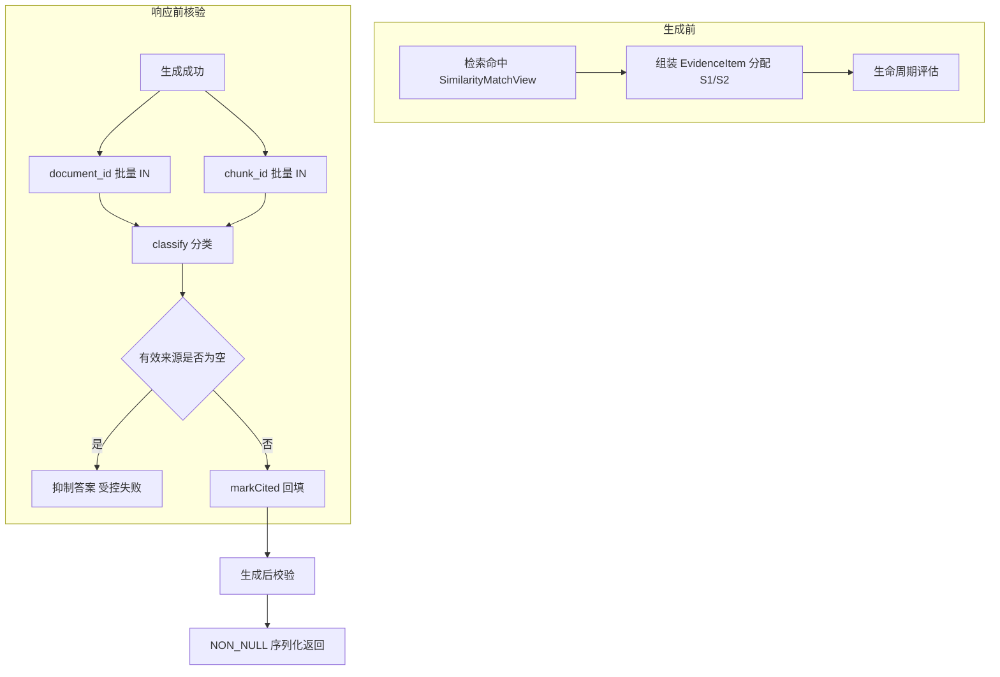

# D35-02 引用溯源与返回契约 · 技术文档说明与实践指南

> 模块：`D35/D35_RTARC`；基础包：`com.zl.d35`
> 文档定位：原理深解、核心代码、配置与实践指南（与 `D35-01-...全量信息与操作.md` 配套）

---

## 1. 是什么

引用溯源（Citation Traceability）要求：**回答中每一个可被引用的来源，都能确定性地回溯到本轮真实检索命中的一个文档/片段，并携带稳定标识、物理位置与真实片段**。返回契约（Response Contract）则统一这些字段的命名、口径与序列化规则。

核心原则一句话：

> 引用元数据只来自本轮真实检索与权威持久化；模型只能生成引用标记，不能创造来源、页码、片段、URL；缺失如实缺失，不补造。

## 2. 为什么需要

1. **模型幻觉**：大模型可能生成看似合理但不存在的来源编号、URL 或参数；若直接返回，用户无法核验。
2. **悬空引用**：检索命中后、响应返回前，文档可能被删除或废弃，导致引用指向空目标。
3. **删除竞态窗口**：检索与生成之间存在时间差，单靠生成前评估无法覆盖期间变更。
4. **前端 XSS 面**：不可信内容若经 `innerHTML` 渲染，或 `javascript:` 链接被渲染成锚点，会形成脚本执行面。
5. **双通道一致性**：SSE 流式与同步 API 若字段语义不一致，前端与下游会出现不可预期的差异。

## 3. 底层原理与组件职责

### 3.1 组件分层

| 组件 | 类型 | 职责 | 边界 |
| --- | --- | --- | --- |
| `UrlSafetyPolicy` | 静态工具 | 协议白名单、主机/路径校验 | 不发起网络请求，失败 fail-closed |
| `SnippetExtractor` | 静态工具 | 从真实内容截取片段，代理对安全 | 不生成新文本，模型不参与 |
| `CitationVerificationService` | Spring 服务 | 响应前批量核验、分类、`markCited`、URL 解析 | 只认权威持久化，两条 IN 查询 |
| `RagOrchestrator` | 编排器 | 在生成成功后插入响应前核验，全失效受控失败 | 不改变既有检索/评估骨架 |
| `CitationRegistry` | 前端引用注册表 | 标记清洗、cited 语义、URL 清洗 | 浏览器侧补充，不替代后端 |

### 3.2 两道独立关口

- **生成前关口**：`EvidenceAssessmentService` 处理证据充分性与生命周期（DRAFT/DEPRECATED 拒绝、LOOKUP_FAILED fail-closed）。
- **响应前关口**：`CitationVerificationService.verify` 以权威持久化数据为准，覆盖删除竞态。二者关注点不同，不能互相替代。

### 3.3 稳定标识与请求级标识

- 稳定：`sourceId=documentId`、`chunkId`（UUID v5，由内容指纹确定性生成）。
- 请求级：`citationId=sourceRef`，本轮从 S1 起顺序分配；其生命周期仅限本次请求。

## 4. 执行流程



## 5. 核心代码解读

### 5.1 URL 安全：白名单 + fail-closed

`UrlSafetyPolicy.sanitize` 先拒绝本机绝对路径，再用 `URI` 解析；协议不在 http/https 白名单、主机为空、或主机被判定为环回/内网/无法解析时，一律返回 `null`：

```java
String scheme = uri.getScheme();
if (scheme == null || !ALLOWED_SCHEMES.contains(scheme.toLowerCase(Locale.ROOT))) {
    return null;
}
if (isLocalOrPrivateHost(host)) {
    return null; // 含无法解析主机名时的 fail-closed 分支
}
return candidate;
```

### 5.2 片段截取：代理对安全

`SnippetExtractor` 预留省略号位置后，若切点正好落在高代理项上则回退，避免产生孤立代理：

```java
int cut = maxChars - 1;
if (Character.isHighSurrogate(trimmed.charAt(cut - 1))
        && Character.isLowSurrogate(trimmed.charAt(cut))) {
    cut--;
}
return trimmed.substring(0, cut) + ELLIPSIS;
```

### 5.3 响应前核验：两条 IN 查询，无 N+1

`loadDocuments` 与 `loadChunks` 各收集去重 ID 后执行一次 `IN` 查询；`classify` 按“文档存在 → Chunk 存在 → 生命周期有效”顺序判定：

```java
if (doc == null) {
    return RagErrorCode.CITATION_TARGET_DELETED;
}
if (item.getChunkId() == null || !existingChunkIds.contains(item.getChunkId())) {
    return RagErrorCode.CITATION_TARGET_DELETED;
}
if (!DocumentLifecycleStatus.fromName(doc.getLifecycleStatus()).isEffective()) {
    return RagErrorCode.EVIDENCE_NOT_EFFECTIVE;
}
return RagErrorCode.NONE;
```

`markCited` 仅在已核验有效的来源上，按回答中真实出现的 `[Sx]` 标记回填 `cited`，因此标记由模型生成、但 cited 真值由后端权威确定。

### 5.4 前端安全渲染

`app.js` 清空列表使用 `replaceChildren`，全量源码无 `innerHTML` 赋值；`isSafeUrl` 先剥离端口再判定主机名，仅安全 URL 才创建锚点并强制 `rel='noopener noreferrer'`。

## 6. 配置项

| 配置（前缀 `app.rag`） | 默认 | 说明 |
| --- | --- | --- |
| `quoted-snippet-max-chars` | 200 | 引用片段 UTF-16 上限（含省略号） |
| `context-budget-chars` | 6000 | 上下文预算，字符口径 |
| `default-top-k` | 5 | 默认检索数量 |

真实守卫开关（默认不设置即跳过）：`D35_REAL_INFRA`、`D35_REAL_CHATMODEL`；真实生成还需会话内 `AI_MODE=deepseek`。凭据仅经环境变量注入，禁止硬编码。

## 7. 常见问题与失败模式

1. **`javascript:alert(1)` 漏检**：只匹配 `://` 的正则会漏单冒号形态；已增加危险单冒号协议拦截。
2. **`localhost:8080` 绕过**：未剥离端口会使主机名比较失效；已先得主机名再判定。
3. **把 `chunkIndex` 当页码**：二者口径不同（页码物理从 1、Chunk 索引从 0），禁止互推。
4. **旧向量无 page**：保持 `null` 并由覆盖率统计记录，回填需重走入库管线，不做魔法还原。
5. **字符当 Token**：预算与片段均为 UTF-16 字符口径，不伪称 Token。

## 8. 工程实践与官方溯源

- 默认全部 `@JsonInclude(NON_NULL)`，null 字段直接隐藏，前端不依赖占位符。
- 前端校验只作纵深防御补充，权威判定始终在服务端。
- 真实端到端用独立环境变量守卫，Mock 不替代真实链路；真实 ChatModel 严格最小调用。

参考资料（中英对应）：

1. 《OWASP Cross Site Scripting Prevention Cheat Sheet | OWASP 跨站脚本防护备忘单》：https://cheatsheetseries.owasp.org/cheatsheets/Cross_Site_Scripting_Prevention_Cheat_Sheet.html
2. 《OWASP Top 10 | OWASP 十大 Web 安全风险》：https://owasp.org/Top10/
3. 《Spring Framework Reference | Spring Framework 参考文档》：https://docs.spring.io/spring-framework/reference/
4. 《Spring AI Reference Documentation | Spring AI 参考文档》：https://docs.spring.io/spring-ai/reference/
5. 《MDN: The Anchor element | MDN：锚点元素与 rel=noopener》：https://developer.mozilla.org/en-US/docs/Web/HTML/Element/a
