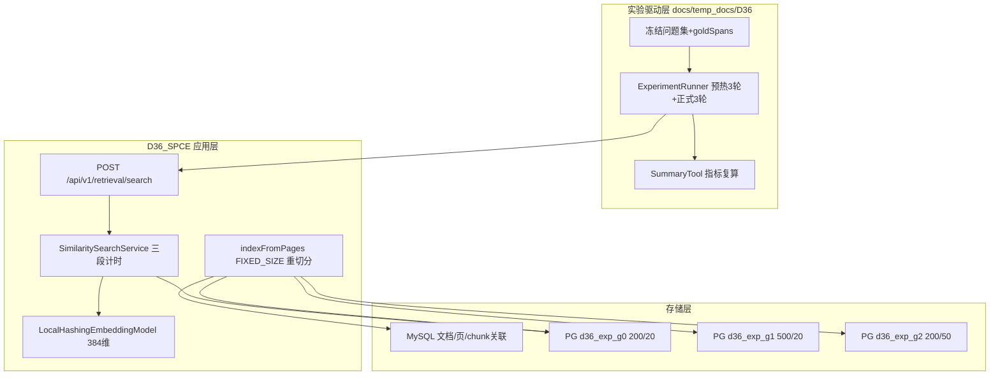

# D36-02-检索参数对照实验-技术文档说明与实践指南

> 视角：12 年 Java 架构师 + 6 年 AI 工程落地。本文回答"为什么这么做、下次怎么用"，与 D36-01（做了什么、怎么复现）配套。

## 一、概述

检索参数调优的本质是**受控实验**而非主观试错：固定数据与模型，单变量扰动，用可复算指标刻画因果。本迭代在 Spring AI 1.1.8 + pgvector 0.8.7 真实链路上建立了可重复的实验方法，并暴露了本地哈希 Embedding 的分数语义边界。

## 二、架构与实验链路

## 三、核心原理

### 3.1 两类变量的工程成本不对称

- **切分类（chunkSize/overlap）**：改变 Chunk 边界与稳定 chunkId（UUID v5），必须重切分→重 Embedding→重入库。`vectorSpaceId` 仅由 provider/model/version/dimensions 构成，**不含切分参数**，故隔离必须落在表/collection 维度（本实验用 `PGVECTOR_TABLE` 注入独立表，读写同表天然闭环）。
- **查询类（Top-K/threshold）**：同一索引上多次查询即可，零重建成本。实验拓扑据此设计为 3 次启动覆盖 9 组。

### 3.2 指标口径（分母 0 标 N/A，禁止伪装）

| 指标 | 公式 | 要点 |
|---|---|---|
| HitRate@K | 命中≥1 相关文档的可回答问题数 / 可回答问题数 | 用户原始口径即此项，非标准 Recall |
| Recall@K（Macro） | 单问=被 Top-K 覆盖的 goldSpan 数/该问 goldSpan 总数；再对可回答问题取均值 | UNANSWERABLE 不混入 |
| Precision@K | 相关 chunk 数 / 实际返回数 | 返回 0 → N/A + EMPTY_RETRIEVAL |
| 噪声占比 | 1 − Precision | 空检索 N/A |
| 三段耗时 | Embedding 段 / VectorStore 段 / 总段 | 禁混生成、SSE、渲染；报均值/P50/P95/min/max |

**重切分场景的相关性判定**：chunkId 随切分变化，不能按 ID 匹配。本实验用**证据片段覆盖率**：chunk 与 goldSpan 摘录归一化（去空白/标点）后的最长公共子串长度 / 摘录长度 ≥ 0.5 判相关——对边界切分鲁棒（半包含≈0.5），且完全确定性、可从原始记录复算。

### 3.3 阈值地板效应（本次最重要发现）

本地哈希 Embedding 的 COSINE 分数是词面重叠的代理，非语义概率：本语料可回答问题 Top1 实测 0.2408–0.5015，无答案问题 Top1=0.2144。"通用阈值 0.25"恰好落在有效分数带内 → 误杀 Q001（0.2499，差 0.0001）与 Q005。**阈值必须按模型+语料的实测分数分布校准**，数据给出的安全窗口为 (0.2144, 0.2408]。换神经 Embedding 后分布整体右移且更陡峭，窗口必须重测。

### 3.4 粒度-召回权衡

chunkSize 200→500：整篇文档成为单 chunk，主题混合稀释目标信号（Q004 伺服过载漏召回），Recall 0.7778→0.6667；但返回 chunk 总数 5→3，单 chunk 覆盖更多证据，Precision 0.2383→0.3333。**大 chunk 省索引、利粗粒度；小 chunk 利细粒度召回**——与理论一致，且本次有真实数据支撑。

## 四、实验纪律（可迁移清单）

1. 双基线分离：真实运行配置（CURRENT_RUNTIME_BASELINE）与指定受控基准（G0）分开记录，未知标 null。
2. 数据先冻结：问题集/语料/标注先于任何检索运行定稿并 SHA-256 入 Git；禁止看结果反改标注。
3. 单变量控制：每组仅一个变量偏离所属基准；阈值地板出现时增设平行矩阵而非偷改原矩阵。
4. 预热 3 轮不纳入 + 正式 ≥3 轮 + 固定顺序；本次 3 轮结果完全一致（错误计数均为 3 的倍数）验证了确定性。
5. 原始记录 jsonl 全量落盘，汇总一律复算；空检索/误检/漏召回逐条留痕（111 条）。
6. 四态（PASS/FAIL/BLOCKED/NOT RUN）+ Level 1–5；Mock 不冒充真实端到端。

## 五、配置速查

| 项 | 键/环境变量 | 本次值 |
|---|---|---|
| 切分 | app.ai.chunk.chunk-size / CHUNK_SIZE；chunk-overlap / CHUNK_OVERLAP | 200/20、500/20、200/50 |
| 向量表隔离 | PGVECTOR_TABLE | d36_exp_g0/g1/g2 |
| PG 口令 | PGVECTOR_DB_PASSWORD（会话桥接自 PG_VECTOR_PASSWORD，缺失 fail-fast） | 不持久化 |
| 检索 | topK 1..20；threshold 0..1（similarity 方向，非 distance） | 见矩阵 |
| 切分策略 | indexFromPages?strategy=FIXED_SIZE（默认 STRUCTURE 不吃 chunkSize/overlap） | 显式 FIXED_SIZE |

## 六、排障指南（本次真实踩坑）

| 症状 | 根因 | 处置 |
|---|---|---|
| indexFromPages 报 NO_PAGES | txt/md 导入原实现只校验不写页表（页表链路 PDF 专属） | handleText 最小增量写单页；已导入文档需清/hash 去重记录后重导 |
| COUNT_MISMATCH 写入后核对不一致 | 跨切分配置复用同一 MySQL 文档，旧 chunk 关联行数≠新 chunk 数 | 组间清理本实验关联行（CleanupChunkRows）；生产多配置并存应扩展关联键含 collection 维度 |
| 阈值组全空检索 | 阈值高于模型分数区间（地板效应） | 先 threshold=0 冒烟看真实分数分布，再校准；保留原矩阵留痕 |
| 中文控制台乱码 | Windows GBK 控制台 | `[Console]::OutputEncoding=UTF8` + java `-Dfile.encoding=UTF-8` |

## 七、边界与下次怎么用

- 本结论仅限冻结的本地哈希模型/3 文档语料/10 问；Top-K 与 overlap 的"无效应"是小库产物（K=10 超库存 5），大库须重测。
- 迁移到神经 Embedding 的步骤：换模型→重建全部索引（vectorSpaceId 变化自动隔离）→重跑 threshold=0 冒烟→按新分数分布重标定阈值→复用本套 Runner/SummaryTool（相关性规则与指标口径不变）。
- 扩展方向（本次未做）：Reranker、混合检索、大库 P99 压测、并发负载、标注多人一致性校验。

## 八、官方文档溯源

- Spring AI Reference - PGvector Vector Store | Spring AI 参考-PGvector 向量存储：https://docs.spring.io/spring-ai/reference/api/vectordbs/pgvector.html
- Spring AI Reference - Vector Databases | Spring AI 参考-向量数据库：https://docs.spring.io/spring-ai/reference/api/vectordbs.html
- Spring AI Reference - Embedding Model API | Spring AI 参考-Embedding 模型 API：https://docs.spring.io/spring-ai/reference/api/embeddings.html
- pgvector - Open-source vector similarity search for Postgres | pgvector-PostgreSQL 开源向量相似度搜索：https://github.com/pgvector/pgvector
