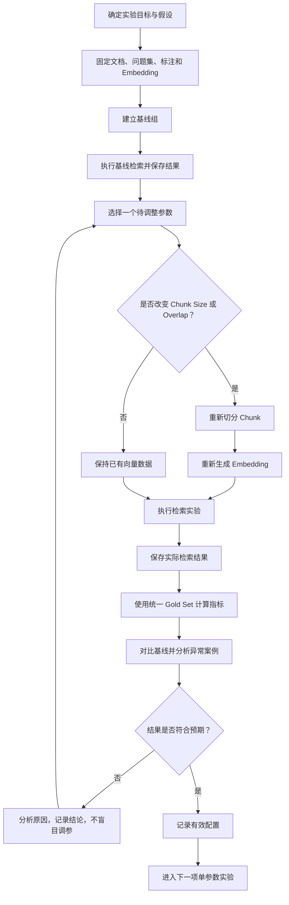

# M3 知识笔记：RAG 检索参数影响与实验控制变量

> **技术基线**：JDK 21 / Spring Boot 3.5.16 / Spring AI 1.1.8 / PostgreSQL 18.7 / pgvector 0.8.7  
> **学习目标**：理解 Chunk Size、Overlap、Top-K、Similarity Threshold 的影响，掌握检索参数的控制变量实验。  
> **核心原则**：固定数据、固定模型、固定评价标准，每轮只改变一个参数。  
> **实验状态**：本文提供实验方案、指标公式、记录模板和演示计算。由于尚未提供本轮实际评测数据及运行日志，本文不声称已经完成真实实验，也不预设哪组参数效果最好。

---

## 一、先建立整体认识：RAG 检索到底在优化什么？

假设用户向设备知识库提出问题：

> 设备运行过程中出现 E17 报警，同时电机温度异常，应该如何排查？

知识库中可能有以下内容：

| Chunk | 内容概述                     | 与问题的相关性 |
| ----- | ---------------------------- | -------------- |
| C001  | E17 报警代码的定义和触发条件 | 高             |
| C002  | 电机温度异常的判断标准       | 高             |
| C003  | E17 报警的排查步骤           | 高             |
| C004  | 设备日常保养说明             | 低             |
| C005  | 电机安装结构介绍             | 中低           |

检索系统的任务不是随便找出五段文字，而是：

1. 找到能够回答问题的证据。
2. 尽量不要漏掉重要证据。
3. 尽量不要返回无关内容。
4. 让重要证据排在更靠前的位置。
5. 控制传入后续模型的上下文规模。

这五个目标并不总是一致。

例如：

- Top-K 从 3 增大到 10，可能找回更多相关 Chunk，但同时引入更多噪声。
- Chunk Size 从 200 增大到 800，可能让上下文更完整，也可能把多个主题混在一个 Chunk 中。
- Threshold 从 0.5 提高到 0.8，可能过滤低相关结果，也可能把真正有用的证据过滤掉。

因此，检索优化不是寻找最大的参数，而是寻找符合业务要求的参数组合。

### 1.1 检索实验的基本流程

```text
原始文档
   |
   v
文档解析
   |
   v
Chunk 切分
   |  Chunk Size / Overlap
   v
Embedding
   |
   v
PostgreSQL + pgvector
   |
   v
用户问题
   |
   v
Query Embedding
   |
   v
向量相似度检索
   |  Top-K / Similarity Threshold
   v
检索结果
   |
   v
与人工标注的标准相关性比较
   |
   v
计算 Recall / Precision / HitRate / MRR / nDCG
   |
   v
分析实验结果
```

**本阶段重点：只评价检索结果，不评价生成模型最终回答是否优秀。**

例如，检索阶段已经漏掉了正确的维修步骤，后续模型再强也无法从不存在的上下文中可靠地引用该步骤。

---

## 二、四个检索参数的原理与影响

## 2.1 Chunk Size：每个文本块有多大？

Chunk Size 是切分文档时，每个 Chunk 允许包含的文本规模。

例如，一份设备维修手册有 10,000 个 Token：

- Chunk Size = 200：切成较多的小块。
- Chunk Size = 500：切成中等大小的块。
- Chunk Size = 800：切成较少的大块。

这里必须先明确单位：

- 200 Tokens：以 Token 数量为单位。
- 200 Characters：以字符数为单位。

两者不是一回事。实验记录必须写清楚，不能将字符数实验和 Token 数实验放到一起比较。

### Chunk Size 较小时

优势：

- 检索粒度细。
- 单个 Chunk 的主题通常更集中。
- 进入上下文的无关内容可能更少。
- 更容易精确定位具体参数、报警代码和操作步骤。

劣势：

- 完整语义可能被拆散。
- 原因、条件、处理步骤可能分布在不同 Chunk。
- 单独一个 Chunk 不一定足以回答问题。
- Chunk 数量增加，Embedding 和存储成本可能上升。

举例：

```text
原始内容：

E17 报警表示传感器检测异常。
设备出现该报警时，应首先检查传感器连接状态，
再检查传感器供电和信号线路。
确认故障排除后，才能执行复位操作。
```

如果 Chunk Size 过小，可能被切成：

```text
Chunk A：E17 报警表示传感器检测异常。

Chunk B：设备出现该报警时，应首先检查传感器连接状态。

Chunk C：再检查传感器供电和信号线路。

Chunk D：确认故障排除后，才能执行复位操作。
```

用户问“E17 报警后应该如何排查”，如果检索只命中 Chunk A，虽然它与问题相关，但没有返回完整的处理过程。

### Chunk Size 较大时

优势：

- 更容易保留上下文。
- 相关的定义、条件、原因和操作步骤可能集中在一个 Chunk。
- 有机会提高复杂问题的证据覆盖率。

劣势：

- 检索粒度变粗。
- 一段文本可能同时包含多个主题。
- 某个主题相关，并不代表整段文本都相关。
- 传入模型的上下文更长，可能引入噪声和 Token 成本。

### 核心结论

Chunk Size 增大，不代表 Recall 必然增加，也不代表 Precision 必然下降。

具体变化取决于文档结构、问题类型、Embedding 模型和 Chunk 切分方式，必须使用固定评测集进行验证。

---

## 2.2 Overlap：相邻 Chunk 之间重复多少内容？

Overlap 是相邻 Chunk 之间重复保留的文本数量。

例如：

```text
Chunk Size = 500 Tokens
Overlap = 50 Tokens
```

那么：

- 第一个 Chunk 包含第 1～500 个 Token。
- 第二个 Chunk 从第 451 个 Token 开始。
- 两个 Chunk 有 50 个 Token 重叠。

可以理解为：

```text
Chunk A:
|----------------------500 Tokens----------------------|

Chunk B:
                                          |----------------------500 Tokens----------------------|
                                          |--50 Tokens--|
```

实际切分的起始位置会根据切分器实现确定，上图仅展示重叠关系。

### Overlap 较小

优势：

- 文本重复少。
- Chunk 总量较少。
- Embedding、存储和索引成本相对低。

劣势：

- 重要语义可能刚好被边界拆开。
- 某个问题的前置条件和后续步骤可能分散在两个 Chunk 中。

### Overlap 较大

优势：

- 边界附近的上下文更完整。
- 降低关键信息刚好被边界截断的概率。

劣势：

- 大量重复文本被重复生成向量。
- 检索结果可能包含多个高度重叠的 Chunk。
- Top-K 名额可能被相似内容占据。
- 存储、索引和检索冗余增加。

例如：

```text
Chunk A：传感器连接检查 + 供电检查 + 信号检查

Chunk B：供电检查 + 信号检查 + 故障排除

Chunk C：信号检查 + 故障排除 + 复位操作
```

如果查询命中这三个 Chunk，结果看起来有三条证据，实际上可能大部分内容是重复的。

### 重点：Overlap 不是越大越好

建议重点观察：

- Recall@K 是否提高。
- Precision@K 是否下降。
- 检索结果重复率是否上升。
- Chunk 总数和 Embedding 数量增加多少。
- 实际上下文是否包含更多独立有效信息。

一个非常重要的实验细节：

**必须明确 Overlap 使用绝对 Token 数，还是 Chunk Size 的百分比。**

例如：

| Chunk Size | Overlap | 重叠比例 |
| ---------: | ------: | -------: |
|        500 |       0 |       0% |
|        500 |      50 |      10% |
|        500 |     100 |      20% |

不要只记录 `Overlap=50`，还应该记录单位和比例。

---

## 2.3 Top-K：一次取回多少个候选 Chunk？

Top-K 是向量检索最多返回多少个结果。

例如：

```text
Top-K = 3
```

表示最多返回相似度排名靠前的 3 个 Chunk。

```text
Top-K = 10
```

表示最多返回排名靠前的 10 个 Chunk。

假设检索排序为：

| 排名 | Chunk | 相关性 |
| ---: | ----- | ------ |
|    1 | C001  | 相关   |
|    2 | C002  | 相关   |
|    3 | C003  | 相关   |
|    4 | C004  | 无关   |
|    5 | C005  | 无关   |
|    6 | C006  | 相关   |
|    7 | C007  | 无关   |
|    8 | C008  | 无关   |
|    9 | C009  | 相关   |
|   10 | C010  | 无关   |

不同 Top-K 的结果：

| Top-K | 找回相关 Chunk 数 | 说明                             |
| ----: | ----------------: | -------------------------------- |
|     3 |                 3 | 前三条全部相关                   |
|     5 |                 3 | 引入两条无关内容                 |
|    10 |                 5 | 找回更多相关内容，也引入更多噪声 |

### Top-K 增大可能带来的收益

- 有机会召回更多相关 Chunk。
- 对需要多个证据共同回答的问题更有帮助。
- 减少因候选数量不足造成的漏召回。

### Top-K 增大可能带来的代价

- 无关内容进入检索结果的机会增加。
- 上下文 Token 消耗增加。
- 重复 Chunk 可能占据更多名额。
- 后续模型需要处理更多内容。
- 模型注意力可能被无关信息分散。

### 一个容易忽略的问题

Top-K 是**结果数量上限**，不是相关结果数量保证。

设置 Top-K=10，不代表系统一定会找到 10 个相关 Chunk。

如果知识库里只有 3 条相关内容，剩余结果可能都是噪声。

---

## 2.4 Similarity Threshold：相似度阈值

Similarity Threshold 是对检索结果设置最低相似度要求。

假设检索得到：

| Chunk | 相似度分数（示意） |
| ----- | -----------------: |
| C001  |               0.92 |
| C002  |               0.86 |
| C003  |               0.76 |
| C004  |               0.64 |
| C005  |               0.43 |

当阈值为 0.60：

```text
返回 C001、C002、C003、C004
```

当阈值为 0.80：

```text
返回 C001、C002
```

在 Spring AI 的 `SearchRequest.similarityThreshold` 语义中，阈值越大，过滤条件越严格。

### 阈值提高的收益

- 过滤较低相关度的结果。
- 有机会提高返回内容的相关性。
- 降低无关上下文进入后续模型的概率。

### 阈值提高的代价

- 可能过滤掉有效证据。
- Recall 可能下降。
- 检索结果可能为空。
- 存在知识库有正确资料，但系统没有返回可用证据的情况。

### 必须理解：相似度与距离不是同一个方向

这是本阶段非常容易出错的地方。

pgvector 0.8.7 提供了不同距离操作符：

| 操作符 | 含义                           | 排序方向   |
| ------ | ------------------------------ | ---------- |
| `<->`  | L2 欧氏距离                    | 越小越接近 |
| `<=>`  | Cosine Distance，余弦距离      | 越小越接近 |
| `<#>`  | Negative Inner Product，负内积 | 越小越接近 |

对于余弦距离：

\[
CosineSimilarity = 1 - CosineDistance
\]

例如：

| Cosine Distance | Cosine Similarity |
| --------------: | ----------------: |
|            0.10 |              0.90 |
|            0.20 |              0.80 |
|            0.40 |              0.60 |
|            0.80 |              0.20 |

因此：

- 原始距离越小，通常越相似。
- 余弦相似度越大，通常越相似。
- 不能看到一个字段叫 `distance`，就直接认为数值越大越相关。

**工程上必须确认当前 VectorStore 返回的是原始距离，还是经过转换的相似度分数。**

### Spring AI 1.1.8 + pgvector 的版本级细节

`SearchRequest.Builder` 的官方 Javadoc 说明：

- `similarityThreshold` 的范围是 0～1。
- 0.0 被定义为接受所有搜索分数。
- 1.0 表示要求精确匹配。
- `DEFAULT_TOP_K` 为 4。
- `SIMILARITY_THRESHOLD_ACCEPT_ALL` 为 0.0。

但是，不能只看通用 Javadoc 就推断具体数据库实现。

在 Spring AI 1.1.8 的 `PgVectorStore.doSimilaritySearch()` 实现中，关键逻辑是：

```java
double distance = 1 - request.getSimilarityThreshold();
```

随后将这个距离条件传给 SQL，SQL 模板的核心逻辑是：

```sql
SELECT *,
       embedding <=> ? AS distance
FROM vector_store
WHERE embedding <=> ? < ?
ORDER BY distance
LIMIT ?;
```

这段是 Cosine Distance 模式下的示意 SQL，与该版本源码中的逻辑一致。

因此，在 `COSINE_DISTANCE` 模式下：

```text
similarityThreshold = 0.70
```

对应：

```text
cosine_distance < 0.30
```

也就是相似度需要严格大于 0.70。

还要注意两个细节：

1. SQL 使用的是严格小于 `<`，不是小于等于 `<=`。
2. 阈值条件由具体 PgVectorStore SQL 实现下推到数据库，之后再排序并执行 LIMIT。因此，阈值过滤和 Top-K 会共同影响最终结果。

另外，pgvector 的余弦距离理论上可以大于 1，对应负余弦相似度。因此，在 Spring AI 1.1.8 的这个具体实现中，`threshold=0.0` 会形成 `distance < 1` 的条件，并不等价于数学上无条件接受全部向量。

**这也是为什么要核对具体版本源码，而不是只凭参数名称猜测行为。**

特别注意：Spring AI 1.1.8 的 PgVectorStore 源码对不同距离类型都使用 `1 - threshold` 构造距离条件。对于 `EUCLIDEAN_DISTANCE`，不能把该距离直接当作余弦相似度使用。当前参数实验建议固定 `COSINE_DISTANCE`，不要在阈值实验中同时切换距离类型。

---

## 三、参数影响矩阵

| 参数       | 参数增大时的典型变化                 | 潜在收益             | 潜在代价                               | 重点观察指标                             |
| ---------- | ------------------------------------ | -------------------- | -------------------------------------- | ---------------------------------------- |
| Chunk Size | 单块内容增加，Chunk 数量通常减少     | 语义上下文更完整     | 检索粒度变粗、噪声增加、上下文变长     | Recall、Precision、nDCG、Token 成本      |
| Overlap    | 相邻 Chunk 重复内容增加              | 边界信息更完整       | 冗余、重复召回、存储增加               | Recall、Precision、重复率、Chunk 数量    |
| Top-K      | 返回结果数量上限增加                 | 相关内容覆盖机会增加 | 无关结果及上下文 Token 消耗增加        | Recall@K、Precision@K、HitRate@K、nDCG@K |
| Threshold  | 过滤条件更严格，即最低相似度要求提高 | 减少低相关结果       | 漏召回增加、误拒率可能上升、无结果增加 | Precision、Recall、误拒率、空结果率      |

**注意：这是常见趋势，不是对所有数据集都成立的定律。**

例如：

- 增大 Chunk Size 可能提高 Recall，也可能因为文本主题混杂而降低检索质量。
- 增大 Overlap 可能保留边界信息，也可能导致 Top-K 被相同段落的重复片段占据。
- 增大 Top-K 通常有机会增加召回覆盖，但不保证 Precision 提高。
- 提高 Threshold 通常会过滤更多低分内容，但是否真正提高 Precision，要看被过滤掉的内容是否真的无关。

---

## 四、必须掌握的五个评价指标

首先建立统一评价单位。

本笔记使用以下概念：

- **Query**：一条评测问题。
- **Relevant Evidence**：对该问题有帮助的标准证据。
- **Retrieved Evidence@K**：检索系统返回的前 K 个证据。
- **Gold Set**：人工标注的标准相关证据集合。

设：

- \(R_q\)：问题 q 的标准相关证据集合。
- \(Rel_q=|R_q|\)：标准相关证据数量。
- \(D_q@K\)：检索返回的前 K 个结果。
- \(r_q@K\)：前 K 个结果中相关证据的数量。

### 4.1 Recall@K：召回率

定义：

\[
Recall@K=\frac{r_q@K}{Rel_q}
\]

回答的问题：

> 所有已知相关证据中，Top-K 找回了多少？

例如：

- 标准相关证据有 4 个。
- Top-5 找回 3 个。

\[
Recall@5=\frac{3}{4}=0.75
\]

即召回率为 75%。

**特点：**

Recall 越高，说明漏掉的相关证据越少。

但 Recall 高，不代表检索结果质量一定高。

例如，返回 100 个 Chunk，其中 4 个相关、96 个无关，仍然可能达到 100% Recall，但这显然不是理想的检索结果。

### 4.2 Precision@K：精确率

定义：

\[
Precision@K=\frac{r_q@K}{K}
\]

回答的问题：

> 检索出来的 K 个结果中，有多大比例是真正相关的？

例如：

- Top-5 返回 5 个 Chunk。
- 其中 3 个相关。

\[
Precision@5=\frac{3}{5}=0.60
\]

即精确率为 60%。

需要注意：Threshold 过滤后，实际返回数量可能小于 K。

为了保持不同阈值实验的 Precision@K 口径一致，可以把未填满的名额视为未命中，并同时记录：

\[
Precision@Returned=\frac{相关结果数量}{实际返回结果数量}
\]

两种指标应明确区分，不能有时用 K 作分母、有时用实际返回数量作分母。

### 4.3 HitRate@K：命中率

定义：

\[
HitRate@K=
\frac{至少命中一个相关结果的问题数}{总问题数}
\]

回答的问题：

> 有多少个问题至少找到了一个相关证据？

例如有 10 个问题：

- 8 个问题的 Top-5 至少命中一个相关 Chunk。
- 2 个问题没有命中任何相关 Chunk。

\[
HitRate@5=\frac{8}{10}=0.80
\]

即命中率为 80%。

**特点：**

HitRate 不关心命中了多少个相关证据，只关心有没有命中。

如果一个问题需要三个不同证据才能回答完整，命中一个证据也算 Hit。因此，HitRate 不能代替 Recall。

### 4.4 MRR：平均倒数排名

MRR 全称 Mean Reciprocal Rank。

它主要关注：

> 第一个相关结果出现在第几名？

单个问题的 Reciprocal Rank：

\[
RR_q=\frac{1}{rank_q}
\]

如果第一个相关结果：

- 排名第 1：RR=1。
- 排名第 2：RR=0.5。
- 排名第 3：RR≈0.333。
- 没有相关结果：RR=0。

多个问题的 MRR：

\[
MRR=\frac{1}{N}\sum_{q=1}^{N}RR_q
\]

例如：

| 问题 | 第一个相关结果排名 |   RR |
| ---- | -----------------: | ---: |
| Q1   |                  1 |  1.0 |
| Q2   |                  2 |  0.5 |
| Q3   |                  4 | 0.25 |
| Q4   |             未命中 |    0 |

\[
MRR=\frac{1+0.5+0.25+0}{4}=0.4375
\]

MRR 越高，说明系统越倾向于把第一个相关证据排在前面。

但它只关心第一个相关结果，不关心第二个、第三个相关结果是否也被找回。

### 4.5 nDCG@K：归一化折损累计增益

nDCG 不仅关心有没有相关结果，还关心：

1. 相关程度有多高。
2. 排名是否靠前。

建议使用分级相关性标注：

| 等级 | 含义                   | 示例                       |
| ---: | ---------------------- | -------------------------- |
|    3 | 高度相关，直接回答问题 | 报警代码对应的具体处理步骤 |
|    2 | 相关，提供重要支持     | 报警代码定义或必要前置条件 |
|    1 | 弱相关，提供背景信息   | 设备总体结构介绍           |
|    0 | 不相关                 | 无关设备的说明             |

DCG@K：

\[
DCG@K=\sum_{i=1}^{K}
\frac{2^{rel_i}-1}{\log_2(i+1)}
\]

其中：

- \(rel_i\)：第 i 位结果的相关性等级。
- 位置越靠后，折损越大。

再计算理想排序下的 IDCG：

\[
nDCG@K=\frac{DCG@K}{IDCG@K}
\]

取值通常在 0～1 之间，越接近 1 表示排序越接近理想排序。

### 4.6 五个指标的区别

| 指标        | 主要关注点           | 是否关注排序 | 典型用途               |
| ----------- | -------------------- | ------------ | ---------------------- |
| Recall@K    | 相关证据找回多少     | 否           | 发现漏召回             |
| Precision@K | 返回结果有多少相关   | 否           | 发现噪声               |
| HitRate@K   | 问题是否至少命中一次 | 否           | 衡量问题命中覆盖       |
| MRR         | 第一个相关结果排第几 | 是           | 评价首个有效证据的位置 |
| nDCG@K      | 相关等级与排序位置   | 是           | 评价整体排序质量       |

不能只看一个指标就判断检索系统已经优化成功。

例如：

- Recall 上升，Precision 大幅下降：可能是召回范围扩大，但噪声也增多。
- Precision 上升，Recall 大幅下降：可能是过滤变严格，但重要证据被漏掉。
- HitRate 很高，但 Recall 较低：可能每个问题只找到一小部分证据。
- Recall 和 Precision 接近，但 MRR 下降：可能相关内容仍在结果中，只是排名靠后。

---

## 五、误拒率：知识库有答案，系统却拒绝返回

误拒率是 Threshold 实验中特别重要的指标。

定义：

> 对于知识库中确实存在相关证据的问题，系统经过检索和阈值过滤后，却没有返回任何可用相关证据的比例。

设：

- \(Q^+\)：知识库中确实存在相关证据的问题集合。
- \(Reject(q)=1\)：问题 q 检索后没有返回任何可用相关证据。
- \(N^+=|Q^+|\)。

则：

\[
FalseRejectRate=
\frac{\sum_{q\in Q^+}Reject(q)}{N^+}
\]

例如：

- 评测集中有 40 个确实能够从知识库找到证据的问题。
- 阈值过滤后，有 8 个问题没有返回任何相关证据。

\[
FalseRejectRate=\frac{8}{40}=20\%
\]

这代表 20% 的可回答问题被检索系统误拒。

### 误拒率与无相关资料问题有什么区别？

必须分开处理：

| 问题类型         | 知识库是否存在正确证据 | 系统没有返回证据时的判断 |
| ---------------- | ---------------------- | ------------------------ |
| Q+：有答案的问题 | 存在                   | 可能属于误拒             |
| Q-：无答案的问题 | 不存在                 | 正确不返回，不算误拒     |

例如：

- Q1：E17 报警如何排查？知识库确实有对应维修手册。如果阈值过高，正确内容被过滤掉，属于误拒。
- Q2：某个知识库从未收录的设备型号，其专有报警码如何处理？如果确实没有资料，系统不返回证据是合理的，不应算作误拒。

所以，评测集不能全部由有答案的问题构成。

建议另外建立无答案问题集，观察系统能否避免把无关内容误当成有效证据。

---

## 六、控制变量实验：为什么一次只能修改一个参数？

实验最重要的是保证结果能够归因。

### 6.1 自变量、因变量和控制变量

| 概念     | 含义                   | 本阶段示例                           |
| -------- | ---------------------- | ------------------------------------ |
| 自变量   | 本轮主动调整的参数     | Chunk Size                           |
| 因变量   | 通过实验观察的结果     | Recall@5、Precision@5                |
| 控制变量 | 本轮必须保持不变的条件 | Embedding 模型、Overlap、Top-K、阈值 |
| 基线组   | 作为比较参照的实验配置 | Chunk Size=500                       |
| 实验组   | 修改单个自变量后的配置 | Chunk Size=200 或 800                |

### 6.2 为什么不能同时修改 Chunk Size 和 Top-K？

假设原始实验：

```text
Chunk Size = 500
Top-K = 5

Recall@5 = 0.70
Precision@5 = 0.80
```

修改后：

```text
Chunk Size = 800
Top-K = 10

Recall@10 = 0.90
Precision@10 = 0.60
```

现在出现两个变化：

1. Chunk Size 从 500 变成 800。
2. Top-K 从 5 变成 10。

Recall 提高了 20 个百分点，但无法判断：

- 是 Chunk Size 增大带来的？
- 是 Top-K 增大带来的？
- 是两个参数共同作用带来的？
- 是两个参数之间发生了交互作用？

这就是无法归因。

正确做法：

```text
第一轮：只修改 Chunk Size

500 → 200
500 → 800

第二轮：只修改 Overlap

50 → 0
50 → 100

第三轮：只修改 Top-K

5 → 3
5 → 10

第四轮：只修改 Threshold

T0 → T1
T0 → T2
```

每一轮都与相同的基线组进行比较。

---

## 七、固定评测数据集：确保实验真的可比较

只固定 Chunk Size、Top-K 还不够，必须固定影响检索的其他条件。

### 7.1 必须固定的条件

| 项目            | 必须固定的内容               | 原因                   |
| --------------- | ---------------------------- | ---------------------- |
| 原始文档        | 文档内容、文档版本、文件数量 | 避免知识库内容变化     |
| 问题集          | 相同问题、问题顺序、问题文本 | 避免问题难度变化       |
| 相关性标注      | 相同 Gold Set、标注口径      | 保证指标分母一致       |
| Embedding 模型  | 模型名称、版本、维度、配置   | 保证向量空间一致       |
| Query 预处理    | 分词、清洗、前缀、归一化等   | 避免查询变化           |
| 距离算法        | COSINE_DISTANCE 等           | 保证分数意义一致       |
| 向量索引        | HNSW / NONE 及相关配置       | 避免索引策略改变结果   |
| Metadata Filter | 相同过滤表达式               | 避免可检索数据范围变化 |
| 评测程序        | 指标计算代码、去重规则       | 保证结果计算一致       |

### 7.2 为什么必须固定 Embedding 模型？

Embedding 模型负责把文本映射到向量空间。

例如：

```text
问题：
E17 报警应该如何排查？

模型 A：
Query Embedding → 向量 A

模型 B：
Query Embedding → 向量 B
```

两种模型的向量空间可能不同。

即使原始文档和问题完全一样：

- 向量表示可能改变。
- 不同 Chunk 之间的相似度排序可能改变。
- 分数分布可能改变。
- 之前校准好的 Threshold 可能不再适用。

因此，更换 Embedding 模型本身就是一个新的实验变量，不能在 Chunk Size 实验中顺便更换。

至少记录：

```text
embeddingProvider
embeddingModelName
embeddingModelVersion
embeddingDimensions
embeddingConfiguration
normalizationConfiguration
```

### 7.3 Chunk Size 改变后必须重新切分和生成向量

错误做法：

```text
原始文档
   |
   v
Chunk Size = 500
   |
   v
生成 Embedding
   |
   v
存入数据库

之后把实验配置修改为 Chunk Size = 800
   |
   v
直接使用原来 500 的向量
```

这不是 Chunk Size=800 的实验。

正确做法：

```text
                    原始文档
                       |
             +---------+---------+
             |                   |
             v                   v
       Chunk Size=500      Chunk Size=800
             |                   |
             v                   v
        重新切分             重新切分
             |                   |
             v                   v
        新的 Chunk           新的 Chunk
             |                   |
             v                   v
        重新 Embedding       重新 Embedding
             |                   |
             v                   v
        向量集合 A            向量集合 B
             |                   |
             +---------+---------+
                       |
                       v
                固定问题集评测
```

Embedding 模型保持不变，但由于 Chunk 内容改变，所以 Chunk 的 Embedding 必须重新生成。

### 7.4 相关性标注必须稳定

Recall 和 Precision 都需要知道哪些结果是真正相关的。

如果没有相关性标注：

- Recall 没有可靠分母。
- Precision 无法判断结果是否相关。
- MRR 不知道第一个正确结果在哪里。
- nDCG 无法计算相关等级。

建议建立评测集：

| queryId | question                   | evidenceId | documentId | startOffset | endOffset | relevance |
| ------- | -------------------------- | ---------- | ---------- | ----------: | --------: | --------: |
| Q001    | E17 报警如何排查？         | E001       | DOC001     |         100 |       260 |         3 |
| Q001    | E17 报警如何排查？         | E002       | DOC001     |         261 |       420 |         2 |
| Q001    | E17 报警如何排查？         | E003       | DOC002     |          50 |       180 |         2 |
| Q002    | 电机温度异常有哪些检查项？ | E004       | DOC003     |         300 |       500 |         3 |

这里的 `startOffset`、`endOffset` 指向原始文档的标准文本位置，用于稳定标注证据。

**特别重要：不同 Chunk Size 会产生不同 Chunk ID，所以不能把某一次切分产生的 Chunk ID 直接当成所有实验共用的 Gold Set。**

更合理的方法是以稳定的原始文档、原始段落、证据文本范围作为标注基础。每次实验再把新 Chunk 映射到这些标准证据范围，避免 Chunk 切分变化导致评价标准也发生变化。

建议初期准备：

- 30～50 条有答案的评测问题。
- 10～15 条无答案问题。
- 覆盖设备型号、报警代码、故障原因、维修操作和参数定义等不同类型。
- 对每个问题标注一个或多个标准证据及相关等级。

这是一个适合起步的评测集规模，不是行业强制标准。后续根据问题类型和业务重要程度扩充。

---

## 八、四组可执行实验设计

统一设置实验基线：

| 参数          | 基线设置                       |
| ------------- | ------------------------------ |
| Chunk Size    | 500 Tokens                     |
| Overlap       | 50 Tokens                      |
| Top-K         | 5                              |
| Threshold     | T0，经过独立验证集校准的固定值 |
| Embedding     | 固定模型与版本                 |
| Distance Type | COSINE_DISTANCE                |
| Vector Index  | 固定索引类型和搜索配置         |
| 原始文档      | 固定文档快照                   |
| 问题集        | 固定评测集                     |

`T0` 不是通用推荐阈值，必须根据自己的验证集校准。以下实验只调整对应的单一参数。

### 实验 A：Chunk Size

实验假设：

> Chunk Size 改变，会影响语义完整性、检索粒度和召回覆盖。

| 组别     | Chunk Size | Overlap | Top-K | Threshold |
| -------- | ---------: | ------: | ----: | --------- |
| A1       |        200 |      50 |     5 | T0        |
| A2：基线 |        500 |      50 |     5 | T0        |
| A3       |        800 |      50 |     5 | T0        |

保持不变：

- Overlap 绝对值固定为 50 Tokens。
- Embedding 模型和版本固定。
- Top-K 固定为 5。
- Threshold 固定为 T0。
- 原始文档、问题集和标注固定。

观察：

- Recall@5。
- Precision@5。
- HitRate@5。
- MRR。
- nDCG@5。
- Chunk 总数。
- 平均 Chunk Token 数。
- 单次检索返回的上下文 Token 数。

注意：本组采用固定的绝对 Overlap，因此其相对重叠比例会随 Chunk Size 改变。实验报告必须同时记录绝对值和比例。

每组都必须重新切分、重新生成 Embedding，并更新对应的向量数据。

### 实验 B：Overlap

实验假设：

> 合理增加 Overlap，可能缓解边界信息丢失，但过大可能造成重复召回。

固定：

```text
Chunk Size = 500 Tokens
Top-K = 5
Threshold = T0
```

实验配置：

| 组别     | Chunk Size | Overlap | 重叠比例 |
| -------- | ---------: | ------: | -------: |
| B1       |        500 |       0 |       0% |
| B2：基线 |        500 |      50 |      10% |
| B3       |        500 |     100 |      20% |

观察：

- Recall@5。
- Precision@5。
- HitRate@5。
- nDCG@5。
- 重复结果数量。
- Chunk 总数量。
- Embedding 存储量。

建议额外统计：

\[
DuplicateRate@K=
\frac{TopK中重复证据的结果数}{实际返回结果数}
\]

这里的“重复证据”应根据原始文档范围或重叠内容判定，而不是只比较 Chunk ID。

### 实验 C：Top-K

实验假设：

> 增加 Top-K 会提高召回相关证据的机会，但可能增加无关内容和上下文成本。

固定：

```text
Chunk Size = 500
Overlap = 50
Threshold = T0
```

实验配置：

| 组别     | Top-K |
| -------- | ----: |
| C1       |     3 |
| C2：基线 |     5 |
| C3       |    10 |

观察：

- Recall@3、Recall@5、Recall@10。
- Precision@3、Precision@5、Precision@10。
- HitRate@K。
- MRR@K。
- nDCG@K。
- 实际返回的 Chunk 数量。
- 上下文 Token 数量。

注意：

Top-K 不同，评价指标的 K 也必须一致对应。

不能拿 Recall@10 和 Precision@3 作为同一轮的两个核心指标，然后直接得出某组更好。

### 实验 D：Similarity Threshold

实验假设：

> 提高 Threshold 可以过滤低相关结果，但可能增加误拒率。

固定：

```text
Chunk Size = 500
Overlap = 50
Top-K = 5
Distance Type = COSINE_DISTANCE
```

建议测试候选值：

| 组别 | Threshold |
| ---- | --------: |
| D1   |      0.50 |
| D2   |      0.60 |
| D3   |      0.70 |
| D4   |      0.80 |
| D5   |      0.90 |

这些数值只是候选实验点，不是通用最优值。

观察：

- Recall@5。
- Precision@5。
- HitRate@5。
- MRR@5。
- nDCG@5。
- False Reject Rate。
- 空结果率。
- 实际返回数量。

重点分析：

当阈值从 0.60 提高到 0.80 时：

- 是否过滤掉了无关证据？
- 是否同时过滤掉了有效证据？
- 原本有答案的问题是否变成无结果？
- Precision 的提高是否值得 Recall 的损失？

**阈值最终应当通过验证集校准，并在独立测试集上确认，而不是在测试集上反复调到最好看。**

---

## 九、控制变量实验完整流程



### 9.1 每轮实验必须记录什么？

| 记录项              | 示例                 |
| ------------------- | -------------------- |
| experimentId        | D36-A-001            |
| experimentTime      | 实际执行时间         |
| gitCommit           | 本次代码版本         |
| documentSnapshot    | 文档快照版本或哈希   |
| questionSetVersion  | 评测集版本           |
| goldSetVersion      | 相关性标注版本       |
| splitterVersion     | 切分实现及版本       |
| chunkSize           | 500 Tokens           |
| overlap             | 50 Tokens            |
| embeddingModel      | 实际模型名称         |
| embeddingVersion    | 实际模型版本         |
| embeddingDimensions | 实际维度             |
| distanceType        | COSINE_DISTANCE      |
| vectorIndex         | HNSW 或 NONE         |
| indexConfig         | 实际索引及搜索配置   |
| topK                | 5                    |
| similarityThreshold | T0                   |
| recallAtK           | 实际计算值           |
| precisionAtK        | 实际计算值           |
| hitRateAtK          | 实际计算值           |
| mrr                 | 实际计算值           |
| ndcgAtK             | 实际计算值           |
| falseRejectRate     | 实际计算值           |
| resultFile          | 实际检索结果文件路径 |

### 9.2 建议保存原始检索结果

不要只保存最后的指标汇总。

每道题的检索结果也要保存，例如：

```json
{
  "experimentId": "D36-A-001",
  "queryId": "Q001",
  "question": "E17 报警应该如何排查？",
  "config": {
    "chunkSize": 500,
    "overlap": 50,
    "topK": 5,
    "similarityThreshold": 0.65
  },
  "retrieved": [
    {
      "rank": 1,
      "chunkId": "actual-chunk-id",
      "documentId": "actual-document-id",
      "distance": 0.12,
      "relevance": 3
    }
  ]
}
```

上面的 JSON 只是记录结构示意，`distance` 和 `relevance` 必须由实际检索结果及评测标注填充，不能拿模拟值充当运行结果。

---

## 十、六道重点思考题

### 1. 为什么不能同时修改 Chunk Size 和 Top-K？如何保证实验结果可以归因？

原因是两者都会改变返回的相关证据数量。

Chunk Size 影响每个向量代表的文本范围，Top-K 影响系统返回多少个候选结果。

如果同时调整：

- Chunk Size 变大，单个 Chunk 可能包含更多证据。
- Top-K 变大，系统又有机会返回更多 Chunk。

最终 Recall 上升，无法判断到底是哪一个因素发挥了作用。

正确方法：

1. 固定 Top-K，只改变 Chunk Size。
2. 记录新的 Recall、Precision 和 nDCG。
3. 与基线比较。
4. 恢复基线 Chunk Size，再单独调整 Top-K。
5. 只有完成单变量分析后，才考虑设计多因素实验。

### 2. Chunk Size 从 200 增加到 500，Recall 上升就代表检索效果更好吗？

不一定。

假设某组结果：

| 指标        | Chunk Size=200 | Chunk Size=500 |
| ----------- | -------------: | -------------: |
| Recall@5    |           0.60 |           0.80 |
| Precision@5 |           0.80 |           0.60 |
| HitRate@5   |           0.70 |           0.85 |

这组数字仅用于解释指标，不是实际测试结果。

虽然 Recall 上升，但 Precision 下降，意味着系统找到了更多相关证据，同时也引入了更多无关内容。

还需要考虑：

- Chunk 是否变得过大？
- 无关段落是否被包含进来？
- 上下文 Token 是否明显增加？
- 检索结果是否更容易覆盖完整的故障处理流程？
- nDCG 是否提高？

如果召回率提高，但返回结果的噪声和 Token 成本大幅增加，那么未必是更好的工程方案。

最终应综合判断召回覆盖、相关性、排序质量和上下文成本。

### 3. Similarity Threshold 应该如何确定？为什么不能只看 Recall，还必须看 Precision 和误拒率？

Threshold 不应该靠感觉设置。

推荐流程：

1. 建立独立验证集。
2. 使用固定 Embedding 模型和距离算法。
3. 统计不同相关性等级的检索分数分布。
4. 选择多个候选阈值。
5. 计算每个阈值下的 Recall、Precision、HitRate 和误拒率。
6. 根据业务需要选择合适的阈值。
7. 在未参与调参的测试集上确认结果。

例如：

| Threshold | Recall | Precision | 误拒率 |
| --------- | ------ | --------- | ------ |
| 0.50      | 待实测 | 待实测    | 待实测 |
| 0.60      | 待实测 | 待实测    | 待实测 |
| 0.70      | 待实测 | 待实测    | 待实测 |
| 0.80      | 待实测 | 待实测    | 待实测 |

为什么不能只看 Recall？

因为降低阈值可能返回更多结果，Recall 可能提高，但无关内容也会增加。

为什么不能只看 Precision？

因为提高阈值可能只留下少量高分结果，Precision 可能提高，但一些真实有效的证据可能被过滤掉。

为什么还要看误拒率？

因为 RAG 系统经常需要在“回答”和“拒绝回答”之间作出判断。

如果知识库里明明有正确维修手册，却因为阈值过高而没有检索到有效证据，系统就会错误地认为没有资料可用。

### 4. 为什么更大的 Top-K 不一定带来更好的 RAG 回答？

Top-K 增大，只代表系统返回更多检索结果。

它不能保证新增结果都与问题相关。

可能产生以下问题：

- 无关内容增多。
- 重复 Chunk 占据名额。
- 上下文 Token 消耗增加。
- 模型需要在更长的上下文中识别关键证据。
- 有价值的内容被大量低价值内容干扰。

例如，一个问题真正只需要三段维修说明。

Top-K=3 时，可能已经包含全部必要证据。

Top-K=10 时，可能又加入七段其他设备介绍。

更多上下文不代表更多有效信息。

所以应通过 Recall、Precision、nDCG、重复率和上下文 Token 成本共同判断。

### 5. 为什么固定问题集和原始文档仍然不够，还必须固定 Embedding 模型和版本？

因为向量检索依赖 Embedding 空间。

同一个问题和同一段文档，使用不同模型生成的向量可能处于不同的语义空间。

模型发生变化后：

- 向量位置可能改变。
- 相似度分数可能改变。
- 排名可能改变。
- Threshold 的有效区间可能改变。

那么实验结果可能来自 Embedding 模型变化，而不是 Chunk Size 或 Top-K 变化。

因此，不仅要固定模型名称，还要记录模型版本、维度和相关配置。

### 6. Chunk Size 改变后，为什么必须重新切分、生成 Embedding 和建立评测基线？

Chunk Size 改变后，Chunk 的文本范围就会改变。

例如：

```text
Chunk Size = 200

C001：第 1～200 Token
C002：第 201～400 Token
```

变成：

```text
Chunk Size = 500

C001：第 1～500 Token
C002：第 451～950 Token
```

原本的 Chunk 不再代表同一段文本。

如果仍然使用旧向量：

- 检索的仍然是旧 Chunk。
- 新 Chunk Size 并没有真正生效。
- 检索结果和实验参数不一致。
- Recall、Precision 失去实验意义。

因此必须：

1. 使用相同原始文档重新切分。
2. 重新生成每个新 Chunk 的 Embedding。
3. 更新对应向量数据。
4. 保证查询 Embedding 模型不变。
5. 用固定 Gold Set 重新评价。
6. 保存新实验的配置和结果。

注意：建立评测基线不是每次随意更换评测问题，而是使用固定的文档快照、固定问题集和固定标准证据，重新运行当前切分版本的检索实验。

---

## 十一、Spring AI 1.1.8 与 pgvector 0.8.7 工程落点

### 11.1 参数在工程中的位置

| 参数                 | 所属环节       | 工程落点                                    |
| -------------------- | -------------- | ------------------------------------------- |
| Chunk Size           | 文档处理       | 文档切分器 / Ingestion Pipeline             |
| Overlap              | 文档处理       | 文档切分器 / Ingestion Pipeline             |
| Top-K                | 检索阶段       | `SearchRequest.topK()`                      |
| Similarity Threshold | 检索阶段       | `SearchRequest.similarityThreshold()`       |
| Distance Type        | 向量存储配置   | `PgVectorStore.PgDistanceType`              |
| Vector Index         | 数据库索引配置 | `PgVectorStore.PgIndexType` / pgvector 索引 |

最重要的区分：

**Chunk Size 和 Overlap 不是 `SearchRequest` 的检索请求参数，它们发生在文档入库切分阶段。**

Top-K 和 Threshold 才是检索请求阶段的控制参数。

### 11.2 Spring AI 1.1.8 基础检索代码

```java
SearchRequest request = SearchRequest.builder()
        .query(question)
        .topK(5)
        .similarityThreshold(0.65d)
        .build();

List<Document> documents =
        vectorStore.similaritySearch(request);
```

这里的 `0.65` 只是代码示例，不是通用推荐阈值。

建议把参数集中配置，方便实验时显式指定：

```yaml
rag:
  retrieval:
    chunk-size: 500
    chunk-overlap: 50
    top-k: 5
    similarity-threshold: 0.65
```

这个配置结构是应用侧示例，不是 Spring AI 官方属性。

每次实验应保存实际生效的配置，而不是只保存配置文件里曾经写过的默认值。

### 11.3 PgVectorStore 的距离类型

Spring AI 1.1.8 中，PgVectorStore 支持：

```java
PgVectorStore.PgDistanceType.COSINE_DISTANCE
PgVectorStore.PgDistanceType.EUCLIDEAN_DISTANCE
PgVectorStore.PgDistanceType.NEGATIVE_INNER_PRODUCT
```

对当前阶段，建议固定 `COSINE_DISTANCE`，避免将不同距离算法混入同一轮实验。

pgvector 的原始操作符：

```sql
-- L2 欧氏距离：越小越接近
embedding <-> query_vector

-- 负内积：越小越接近
embedding <#> query_vector

-- 余弦距离：越小越接近
embedding <=> query_vector
```

余弦距离转换为余弦相似度：

```sql
SELECT
    1 - (embedding <=> query_vector) AS cosine_similarity
FROM vector_store;
```

不要将原始距离字段直接当成相似度字段使用。

### 11.4 准确搜索与近似搜索

pgvector 支持精确最近邻搜索和近似最近邻搜索。

在 Spring AI 1.1.8 的 PgVectorStore 中：

- `PgIndexType.NONE`：精确最近邻搜索。
- `PgIndexType.HNSW`：近似最近邻搜索。
- `PgIndexType.IVFFLAT`：另一种近似最近邻索引。

精确搜索可作为检索质量对照，但数据规模较大时可能带来更高查询成本。

如果正式实验使用 HNSW，则所有实验组应保持索引类型和搜索配置一致。不能在 Chunk Size=200 时用 HNSW，Chunk Size=500 时换成精确搜索。

否则检索结果变化可能来自索引方式，而不是 Chunk Size。

### 11.5 本阶段建议的工程实现方式

建议把实验执行与生成回答分离：

```text
RetrievalEvaluationService
    |
    +-- 加载固定问题集
    |
    +-- 读取实验配置
    |
    +-- 调用 VectorStore.similaritySearch()
    |
    +-- 保存实际检索结果
    |
    +-- 关联标准相关性标注
    |
    +-- 计算 Recall / Precision / HitRate / MRR / nDCG
    |
    +-- 输出实验报告
```

评测时不要调用生成模型来判断检索效果。

这样可以把检索参数的影响独立出来，避免把生成模型的随机性、Prompt 变化等因素混入检索指标。

---

## 十二、常见实验错误与排查方法

| 常见错误                               | 造成的问题                   | 排查方法                        |
| -------------------------------------- | ---------------------------- | ------------------------------- |
| 一次修改多个参数                       | 无法归因                     | 每轮只改变一个参数              |
| 只修改 Chunk Size，不重新切分          | 实际检索仍使用旧 Chunk       | 检查入库记录和 Chunk 数量       |
| 重新切分但不重新 Embedding             | 文本与向量不匹配             | 检查向量生成任务及数据版本      |
| 更换 Embedding 模型                    | 向量空间发生变化             | 固定模型名称、版本和维度        |
| 没有人工相关性标注                     | Recall、Precision 无可靠分母 | 建立 Gold Set                   |
| Chunk Size 改变后仍直接比较旧 Chunk ID | 评价单位不一致               | 用原始文档范围映射证据          |
| 把距离越大理解为越相关                 | 阈值方向配置错误             | 确认 Distance Type 和实际字段   |
| 只看 Recall                            | 可能引入大量无关内容         | 同时观察 Precision 和上下文成本 |
| 只看 Precision                         | 可能漏掉关键证据             | 同时观察 Recall 和误拒率        |
| 忽略无答案问题                         | 无法判断误拒与合理拒绝       | 单独建立 Q- 问题集              |
| 阈值只在测试集上反复调整               | 测试集被污染                 | 验证集调参、独立测试集确认      |
| 只看生成模型回答                       | 无法判断检索是否真的变好     | 单独保存检索结果并计算指标      |
| 忽略 Overlap 重复片段                  | 相关结果数量可能被虚高估计   | 通过原文范围计算重复率          |
| 未固定向量索引配置                     | 把索引变化误判成参数收益     | 固定索引类型和配置              |
| 只保存汇总指标                         | 无法复核异常问题             | 保留每道题的原始检索结果        |

---

## 十三、实验记录模板

每轮实验建议按以下格式记录，所有数值必须来自实际运行。

### 13.1 实验基本信息

```markdown
## 实验记录

- Experiment ID：
- 执行时间：
- Git Commit：
- 原始文档快照：
- 评测问题集版本：
- Gold Set 版本：
- Embedding 模型：
- Embedding 模型版本：
- Embedding 维度：
- 距离类型：
- 向量索引类型：
- Chunk Size：
- Overlap：
- Top-K：
- Similarity Threshold：

### 实验目标

### 控制变量

### 唯一自变量

### 实验假设

### 实际执行命令或 API：

### 原始检索结果文件：

### 指标结果

- Recall@K：
- Precision@K：
- HitRate@K：
- MRR：
- nDCG@K：
- False Reject Rate：
- 空结果率：
- Duplicate Rate：
- 平均上下文 Token 数：

### 与基线比较

### 典型命中案例

### 典型漏召回案例

### 典型噪声案例

### 实验结论

### 是否进入下一轮实验
```

### 13.2 最终实验汇总表

| 实验组   | 唯一调整参数     | Recall@K | Precision@K | HitRate@K | MRR    | nDCG@K | 误拒率 | 结论   |
| -------- | ---------------- | -------- | ----------- | --------- | ------ | ------ | ------ | ------ |
| Baseline | 基线配置         | 待实测   | 待实测      | 待实测    | 待实测 | 待实测 | 待实测 | 待分析 |
| A1       | Chunk Size=200   | 待实测   | 待实测      | 待实测    | 待实测 | 待实测 | 待实测 | 待分析 |
| A3       | Chunk Size=800   | 待实测   | 待实测      | 待实测    | 待实测 | 待实测 | 待实测 | 待分析 |
| B1       | Overlap=0        | 待实测   | 待实测      | 待实测    | 待实测 | 待实测 | 待实测 | 待分析 |
| B3       | Overlap=100      | 待实测   | 待实测      | 待实测    | 待实测 | 待实测 | 待实测 | 待分析 |
| C1       | Top-K=3          | 待实测   | 待实测      | 待实测    | 待实测 | 待实测 | 待实测 | 待分析 |
| C3       | Top-K=10         | 待实测   | 待实测      | 待实测    | 待实测 | 待实测 | 待实测 | 待分析 |
| D1-D5    | Threshold 候选值 | 待实测   | 待实测      | 待实测    | 待实测 | 待实测 | 待实测 | 待分析 |

---

## 十四、本阶段最终验收标准

完成学习和实验后，应该能够独立回答以下问题：

- [ ] 能解释 Chunk Size 如何影响语义完整性和检索粒度。
- [ ] 能解释 Overlap 如何影响边界信息和重复召回。
- [ ] 能解释 Top-K 如何影响召回覆盖、噪声和上下文成本。
- [ ] 能解释 Similarity Threshold 的过滤逻辑和方向。
- [ ] 能区分 Recall、Precision、HitRate、MRR、nDCG。
- [ ] 能独立计算至少一组检索指标。
- [ ] 能解释误拒率，并区分有答案和无答案的问题。
- [ ] 能建立固定问题集、原始文档和标准相关性标注。
- [ ] 能固定 Embedding 模型及版本。
- [ ] 知道 Chunk Size / Overlap 改变后必须重新切分、生成向量。
- [ ] 能设计四组单变量实验。
- [ ] 能保存原始检索结果并复核指标。
- [ ] 能结合实验数据解释收益、代价和异常情况。
- [ ] 能结合 Spring AI 1.1.8 与 pgvector 0.8.7 定位工程配置。

### 最终应该形成的能力

不是记住：

```text
Chunk Size 越大越好
Overlap 越大越好
Top-K 越大越好
Threshold 越大越好
```

而是能够根据实验回答：

```text
当前数据集下：

Chunk Size 从 200 调整到 500，
Recall 是否提高？
Precision 是否下降？
上下文成本增加多少？

Overlap 从 0 调整到 50，
边界证据是否找回？
重复结果是否增加？

Top-K 从 5 调整到 10，
新增的 5 个结果是否真正有价值？

Threshold 从 0.60 调整到 0.80，
过滤掉了多少噪声？
又误拒了多少原本可回答的问题？
```

**本阶段最终目标：能够用真实检索结果和可复核的指标，证明某个参数调整是否真正改善了 RAG 检索质量。**

---

## 十五、官方技术参考

以下资料优先采用 Spring AI 1.1.8 和 pgvector 0.8.7 对应版本。

1. SearchRequest | 检索请求参数与默认值：[Spring AI 1.1.8 SearchRequest API](https://docs.spring.io/spring-ai/docs/1.1.8/api/org/springframework/ai/vectorstore/SearchRequest.html)

2. SearchRequest.Builder | 检索参数构建器与阈值语义：[Spring AI 1.1.8 SearchRequest.Builder API](https://docs.spring.io/spring-ai/docs/1.1.8/api/org/springframework/ai/vectorstore/SearchRequest.Builder.html)

3. PgVectorStore | PostgreSQL 向量存储实现：[Spring AI 1.1.8 PgVectorStore API](https://docs.spring.io/spring-ai/docs/1.1.8/api/org/springframework/ai/vectorstore/pgvector/PgVectorStore.html)

4. PgVectorStore.PgDistanceType | PgVector 距离类型：[Spring AI 1.1.8 PgDistanceType API](https://docs.spring.io/spring-ai/docs/1.1.8/api/org/springframework/ai/vectorstore/pgvector/PgVectorStore.PgDistanceType.html)

5. Constant Field Values | Spring AI 默认常量：[Spring AI 1.1.8 Constant Field Values](https://docs.spring.io/spring-ai/docs/1.1.8/api/constant-values.html)

6. PgVectorStore.java | Spring AI 1.1.8 PgVectorStore 源码：[GitHub v1.1.8 PgVectorStore.java](https://github.com/spring-projects/spring-ai/blob/v1.1.8/vector-stores/spring-ai-pgvector-store/src/main/java/org/springframework/ai/vectorstore/pgvector/PgVectorStore.java)

7. pgvector README | pgvector 向量距离、查询操作符和索引：[pgvector v0.8.7 README](https://github.com/pgvector/pgvector/blob/v0.8.7/README.md)

8. PostgreSQL 18 Documentation | PostgreSQL 18 官方文档：[PostgreSQL 18 Documentation](https://www.postgresql.org/docs/18/)