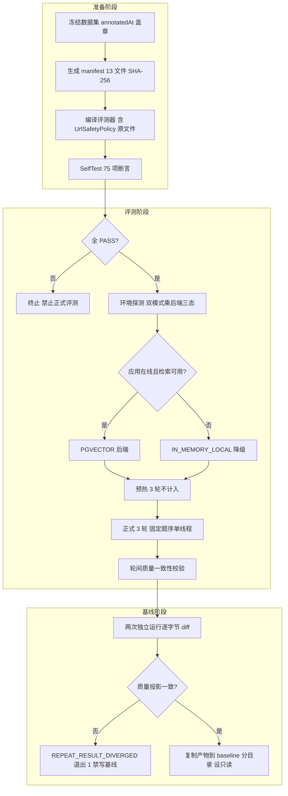

# D37-02-RAG评测脚本与基线-技术文档说明与实践指南

> 配套文档：D37-01（全量信息与操作）。本篇按"是什么 → 为什么 → 底层原理 → 执行流程 → 核心代码 → 常见问题 → 工程实践"展开，全部机制结论以本地源码实读为依据。

## 一、是什么：评测器与基线的工程定位

评测器是一个**独立于 Spring 容器的 Java 21 程序**，只依赖 Jackson 2.19.0 与生产 `UrlSafetyPolicy.java` 原文件（只读编译复用）。它不是单元测试，而是"黑盒观测 + 白盒复算"的混合体：

- 黑盒：通过 HTTP 观测真实应用的 `/api/v1/retrieval/search` 与 `/api/v1/rag/ask`；
- 白盒：逐位复刻生产 Embedding，在内存中重建索引作为降级后端，并独立复算全部指标。

基线（baseline）是"冻结输入 + 受控参数 + 原始记录复算"的产物，永久只读、按后端分目录。它的价值不是分数高低，而是**给后续迭代一个可逐字节对照的锚点**。

## 二、为什么：三个设计动机

1. **双基线分离**：应用默认值（CURRENT_RUNTIME_BASELINE）与评测显式参数（EVAL_CONTROLLED_BASELINE）必须分开声明，否则"调了评测参数"会被误读为"改了应用行为"。
2. **先冻结后评测**：标注（annotatedAt）与 manifest 哈希先于任何评测固定，杜绝"看结果反改标注"的自欺。
3. **复现性优先于分数**：质量投影排除耗时/时间戳/相似度浮点，只保留有序逻辑 chunkId、documentId、relevant、决策、状态码、标签、status——这些字段跨机器逐字节一致才算可复现。

## 三、底层原理

### 3.1 本地哈希 Embedding 的逐位复刻

生产 `LocalHashingEmbeddingModel` = TextFeatureExtractor + FeatureHasher：

- 特征：`w:` 连续字母数字串（toLowerCase）、`c:` 每个非空白字符、`g:` 相邻非空白 bigram；
- 哈希：32 位 FNV-1a（offset basis `0x811c9dc5`，prime `0x01000193`），桶 = hash % 384（负数修正），符号 = 最高位；
- 累加：float 带符号累加 → L2 归一化。

评测器 `LocalEmbedding.java` 逐位复刻上述每一步（含 float 精度顺序），因此内存后端与 PG 后端的排序在文档级完全一致（本迭代 precisionMacro 两后端均 0.2222，逐字探针 similarity=1.0）。**这是词法模型，不是神经语义模型**：它度量字符/词面重合，不理解语义，相似度天然偏低。

### 3.2 相似度与距离方向

PG 侧 COSINE_DISTANCE：distance ∈ [0,2]，similarity = 1 − distance。threshold 是 **similarity 语义**（越高越严），0.0 表示不过滤。实测 QA-001 Top1 similarity=0.3797、distance=0.6203——排序正确但低于评估阈值 0.55。

### 3.3 决策优先级（EvidenceAssessmentService 实读）

生命周期筛选（仅 ACTIVE 有效，fail-closed）→ 冲突 CONFLICT → 无有效证据 REFUSE/NO_EVIDENCE → **allLowRelevance（全部 similarity<0.55）REFUSE/LOW_RELEVANCE** → 跨 ≥2 主体 CLARIFY → 术语覆盖率 <0.60 REFUSE/INSUFFICIENT_EVIDENCE → ANSWER。

关键后果：LOW_RELEVANCE 先于 CLARIFY 判定，词法模型下模糊题也会被拒答而非澄清（QF-001/002 实测）；CONFLICT 先于 LOW_RELEVANCE，但**生命周期过滤最先**——夹具无 MySQL ACTIVE 行时冲突永远不可触发（本迭代真实踩坑并修复）。

### 3.4 稳定 chunkId 与逻辑映射

生产 chunkId 是 UUID v5（由 documentId/version/strategy/chunkIndex/内容哈希/splitVersion 派生），内容变则 UUID 变。评测器不依赖 UUID 稳定性，而用 **content+documentId 精确匹配**冻结语料建立逻辑映射（语料内容唯一）；映射失败标 mappingAmbiguous → RETRIEVAL_ERROR。这使基线对"重建索引换 UUID"免疫。

### 3.5 幂等入库的自然键语义

`document_chunk_index` 唯一键 `uk_doc_ver_strat_idx` = (document_id, version, strategy, chunk_index)，且 ON DUPLICATE KEY UPDATE **不更新 chunk_id 列**。因此换 strategy 重索引会残留旧行导致 COUNT_MISMATCH；同 strategy 换内容会留下旧 chunk_id 指向不存在的向量。正确做法：先 DELETE 本文档再重建（本迭代仅操作 3 个夹具 documentId，历史残留只读）。

### 3.6 引用契约与 URL 双层防护

同步出口 RagSourceView：sourceId=documentId（稳定）、citationId=sourceRef=S1/S2（请求级）、quotedSnippet 真实截取 ≤200 字符、url 恒 null（NON_NULL 隐藏）。前端 isSafeUrl 与后端 UrlSafetyPolicy 同向白名单（http/https，拒盘符/环回/内网/危险协议）。SSE 出口 CitationDto 缺 paragraphIndex（前端死分支，低危展示级，记录不修）。

## 四、执行流程（Typora 兼容 Mermaid）



## 五、核心代码选读

### 5.1 稳定次级排序（内存后端，C16）

```java
public static void sortHits(List<Hit> hits) {
    hits.sort(Comparator.comparingDouble((Hit h) -> h.similarity() == null ? 0 : h.similarity())
            .reversed()
            .thenComparing(h -> h.logicalChunkId() == null ? h.chunkId() : h.logicalChunkId()));
}
```

相似度降序 + 同分按稳定逻辑 chunkId 次级键，保证跨进程顺序一致。耗时字段写 `inMemorySearchMs`，**禁写 vectorSearchMs**（语义诚实）。

### 5.2 决策类指标的 N/A 门槛

```java
// 无任何决策被实际执行（离线内存后端）时整体 N/A，不得显示 0 造成"决策全错"误读
putMetric(overall, "refusalAccuracy",
        decisionsJudged == 0 ? null : MetricsCalculator.rate(refuseCorrect, refuseExpected));
```

分母 0 → N/A 是通用规则；decisionsJudged=0 是附加门槛——分母非 0 但分子不可测时同样 N/A。

### 5.3 manifest 复验（防篡改）

```java
for (var e : files.properties()) {
    String actual = sha256(repo.resolve(e.getKey()));
    if (!actual.equalsIgnoreCase(e.getValue().asText())) {
        throw new IllegalStateException("manifest 哈希不一致（疑似篡改）: " + e.getKey());
    }
}
```

### 5.4 检索失败与空结果严格区分

```java
return new SearchOutcome(hits.isEmpty() ? "EMPTY" : "SUCCESS", hits, ...);
// EMPTY 是成功态，不触发 RETRIEVAL_ERROR；FAILED 才触发，原因码区分 EMBED_FAIL/BACKEND_FAIL
```

## 六、常见问题（本迭代真实踩坑）

| 现象 | 根因 | 处置 |
|---|---|---|
| javac double→Long 错误 ×3 | AskOutcome.totalMs 为 Long，ms() 返回 double | Math.round 包装 |
| Jackson fields() 弃用警告 | 2.19 推荐 properties() | 替换，-Xlint 零警告 |
| 离线基线 refusalAccuracy=0.0000 | 决策未执行却按 0 计 | decisionsJudged=0 → N/A |
| node --test MODULE_NOT_FOUND | 传目录被当模块解析 | 传测试文件路径 |
| 重索引 COUNT_MISMATCH | 自然键含 strategy，旧行残留 | 先 DELETE 本文档再重建 |
| CONFLICT 夹具不触发 | 生命周期过滤先于冲突，夹具无 ACTIVE 行 | 先 /documents/register |
| PG 基线 page 全 null | 直接入库 API 无 page 承载字段 | 如实记录 PAGE_LOCATION_MISSING（仅统计），不改公共 DTO |
| C02 期望退出码 0 实际 1 | 真实 HIGH_NOISE FAIL 存在 | 退出码规则优先，禁止隐藏失败凑 0 |

## 七、工程实践与面试表达

1. **评测器为什么独立于 Spring 容器？** 避免被测系统的自动配置/Bean 生命周期污染观测；降级后端可在应用完全缺席时运行；编译复用 UrlSafetyPolicy 原文件保证安全判定零漂移。
2. **为什么质量投影排除相似度浮点？** 浮点运算跨 JVM/硬件可能有末位差异；排序与标签才是语义不变量。排除后逐字节 diff 才是有效的复现性判据。
3. **误拒率 1.0 是不是评测器写错了？** 不是。检索排序正确（hitRate=1.0）、逐字探针 similarity=1.0 证明 Embedding 确定性；误拒源于词法模型相似度低于 0.55 阈值——这是被测系统的真实属性，评测器的职责是如实暴露而非美化。
4. **fail-closed 如何验证？** 生命周期夹具无 MySQL 行 → NOT_FOUND → 证据全失效 → REFUSE/NO_EVIDENCE（rejected=1），答案被抑制；与 LOOKUP_FAILED（基础设施故障）原因码可区分。
5. **基线为什么按后端分目录？** inMemorySearchMs 与 vectorSearchMs 语义不同，混算会把内存耗时当数据库耗时；质量投影本迭代恰好一致也不得推广为"两后端等价"。

## 八、D38 对接

- 对照锚点：`baseline/v1.0/<backend>/`（只读）；更换神经 Embedding/调阈值须升版本重新冻结。
- 候选改进：入库 API 承载 page/section 元数据；SSE CitationDto 补 paragraphIndex；C02 退出码期望与 §2.3 规则矛盾澄清；跨机器复现验证；FULL 模式 L5（真实模型，每问至多 1 次调用，Token 阈值 300/400/500 万）。

## 九、官方文档溯源

- Spring AI Reference - RAG | Spring AI 参考-RAG：https://docs.spring.io/spring-ai/reference/api/rag.html
- Spring AI Reference - Vector Databases | Spring AI 参考-向量数据库：https://docs.spring.io/spring-ai/reference/api/vectordbs.html
- Spring AI Reference - PGvector Vector Store | Spring AI 参考-PGvector 向量存储：https://docs.spring.io/spring-ai/reference/api/vectordbs/pgvector.html
- Spring AI Reference - Embedding Model API | Spring AI 参考-Embedding 模型 API：https://docs.spring.io/spring-ai/reference/api/embeddings.html
- pgvector - Open-source vector similarity search for Postgres | pgvector-PostgreSQL 开源向量相似度搜索：https://github.com/pgvector/pgvector
