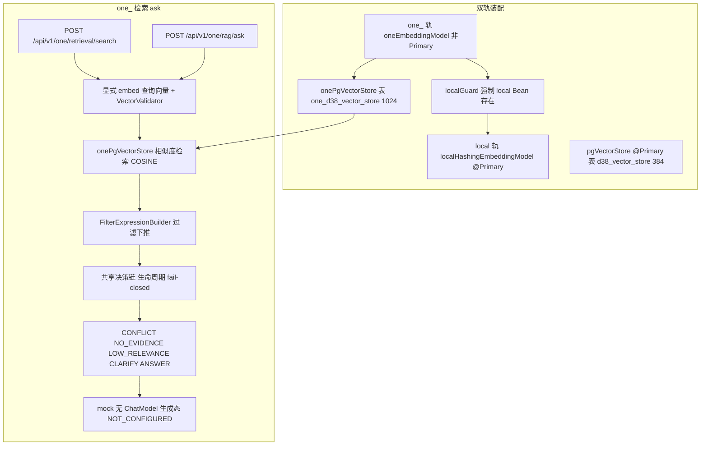
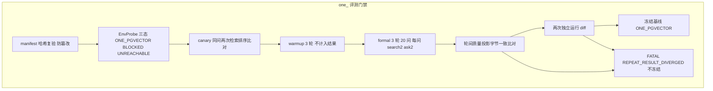

# D38-02-阿里百炼Embedding双轨接入-技术文档说明与实践指南

> 切片：D38 / R01 ｜ 配套：`D38-01-阿里百炼Embedding双轨接入-项目迭代全量信息与操作.md`
> 人设视角：12 年 Java 架构师 + 6 年 AI 工程落地。本文按"是什么→为什么→底层原理→执行流程→核心代码→常见问题→工程实践"展开。

## 一、是什么：双轨 Embedding 的工程定位

**双轨（dual-track）**指在同一应用进程内并存两条完全隔离的 Embedding 链路：

- **local 轨**：本地哈希词面模型（local-hashing-embedding，384 维，零网络零密钥），承载既有检索/入库/ask，行为逐字节不变。
- **one_ 轨**：阿里百炼神经模型（qwen3.7-text-embedding，1024 维，远程 HTTP），全新隔离资产，承载语义检索能力。

关键界定：双轨**不是**"把 local 的 provider 切换成 bailian"。后者是单轨替换（会改变 local 行为，违反 H1）；双轨是**新增独立轨道 + 既有轨道加 @Primary 保持解析不变**。两轨向量空间永不混用（H3），跨空间复用必须被兼容性检查拒绝。

## 二、为什么：三个设计动机

1. **零回归接入新能力**：生产/学习工程引入远程模型时，最大风险是悄悄改变既有链路。双轨 + @Primary + localGuard 把"既有行为不变"变成可证明的契约（C07 逐字节 diff），而非口头承诺。
2. **神经模型不可本地复刻**：local 哈希模型可逐位复刻（D37 内存后端），但神经模型向量空间无法本地重现。因此 one_ 评测器**删除 IN_MEMORY 后端**，离线即 BLOCKED，绝不用哈希向量冒充神经检索结果伪造指标（H7）。
3. **真实调用最小化**：远程 Embedding 按 Token 计费且有限流。探测先行冻结参数（避免运行时猜维度建表）、受控注入测重试（零远程）、跨进程如实汇总用量，把成本压在预算内（514/1000）。

## 三、底层原理

### 3.1 双轨装配与 @Primary 解析（ConditionalOnMissingBean 陷阱）

local 轨 `localHashingEmbeddingModel` 带 `@ConditionalOnMissingBean(EmbeddingModel.class)`。若直接新增 one_ EmbeddingModel：

- 若 one_ Bean 先注册 → local 的条件判定"已存在 EmbeddingModel" → **local Bean 直接消失**，既有链路被静默换轨。
- 若 local 先注册、one_ 后注册 → 容器有两个 EmbeddingModel → 既有按类型注入点（SimilaritySearchService/DocumentEmbeddingService/pgVectorStore）抛 `NoUniqueBeanDefinitionException`。

解法（H1 唯一豁免）：local 两个 Bean 加 `@Primary`，既有按类型注入仍解析到 local；one_ Bean 全部显式 `@Qualifier`。再加 **localGuard**：oneEmbeddingModel 方法参数显式依赖 `@Qualifier("localHashingEmbeddingModel")`，若扫描顺序异常导致 local 被条件回退，启动立即抛 NoSuchBeanDefinitionException（响亮失败），而非静默换轨。

### 3.2 远程客户端重试分类与退避

`OneBailianEmbeddingClient`（JDK HttpClient + Jackson，零新增依赖）的重试语义对齐 `app.ai.resilience` 口径：

| 情形 | 错误码 | 可重试 | 理由 |
|---|---|---|---|
| 400 | BAD_REQUEST | 否 | 参数错误，重试无意义 |
| 401/403 | AUTH_FAILED | 否 | 鉴权失败 |
| 404 | MODEL_NOT_FOUND | 否 | 模型不存在 |
| 429 | RATE_LIMITED | 是 | 限流，退避后重试 |
| 5xx | REMOTE_ERROR | 是 | 服务端瞬时故障 |
| 连接类 IO | NETWORK | 是 | 网络瞬时失败 |
| 读取超时 | READ_TIMEOUT | 否（默认） | 请求已发送、结果不确定，重试可能重复计费 |

最多 maxAttempts=2 次尝试（含首次），退避 200ms×2.0 抖动 0.2，受 totalDeadline 总墙钟约束。C16 用本地 `com.sun.net.httpserver` 桩受控注入 14 场景全验证（零真实调用）。

### 3.3 向量空间隔离与兼容性三态

vectorSpaceId = `provider|model|modelVersion|dimensions`（如 `bailian|qwen3.7-text-embedding|remote-v1|1024`）。one_ 检索只打 one_ 表，local 只打 local 表。兼容性端点三态：

- `DIMENSION_MISMATCH`：维度不符（如 local 384 vs one_ 1024）。
- `MODEL_SPACE_MISMATCH`：维度同但模型/版本不同（如 remote-v2 1024）。
- `COMPATIBLE`：四元组全一致。

跨空间复用向量必须被拒绝（H3），防止把不同语义空间的向量混算相似度。

### 3.4 稳定 chunkId 跨轨同逻辑

chunkId 由 `StableChunkIdGenerator`（UUID v5，NAMESPACE=0f9f7d52-6b3e-4a1c-9f2d-7c8e5b3a6d41）生成，name=`documentId|version|strategy|chunkIndex|chunkContentHash|splitVersion`，**不含模型身份**。因此同一 chunk 在 local 与 one_ 轨得到相同 UUID——这是特性而非缺陷：逻辑 chunk 身份与向量空间解耦，跨轨对账/引用溯源可用同一逻辑 ID，而 vectorChunkId（PG 行 ID）各轨独立。

### 3.5 COSINE 与未归一化向量

P0 G4 实测远端输出 L2 范数 0.0218（未归一化）。COSINE 距离 = 1 − 余弦相似度，余弦对模长不敏感（只看向量方向），故未归一化不影响排序口径，与 local 轨一致。pgvector 用 `vector_cosine_ops` HNSW 索引。similarity=document.getScore()，distance=metadata["distance"]，similarity+distance=1。

### 3.6 远端非确定性与近似平局排序（C12 根因）

神经模型服务端因批处理浮点误差/硬件非确定性，同一文本多次 embed 向量存在 ~1e-4 量级抖动。对分离度大的命中（QA-001 top1=0.874）排序稳定；但对**近似平局**（QU-005 两个无关片段 Δsim=2.4e-5）抖动足以翻转排序。

工程结论：质量投影排除 similarity/计时浮点是 D37 已验证设计，但**排序**对浮点敏感。严格排序字节一致门禁对近似平局对不可长期保证。本轮如实标 BLOCKED，不伪造一致。可选修订方向：tie-band ε 平局带（相邻 |Δsim|<ε 视为平局、组内按逻辑 ID 规范化排序），把"语义稳定"与"浮点排序"解耦——需用户批准且 ε 预先冻结，禁止看结果后调整。

### 3.7 usage 真实累计与脱敏

`usage.total_tokens` 来自 API 真实返回（LongAdder 线程安全累计），**禁止用字符数估算冒充 Token**；API 未返回 usage 时单独计 usageUnavailableCalls。密钥卫生：Authorization 头不落日志；错误体剔除密钥本体/Bearer/sk- 模式并截断 ≤500 字符（C16 S7 验证）。

## 四、执行流程（Typora 兼容 Mermaid）

### 4.1 双轨装配与检索 ask 链路



### 4.2 评测门禁流程



> 本轮实际：N/O/P/Q/R 通过，S 在 QU-005 触发分歧 → V（run2 未执行，基线未冻结）。

## 五、核心代码选读

### 5.1 装配顺序守卫 localGuard（OneEmbeddingConfiguration）

```java
@Bean
public EmbeddingModel oneEmbeddingModel(OneEmbeddingProperties properties,
                                        OneBailianEmbeddingClient oneBailianEmbeddingClient,
                                        @Qualifier("localHashingEmbeddingModel") EmbeddingModel localGuard) {
    return new OneRemoteEmbeddingModel(properties, oneBailianEmbeddingClient);
}
```

`localGuard` 参数不参与构造，唯一作用是**强制 local Bean 存在**：若 local 被条件回退，Spring 解析该 Qualifier 失败 → 启动响亮失败，杜绝静默换轨。

### 5.2 重试分类（OneBailianEmbeddingClient 节选）

```java
boolean retryable = status == 429 || status >= 500;
String code = classifyErrorCode(status);
last = new OneEmbeddingException(status, code, retryable, "one_ embed HTTP " + status + ": " + sanitized);
if (!retryable || attempt == maxAttempts) {
    throw last;
}
// 读取超时：请求已发送、结果不确定，默认不重试
catch (HttpTimeoutException ex) {
    boolean retryable = properties.isRetryOnReadTimeout(); // 默认 false
    last = new OneEmbeddingException(0, "READ_TIMEOUT", retryable, ...);
    if (!retryable || attempt == maxAttempts) throw last;
}
```

### 5.3 fail-fast 启动校验（OneEmbeddingProperties.validate 节选）

```java
@PostConstruct
public void validate() {
    if (!enabled) return; // 关闭短路，零远程
    if (apiKey == null || apiKey.isBlank())
        throw new IllegalArgumentException("one_ 轨启用时必须经环境变量 DASHSCOPE_API_KEY 注入 apiKey");
    if (dimensions < 1 || dimensions > 2000)
        throw new IllegalArgumentException("one_ 轨 dimensions 必须经 ONE_EMBEDDING_DIMENSIONS 注入 P0 冻结值（1..2000，HNSW vector 红线），当前=" + dimensions);
    // baseUrl/model/maxBatch/超时/退避/COSINE 逐项校验，缺一即 fail-fast
}
```

C04 实证：缺密钥 → exit 1 明确报错；缺 dims（当前=0）→ exit 1 明确报错；enabled=false → 启动成功 + one_ 端点 absent + 结构性零远程。

### 5.4 错误体脱敏（OneBailianEmbeddingClient.sanitize 节选）

```java
String s = raw.replace(properties.getApiKey(), "***API_KEY***");
s = s.replaceAll("Bearer\\s+\\S+", "Bearer ***");
s = s.replaceAll("sk-[A-Za-z0-9]{16,}", "sk-***");
if (s.length() > 500) s = s.substring(0, 500) + "...(truncated)";
```

## 六、常见问题（本迭代真实踩坑）

| 现象 | 根因 | 修复 |
|---|---|---|
| 共享页表查询报表不存在 | 真实表名 knowledge_document_page，非 document_page_content | 以本地实际 schema 为准 |
| diff 报告按 JSON 解析失败 | D37/oneeval diff 输出为纯文本（QUALITY_FIELDS_IDENTICAL 标记），非 JSON | 按文本判定，exit 0=一致 |
| 批量 25 条返回 400 | maxBatch 实测上限 16（G3） | 客户端按 16 分批 |
| usage 端点返回 5000 | 路径误用 /embedding/（单数），真实为 /embeddings/usage（复数） | 核对 Controller @RequestMapping |
| QU-005 轮间排序翻转 | 远端 query 向量 ~1e-4 抖动翻转近似平局（Δ=2.4e-5） | 如实 BLOCKED，不伪造一致 |
| C15 扫描 PG 密码命中 | D30 任务书文档历史硬编码真实密码 | 用户授权脱敏 + surefire 清理 |
| Write/Edit 报 modified since read | 文件被外部修改 | 先 Read limit 3 刷新再写 |

## 七、工程实践与面试表达

- **双轨设计**：面试可表述为"用 @Primary 保住既有按类型注入的解析目标，用 @Qualifier 隔离新轨道，用 localGuard 把装配顺序假设变成启动期硬约束——零回归不是测出来的，是装配契约保证的，再用逐字节 diff 实证"。
- **非确定性处理**：远程神经模型评测要区分"语义质量稳定"与"浮点排序稳定"。近似平局排序翻转是服务端固有属性，诚实标 BLOCKED 比伪造字节一致更有工程价值；tie-band 投影是可选修订，但 ε 必须预先冻结、用户批准，禁止看结果后调参（p-hacking）。
- **密钥卫生**：密钥仅 env 注入，错误体脱敏，定期扫描 git/日志/证据；历史遗留泄漏（D30 文档）要主动发现并授权清理，surefire-reports 含 java.library.path 环境信息禁提交。
- **受控注入测试**：重试/退避/脱敏这类韧性逻辑，用本地桩服务器受控错误注入即可全覆盖，零真实调用零成本，比真实 4xx 更可控可重复。
- **成本核算**：usage 计数器进程内归零，全程用量须跨进程手工汇总；Token 用 API 真实返回，字符数≠Token。

## 八、后续迭代对接（D39+）

- **SSE 流式 one_ ask**：D38 为同步闭环，SSE 与同步一致性留后续。
- **真实 ChatModel 生成态**：deepseek 真实答案质量/Grounding/幻觉率取证（预算允许时）。
- **tie-band 评测协议 v1.1（可选）**：若需冻结 one_ 基线，用户批准 ε 平局带修订 + 补跑。
- **原生 SDK 通道**：骨架预置 dashscope-sdk-java/openai-java 保留未用，D39 可评估原生通道备选。
- **页表链路与卡住恢复**：one_ 本轮未提供（留 local/D39）。

## 九、官方文档溯源

| 标题（中英对应） | 官方链接 |
|---|---|
| 《Spring Framework Core Reference \| Spring 框架核心参考》（@Primary/@Qualifier/Bean 生命周期） | https://docs.spring.io/spring-framework/reference/core.html |
| 《Spring Boot Reference \| Spring Boot 参考文档》（@ConfigurationProperties/条件装配） | https://docs.spring.io/spring-boot/3.5/index.html |
| 《Spring AI Reference \| Spring AI 参考文档》（EmbeddingModel/VectorStore/AbstractEmbeddingModel） | https://docs.spring.io/spring-ai/reference/ |
| 《pgvector README \| pgvector 说明》（HNSW/vector_cosine_ops/维度上限） | https://github.com/pgvector/pgvector |
| 《阿里云百炼 Model Studio \| Alibaba Cloud Model Studio》（OpenAI 兼容 Embedding/usage） | https://help.aliyun.com/zh/model-studio/ |
| 《Java 21 HttpClient API \| Java 21 HttpClient 接口》（超时/重试/BodyHandlers） | https://docs.oracle.com/en/java/javase/21/docs/api/java.net.http/java/net/http/HttpClient.html |

> 注：官方入口链接；深层 API 页以对应版本官方文档为准，未核实深层 URL 不伪造。