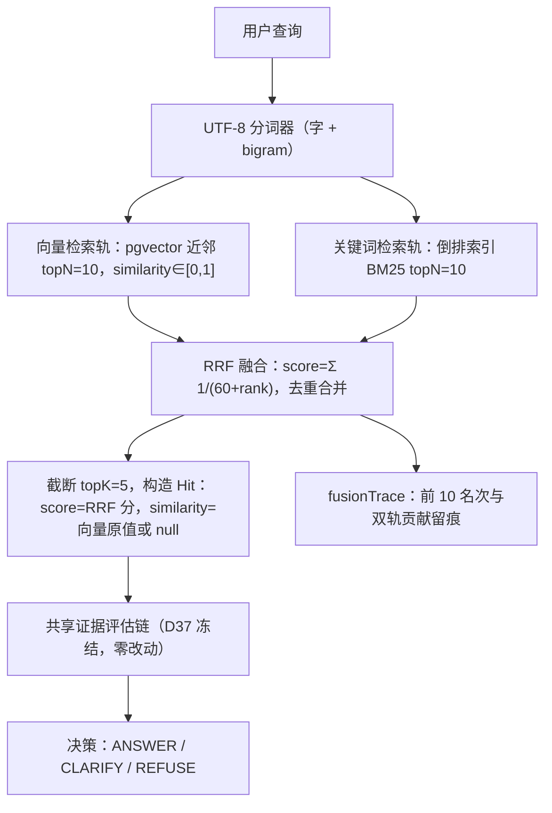

# D38-04 混合检索（关键词 BM25 + 向量 + RRF）— 技术文档说明与实践指南

- 适用迭代：D38-R02（2026-11-21）
- 代码位置：`D38/D38_QWE_MROQRE/src/main/java/com/zl/d38/hybrid/`（默认关闭，开关 `d38.hybrid.enabled`）
- 展开顺序：是什么 → 为什么 → 底层原理 → 执行流程 → 核心代码 → 常见问题 → 工程实践

## 一、是什么

混合检索（Hybrid Retrieval）= 在同一查询上并行执行**稀疏检索**（关键词 BM25，Best Match 25 概率检索模型）与**稠密检索**（向量近邻，Embedding 余弦相似度），再用**RRF**（Reciprocal Rank Fusion，倒数排名融合）把两个有序列表合并成一个列表。它解决的单侧盲区是：纯向量检索对**精确词面**（型号、术语、错一字即不同义）弱，纯关键词对**语义改写**（同义、上位词）弱。

## 二、为什么选 RRF 而不是加权分数融合

RRF 只用**名次**不用分数：`score(d) = Σ_r 1/(k + rank_r(d))`，k=60。原因：
1. BM25 分数无上界、余弦有界 [0,1]，两者直接加权需归一化，归一化本身引入分布假设；名次是无量纲的，天然可比。
2. 对离群分数鲁棒：某一路偶发高分霸榜，RRF 只记 rank 1，影响被 `1/(k+1)` 封顶。
3. 无训练参数、可解释、公式一行——符合本项目"避免过度设计"规范。
代价：**丢失分数信息**。top1 与 top2 若真实差距悬殊，RRF 仍按等差名次处理；且 k=60 时名次间差异被强烈压缩（见 §五凸性反例），这直接解释了本轮实验 Δprecision=0 的现象。

## 三、底层原理

### 3.1 BM25

```
score(q,d) = Σ_{t∈q} idf(t) · [ tf(t,d)·(k1+1) ] / [ tf(t,d) + k1·(1 − b + b·|d|/avgdl) ]
idf(t)     = ln( 1 + (N − n_t + 0.5) / (n_t + 0.5) )
```
- **tf 饱和**：词频项分子分母同含 tf，tf→∞ 时收敛于 idf·(k1+1)——词出现 10 次不比 2 次强 5 倍，修正了经典 TF-IDF 的线性偏好。k1=1.2 控制饱和速度。
- **长度归一**：分母中 `k1·(1−b+b·|d|/avgdl)` 惩罚长文档；b=0.75 是"部分归一"经验值，b=0 完全豁免长度（本项目 SelfTest 已实测该退化恒等式）。
- **idf**：N=8、n=1 时 =1.79175946922805；n=8（全部文档命中）=0.0571584138399486——仍为正，是 Lucene 风格 `ln(1+…)` 平滑变体，非原始 Okapi BM25（后者 n=N 时 idf≤0）。

### 3.2 RRF 的"凸性挤压"

k=60 下，rank 1 = 1/61 = 0.016393，rank 2 = 0.016129，相邻差仅 0.00026。**两路各排第 2（和 = 2/62 = 0.0322581）反而输给一路第 1 + 一路第 3（和 = 1/61 + 1/63 = 0.0322665）**——倒数函数的凸性使"均衡名次"略优于"单边榜首"，且差距在 1e-5 量级。这是 RRF 保守性的数学根源，也是本项目 SelfTest F5 夹具（曾手算错、被真实实现纠正）的教学价值。

### 3.3 项目内实现要点

- **进程内倒排索引**：启动时对 8 chunk 语料建 `term → postings(chunkId, tf)`，构建输入经 canonical 规范化（排序+编码固定）后取 SHA-256 指纹，保证跨进程逐字节可复现（C03：`10fc69d5…` 双进程一致）。
- **UTF-8 分词器**：中文按单字 + 相邻双字 bigram 切，英文数字按词；无外部分词依赖，行为由 6 个冻结夹具钉死。
- **candidateTopN=10 → topK=5**：两路各取 10 融合后截 5，与对照 PURE 轨 topK=5 严格同参——控制变量是本实验的全部意义。
- **分数语义契约**（C09 七断言）：hybrid 响应的 `score` 槽承载 RRF 融合分（量纲 <0.05，绝不冒充 0–1 相似度）；`hitSource=KEYWORD_ONLY` 的命中 `similarity=null`——**宁空勿假**；向量轨原始 similarity 完整保留在 `extra.rawMatches` 供溯源。
- **共享链零分叉**：融合后的候选仍走 D37 冻结的证据评估/决策链（`EvidenceAssessmentService`），`similarity==null` 不阻断规则 = KEYWORD_ONLY 走既有决策路径，未新增任何决策分支。

## 四、执行流程



评测侧 ABAB 交错：第 1 轮 PURE→HYBRID、第 2 轮 HYBRID→PURE、第 3 轮 PURE→HYBRID——同一问的双策略在同一时段内互为先后，消除环境时段偏置；记录键 `qid|strategy` 使 120 条记录天然幂等可 diff。

## 五、核心代码语义（摘自真实类，评测直调同一实现）

```java
// RrfFusionService.fuse —— 纯函数，SelfTest 手算对拍即调此方法
static List<FusedHit> fuse(List<String> vectorRanked, List<String> keywordRanked, int k) {
    Map<String, Double> score = new HashMap<>();
    accumulate(score, vectorRanked, k);   // score += 1/(k + rank)，rank 从 1 起
    accumulate(score, keywordRanked, k);
    return sortByScoreThenChunkId(score); // 同分按 chunkId 字典序升序——确定性保证
}
```
- 同分打破用 **chunkId 升序**而非插入序：这是 C11 跨进程逐字节 diff=0 的前提之一（浮点求和序无关性 + 稳定排序键）。
- `InvertedIndex.idf(N, n)`、`KeywordSearchService.bm25Score(...)` 静态化 = "实现即夹具"模式：评测的数学正确性与应用运行代码同源，杜绝测试与实现各写一份公式的漂移风险。

## 六、实验结论的技术解读

1. **Δrecall=Δprecision=0**：8 个 chunk、20 问的语料太小且全部为词面强相关设计（D36/D37 基线本就 top1 全对），关键词轨几乎没有"向量漏检而 BM25 捞回"的机会——KEYWORD_ONLY 全矩阵仅 1 次。RRF 在此规模下只做了"把满分名单洗牌"（7 题名次微动），无法产生指标增益。
2. **QT-003 RECALL_GAIN 与 QA-005 RECALL_LOSS 成对出现**：融合是零和的名单重排，candidateTopN=10 截 topK=5 时，一路的强挤占必然以另一路的边缘命中为代价。QA-005 丢掉的相关 chunk 恰是 REFUSE→CLARIFY 决策翻转的原因——**名次工程会传染到决策层**。
3. **耗时 1.38x**：BM25 全内存扫描 + 融合在本语料规模下仍是亚毫秒级，1.38x 主要是固定开销（一次额外检索往返），语料增大后该比值不会恶化到不可接受——耗时不是 ROLLBACK 的理由，也从来不是。
4. **决策诚实性**：ROLLBACK 由冻结公式机器判定，人没有改判权；falseRefusal −0.10 不构成 KEEP，因为 PASS 集合未变（0/20→0/20），改善落在"错误形态迁移"而非"正确性提升"。

## 七、常见问题与边界

- **precisionMacro=0.2222 不是 bug**：mock 决策链恒 HIGH_NOISE_PRECISION，D37 冻结记录即为 0.2222；任何引用 0.4 的文档表述都应视为笔误（本轮已修正）。
- **RRF 分数能当相似度用吗**：不能。量纲 <0.05 且无上界语义，本项目将其与 similarity 严格分槽（C09 断言 6）。
- **b=0 会怎样**：长度归一完全失效（bm25=idf·tf(k1+1)/(tf+k1)），短文档被系统性低估；消融未做（见 D38-03 §六）。
- **何时该重新评估本分支**：语料 ≥50 片、引入真实 Embedding、或出现"术语/型号查询漏检"实锤案例时；届时直接复用 hybrideval 全套（探测→双 run→diff→compare 已闭环），预计成本 ≤0.5 人日。

## 八、参考来源

- 《Introduction to Information Retrieval | 信息检索导论》Ch.6：https://nlp.stanford.edu/IR-book/
- Cormack et al., RRF, SIGIR 2009：https://doi.org/10.1145/1571941.1572111
- Robertson & Walker 1994（BM25 k1/b 经验值）；Lucene `BM25Similarity` javadoc（idf 平滑变体实现参照）：https://lucene.apache.org/core/
- 《Spring AI Reference | Spring AI 参考文档》RAG 章节：https://docs.spring.io/spring-ai/reference/
