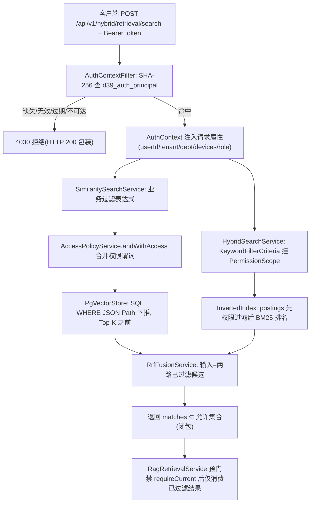

# D39-02 知识权限与元数据过滤——技术文档与实践指南

> 面向：需要理解、复用或扩展本项目权限体系的工程师与面试表达。
> 组织顺序：是什么 → 为什么 → 底层原理 → 执行流程 → 核心代码 → 常见问题 → 工程实践。
> 依据：Spring AI 1.1.8 本地 javap/AST 实测、PostgreSQL json 语义 SQL 实证、D39-R01 全量测试证据；不引用记忆值。

---

## 1. 是什么

知识权限体系 = 让「谁能检索到哪些知识片段」由**服务端**在**检索发生之前**决定，而不是由模型、Prompt 或客户端决定。本项目由四块组成：

1. **服务端可信身份**：`Authorization: Bearer <token>` → SHA-256 → MySQL 凭据表 `d39_auth_principal` → 请求级 `AuthContext`（record，不可变）。
2. **元数据权限标签**：文档三键 `tenantId/deptId/deviceId`，随入库写入向量 metadata 与倒排 ChunkFields；「不限」用显式哨兵 `"*"` 而非 null。
3. **检索前置过滤**：向量路渲染为 SQL WHERE 下推（Top-K 之前）；关键词路在 BM25 排名之前过滤候选；RRF 融合输出 ⊆ 两路已过滤并集。
4. **暴露面收口**：预览文档级校验、raw/运维 admin-only、会话 owner 服务端化；一切拒绝 fail-closed。

## 2. 为什么（不做会怎样）

| 反模式 | 后果 | 本项目的对位设计 |
|---|---|---|
| 身份取自请求体/头（X-Dev-User） | 任意伪造 ADMIN，全部越权 | H3：身份只来自服务端凭据表；声明字段一律忽略（T2 实证） |
| 检索后再让模型/ Prompt「注意权限」 | 越权内容已进 Prompt/上下文，日志、缓存、复述都会泄露 | H4：过滤先于暴露；通过标准=检索结果里没有（H8） |
| 权限过滤=取回 Top-K 后内存剔除 | Top-K 名额被越权内容占用导致合法结果丢失；「返回变少」伪装成安全 | KP4 决定性夹具证伪：字面同问句必占 top1，权限端点 topK=20/th=0 仍零命中 ⇒ 发生在 WHERE 层 |
| 缺 token 时降级为公开检索 | 攻击者只需不带凭据即可看全库 | H5：缺失/无效/过期/存储不可达全部拒绝（4030）；无标签遗留=权限空间外 |
| 用 null 表达「不限」 | metadata 缺失键与「不限」语义不可区分，fail-open 风险 | D2：显式 `"*"` 哨兵；缺失键因 NULL 三值逻辑天然不可见（实证 0 命中） |

## 3. 底层原理

### 3.1 FilterExpressionBuilder 与 SQL 下推（向量路）

Spring AI 的 `SearchRequest.filterExpression` 接收 `Filter.Expression` AST；`PgVectorStore` 将其渲染进向量相似度 SQL 的 WHERE（JSON Path 提取 metadata 键比较），因此**过滤发生在数据库排序取 Top-K 之前**。本项目谓词代数（USER）：

```
tenantId == ctx.tenant
AND (deptId == ctx.dept OR deptId == "*")
AND (deviceId IN (ctx.devices ∪ {"*"}) OR deviceId == "*")
```

ADMIN 仅 `tenantId == ctx.tenant`（租户内 bypass 部门/设备，绝不跨租户）。

实测 AST（1.1.8 dump）：顶层 `AND(AND(AND(EQ..),GROUP(OR..)),GROUP(IN..))`；`Filter$Expression` 是 **record**，字段 private，断言用访问器 `type()/left()/right()`、`Group.content()`、`Key.key()`、`Value.value()`。业务过滤（documentId/version/strategy/title）与权限谓词经 `andWithAccess` 合并为单一表达式，两路共用同一 `PermissionScope` 代数源，杜绝双实现漂移。

### 3.2 json/jsonb 缺失键的 NULL 语义（fail-closed 的数据库根基）

PG 对 metadata 缺失键的提取结果为 NULL；`NULL = 'T1'`、`NULL IN (...)` 均为 UNKNOWN → WHERE 不成立 → 行不可见。SQL 层实证三种形态谓词全部 0 命中 ⇒ **无标签遗留文档天然权限空间外**，不需要任何代码分支去「排除缺失键」。注意本项目列为 `json` 而非 `jsonb`：二者在此语义上等价（`->>` 提取缺失键同为 NULL），实测验证后冻结。

工程含义：缺失键=不可见是**特性而非事故**；想要「所有人可见」必须显式写 `"*"`，想要「运维可见」走 admin-only raw 通道。

### 3.3 倒排先过滤后排名（关键词路）

`InvertedIndex` 的 `ChunkEntry` 携带三权限字段（加载 PG 时同源读取，canonical 行格式不变——这是加权限键**不改变集合指纹**的原因）。检索流程：postings 收集 → **权限谓词逐条判定（permission==null 或与向量路同代数）** → 通过者才计算 BM25(k1=1.2,b=0.75) 并排序截断。越权文档连候选都不进入，「排名后被删」不存在。

### 3.4 RRF 融合闭包

`score(d)=Σ 1/(rrfK+rank_i)`，rrfK=60，输入=两路**已过滤**候选（各 candidateTopN=10）。纯函数性质：输出集合 ⊆ 输入并集 ⇒ 只要两路同口径过滤，融合天然闭包（RrfFusionClosureTest 单测+集成集合断言双证）。反例设计思维：若关键词路漏过滤，融合会把越权 id「重新引入」（reintroduce）——闭包断言专防此类。

### 3.5 fail-closed 的三层实现

1. **过滤器层**：`AuthContextFilter` 解析失败即写回 `Result(4030)`（HTTP 200+业务码），不进业务。
2. **异常路由层**：业务层 `AccessDeniedException` 由 `@Order(-100)` 的专属 advice 精确接管为 4030；若不加，GlobalExceptionHandler 兜底 Exception→5000，拒绝语义丢失（本轮实踩）。
3. **启动层**：凭据表/PG 不可达 → 数据源 Bean fail-fast，进程拒绝进入可服务态（坏端口双演练实证）；主链路无 `catch→去过滤重试` 分支。

### 3.6 凭据存储：只存哈希

`token_sha256 CHAR(64)` 主键。token 明文随机 ≥32 字节仅存夹具 JSON（不提交 Git）；DB 泄库≠泄凭据（SHA-256 单向，本地学习威胁模型下够用；生产换 HMAC/加盐派生，见 §6）。`expires_at/enabled` 在查表点判定，过期=无效同类拒绝。

## 4. 执行流程（enabled=true 一次 hybrid 检索）



清理与回归流程：DELETE 端点×6 →（实测不联动 MySQL）DB 级夹具 DELETE → PG 行数=8+指纹恢复 10fc69d5 → enabled=false 全量评测 diff=IDENTICAL。

## 5. 核心代码（真实文件为源，节选骨架）

**双路同源谓词（向量路）** `AccessPolicyService`：

```java
public Filter.Expression andWithAccess(Filter.Expression business, AuthContext ctx) {
    Filter.Expression access = PermissionScope.from(ctx, wildcardSentinel).toVectorPredicate(builderFactory);
    // USER: eq(tenant) AND GROUP(OR eq(dept), eq("*")) AND GROUP(IN devices∪"*")
    // ADMIN: eq(tenant)  —— 租户硬边界，bypass 仅限部门/设备
    return business == null ? access : builder.and(business, access).build();
}
```

**检索入口装配（门禁等价）** `SimilaritySearchService`：

```java
Filter.Expression business = hasBusinessFilters ? buildFilterExpression(req) : null;
AccessPolicyService policy = accessPolicyProvider.getIfAvailable();   // disabled→null
Filter.Expression effective = (policy == null) ? business : policy.andWithAccess(business, policy.requireCurrent());
```

disabled 路径逐语句等价基线（H1 零差异的结构性保证：ObjectProvider+三元，而非 if 包裹业务逻辑）。

**fail-closed 过滤器（节选）** `AuthContextFilter`：

```java
String bearer = request.getHeader(properties.getTokenHeader());          // Authorization
String sha = tokenHasher.sha256(stripBearerPrefix(bearer));              // 缺失→CREDENTIAL_MISSING
AuthPrincipal p = principalRepository.findByTokenSha256(sha)             // 不可达→STORE_UNAVAILABLE
        .filter(pr -> pr.isEnabled() && notExpired(pr))                  // 过期→CREDENTIAL_EXPIRED
        .orElseThrow(AccessDeniedException::new);
AuthContextHolder.bind(request, AuthContext.of(p));                      // 只信服务端列，忽略 body 声明
```

**倒排先过滤** `InvertedIndex`：`entry.permission() == null || scope.matches(entry.permission())` 后才进 BM25 打分；null=无标签=不可见（与向量路缺失键语义对齐）。

## 6. 常见问题（FAQ）

- **Q：过滤会不会拖慢检索？** 谓词是索引表上的 JSON Path 等值/IN 条件，与业务过滤同构；PG 无独立权限索引时随 metadata 全表扫描线性放大，生产可考虑生成列+索引或标签表 join。本地 20 行量级实测检索毫秒级不变。
- **Q：为什么 ADMIN 也看不到遗留无标签文档？** D3 裁决：补标签=改冻结资产；「运维可见」由 admin-only raw 通道承担。若业务要求迁移，做生命周期标签迁移切片而非放开过滤。
- **Q：token 表在 MySQL，PG 挂了会部分放行吗？** 不会。两路任一存储不可达分别 fail-fast（启动）/5000 报错（运行期），代码无「降级为无过滤」分支；这正是演练要证明的性质。
- **Q：SSE/异步线程 AuthContext 丢失？** ThreadLocal 不跨线程；请求线程内完成授权快照（AuthContextHolder 快照传递），流式分支消费快照。全路径端到端列入 D40。
- **Q：能上生产吗？** 机制方向正确（服务端身份/fail-closed/下推），但 Bearer→静态哈希表是学习级最小实现：生产需短时效 token、撤销通道、HMAC/加盐派生、审计日志与 Spring Security 体系（D1 裁决明确排除）。

## 7. 工程实践清单（复用到任何 RAG 权限设计）

1. **先冻结证据再写代码**：探测门禁（端点清单/存储盘点/表达能力实证/参数冻结）前置，本轮 KP2 发现 0 行、KP3 发现 json≠jsonb 都在编码前消化。
2. **零差异开关结构**：默认关 Bean 不装配；业务路径用 ObjectProvider 三元接入，改语义的 if 不写进主流程。
3. **决定论夹具**：安全测试要能区分「拦住了」与「库里没有」——构造无过滤必现顶的样本+合法方可见正证+运维通道在库正证，三面对拍。
4. **集合断言**：越权判定=返回 ID 集合运算（forbidden∩returned=∅ ∧ returned∖allowed=∅）；文案、条数、模型输出永不作为通过证据。
5. **指纹/哈希做资产一致性哨兵**：canonical 行设计决定其敏感度（不含权限键⇒加标签零扰动；含内容⇒增删行必变），先推导指纹语义再依赖它。
6. **测试脚手架的失败先怀疑自己**：本轮 4 个"FAIL"全部是脚本缺陷（方法名/路径/参数绑定/空 header），产品断言一次未红——修复循环里先取原始响应定性，再动产品代码。
7. **拒绝语义要有专属路由**：全局兜底 Exception→5000 的系统里，新异常类型必须更高优先级的 @RestControllerAdvice 精确接管，否则安全码被吞成系统错误。

## 8. 官方溯源

- 《Spring AI Reference — Metadata Filters | Spring AI 元数据过滤》：https://docs.spring.io/spring-ai/reference/api/vectordbs.html （Filter.Expression 下推契约；版本敏感结论以本地 javap 1.1.8 实测为准）
- 《PostgreSQL Documentation — JSON Types / Functions | PostgreSQL JSON 类型与函数》：https://www.postgresql.org/docs/current/datatype-json.html 、https://www.postgresql.org/docs/current/functions-json.html （缺失键→NULL 三值逻辑）
- 《pgvector — Vector Similarity Search | pgvector 官方仓库》：https://github.com/pgvector/pgvector （WHERE 与相似度检索共存）
- 《OWASP Access Control Cheat Sheet | OWASP 访问控制速查》：https://cheatsheetseries.owasp.org/cheatsheets/Access_Control_Cheat_Sheet.html （服务端强制、默认拒绝、最小权限）
- 《OWASP ASVS V4 Access Control | OWASP 应用安全验证标准-访问控制》：https://owasp.org/www-project-application-security-verification-standard/ （越权测试设计）
- 本地权威：`docs\evidence\D39\`（本轮全部实测）、D37 冻结基线、D38 hybrid 证据（均只读复用）。
