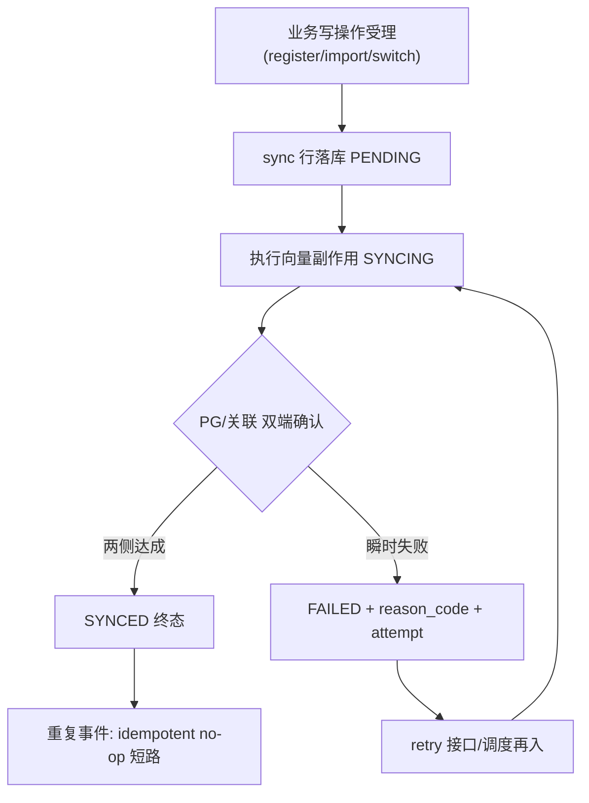
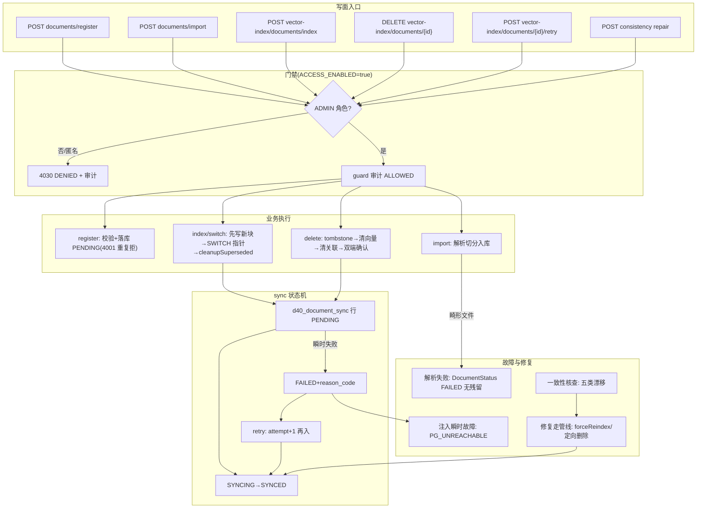

# D40-01 文档更新、删除与一致性修复——全量信息与操作手册

> 项目迭代：D40-R01（代号 DUDACR：Document Update-Delete And Consistency Repair）
> 仓库：`E:\AI\project\AI-Learning-one\M3-Java`（one 线）｜模块：`D40\D40_DUDACR`｜包：`com.zl.d40`｜端口：8080
> 基线 HEAD：`f3cf475`（本迭代全部改动位于工作区，未提交、未 push）
> 技术基线：JDK 21 / Spring Boot 3.5.16 / Spring AI 1.1.8 / MySQL 8.0.33（ai_db）/ PostgreSQL 18.7 + pgvector 0.8.7（192.168.200.153:5432/spring_ai）/ Redis 本地
> 运行模式：全程 `AI_MODE=mock`，DeepSeek 0 调用、百炼 0 调用、model token 0
> 关联任务书：`docs\temp_docs\D40\D40-项目迭代任务书Prompt-文档更新删除与一致性修复.md`
> 配套阅读：《D40-02 文档更新删除与一致性修复技术文档与实践指南》

---

## 1. 迭代总览与结论

D40 在 D31（入库幂等）/D32（检索）/D35（引用溯源）/D38（百炼双轨+混合检索）/D39（权限元数据过滤）之上，补齐**文档生命周期写面的操作级治理能力**：

1. **操作级同步状态机**（新表 `d40_document_sync`）：每个"文档 × 操作（UPDATE_DELETE/UPDATE_CLEANUP/DELETE）× 版本"一条状态行，PENDING→SYNCING→SYNCED/FAILED，含 reason_code、attempt、payload_hash，替代 D31 只依赖文档级状态的粗粒度语义。
2. **删除闭环**：tombstone 标记（DEPRECATED）→ 清 PG 向量 → 清 MySQL 关联 → 双端确认 → SYNCED；失败落库、重试收敛、重复事件幂等短路。
3. **更新闭环权威化**：新块先写 → SWITCH 原子切版本指针（`knowledge_document.version` 为唯一权威）→ `cleanupSuperseded` 清旧版，清理失败以 UPDATE_CLEANUP 行落库并可重试。
4. **一致性核查扩展**：五类漂移（DRIFT_META_ONLY / DRIFT_VECTOR_ONLY / VERSION_MISMATCH / STALE_VERSION / SYNC_STUCK）检测全覆盖，修复一律走既有删除/重建管线（零裸 SQL 直改业务表）。
5. **写面 ADMIN 门禁 + 审计**（新表 `d40_admin_audit`）：enabled 态非 ADMIN 写面一律 4030、特权操作全量留痕（actor/role/action/target/version/result/reason_code/request_id）；disabled 态行为零差异。
6. **受控故障注入**：装饰器 + 计数消耗的一次性故障点，默认 `false` 永不装配主 profile。
7. **E1–E5 异常矩阵 + C17 引用交叉验证**：解析失败、向量写失败重试、删 PG 失败重试、幂等短路、一致性收敛、删除后引用核验（CITATION_TARGET_DELETED）。
8. **回归与清理**：C05 与 D37 冻结基线逐字节零差异；C19 夹具全域清零且集合指纹恢复冻结值；C20 证据卫生零命中。

**总结论：C01–C20 全部门禁 PASS**；过程中实测暴露并修复 2 个真实产品缺陷（见 §8），修复后单测 42/42 全绿、回归零差异。

### 1.1 门禁结果总表

| 门禁 | 内容 | 结果 | 证据（`docs\evidence\D40\`） |
|---|---|---|---|
| C01 | 编译+单测 42/42+前端 node 6/6 | PASS | `unittest\c01-unittest.md` |
| C02 | KP1–KP4 探测裁决+写面分级+参数冻结 | PASS | `probe\kp1-kp4-adjudication.md`、`probe\endpoint-inventory.csv`、`probe\sync-params.json` |
| C03 | DDL ×2 重跑幂等零变化 | PASS | `ddl\c03-ddl-idempotent.md`、`ddl\ddl-seed.log` |
| C04 | seeding 8 片段+指纹=10fc69d5… 逐字节 | PASS | `probe\kp2-inventory-postseed.json`、`probe\kp2-legacy-rows.txt` |
| C05 | 零差异回归（60/60 字节一致+QA-001 delta=0+匿名探针） | PASS | `regression\diff-vs-d37-frozen.txt`、`regression\regression-result.json`、`regression\selftest.log`、`regression\run-evaluator.log` |
| C06 | 更新闭环 v1→v2 顺序实证（先写→SWITCH→清理） | PASS | `update\quad-f-vs-f2.json` |
| C07 | 更新重入幂等四元组逐字节一致 | PASS | `update\reentry-fingerprint.json`、`update\quad-f-vs-f2.json` |
| C08 | 删除闭环（tombstone→清向量→双端确认→SYNCED） | PASS | `delete\retry-converge.json`、`exceptions\p5-matrix.json` |
| C09 | 删除失败注入→FAILED+PG_UNREACHABLE→重试收敛 0/0 | PASS | `delete\retry-converge.json`、`exceptions\e2-e3-instance-a.json` |
| C10 | 重复删除/更新事件幂等短路 | PASS | `exceptions\p5-matrix.json`（重复 register 4001、SYNCED no-op） |
| C11 | cleanupSuperseded 失败落库→重试→残留归零 | PASS | `update\cleanup-sync.json` |
| C12 | 五类漂移检测全命中（含 DB 级构造 C12b） | PASS | `consistency\detect-report.json`、`consistency\c12b-*.json` |
| C13 | 漂移修复走管线+复查归零+零裸 SQL grep 证明 | PASS | `consistency\repair-recheck.json`、`consistency\c12-c13-summary.md` |
| C14 | ADMIN 门禁：非 ADMIN 4030/ADMIN 放行/disabled 零差异 | PASS | `security\gating.jsonl` + `regression\`（disabled 侧） |
| C15 | 审计留痕字段齐全+request_id 贯通 | PASS | `security\audit-trail.json` |
| C16 | E1 解析失败：FAILED、PG delta=0、零残留 | PASS | `exceptions\e1-parse.json` |
| C17 | 引用交叉：removed=CITATION_TARGET_DELETED、竞态 N/A 留痕 | PASS | `exceptions\citation-deleted.json` |
| C18 | 故障注入收口：默认 false、主 profile 不装配、回归无残留 | PASS | `exceptions\injection-containment.json` |
| C19 | FIXTURE_REMAINING=0、DOC-*/D39 零触碰、指纹恢复 | PASS | `cleanup\c19-summary.json` 及同目录 4 件 |
| C20 | 卫生零命中+DeepSeek/百炼 0 调用 | PASS | `iteration_records\C20-hygiene-cost.json` |

`exceptions\p5-matrix.json` 为 P5 主矩阵逐操作留痕；`probe\snap-*.json` 为各关键节点四表快照（PG 分域行数、knowledge_document、关联表、sync 表投影），是所有 delta 判定的原始底账。

---

## 2. 变更范围清单

### 2.1 新增（本迭代主体）

| 类别 | 路径（相对模块 `D40\D40_DUDACR` 或标注） | 说明 |
|---|---|---|
| sync 包 | `src\main\java\com\zl\d40\document\sync\**`（15 文件） | 操作级状态机：Entity/Mapper/Service/状态枚举/原因码/payload 指纹/重试 |
| DDL | `docs\temp_docs\D40\ddl\d40_governance_schema.sql` | `d40_document_sync`、`d40_admin_audit`（幂等 DDL，×2 重跑零变化） |
| 门禁 | `VectorIndexController` / `DocumentController` 写面 ADMIN guard | 4030 拒绝码 + ALLOWED/DENIED 审计 |
| 装饰器 | fault-injection 装饰器（`FAULT_INJECTION_ENABLED` 门控装配） | 向量写/PG 删一次性故障点，计数器内存态 |
| 核查 | 一致性核查脚本扩展（五类漂移） | 检测恒全域、修复按 scope 走管线 |
| 配置 | `application.yml` `app.vector-index` 段（batch-size 占位等） | 见 §2.2 缺陷修复关联 |
| 测试 | 单测新增（42 全量中 D40 新增项，含 CitationDeletedClassificationTest 5 case） | C01 |

### 2.2 修改（实测缺陷修复，4 文件）

| 文件 | 修改 |
|---|---|
| `document\mapper\KnowledgeDocumentMapper.java` | 新增 `setVersionPointer`（绝对置位语义） |
| `document\vectorindex\support\VectorIndexStateTx.java` | repoint 改调 `setVersionPointer`（缺陷 2，见 §8） |
| `document\vectorindex\service\DocumentVectorIndexService.java` | `indexChunks` 增加 `forceReindex` 重载（缺陷 1） |
| `document\vectorindex\service\VectorReconciliationService.java` | 一致性修复两处调用传 `forceReindex=true` |

另：`src\main\resources\application.yml` 增加 `app.vector-index` 配置段。

### 2.3 零触碰边界

- 既有 Controller/Service 分层契约、`/retrieval/search` 读语义、D39 权限过滤：C05 逐字节回归证明行为不变。
- 共享业务表非 d40 域行（`DOC-*`、`d32eval`、D38/D39 轨）：C19 harness before/after 计数证明零误删。
- 设备工单域（equipment/device）：本迭代未涉及。

---

## 3. 核心设计与执行流程

### 3.1 操作级同步状态机（d40_document_sync）

D31 文档级状态（`knowledge_document.status`）无法表达"同一文档上更新与清理两个独立操作的成败与重试"。D40 把**副作用操作**独立成行：

- 键：`document_id + operation + version`（operation ∈ UPDATE_CONTENT / UPDATE_CLEANUP / DELETE，冻结语义中以 UPDATE_CLEANUP 与 DELETE 两类承载 v1→v2 与删除）。
- 状态机：`PENDING → SYNCING → SYNCED | FAILED(reason_code)`；重试 `attempt+1`，成功即终态 SYNCED。
- 幂等：payload_hash（内容指纹）+ 状态短路——已 SYNCED 的重复事件 no-op 返回（C10）；FAILED 才允许重试推进。
- 关键原因码：`PG_UNREACHABLE`（E2/E3/E5 注入实证落库）。



**R01 整改增补（2026-11-23）——FAILED 任务原子领取**：上表"FAILED 才允许重试推进"的领取动作由 `claimForRetry` 承载，原实现为"内存判态 → `updateById` 无条件覆写"，多实例并发下同一 FAILED 行可被双领取、attempt 双计数。整改后领取改为**数据库条件 UPDATE**（`DocumentSyncMapper.claimFailedAtomically`）：`UPDATE … SET sync_status='PENDING',… WHERE id=? AND sync_status='FAILED'`，affected≠1 即领取失败返回 null，调度侧既有 `claimed==null→skip` 路由天然兼容（`SyncRetryRunner` 零改动）。attempt 递增点冻结在 `markFailed`，claim 不自增（防双重计数）。实证双层：单测 `DocumentSyncServiceAtomicClaimTest` 6 case + 真实 MySQL 双线程竞争 harness `repair\D40-R02-atomic-claim-realdb.json`（affected=[0,1]、winners=1）。

### 3.2 删除闭环（C08/C09）

`DELETE /api/v1/vector-index/documents/{id}` 的真实语义（实测）：

1. `knowledge_document` 标 **DEPRECATED**（tombstone 保留，行不物理删——物理删属 C19 治理清理动作）；
2. 建 DELETE 行 PENDING；
3. 删 PG 向量（按 metadata documentId 定向）；
4. 清 MySQL 关联（`document_chunk_index`/`document_vector_index`）；
5. 双端计数确认（PG delta 与关联行数=0）→ SYNCED；
6. 任一步瞬时失败 → FAILED+原因码，`POST /vector-index/documents/{id}/retry` 再入收敛（E3/E5 实证 attempt=1→SYNCED，双端归零）。

**竞态边界（C17 裁决）**：已删 chunk 不在 PG 向量库中，检索链路结构上不可达，"删除后仍被检索命中"的竞态在本架构下 N/A，已在证据中如实留痕而非伪造通过。

### 3.3 更新闭环与版本指针权威化（C06/C07）

v1→v2 顺序实证（`update\quad-f-vs-f2.json` quad 四元组）：

1. **先写新块**：v2 chunk 计算稳定 chunkId、写 PG、写关联；
2. **SWITCH 原子切指针**：`knowledge_document.version` 置 2（唯一权威来源；见 §8 缺陷 2 修复后语义）；
3. **后清旧版**：`cleanupSuperseded` 删 v1 向量与关联；失败→ UPDATE_CLEANUP FAILED 落库（C11），重试收敛 SYNCED 残留归零。

重入幂等（C07）：中途失败重跑后 `payloadHash + chunkId 集合 + PG 行数 + 关联行数` 四元组与一次成功**逐字节一致**（`update\reentry-fingerprint.json`）。

### 3.4 一致性核查与修复（C12/C12b/C13）

五类漂移与实测构造方式：

| 漂移 | 语义 | 构造 | 修复路径 |
|---|---|---|---|
| DRIFT_META_ONLY | 关联有、PG 无 | 直删 PG 行（D40DriftConstruct） | forceReindex 重建管线 |
| DRIFT_VECTOR_ONLY | PG 有、关联无 | DB 删关联行 | 管线删除该向量 |
| VERSION_MISMATCH | 两侧版本不一致 | 改指针 | 重对齐+repoint |
| STALE_VERSION | PG 残留旧版本块 | 保留 v1 行 | 定向删除 v1 |
| SYNC_STUCK | sync 行卡 PENDING/SYNCING | 不执行副作用 | retry/repair 收敛 |

设计裁决（非缺陷，如实记录）：**检测恒全域、scope 仅限定修复范围**；修复一律走删除/重建管线，`grep` 证明修复代码路径无破坏性裸 SQL 直改业务表（`consistency\c12-c13-summary.md`）。修复后复查五类归零（`consistency\repair-recheck.json`、`c12b-repair-recheck.json`）。

**R01 整改增补（2026-11-23）——恢复段范围隔离**：主迭代 `recoverStuckTasks()` 为无参全表扫（`document_vector_index` 是 Dxx 共享表），`applyCompensation` 恢复段未透传 scope，存在跨 Dxx 域误恢复风险。整改后 `recoverStuckTasks(String documentPrefix)` 在 SQL 层追加 `document_id LIKE 'prefix%'`（likeRight）+ 循环内 `startsWith` 防御终校验（范围外行不读快照直接跳过）；`applyCompensation` 改传 `scope.isEmpty() ? null : scope`（空 scope 保持全量兼容语义）。**风险在线实证**：r6 全域 dryRun 可见 driftMetaOnly=24（d32eval/DOC-* 域 D31 时代历史差异）——若无范围隔离，一次全局非 dryRun 修复会跨域误重索引这 24 条域外行；证据 `repair\D40-R01-scope-isolation-realdb.json`（真实库 4 夹具行：scoped 恰命中 2、越界行全字段指纹不变）+ `repair\D40-R01-online-probe.json`（`/api/v1/sync/consistency` 回显 scopePrefix='d40-'）。注意端点契约：带修复域的请求体字段是 **`documentPrefix`**（`ConsistencyCheckRequest`），`/vector-index/reconcile` 仅有 dryRun=全量语义。

### 3.5 ADMIN 门禁与审计（C14/C15）

- `ACCESS_ENABLED=true` 时写面（sync/retry、vector-index index/DELETE、documents register 等 endpoint-inventory 分级项）要求 ADMIN 角色；
- 实测矩阵（`security\gating.jsonl` 14 探针）：匿名 5 探针与 userA1 3 探针全 **4030**；adminA1 以业务码放行（200/4001）；读面 `GET /documents` 非写门禁对象维持 D39 可读语义；
- 审计 `d40_admin_audit`（`security\audit-trail.json`）：ALLOWED=4/DENIED=3，actor_user_id/role/action/target_document_id/version/result/reason_code/request_id（32 字符 MDC 贯通）零缺失；
- **匿名边界语义**：无/坏 Bearer 由 access filter 在进入 controller guard 前拦截，guard 级审计结构上不触发（D39 同型设计，留痕于判定 note）；
- `d40_auth_principal` 4 行身份源为治理基础设施（DDL 种子），非文档夹具，C19 保留并标注；
- `ACCESS_ENABLED` 缺省 false：disabled 侧零差异由 C05 匿名探针回归覆盖。

### 3.6 故障注入收口（C18）

- 装配门：`FAULT_INJECTION_ENABLED`（缺省 false）+ 独立 profile，主 profile 永不装配（`exceptions\injection-containment.json` 反射/装配清单证明）；
- 消耗模型：每注入点一次性（add-attempt/delete-attempt 环境变量配置），装饰器计数器 per-instance 内存态，重启归零——因此矩阵证据必须与实例生命周期绑定（injA/injB 两套日志）；
- 回归态（r5）无任何注入残留。

### 3.7 引用交叉验证（C17）

文档删除后，`CitationVerificationService` 实库核验引用目标：命中删除集合的 citation 标记 **removed=CITATION_TARGET_DELETED**（`exceptions\citation-deleted.json`），不谎报"仍有效"；配套单测 CitationDeletedClassificationTest（5 case）进 42 全量。

---

## 4. 异常矩阵 E1–E5 事实表

| 编号 | 场景 | 实例 | 实测结果 |
|---|---|---|---|
| E1 | 非 PDF 字节流导入（d40-doc-e1） | r3 默认 | register 前置必需（否则 4001）；import code=200 受理；status=FAILED errorCode=PARSE_FAILED；PG 无行 delta=0、关联零残留；lifecycle 保持 ACTIVE（FAILED 非删除态） |
| E2 | 向量写失败注入（ADD） | injA | 首轮 FAILED+原因码；重跑成功（C07 四元组一致） |
| E3 | 删除 PG 失败注入 | injA | DELETE FAILED+PG_UNREACHABLE 落库；retry→SYNCED，双端归零 |
| E4 | 重复事件/幂等短路 | injA | SYNCED no-op 不变。**注**：幂等短路三元组不含 PG 为 D31 冻结语义；一致性修复场景的唯一兼容解是 `forceReindex` 重载（§8 缺陷 1） |
| E5 | 全域向量删失败+对账修复 | injB | FAILED 落库→ reconciliation repair 走管线→snap 终态归零 |

---

## 5. 全链路 Mermaid（写面总览，含失败分支与重试路径）



---

## 6. 运维手册

### 6.1 实例启动/停止

前置探测：`Get-NetTCPConnection -LocalPort 8080 -State Listen`（无输出=PORT_FREE 才可起新实例）。

```powershell
# 默认零差异态（回归/清理用）
$env:JAVA_HOME='D:\SoftwareInstall\JDK\JDK21'
$env:AI_MODE='mock'
$env:MYSQL_PASSWORD='123456'
$env:PG_VECTOR_PASSWORD=[Environment]::GetEnvironmentVariable('PG_VECTOR_PASSWORD','User')
Set-Location 'E:\AI\project\AI-Learning-one\M3-Java\D40\D40_DUDACR'
mvn -B spring-boot:run
```

场景变量矩阵（仅按场景追加，默认全不设）：

| 变量 | 用途 | 场景 |
|---|---|---|
| `FAULT_INJECTION_ENABLED` + `FAULT_INJECTION_ADD_ATTEMPT` / `DELETE_ATTEMPT` | 一次性故障点 | E2/E3/E5 矩阵（injA/injB） |
| `VECTOR_INDEX_BATCH_SIZE` | 向量批次（默认 100） | PARTIAL 验证需 batch=1 |
| `ACCESS_ENABLED` | ADMIN 门禁开关 | C14/C15（gateC） |

停止：终止后台任务后必须复查 PORT_FREE；装饰器计数器随实例内存态归零（勿跨实例复用注入预期）。

### 6.2 写面 API 清单（门禁对象）

| 端点 | 方法 | 说明 |
|---|---|---|
| `/api/v1/documents/register` | POST | 登记文档（import 前置） |
| `/api/v1/documents/import` | POST | 导入解析（依赖 register 行） |
| `/api/v1/vector-index/documents/index` | POST | 入库/切换（body 含 mode） |
| `/api/v1/vector-index/documents/{id}` | DELETE | 删除闭环 |
| `/api/v1/vector-index/documents/{id}/retry` | POST | FAILED 重试再入 |
| `/api/v1/vector-index/documents/{id}/sync/status` | GET | sync 行状态（documentId 可选、operation 过滤） |
| `/api/v1/documents/{id}` | GET | 文档状态（status 字段，非 lifecycle） |
| 一致性核查/修复 | 见 `d40_` 前缀脚本 | `docs\temp_docs\D40\` |

### 6.3 故障处置 Runbook

1. **看到 5000"系统繁忙"（HTTP 200 体内）**：查 `logs\D40\` 当前实例日志 + `GET /sync/status?operation=...`；若注入实例，先核对 attempt 消耗。
2. **sync 行 FAILED**：确认原因码（PG_UNREACHABLE=向量端瞬时；业务类先修数据）→ `retry` 再入 → 复查 SYNCED。多实例并发下领取互斥由 DB 条件 UPDATE 保证（R01 整改，见 §3.1），双实例同时 retry 恰好一个成功、另一个 no-op 跳过。
3. **怀疑漂移**：跑核查（全域检测）→ 记录五类命中 → 修复走管线（勿手写 SQL 改业务表）→ 复查归零。**共享表环境务必带修复域**：`POST /api/v1/sync/consistency` body `{"dryRun":false,"documentPrefix":"d40-"}`（字段名 documentPrefix；恢复段已按 prefix 隔离，见 §3.4 整改增补）；全域非 dryRun 会波及 d32eval/DOC-* 历史差异行。
4. **写面被 4030**：确认 ACCESS_ENABLED 场景 → ADMIN token 走 `d40_auth_principal` 身份源；匿名在 filter 层即拒、guard 审计不留痕属设计语义。
5. **回归基线疑似漂移**：跑 `d40_c05-regression.ps1`（内置熔断 exit 3=BASELINE_DRIFT），先核对 PG 指纹 `10fc69d5…`。

### 6.4 安全与密钥红线

- 密钥仅环境变量注入（`AI_API_KEY`/`DASHSCOPE_API_KEY`/`PG_VECTOR_PASSWORD`/`MYSQL_PASSWORD`/`REDIS_PASSWORD`），禁硬编码/日志/证据/Git；
- `fixture-tokens.json`（temp_docs\D40\auth\）已被 .gitignore 覆盖，任何脚本引用 token 时只读键名与结构、打印必须脱敏；
- 本迭代所有运行态为零外呼 mock；启用真实模型须另行走预算与卫生评审。

---

## 7. 清理与恢复程序（C19 模板）

`docs\temp_docs\D40\d40_p6_cleanup.ps1`（可重复执行，幂等）：

1. 管线 DELETE 收口全部 `d40-doc-*`（tombstone 行走 SYNCED no-op 短路，FAILED/ACTIVE 走完整闭环）；
2. `D40Cleanup` harness：dryRun 计数留痕 → apply（仅 `document_id LIKE 'd40-%'` 前缀 + 两张 D40 治理表全量 + PG `metadata->>'documentId' LIKE 'd40-%'`）→ verify；
3. `D40Probe` 复算集合指纹，须逐字节等于 `10fc69d5…`（语料 8 行态）；
4. 实测结果：kd_d40 12→0、sync 16→0、audit 7→0、PG 夹具 0、`DOC-*` 3 行/chunk_other 32/pg_total 8 零触碰、principal 4 行保留标注。

指纹算法与 InvertedIndex.build 逐字节一致（行=`chunkId|contentSha|chars|documentId|version|strategy|chunkIndex|splitVersion`，行集字典序 `\n` join 后 SHA-256），不含权限键。

---

## 8. 实测产品缺陷与修复记录（2 项）

### 缺陷 1：一致性修复被 D31 幂等三元组短路（E4 场景暴露）

- **症状**：DRIFT_META_ONLY（关联在、PG 无）修复调用 `indexChunks`，因 payloadHash+chunkId 集+关联数三元组已一致而 idempotent 短路，**不触发 PG 重写**，漂移无法归零。
- **根因**：D31 冻结语义的幂等判定不含 PG 侧事实；修复需要"无视三元组强制重建"。
- **修复**：`DocumentVectorIndexService.indexChunks` 增加 `forceReindex` 重载（旁路三元组、走删除+重建管线），`VectorReconciliationService` 修复路径两处传 `true`。普通入库路径不变，零行为回归（C05 佐证）。

### 缺陷 2：repoint 复用 `WHERE version < target` 守卫的单调性错误

- **症状**：C12b 构造 VERSION_MISMATCH 后，修复 repoint 无效。
- **根因**：`bumpVersionPointer` 的 `WHERE version < target` 守卫语义是"单调前进"，用于漂移回拨/重对齐（目标可能 ≤ 当前）时条件不成立 → 0 行更新。
- **修复**：`KnowledgeDocumentMapper.setVersionPointer`（绝对置位）+ `VectorIndexStateTx.repoint` 改调之；`bumpVersionPointer` 保留原语义供正常 SWITCH 前进使用。两处职责分离即"前进守卫"与"权威置位"两种意图显式化。

---

## 9. 遗留与后续建议

- **R01 整改（2026-11-23）注记**：主迭代已提交（基础 SHA 见 `git log`：骨架 f3cf475 / 迭代 2f2af95）；R01/R02/R03 三问题整改随后续 `fix(D40)` 提交（SHA 见 `git log -1`，不 push），整改全貌见 `docs\evidence\D40\iteration_records\D40_R01_repair-summary.md`。
- 建议尽快在真实模型态做一次 smoke（当前仅 mock 链路验证）。
- `d40_document_sync` 长期保留策略（SYNCED 行归档）任务书未定义，暂不处理。
- 前端 front-end-safety 6/6 零回归，D40 无前端新功能。
- 生产化提醒：当前 ADMIN 角色判定基于本地 `d40_auth_principal` 种子，接入真实 IdP/RBAC 时需重做 token 生命周期与密钥管理；本地弱密码配置不得描述为生产可用。
