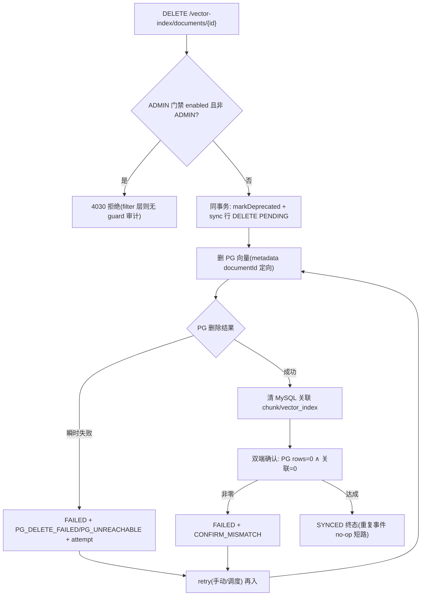
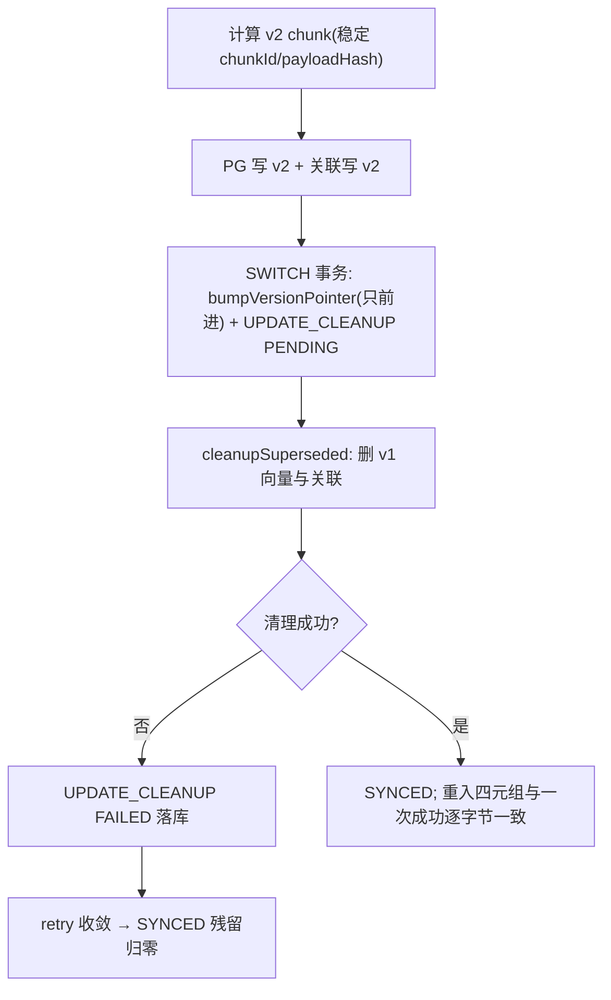

# D40-02 文档更新、删除与一致性修复——技术文档与实践指南

> 面向：one 线 `D40\D40_DUDACR`（`com.zl.d40`）维护者与后继迭代（D41+）开发者
> 视角：以 12 年 Java 架构 + 6 年 AI 工程落地的口径，按"是什么 → 为什么 → 底层原理 → 执行流程 → 核心代码 → 常见问题 → 工程实践"展开
> 事实来源：本文件所有结论均出自本地实码与 `docs\evidence\D40\` 实测证据；学习型阐述不涉及未验证断言
> 基线：JDK 21 / Spring Boot 3.5.16 / Spring AI 1.1.8 / MyBatis(-Plus 3.5.17 体系) / MySQL 8.0.33 / PostgreSQL 18.7 + pgvector 0.8.7

---

## 1. 是什么

D40 给向量知识库补上**写面治理层**，回答三个生产必答问题：

1. **副作用可观测**：一次"文档更新/删除"在 MySQL 元数据与 PG 向量库两侧的真实完成状态是什么？——`d40_document_sync` 操作级状态机。
2. **失败可收敛**：中途失败（PG 不可达、清理未净）能否重试到双端归零、且重复执行不多删不少删？——retry 管线 + 双端确认 + 幂等短路。
3. **状态可修复**：两侧数据漂移了怎么办？——五类漂移核查 + **修复一律走管线**（绝不裸 SQL 改业务表）。

外加两件配套治理：**ADMIN 门禁 + 审计**（谁能写）与**受控故障注入**（怎么证明失败路径真的被演练过）。

## 2. 为什么这样设计

### 2.1 为什么是"操作级"状态行，而不是文档级状态位

D31 的 `knowledge_document.status` 一个字段要同时表达"内容解析成功"与"向量同步成功"，v1→v2 场景里**新块已写、指针已切、旧版清理失败**这三种事实挤在一个状态位上必然失真。操作级模型把"文档 × 操作 × 版本"作为状态主键，一个文档可以同时有 `UPDATE_CLEANUP=FAILED` 与 `DELETE=SYNCED`，重试、审计、卡滞检测（SYNC_STUCK）都有落点。

**代价**：多一张表、多一套状态语义，且必须回答"状态行本身与事实不一致怎么办"——答案就是 D40 的一致性核查把 `SYNC_STUCK` 也列为漂移。

### 2.2 为什么删除用 tombstone 而不是物理删

`DELETE` 管线第一步是 `lifecycle_status='DEPRECATED'`（markDeprecated，见 §5），向量物理删除发生在 PG。保留 MySQL 文档行有三个真实收益：引用溯源可判"目标已删"（C17 `CITATION_TARGET_DELETED`）、重复删除事件有幂等锚点、误删可恢复语义留给未来。物理删除是**治理动作**（C19 cleanup），与业务删除动作在权限与流程上彻底分开。

### 2.3 为什么版本指针是唯一权威

"当前生效版本"只能有一个真源。D40 裁决：`knowledge_document.version` 为权威，`document_vector_index`/PG 是**派生事实**。因此：SWITCH 只前进（`bumpVersionPointer` 单调守卫）；一致性修复回拨指针用**绝对置位**（`setVersionPointer`，实测缺陷 2 的教训，见 §6）。指针切换与 sync 行落库同处一个 MySQL 本地事务，PG 侧靠"先写新→切指针→清旧"顺序保证任何时刻至少一个完整版本可检索。

### 2.4 为什么修复必须走管线

裸 SQL 直改业务表会绕过：payload 指纹重算、稳定 chunkId 生成、关联表联动、sync 状态推进、审计。一次性手工修好 ≠ 系统语义修好，且漂移会再次长出来。D40 用 grep 证明修复代码路径只调用 `forceReindex`/定向删除管线（C13 证据），这是"可重复性"与"可审计性"的最低门槛。

## 3. 底层原理

### 3.1 双端确认（two-sided confirmation）

SYNCED 的判定不是"管线没抛异常"，而是**执行后再读两侧事实**：PG 该文档向量行数=0 ∧ MySQL 关联/任务计数达成预期（`SyncStatus` 注释即此语义）。这来自一个朴素原则：分布式副作用（跨 MySQL/PG 两个存储，无 XA）下，只有**重读状态**能证明完成，返回值只能证明"上次尝试没炸"。`SyncRetryResultView` 把"未抛异常"与"SYNCED"分成两个字段（`executedWithoutError` ≠ 终态），防调用方误读。

### 3.2 幂等三元组与其盲区

D31 冻结的幂等判定 = `payloadHash + chunkId 集合 + 关联数`。盲区：它不含 PG 侧事实，所以"关联在、PG 没了"（DRIFT_META_ONLY）用普通 index 调用会被短路，**漂移永远修不掉**——这就是实测缺陷 1 与 `forceReindex` 重载的由来。工程启示：**幂等键必须覆盖你想保护的全部副作用面**，否则"幂等"会退化为"拒不修复"。

### 3.3 事务边界

- MySQL 本地事务内：tombstone 标记 + sync 行落库；SWITCH 切指针 + UPDATE_CLEANUP 行落库。均为单库事务，无跨库事务。
- 事务外：PG 删/写（网络调用，不可回滚）。失败通过 `SyncReasonCode` 落库（KP4 冻结 6 项：`PG_DELETE_FAILED`/`CONFIRM_MISMATCH`/`MARK_FAILED`/`SNAPSHOT_MISSING` 等；索引侧既有 3 码与 `PARSE_FAILED` 保留原存储位、不并入新枚举，防双实现漂移）。
- 重试并发防护：自动调度（`SyncRetrySchedulingConfiguration`，fixedDelay 默认 60s）只捞 `FAILED ∧ 到期 ∧ attempt < maxAttempts` 行，与手动 retry 共用水位。

### 3.4 门禁的两层结构（审计语义的根）

```
请求 → AccessFilter（认证/角色，4030 在此发出） → Controller guard（ADMIN 判定 + ALLOWED/DENIED 审计）
```

匿名/坏 token 在第一层就被拒，**guard 级审计结构上不会有 DENIED 行**——实测 14 探针中匿名 5 项无审计记录，是设计语义而非丢日志。要"匿名也留痕"就得在 filter 层加审计，那是另一个迭代的安全增强决策，不应静默混入。

### 3.5 集合指纹

`SHA-256(字典序 join("chunkId|contentSha|chars|documentId|version|strategy|chunkIndex|splitVersion"))`，与检索侧 InvertedIndex.build 逐字节同算法。指纹**不含权限键**（H6：权限元数据变更不改内容集合），所以 D39 权限演练与 D40 生命周期演练可以共用同一个冻结值 `10fc69d5…` 做回归哨兵。

## 4. 执行流程

### 4.1 删除闭环时序（graph TD）



### 4.2 更新 v1→v2 顺序



### 4.3 一致性核查与修复

检测（恒全域）→ 命中五类之一 → 修复分路：向量缺失走 `indexChunks(forceReindex=true)`；多余向量走定向删除；指针错走 `setVersionPointer` 权威重放；STALE 走 v1 定向删；SYNC_STUCK 走 retry 再入 → 复查归零 → 证据落盘。

## 5. 核心代码（本地实码摘录）

**单调前进 vs 权威置位**（`KnowledgeDocumentMapper.java`，实测缺陷 2 修复后的最终形态）：

```java
/** 版本指针更新（SWITCH 同事务追加）：仅向前推进（version < target），
 *  幂等重跑二次执行 0 行无害；文档行不存在 0 行（直接 /index 入库的未登记文档属预期）。 */
@Update("""
        UPDATE knowledge_document
           SET version = #{targetVersion}, updated_at = #{now}
         WHERE document_id = #{documentId} AND version < #{targetVersion}
        """)
int bumpVersionPointer(...);

/** D40 P4 修复（C12b 实测缺陷）：版本指针权威重放——无单调前进守卫。
 *  复用守卫 SQL 会把"回拨重对齐"静默吞成 0 行。仅由 VectorIndexStateTx
 *  .repointVersionPointer 在 MySQL 本地事务内调用。 */
@Update("""
        UPDATE knowledge_document
           SET version = #{targetVersion}, updated_at = #{now}
         WHERE document_id = #{documentId}
        """)
int setVersionPointer(...);
```

**tombstone（同文件）**：

```java
/** tombstone 标记（删除闭环同事务）：ACTIVE/DRAFT → DEPRECATED；
 *  已是 DEPRECATED 幂等覆盖无副作用；文档行不存在 0 行（不阻断删除管线）。 */
@Update("""
        UPDATE knowledge_document
           SET lifecycle_status = 'DEPRECATED', updated_at = #{now}
         WHERE document_id = #{documentId}
        """)
int markDeprecated(...);
```

**重试扫描水位**（`DocumentSyncMapper.java` 语义）：`WHERE sync_status='FAILED' ∧ 到期 ∧ attempt_count < maxAttempts`——手动 retry 与调度器共用，天然限流防重试风暴。

**状态机契约**（`SyncStatus.java` javadoc）：`SYNCED`＝"PG count=0 ∧ MySQL 关联/任务行=0"双端确认终态；`FAILED`＝任一步失败并落库原因码，attempt 达上限后停止自动重试（等待人工/修复管线）。

## 6. 常见问题（全部来自本轮实测）

**Q1 直接 import 报 4001？** import 前置依赖 register 行（先登记后导入），负路径已留痕 `p5-matrix.json`。E1 的 FAILED 是"受理成功后解析失败"，两者别混。

**Q2 一致性修复跑了但漂移还在？** 普通 `indexChunks` 被幂等三元组短路（§3.2）；修复路径必须 `forceReindex=true`（本迭代已内置于 `VectorReconciliationService`）。

**Q3 VERSION_MISMATCH 修复后指针没动？** 旧实现复用 `WHERE version<target` 静默 0 行；现走 `setVersionPointer`。教训：**"0 行更新"在布尔返回值丢失时就是静默失败**。

**Q4 PARTIAL 状态怎么复现？** `VECTOR_INDEX_BATCH_SIZE=1` 且文档块数 >1；默认 batch=100 小夹具不会出现 PARTIAL，不是 bug。

**Q5 匿名被拒不进审计？** 设计语义（§3.4）。审计矩阵以"已过 filter 的非 ADMIN 凭据请求"为 DENIED 留痕基准。

**Q6 retry 返回 executedWithoutError=true 却仍 FAILED？** 正常：双端确认非零走 `CONFIRM_MISMATCH`。"没抛异常"≠"事实达成"（§3.1）。

**Q7 删除后的文档还能被检索到？** 不能。已删 chunk 不在 PG 检索面，结构上不可达；"竞态残留"在本架构 N/A（C17 裁决留痕）。

**Q8 注入计数怎么突然不生效了？** 装饰器计数器 per-instance 内存态，重启归零、每注入点一次性消耗；矩阵必须绑定实例生命周期（injA/injB 日志）。

**Q9 sync/audit 表能不能直接 DELETE 清数据？** 业务态不能（绕过闭环）；C19 治理清理可以，但必须前缀限定 + dryRun 留痕 + harness 复核（`d40_p6_cleanup.ps1` 模板）。

**Q10 `Result` 为什么 HTTP 全是 200？** 项目冻结约定：业务码在体内（200/4001/4030/5000）；5000+“系统繁忙”是注入态业务异常包装。判门禁看体码。

## 7. 工程实践清单

1. **新副作用先问三件事**：状态放哪个操作行？失败原因码是什么？双端确认读什么事实？——答不出就不该加异步副作用。
2. **幂等键覆盖副作用全貌**（含远端存储），并给修复流程留一个显式 force 通道。
3. **守卫 SQL 与覆写 SQL 分开命名**（bump vs set），绝不复用；mapper 返回 int，调用方对 0 行敏感。
4. **检测与修复分权限**：检测全域只读、修复按 scope 走管线，永远不做"手工 UPDATE 业务表"。
5. **回归哨兵三件套**：逐字节 diff（评测 60 行）+ 集合指纹（10fc69d5…）+ 锚点 top1 delta≤1e-9；任一偏离即熔断，不解释后放行。
6. **夹具与真实语料物理隔离表**（d40_vector_store vs vector_store 域前缀），清理脚本仅前缀 LIKE 限定。
7. **证据先行**：每个 PASS 必须能指到 snap/harness 原始底账；判定 note 与数据文件分开写（gating.jsonl 尾部 note 行）。

### 记忆简语

- **"一行一操作，双端读事实"**——状态机与 SYNCED 判定
- **"先写新、切权威、后清旧；失败落库、重试归零"**——更新闭环
- **"墓碑留、向量删、引用判删、竞态 N/A"**——删除与交叉
- **"检测全域、修复走管线、裸 SQL 零容忍"**——一致性
- **"filter 拒匿名、guard 记审计、前进守卫不复用"**——门禁与指针
- **"指纹不含权限、计数随实例、回归三件套"**——治理哨兵

### 层级树

```text
D40 写面治理
├─ 操作级同步状态机 d40_document_sync
│  ├─ 键：documentId × operation × version
│  ├─ 态：PENDING → SYNCING → SYNCED | FAILED(+原因码/attempt)
│  ├─ 幂等：payloadHash 三元组 + SYNCED no-op 短路；修复盲区=forceReindex
│  └─ 重试：手动 retry + 调度水位(FAILED∧到期∧未耗尽)
├─ 删除闭环
│  ├─ tombstone(markDeprecated 同事务) → PG 定向删 → 关联清 → 双端确认
│  └─ 引用交叉：CITATION_TARGET_DELETED；竞态结构性 N/A
├─ 更新闭环 v1→v2
│  ├─ 先写新块 → SWITCH 原子切指针(权威) → cleanupSuperseded
│  └─ bumpVersionPointer(只前进) vs setVersionPointer(权威重放) 职责分离
├─ 一致性核查
│  ├─ 五类：META_ONLY / VECTOR_ONLY / VERSION_MISMATCH / STALE_VERSION / SYNC_STUCK
│  └─ 修复：全走管线；grep 证明零裸 SQL；复查归零
├─ 门禁与审计 d40_admin_audit
│  ├─ 两层：AccessFilter(认证/4030) + Controller guard(ADMIN/审计)
│  └─ 匿名无 guard 审计=设计语义；disabled 态零差异(C05)
├─ 故障注入(收口)
│  └─ 默认 false + 独立 profile + per-instance 一次性计数
└─ 治理哨兵
   ├─ 集合指纹 10fc69d5…(算法=检索侧 InvertedIndex，不含权限键)
   └─ 回归三件套：60 行 diff + 指纹 + QA-001 top1
```

## 8. 官方文档溯源

| 主题 | 出处 |
|---|---|
| Spring Boot 配置与 Profile 装配（门禁/注入开关） | 《Spring Boot Reference | Spring Boot 参考文档》 https://docs.spring.io/spring-boot/reference/ |
| Spring 事务抽象与 TransactionTemplate（本地事务边界） | 《Spring Framework Transaction | Spring 事务管理》 https://docs.spring.io/spring-framework/reference/transaction.html |
| pgvector 索引与删除语义（向量侧事实源） | 《pgvector README》 https://github.com/pgvector/pgvector |
| PostgreSQL JSON 算子（metadata->>'documentId' 定向删/指纹读取） | 《PostgreSQL Documentation – JSON Functions | PostgreSQL 文档 – JSON 函数》 https://www.postgresql.org/docs/current/functions-json.html |
| Spring AI（向量库抽象与 EmbeddingModel，D31 基线沿用） | 《Spring AI Reference | Spring AI 参考文档》 https://docs.spring.io/spring-ai/reference/ |
| SLF4J MDC（request_id 32 字符贯通审计） | 《SLF4J MDC Manual》 https://www.slf4j.org/manual.html#mdc |
| JUnit Platform / node --test（C01 双栈测试） | https://junit.org/junit5/docs/current/user-guide/ ；https://nodejs.org/api/test.html |

> 溯源说明：以上为机制层官方出处；D40 具体语义（KP4 六原因码、双端确认条件、幂等三元组）为本仓库冻结裁决，以 `docs\evidence\D40\probe\sync-params.json`、`kp1-kp4-adjudication.md` 为准。
