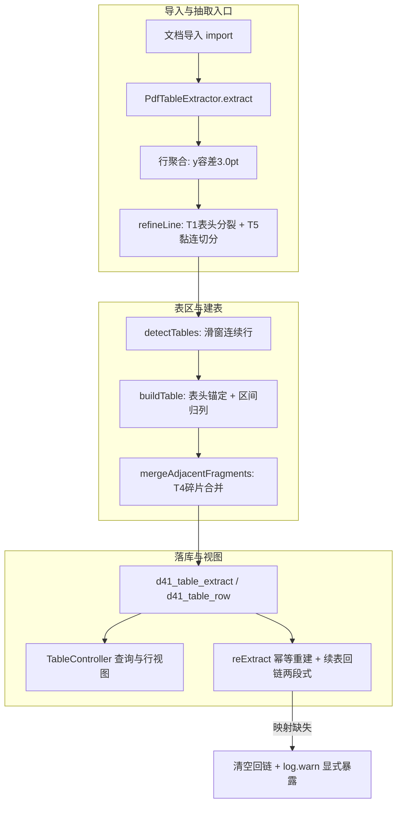

# D41-01 设备手册表格抽取——全量信息与操作手册

- 迭代：D41（D41_TASIIEM：Table-Aware Structuring, Ingestion, Indexing, Evaluation & Memory）
- 日期：2026-11-25（含 R01/R02/R03 切片全量事实）
- 定位：本文是 D41 迭代的**事实与操作台账**（做了什么/改了哪里/如何复跑/如何清理）；
  原理与学习指南见《D41-02_设备手册表格抽取技术文档与实践指南》。

---

## 1. 迭代总览与结论

D41 在 M3-Java 双线仓库 one 轨（模块 `D41\D41_TASIIEM`，包 `com.zl.d41`，端口 8080）建成
**PDF 设备手册表格抽取链路**：导入即抽表 → 结构化落库（`d41_table_extract`/`d41_table_row`）→
按文档/页查询 → 行级检索视图，为后续 RAG 表格问答供给结构化证据。

| 切片 | 内容 | 收口 |
|---|---|---|
| P0–P6 主迭代 | 坐标聚类抽取器、Text 抽取器、落库服务、Controller、导入钩子、权限审计接线、12 受控夹具 25 用例 | 提交树内（b479680 前） |
| R01 | 续表 ID 映射修复 + 表格专项测试 + **真实 ASDA-A2 手册 225 格逐格对账**（27/67/131/0，还原率 41.8%） | `b479680` |
| R02 | 交付规范补齐（状态文件 R02/R03 + 本文档 + D41-02） | 本次 |
| R03 | 解析能力整改 T1–T5（表头锚定/升格修复/区间归列/碎片合并/黏连分隔），**225 格 195/30/0/0，还原率 86.7%，wrong_value=0** | 本次 |

**核心结论**：数值保真红线全程守住（wrong_value 恒 0）；网格还原率 41.8%→86.7% 由坐标级
根因修复达成；剩余 30 格为 R01 真值转写拼写差异（非解析缺陷，见 §4/§9）。

## 2. 变更范围清单

### 2.1 R03 代码改动（本切片，全部在 table 包内）

| 文件 | 变更性质 | 要点 |
|---|---|---|
| `D41\D41_TASIIEM\src\main\java\com\zl\d41\document\table\PdfTableExtractor.java` | 修改 | Span 增 glyphs（内部 record）；refineLine（表头分裂 T1 + 黏连切分 T5）；buildTable 表头锚定 + intervalColumn 区间归列（T1/T3，删全局聚类+subList 截断）；mergeAdjacentFragments（T4） |
| `...\table\model\TablePatterns.java` | 修改 | 新增 MODEL_COL_TOKEN / MODEL_COL_START / NUMERIC_SUFFIX / FRAGMENT_* / FLAG_FRAGMENT_MERGED；六个冻结阈值未动 |
| `D41\D41_TASIIEM\src\test\java\com\zl\d41\document\table\PdfTableR03MechTest.java` | 新增 | 8 用例（先红后绿，合成坐标取自 p396–398 真实 spans dump） |

### 2.2 契约冻结面（未触碰，逐项核验）

TableView/TableCell/DetectedTable 对外字段、`/api/v1/documents/{id}/tables`、
`/api/v1/tables/{id}/rows` 等 Controller 端点、JSON 返回结构、`d41_table_extract`/
`d41_table_row` 表结构——R03 全部零变更；`Span`/`Glyph` 为包内 record，非对外契约。

### 2.3 证据产物（`docs\evidence\D41\R03\`）

r03-mvn-baseline.log（78/78）→ r03-t1t5-red.log（先红 5 FAIL）→ r03-t1t5-green.log（8/8）
→ r03-mvn-full-post.log（86/86 BUILD SUCCESS）→ calib-prerun-cell-diff.json（口径校准
diff=0）→ extracted-cells-post(-raw).json（全书重抽 353 表）→ post-cell-diff.json
（195/30/0/0）→ online-verify-r03rerun.json（在线 11/11 ALL-PASS）。

## 3. 核心设计与执行流程（事实层）

抽取流水线（PdfTableExtractor.extract）：

1. **行聚合**：PDFBox 文本进程按 y（ROW_TOL=3.0pt）聚为 Line，Line 携带 span 字形明细；
2. **行精化 refineLine**（R03 新增，幂等）：型号表头行巨 span → 按空白/型号起点分裂（T1）；
   "标签 数值"复合 span → 数值后缀切分（T5，单位 `5.5 mm` 等前缀数值形态不切）；
3. **表区识别 detectTables**：连续 ≥MIN_TABLE_ROWS(2) 行、≥MIN_TABLE_COLS(2) 锚的 y 滑窗；
4. **建表 buildTable**：列锚=**表头行（refine 后）span x**（非全行聚类）；数据行按锚区间
   归列（列界=相邻锚中点，T3）；LOW_CONF_SHARE=0.3 低置信列仍显式打标不吞值；
5. **碎片合并 mergeAdjacentFragments**（R03 新增）：同页、表区≤2 行或已带合并标记、
   列数相等、lineIndex 间隙≤1 → 合并，后块伪表头降格为类型化数据行（零丢失）；
6. **落库**：TableRecordService 按 document 幂等重建；续表回链两阶段（先插新行、
   idRemap 就绪后第二遍重建，映射缺失清空+log.warn）。

Mermaid（Typora 兼容）：



## 4. 异常矩阵 E1–E6 事实表（error-list 39 行 → 整改结果）

| 编号 | 现象（R01 实测） | 根因（R03 坐标级证据） | 整改 | 复算结果 |
|---|---|---|---|---|
| E1 | p396 右侧型号列整体丢失 | 数值列 x 漂移 ±6–8pt 制造伪锚，`subList(0,baseCols)` 截掉右列 | 表头锚定+区间归列（T1/T3） | 5 列完整，missing 归零 |
| E2 | p397/398 首数据行 LC 升格为表头 | 表头行粘连为单巨型 span（1 锚 <MIN_TABLE_COLS=2）被滑窗排除出表区 | T1 分裂后表区自然含表头（机理修正见 state_R03 §3） | 表头=Model+6/5 型号列，15 行归表 |
| E3 | LL 长标签行数值漂移到 c0 | 全行聚类锚对标签 x=56.7 敏感 | 表头锚区间归列吸收漂移 | LL 行值落正确列 |
| E4 | "LL（不帶剎車） 147.5"同 span 黏连 | 单 span 内含标签+数值（空白分界） | splitStickyValue（数值后缀+前缀非数值谓词） | p398 LL 行值归位 |
| E5 | 大表断裂成 1 行碎片（全书 214 个） | 参数块间 lineIndex 间隙被独立成表 | mergeAdjacentFragments | 碎片 214→117，行数 982→1418 零丢失 |
| E6 | Wingdings 无 Unicode 映射告警 | 符号字体页缺映射 | 本轮记录不改（state_R03 §6） | 目标表无数值字符受影响 |

剩余 30 格 unaligned：p397 真值列名 `C1110ES` ↔ 文本层实测 `C11010ES`（15 格）、
p398 `C111020□S` ↔ `C11020□S`（15 格）——值全部在场且归列正确，属 R01 人工誊录
与原 PDF 拼写差异；真值文件按纪律冻结，待裁决勘误。

## 5. 测试矩阵（15 类 86 用例）

- 既有 14 类 78 用例零退化（含 12 夹具逐格对账、类型化、Text 抽取、reExtract 回链）；
- 新增 PdfTableR03MechTest 8 用例：t1HeaderGiantSpanSplit / t2PromotedHeaderReentry /
  t3DriftedRowInterval / t4FragmentMerge / t4GapTooWideNotMerged / t5StickyLabelValueSplit /
  t5UnitPairNotSplit / t5ModelAndDateNotSplit。

## 6. 运维手册

### 6.1 环境前置

```powershell
# 模块编译测试（JDK=D:\SoftwareInstall\JDK\JDK21；mvn=3.9.16）
mvn -B -f D41\pom.xml -pl D41_TASIIEM test
# 在线验证（默认 mock，零 Key 零外网）
$env:AI_MODE='mock'
mvn -B -f D41\pom.xml -pl D41_TASIIEM spring-boot:run "-Dspring-boot.run.profiles=r5" "-Dspring-boot.run.arguments=--server.port=8080"
# 密钥仅环境变量注入：MYSQL_PASSWORD / REDIS_PASSWORD / DASHSCOPE_API_KEY / PG_VECTOR_PASSWORD
```

### 6.2 关键端点

| 端点 | 方法 | 说明 |
|---|---|---|
| `/api/v1/documents/import` | POST(multipart) | 导入即抽表；**上传上限 2MiB（2097152B），4001 显式拒绝** |
| `/api/v1/documents/{documentId}/tables` | GET | 该文档全部表（header/pageNumber/rowCount） |
| `/api/v1/tables/{tableId}/rows` | GET | 行级单元（value+type） |
| `/api/v1/documents/{documentId}/reExtract` | POST | 幂等重建；返回表数与行数 |

### 6.3 225 格复算程序（可重跑）

```powershell
# 1) 全书重抽（探针 default package，java 直跑；root=裸表数组）
$cp = (Get-Content 'docs\temp_docs\D41\r03\d41-cp.txt' -Raw).Trim()
& 'D:\SoftwareInstall\JDK\JDK21\bin\java.exe' '-Dfile.encoding=UTF-8' -cp "D41\D41_TASIIEM\target\classes;$cp" D41RealManualProbe docs\temp_docs\D41\r01\ASDA-A2-gongkong-mirror.pdf docs\evidence\D41\R03\extracted-cells-post-raw.json
# 2) 逐格 diff（权威工具，口径已校准）
.\docs\temp_docs\D41\r03\d41_r03_cell_diff.ps1 -ExtractedJson docs\evidence\D41\R03\extracted-cells-post.json -OutJson docs\evidence\D41\R03\post-cell-diff.json
```

注意：MySQL8 中 `rows` 是保留字（查询须反引号或换别名）；D41DbQuery 需 `$env:MYSQL_PWD`
注入本地测试库口令（值见 `application-d41*.yml` 的 `${MYSQL_PASSWORD:默认值}` 占位，
本文不转录口令字面）。

### 6.4 清理与恢复程序（C19 模板）

```powershell
# 清场：删除验证文档 → 表/行随 delete 级联清除 → 终态核验
DELETE /api/v1/vector-index/documents/{docId}
# DB 终态（本轮 R03 收口实测）：d41_table_extract=0 行 / d41_table_row=0 行 /
# knowledge_document LIKE 'D41-R03RE%' = 8 条 tombstone（删除闭环终态，正常）
```

## 7. 实测产品缺陷与修复记录

1. **续表回链悬空**（R01 整改，b479680）：reExtract 新 ID 未回写 → 两段式重建修复；
   R03 回归保护：TableRecordRebuildTest 5 用例 + 在线复跑 idRemap 步 PASS
   （旧 ID 行清零=dangling 0/oldRows 0 双口径核验）。
2. **验证脚本三坑**（R03 在线复跑排障，非产品缺陷）：同字节导入命中 contentHash 去重
   （`duplicate:true`，既定设计）；rows URL 前缀笔误；MySQL `rows` 保留字。
   教训：复跑夹具必须变体字节（尾注）走真实导入路。

## 8. 配置项速览（application-d41 相关，实际生效值）

| 配置 | 值 | 语义 |
|---|---|---|
| `d41.table.enabled` | true | 表格链路总开关 |
| `d41.table.max-file-size` | 2097152 | 上传上限（8.5MB 手册在线导入被拒的根源） |
| `document.table.ocr.enabled` | false | OCR 占位关断（维持） |
| Word 支持 | WORD_NOT_SUPPORTED | 显式降级（维持） |
| 冻结阈值 | 见 §3 | TablePatterns 六常量，R03 未动 |

## 9. 遗留与后续建议

1. 30 格真值拼写差异 → 待用户裁决真值勘误（勘误后 expected.json 更新可复算归零）。
2. E6 字体符号映射 → 候选方案（U+FFFD 显式标记）待立项。
3. 真实手册在线导入受 2MiB 上限约束 → 若需在线全链路验证大 PDF，须单独授权调上限。
4. 千分位数值形态（`1,480.5`）超出 225 格样本面 → 更大样本上线后复扫。
5. D42（Rerank 评估）已独立收口（not-adopt，verdict 见 D42 状态文件），表格抽取的
   下游问答价值评估建议挂 D43 立项。
