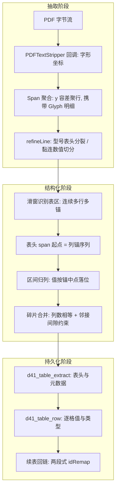

# D41-02 设备手册表格抽取——技术文档与实践指南

- 迭代：D41 · 日期：2026-11-25（R03 整改后口径）
- 人设视角：12 年 Java 架构 + 6 年 AI 工程落地
- 配套：事实台账见《D41-01_设备手册表格抽取全量信息与操作》；
  整改证据链见 `docs\evidence\D41\R03\` 与 `D41_state_R02/R03.md`

---

## 1. 是什么（What）

D41 解决一个问题：**工业设备手册（PDF）里的参数表，如何变成 RAG（Retrieval-Augmented
Generation，检索增强生成）可用的结构化证据**，而不是被切块（chunk）切碎成一堆无列语义
的文本渣。产出物=每张表的表头、逐行逐单元（值+类型）、可按文档/页/表三级检索的库表与 API。

技术边界（L1–L5 能力分层，诚实声明）：

| 层 | 能力 | D41 现状 |
|---|---|---|
| L1 | 文本层可抽 PDF（digital PDF） | ✅ PDFBox 3.0.7 唯一表格源 |
| L2 | 无框线表（空白对齐）坐标聚类还原 | ✅ 本轮主战场 |
| L3 | 续表/跨页表回链 | ✅ 两段式 idRemap |
| L4 | 扫描件/图片表 OCR | ❌ 占位关断（ocr.enabled=false） |
| L5 | Word/富文档表格 | ❌ WORD_NOT_SUPPORTED 显式降级 |

## 2. 为什么难（Why）

工业手册表格是 PDF 里最恶劣的形态：**没有表格线**。PDF 内容流只有"某字体某字号在
(x,y) 画某字符"，一张参数表=几百个独立文本定位指令。所谓"表"只存在于人类视觉的
对齐先验里。程序必须从纯几何（x/y 坐标分布）反推行列结构——这就是 D41 全部缺陷
（E1–E5）的统一根因域。

工程教训一句话：**任何"用一维统计代替二维结构"的捷径（贪心聚类、固定列宽、文本
分隔符）在漂移 ±6pt、黏连、碎片化三重噪声下都会系统性崩塌**；唯一稳的锚是
**表头行本身的 span 边界**。

## 3. 底层原理（How it works）

### 3.1 PDF 文本层与坐标模型

PDFBox（Apache 开源 Java PDF 库）`PDFTextStripper` 的 `writeString(String, int[] yLine,
Rectangle2D, String)` 回调给出每个文本片段的位置矩形（pt，1/72 英寸）。三个事实决定一切：

1. y 微小抖动（同基线 ±1pt）→ 需要 ROW_TOL 容差聚行；
2. x 无列约束（同列各行 x 可漂移 ±8pt）→ 列锚不能取自单行；
3. 一个"单元格"可能是 1 个 span，也可能是 5 个 span，还可能是 1 个 span 内含 2 个语义
   （黏连）→ 语义边界 ≠ span 边界，必须字形（glyph）级介入。

《Apache PDFBox 3.0 | PDFTextStripter 提取》：
https://pdfbox.apache.org/3.0/extensions.html
《Adobe PDF Reference 1.7 | 文本显示算子 Td/Tj》（坐标语义权威）：
https://aardvic.com/pdf/reference/

### 3.2 R03 五个修复的机制本质

| 任务 | 机制 | 一句话原理 |
|---|---|---|
| T1 表头锚定 | 列边界=表头行 refine 后 span starts | 表头是列语义的唯一天然定义者，用它当尺 |
| T1/T2 巨 span 分裂 | 字形级扫描：空白字形 or 型号起点（`(?=\p{Lu}\d{4,5})`）处切开 | 把"1 span 多语义"还原成"1 span 1 语义" |
| T3 区间归列 | 列界=相邻锚中点，行值按落入区间归列 | 对漂移鲁棒的最近邻判定，天然消歧 |
| T4 碎片合并 | 同页+列数相等+双碎片形态+间隙≤1 | 断裂的续块与主表共享列骨架，伪表头降格为数据行 |
| T5 黏连切分 | 空白字形后接完整数值字面（`^[-+±]?\d[\d,]*(\.\d+)?$`）且前缀非数值 | 只在"切了必然对"的谓词下动手，单位对不切 |

**关键设计判断**（面试/评审高频追问点）：

1. **为什么删除"全行贪心聚类 + subList 截断"？** 聚类把漂移 x 当新锚，伪锚挤占名额后
   截断逻辑直接丢弃右侧真列——p396 丢 2 列的实锤路径。表头锚定后列数是先验而非统计产物。
2. **为什么 refine 必须幂等？** detectTables 入口对已精化行再跑一次，若谓词命中已切分
   行会造成二次碎裂；"型号起点"谓词作用于切分产物时前缀已非数值/空白不重现，天然幂等，
   并以防御用例钉死（t5UnitPairNotSplit/t5ModelAndDateNotSplit）。
3. **为什么 wrong_value 恒 0 是红线？** 抽取器可以漏、可以错位（可诊断），但**绝不能改值**
   （147.5 变 147.6 是静默污染下游问答）。所有切分只按字形 x 重排边界，不触碰字符序列。

### 3.3 执行流程（全链）



## 4. 核心代码导读（真实文件锚点）

`PdfTableExtractor.java`（com.zl.d41.document.table）：

```java
// 1) 表头判据：型号 token ≥2 且 ≥半数 span 命中型号形态 → 才允许分裂（防误伤普通行）
boolean isModelHeaderLine(Line line) { ... MODEL_COL_TOKEN ... }

// 2) 列锚 = 表头行 refine 后 span starts —— R03 的胜负手（替代全行聚类+截断）
List<Float> anchors = headerLine.spans.stream().map(s -> s.startX)...;

// 3) 区间归列：二分找落入区间（列界=相邻锚中点）
int col = intervalColumn(anchors, span.startX);

// 4) 黏连切分：空白字形 + 后缀完整数值 + 前缀非数值形态，三者同时成立才切
Optional<int[]> cut = splitStickyValue(span);   // NUMERIC_SUFFIX
```

`TablePatterns.java`：六个冻结阈值（ROW_TOL=3.0 / COL_GAP=25.0 / COL_ANCHOR_TOL=6.0 /
MIN_TABLE_ROWS=2 / MIN_TABLE_COLS=2 / LOW_CONF_SHARE=0.3）**本轮零改动**；新增常量均为
谓词形态（正则/布尔边界），不是新自由度——调参面没有扩大，这是最小改动的设计性证明。

## 5. 常见问题（FAQ，全部来自本轮实测）

1. **为什么导入响应 `duplicate:true` 且不产表？** contentHash 全等且非 FAILED → 去重跳过
   （既定设计）。回归复跑必须用**变体字节**夹具（PDF 尾注 `%%...`、md 注释行）强制真实导入路。
2. **对账显示 missing 但探针里明明有值？** 先查工具根结构：探针输出是**裸表数组**，
   cell-diff 工具期望 `{meta,tables}` 壳；`ConvertFrom-Json` 后 `$j.tables` 对裸数组
   静默空集 → 假 missing。先看 head 确认 root 形态再下结论。
3. **`SELECT ... rows` 报语法错？** MySQL8 保留字，反引号或换别名。
4. **改完单测绿了为什么还要全书重抽？** 合成夹具证明机制、真实手册证明还原率——
   两者不可互替；225 格复算必须与整改前**同一工具同一口径**（先做 diff=0 校准再跑后值）。
5. **值对但列错（unaligned）算修好没有？** 不算全好但性质不同：值在场=抽取零丢失，
   列错=归列或真值问题。本轮 30 格即后者（真值拼写誊录差异），诊断路径见 state_R03 §2。

## 6. 工程实践守则（从 D41 三个切片沉淀）

1. **先红后绿不可妥协**：T1–T5 每项先写复现用例（r03-t1t5-red.log 5 FAIL）再实现——
   红阶段同时是"机理假设的证伪现场"（T2 任务书假设即在此被 spans dump 推翻）。
2. **证据先于叙事**：任务书写"图形区粘连"，实测"表头巨 span"——按证据修，
   并把偏差写进状态文件，不悄悄替换任务书口径。
3. **冻结纪律**：真值文件（expected）不因整改结果反改；阈值不因个案放宽；
   数值字面永不改写。
4. **口径单源**：225 格分类器只有 `d41_r03_cell_diff.ps1` 一个权威实现，
   整改前后各跑一次，杜绝"换了把尺子量出进步"。
5. **在线终态归零**：每轮验证文档删除清场（dangling=0、extract/row=0），
   tombstone 记录保留=删除闭环的正常终态。

## 7. 记忆简语

- 表头是尺，不是统计（锚取表头 span，勿聚类）。
- 可以漏、可以错列，不能改值（wrong_value=0 红线）。
- 幂等靠谓词天然不可重现，不靠状态记录。
- 复跑换字节，不然撞去重（contentHash duplicate）。
- 先红是假设的葬礼，绿是证据的婚礼。

## 8. 知识层级树

```
D41 设备手册表格抽取
├── 输入域
│   ├── digital PDF（文本层可抽，L1/L2）
│   ├── 扫描件 → OCR 关断（L4 占位）
│   └── Word → 显式降级（L5）
├── 几何还原
│   ├── 行：y 容差聚合（ROW_TOL）
│   ├── 列：表头锚定 + 区间归列（R03 核心）
│   ├── 语义修复：T1 巨 span / T5 黏连 / T4 碎片
│   └── 表区：滑窗行数列数下限（冻结值）
├── 持久化
│   ├── d41_table_extract / d41_table_row
│   ├── 幂等重建 reExtract
│   └── 续表两段式 idRemap
├── 验证体系
│   ├── 夹具轨：12 件 SHA 钉死 + 25 用例逐格
│   ├── 机制轨：PdfTableR03MechTest 8 用例先红后绿
│   ├── 真实轨：ASDA-A2 225 格 cell-diff（41.8%→86.7%）
│   └── 在线轨：mock 闭环 11 步 ALL-PASS
└── 纪律层
    ├── 契约冻结 / 最小改动 / wrong_value=0
    ├── 密钥环境变量注入 + 提交前卫生扫描
    └── 诚实声明：NOT RUN 显式标注（大 PDF 在线导入=2MiB 边界）
```

## 9. 官方溯源

1. 《Apache PDFBox 3.0 Documentation | PDFBox 3.0 文档》：
   https://pdfbox.apache.org/3.0/documentation.html
2. 《PDFBox PDFTextStripper Javadoc | 文本提取器 API》：
   https://javadoc.io/doc/org.apache.pdfbox/pdfbox-layout/3.0.7/
3. 《Spring Boot 3.5 Reference | Spring Boot 3.5 参考文档》（模块装配基线）：
   https://docs.spring.io/spring-boot/docs/3.5.16/reference/html/
4. 《MySQL 8.0 Keywords and Reserved Words | 关键字与保留字》（rows 坑权威依据）：
   https://dev.mysql.com/doc/refman/8.0/en/keywords.html

（PDF Reference 1.7 链接为社区转载镜像，正文坐标语义与 Adobe 官方 ISO 32000-1 一致，
以 ISO 32000-1 §9.4 Text Objects 为准。）
