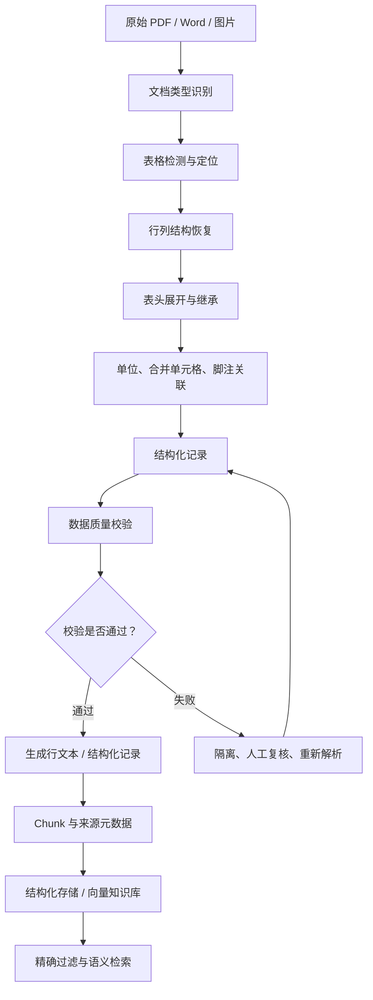

# M3 知识笔记：RAG 中的表格解析与结构化信息抽取

> **建议文件名：** `RAG表格解析与结构化信息抽取.md`\
> **技术基线：** JDK 21 / Spring Boot 3.5.16 / Spring AI 1.1.8 / PostgreSQL 18.7 / pgvector 0.8.7\
> **核心目标：** 将设备手册中的故障码表、参数表转换为字段关系完整、单位明确、来源可追溯、可校验、可检索的知识数据。

---

## 一、核心原理：表格不是普通文本

普通文本主要依靠句子顺序表达语义，而表格依赖行、列、表头、合并关系、单位和注释共同表达语义。

例如设备手册中有一张参数表：

| 设备型号 | 参数名称 | 设定值 | 单位 | 备注     |
| -------- | -------- | ------ | ---- | -------- |
| Servo-A  | 额定压力 | 0.8    | MPa  | 标准工况 |
| Servo-A  | 最高压力 | 1.2    | MPa  | 短时运行 |
| Servo-B  | 额定压力 | 0.6    | MPa  | 标准工况 |

如果直接把表格转成没有上下文的文本：

```
额定压力 0.8
最高压力 1.2
额定压力 0.6
```

就可能丢失：

- 0.8 和 1.2 的单位是 MPa。
- 0.8 属于 Servo-A。
- 1.2 属于 Servo-A，且只适用于短时运行。
- 0.6 属于 Servo-B。
- 额定压力和最高压力不是同一个参数。

一旦这些关系在解析阶段丢失，后面的 Chunk、Embedding、检索和生成都可能建立在错误数据上。

例如用户询问：

> Servo-B 的额定压力是多少？

如果型号关系丢失，系统可能把 Servo-A 的 0.8 MPa 当作 Servo-B 的参数。

**表格解析的核心不是识别出多少个文字，而是正确恢复每个值属于哪个字段、哪个设备、哪个条件和哪个来源。**

### 1. 完整数据流



| 阶段       | 主要处理                   | 可能丢失的信息     |
| ---------- | -------------------------- | ------------------ |
| 文档识别   | 判断 PDF、DOCX、图片类型   | 页面类型识别错误   |
| 表格定位   | 定位表格区域               | 表格边界、标题     |
| 行列恢复   | 恢复单元格坐标及顺序       | 合并关系           |
| 表头处理   | 展开多级表头、继承续表表头 | 字段语义           |
| 语义关联   | 绑定单位、型号、脚注       | 数值与条件错配     |
| 结构化     | 转换为业务记录             | 原始结构及上下文   |
| 校验       | 检查类型、范围和关系       | 异常数据未被发现   |
| Chunk 生成 | 形成可检索内容             | 行之间的业务关联   |
| 入库       | 持久化与索引               | 来源和版本追溯关系 |

## 二、表格结构识别

### 1. 有线表与无线表

**有线表（Ruled Table）**

通过横线、竖线或网格线辅助识别行列边界。

常见识别方法：

- 检测水平线和垂直线。
- 根据线条交点划分单元格。
- 将文字坐标映射到对应单元格。
- 处理线条断裂、边框缺失和扫描噪声。

常见问题：

- 单元格内部有额外分隔线。
- 横线断裂，导致一行被拆成多行。
- 表格边框与文字重叠。
- 合并单元格导致部分边界线消失。

**无线表（Borderless Table）**

没有完整边框，通常依靠文字坐标、间距和对齐关系识别列。

例如：

```
报警代码       故障原因             处理建议
E-07          编码器反馈异常       检查编码器连接线
E-08          电机过载             检查机械负载
```

无线表的列边界可能没有实际线条，需要：

- 获取文字块横纵坐标。
- 根据列对齐关系判断列边界。
- 根据垂直间距和基线判断行。
- 结合表头、重复模式和字段类型修正列归属。

**区别：** 有线表主要依赖几何边界，无线表更多依赖文字布局。不能使用同一套简单的字符串切分规则处理所有表格。

### 2. 合并单元格

合并单元格常见两种情况：

- 跨列合并：一个表头横跨多个字段。
- 跨行合并：一个设备型号、参数类别或适用条件覆盖多行数据。

示例：

| 设备型号            | 参数名称 | 数值 | 单位 |
| ------------------- | -------- | ---- | ---- |
| Servo-A（合并两行） | 额定压力 | 0.8  | MPa  |
| <br>                | 最高压力 | 1.2  | MPa  |

第二行的设备型号为空，并不表示没有设备型号，而是继承上一行合并单元格的 Servo-A。

错误结果：

```
{
  "model": null,
  "parameter": "最高压力",
  "value": 1.2,
  "unit": "MPa"
}
```

正确结果：

```
{
  "model": "Servo-A",
  "parameter": "最高压力",
  "value": 1.2,
  "unit": "MPa"
}
```

但是不能把所有空单元格都自动继承上一行。只有能够确认它属于合并单元格的范围时，才应该继承。

### 3. 嵌套表格

嵌套表格是一个单元格内部还包含另一张表格。

例如：

| 参数类别 | 参数内容                           |
| -------- | ---------------------------------- |
| 电机参数 | 内部包含额定转速、额定功率的小表格 |

如果内部结构实际上是：

| 参数     | 数值     |
| -------- | -------- |
| 额定转速 | 1500 rpm |
| 额定功率 | 5 kW     |

就不能简单把整个单元格拼成一段文本。

处理策略：

1. 先识别外层表格。
2. 检查单元格内部是否包含表格对象或独立布局。
3. 对内部表格单独解析。
4. 保留外层记录与内部参数的父子关系。
5. 为内部记录继承必要的设备型号和来源信息。

### 4. PDF 与 Word 表格解析差异

| 维度       | PDF                            | Word DOCX                            |
| ---------- | ------------------------------ | ------------------------------------ |
| 表格本质   | 页面上的绘制和排版结果         | 文档结构中的表格对象                 |
| 行列信息   | 可能需要从坐标和线条推断       | 通常可以读取行、单元格对象           |
| 合并单元格 | 需要从几何布局或识别结果恢复   | 可以读取单元格合并属性               |
| 阅读顺序   | 可能受到多栏布局、浮动对象影响 | 通常具有较明确的段落与表格顺序       |
| 跨页表格   | 需要结合页面布局判断是否续表   | 需要结合表格结构、分页和重复表头判断 |
| 主要风险   | 结构重建错误                   | 文档结构复杂、嵌套和格式异常         |

PDF 不是天然的二维表格数据库。即使 PDF 内存在可复制文字，也不意味着它保存了完整的行列关系。

Word 原生表格通常可以读取行和单元格结构，但复杂合并、嵌套表格和特殊布局仍然需要业务逻辑处理。

### 5. 扫描件与原生文本表格

**原生文本 PDF：**

- 页面中包含可以提取的文字对象。
- 可以获取文字内容及其位置。
- 可能不包含显式表格对象。

**扫描 PDF：**

- 页面主要是图片。
- 必须先经过 OCR 才能识别文字。
- 还需要额外恢复表格结构。

OCR 解决的是“图片上是什么文字”，表格结构识别解决的是“这些文字属于哪一行、哪一列”。

二者不能混为一谈。

## 三、表头、单位与语义保留

### 1. 表头下沉

表头下沉（Header Propagation）是将表头信息补充到每条数据记录中。

原始表格：

| 参数名称 | 数值 | 单位 |
| -------- | ---- | ---- |
| 额定压力 | 0.8  | MPa  |
| 最高压力 | 1.2  | MPa  |

下沉后：

```
[
  {
    "parameter_name": "额定压力",
    "value": 0.8,
    "unit": "MPa"
  },
  {
    "parameter_name": "最高压力",
    "value": 1.2,
    "unit": "MPa"
  }
]
```

每条记录都具有独立语义，不需要依赖上一行才能理解。

**原则：离开原表格后，每条记录仍然应该知道自己描述的是什么。**

### 2. 多级表头展开

原始表格：

| 设备型号 | 压力参数 | <br>     | 温度参数 | <br>     |
| -------- | -------- | -------- | -------- | -------- |
| <br>     | 额定压力 | 最高压力 | 工作温度 | 最高温度 |
| Servo-A  | 0.8 MPa  | 1.2 MPa  | 80 ℃     | 100 ℃    |

多级表头需要展开为完整字段：

```json
{
  "model": "Servo-A",
  "pressure_rated": {
    "value": 0.8,
    "unit": "MPa"
  },
  "pressure_max": {
    "value": 1.2,
    "unit": "MPa"
  },
  "temperature_working": {
    "value": 80,
    "unit": "℃"
  },
  "temperature_max": {
    "value": 100,
    "unit": "℃"
  }
}
```

不能只保留第二层表头中的“额定压力”，还需要保留它属于“压力参数”这一上级类别。

### 3. 数值与单位必须绑定

以下表示都存在风险：

```
0.8
MPa
```

或者：

```
{
  "value": 0.8,
  "unit": null
}
```

建议将数值和单位作为同一字段对象保存：

```
{
  "value": 0.8,
  "unit": "MPa",
  "raw_value": "0.8 MPa"
}
```

对于温度：

```
{
  "value": 80,
  "unit": "℃",
  "raw_value": "80 ℃"
}
```

保留 `raw_value` 的原因：

- 便于还原原始表述。
- 便于人工复核。
- 便于识别单位换算错误。
- 便于后续重新解析。

**原始单位不能因为统一单位而被覆盖。**

例如：

```
{
  "value": 0.8,
  "original_unit": "MPa",
  "normalized_value": 800,
  "normalized_unit": "kPa"
}
```

换算关系应明确记录，避免只保存换算后的数值而失去原始证据。

### 4. 空值、横线、N/A、零值的区别

不能将所有空白都解释为零。

| 原始内容 | 可能含义                       | 建议处理                   |
| -------- | ------------------------------ | -------------------------- |
| 空单元格 | 未填写、未提供或合并单元格延续 | 标记为空，结合结构判断     |
| `—`      | 不适用、无此项或未提供         | 保留原始符号，结合手册定义 |
| `N/A`    | 不适用或不可用                 | 保留原始状态               |
| `未知`   | 明确表示未知                   | 记录 UNKNOWN               |
| `0`      | 明确的数值零                   | 保存数值 0                 |
| `0.0`    | 精度表达可能有意义             | 保留原始精度               |
| `≤0.5`   | 范围或比较条件                 | 不能只提取为 0.5           |

建议使用明确的状态字段：

```
{
  "value": null,
  "unit": "MPa",
  "value_status": "NOT_PROVIDED",
  "raw_value": "—"
}
```

`NOT_PROVIDED`、`NOT_APPLICABLE`、`UNKNOWN` 和真实数值 0 应区分处理。

### 5. 注释、脚注与适用条件

例如：

| 参数     | 数值 | 单位 | 备注 |
| -------- | ---- | ---- | ---- |
| 额定压力 | 0.8  | MPa  | 注①  |
| 最高压力 | 1.2  | MPa  | 注②  |

表格下方：

```
注①：标准工况下的额定值。
注②：最高压力仅允许短时运行，不得作为持续运行设定值。
```

抽取时必须把注释关联到对应记录：

```
{
  "parameter": "最高压力",
  "value": 1.2,
  "unit": "MPa",
  "notes": [
    "最高压力仅允许短时运行",
    "不得作为持续运行设定值"
  ]
}
```

不能把脚注作为完全独立的 Chunk，否则检索到 1.2 MPa 时可能无法获得使用条件。

## 四、故障码表抽取

### 1. 典型字段

建议至少保留：

| 字段              | 含义         |
| ----------------- | ------------ |
| error_code        | 故障码       |
| symptom           | 故障现象     |
| possible_causes   | 可能原因     |
| actions           | 处置步骤     |
| applicable_models | 适用型号     |
| manual_version    | 手册版本     |
| source_id         | 原始资料标识 |
| page_number       | 页码         |
| table_id          | 表格编号     |
| row_number        | 表格行号     |

### 2. 故障码必须作为独立字段

故障码具有精确匹配需求。

例如：

- `E-07`
- `E-08`
- `E-007`
- `F001`
- `01`
- `001`

这些编码不能随意归一化。

特别注意：

- 前导零不能丢失。
- 字母大小写是否敏感，应以设备手册定义为准。
- 连字符、斜杠和前缀不能随意删除。
- `0` 与 `O`、`1` 与 `I` 不能随意互换。
- 不应把 `E-07` 自动补成 `E-007`。

故障码建议存储为字符串，而不是整数。

### 3. 一个故障码可能对应多个原因和步骤

例如：

| 故障码 | 现象           | 可能原因     | 处理建议             |
| ------ | -------------- | ------------ | -------------------- |
| E-07   | 编码器反馈异常 | 连接线松动   | 检查接插件           |
| E-07   | 编码器反馈异常 | 编码器损坏   | 按手册规定检查编码器 |
| E-07   | 编码器反馈异常 | 参数配置错误 | 核对对应型号参数     |

可以设计成一个故障码主记录，关联多个原因和处置步骤：

```
{
  "error_code": "E-07",
  "symptom": "编码器反馈异常",
  "applicable_models": ["Servo-A"],
  "possible_causes": [
    {
      "cause_id": "CAUSE-01",
      "description": "编码器连接线松动",
      "actions": [
        "检查编码器连接线",
        "检查接插件连接状态"
      ]
    },
    {
      "cause_id": "CAUSE-02",
      "description": "编码器可能损坏",
      "actions": [
        "按照对应型号维修手册检查编码器"
      ]
    }
  ],
  "manual_version": "V3"
}
```

注意：上面是结构示例，不代表所有故障码都具有这些原因。没有原文依据的字段必须保持缺失，不能根据经验擅自补全。

### 4. 故障码与型号、版本绑定

同一个故障码可能在不同型号或不同版本的手册中具有不同含义。

因此检索不能只依赖：

```
error_code = E-07
```

还需要结合：

```
device_model = Servo-A
manual_version = V3
```

如果手册版本不同，应该保留不同记录，而不是覆盖旧版本。

## 五、参数表抽取

### 1. 典型字段

| 字段                | 含义     |
| ------------------- | -------- |
| parameter_code      | 参数编号 |
| parameter_name      | 参数名称 |
| value               | 参数值   |
| unit                | 单位     |
| min_value           | 下限     |
| max_value           | 上限     |
| default_value       | 默认值   |
| applicable_model    | 适用型号 |
| operating_condition | 工况     |
| precision           | 精度     |
| notes               | 备注     |

### 2. 数值、范围和默认值不能混淆

例如：

| 参数     | 范围   | 默认值 | 单位 |
| -------- | ------ | ------ | ---- |
| 额定转速 | 0–1500 | 1200   | rpm  |

正确结构：

```
{
  "parameter_name": "额定转速",
  "range": {
    "min": 0,
    "max": 1500,
    "unit": "rpm"
  },
  "default_value": 1200,
  "unit": "rpm"
}
```

不能将 1200 误认为最大值，也不能将范围 `0–1500` 当作默认值。

### 3. 不同型号、不同工况需要独立记录

例如：

| 型号    | 参数     | 工况     | 数值 | 单位 |
| ------- | -------- | -------- | ---- | ---- |
| Servo-A | 额定压力 | 标准工况 | 0.8  | MPa  |
| Servo-A | 最高压力 | 短时运行 | 1.2  | MPa  |
| Servo-B | 额定压力 | 标准工况 | 0.6  | MPa  |

这三条记录不能只使用 `parameter_name` 作为唯一键。

建议业务唯一标识至少考虑：

```
document_id
+ document_version
+ device_model
+ parameter_name
+ operating_condition
```

### 4. 精度与单位换算

例如：

```
0.80 MPa
```

与：

```
0.8 MPa
```

数值相同，但原始精度表达可能不同。

建议同时保存：

```
{
  "value": 0.8,
  "unit": "MPa",
  "raw_value": "0.80 MPa",
  "decimal_scale": 2
}
```

不要在抽取阶段随意格式化、四舍五入或丢弃有效数字。

## 六、跨页表格与合并单元格

### 1. 第二页没有重复表头，如何继承？

假设第一页：

| 故障码 | 故障现象   | 可能原因   | 处理建议     |
| ------ | ---------- | ---------- | ------------ |
| E-07   | 编码器异常 | 连接线松动 | 检查接插件   |
| E-08   | 电机过载   | 负载过大   | 检查机械负载 |

第二页：

| E-09 | 温度异常 | 散热不良 | 检查冷却系统 |
| ---- | -------- | -------- | ------------ |

第二页没有表头，但可能是上一页的续表。

处理流程：

1. 识别第一页表格的结束位置。
2. 识别第二页表格的起始位置。
3. 检查第二页是否存在独立标题。
4. 比较列数、列位置和字段类型。
5. 检查第二页首行是否符合上一页表格的数据模式。
6. 检查页眉、页脚、页码是否干扰。
7. 结合文档结构和版面位置判断是否续表。

只有判断为同一张表时，才继承第一页表头。

继承结果：

```
{
  "error_code": "E-09",
  "symptom": "温度异常",
  "possible_cause": "散热不良",
  "action": "检查冷却系统",
  "header_source_page": 10,
  "row_source_page": 11
}
```

### 2. 如何避免把新表误认为续表？

建议综合判断：

| 判断维度   | 续表特征               | 新表特征               |
| ---------- | ---------------------- | ---------------------- |
| 表格标题   | 可能标注续表或无新标题 | 出现新的表格标题       |
| 列数       | 通常保持一致           | 可能发生变化           |
| 列位置     | 列边界相近             | 布局明显变化           |
| 字段类型   | 与前页一致             | 字段类型或语义变化     |
| 页面位置   | 常位于下一页顶部       | 可能出现在正文其他位置 |
| 文档上下文 | 内容连续               | 出现新的章节或主题     |

这些是判断依据，不是绝对规则。

如果证据不足，应该标记为 `CONTINUATION_UNCERTAIN`，进入人工复核，而不是强制拼接。

### 3. 合并单元格跨多行如何处理？

假设：

| 型号                | 参数     | 数值 | 单位 |
| ------------------- | -------- | ---- | ---- |
| Servo-A（合并三行） | 额定压力 | 0.8  | MPa  |
| <br>                | 最高压力 | 1.2  | MPa  |
| <br>                | 最低压力 | 0.2  | MPa  |

处理时需要恢复：

```
Servo-A + 额定压力 + 0.8 MPa
Servo-A + 最高压力 + 1.2 MPa
Servo-A + 最低压力 + 0.2 MPa
```

建议保存原始合并关系：

```
{
  "cell_id": "CELL-01",
  "row_start": 1,
  "row_end": 3,
  "column": 1,
  "row_span": 3,
  "raw_text": "Servo-A"
}
```

再根据合并范围将型号继承给对应数据行。

### 4. 跨页断行与重复表头

需要处理：

- 单元格文本被分页截断。
- 下一页重复打印表头。
- 页码被误识别为数据。
- 页眉、页脚被插入表格。
- 表格标题与数据行分离。
- 同一行跨页显示。

例如：

第一页最后一行：

```
E-10 | 冷却系统异常 | 冷却液流量
```

第二页开头：

```
不足 | 检查冷却管路
```

如果没有识别断行，可能形成两条错误记录。

建议根据：

- 单元格坐标。
- 列边界。
- 文本语法连续性。
- 行高和分页位置。
- 原始页面截图。

判断是否需要合并。

**无法确认时，不要自动拼接成高可信知识。**

### 5. 来源追溯信息

每条记录至少保留：

```
{
  "document_id": "MANUAL-001",
  "document_version": "V3",
  "page_start": 10,
  "page_end": 11,
  "table_id": "TABLE-05",
  "row_number": 8,
  "source_file": "servo-manual-v3.pdf"
}
```

对于跨页行，建议同时记录起止页码。

如果能够获取原始坐标，还可以保存：

```
{
  "page_number": 11,
  "bbox": [80.2, 120.5, 510.8, 155.6]
}
```

坐标字段可以帮助前端定位原始 PDF 页面中的具体区域。

## 七、四种表格表示方式的比较

| 表示方式        | 优势                             | 局限                                  | 适用场景                           |
| --------------- | -------------------------------- | ------------------------------------- | ---------------------------------- |
| JSON            | 字段明确、类型清晰、支持嵌套关系 | 需要设计 Schema，文本检索时需要格式化 | 故障码、参数、范围、型号关联       |
| CSV             | 结构简单，适合批量导入和统计     | 多级表头、嵌套结构、复杂脚注表达困难  | 规则简单的平面参数表               |
| Markdown 行文本 | 可读性好，适合进入语义检索       | 依赖表头和上下文，复杂关系容易丢失    | 故障解释、排查步骤、少量结构化字段 |
| 原始表格        | 保留原始布局和证据               | 不便于直接查询和语义检索              | 原始证据存档、人工复核、追溯       |

### 1. JSON：适合结构化业务记录

```
{
  "error_code": "E-07",
  "model": "Servo-A",
  "symptom": "编码器反馈异常",
  "possible_causes": [
    "编码器连接线松动"
  ],
  "actions": [
    "检查编码器连接线",
    "检查接插件"
  ],
  "source": {
    "document_id": "MANUAL-001",
    "version": "V3",
    "page": 10,
    "table_id": "TABLE-05",
    "row": 8
  }
}
```

适合：

- 故障码精确查询。
- 型号过滤。
- 参数范围比较。
- 设备参数关系查询。
- 业务系统直接消费。

### 2. CSV：适合简单平面数据

```
model,parameter,value,unit,condition
Servo-A,额定压力,0.8,MPa,标准工况
Servo-A,最高压力,1.2,MPa,短时运行
Servo-B,额定压力,0.6,MPa,标准工况
```

适合：

- 列结构稳定。
- 一行代表一个业务记录。
- 没有复杂嵌套关系。
- 需要批量导入或使用电子表格处理。

不适合直接表达复杂的多对多关系和多层脚注。

### 3. Markdown 行文本：适合语义检索

```
设备型号：Servo-A
参数名称：额定压力
参数值：0.8 MPa
适用工况：标准工况
来源：MANUAL-001，V3，第10页，TABLE-05，第8行。
```

这种表示可以让每条记录在脱离原表格后仍然保留必要语义。

### 4. 原始表格：适合证据保留

建议保存原始文件及其定位信息，而不是只保存转化后的文本。

原始表格可以作为：

- 解析结果的核验依据。
- 争议数据的复核依据。
- 版本更新后的重新解析来源。
- 用户查看引用原文的证据。

**推荐做法：四种表示不是互斥选项。保留原始表格作为证据，JSON 作为结构化记录，Markdown 行文本作为语义检索内容。CSV 可作为简单数据交换格式。**

## 八、两个完整案例

### 案例一：设备故障码表

#### 1. 原始表格

| 故障码 | 故障现象       | 可能原因     | 处置建议             |
| ------ | -------------- | ------------ | -------------------- |
| E-07   | 编码器反馈异常 | 连接线松动   | 检查连接线和接插件   |
| E-07   | 编码器反馈异常 | 编码器异常   | 按维修手册检查编码器 |
| E-08   | 电机过载       | 机械负载过大 | 检查机械负载         |

假设表格来源：

```
文档：伺服系统维修手册
版本：V3
页码：10
表格：TABLE-05
```

#### 2. 结构化记录

```
{
  "error_code": "E-07",
  "model": "Servo-A",
  "symptom": "编码器反馈异常",
  "causes": [
    {
      "description": "连接线松动",
      "actions": [
        "检查连接线",
        "检查接插件"
      ]
    },
    {
      "description": "编码器异常",
      "actions": [
        "按维修手册检查编码器"
      ]
    }
  ],
  "source": {
    "document_id": "MANUAL-001",
    "version": "V3",
    "page": 10,
    "table_id": "TABLE-05"
  }
}
```

#### 3. 生成语义检索文本

```
设备型号：Servo-A。

故障代码：E-07。
故障现象：编码器反馈异常。

可能原因一：连接线松动。
处置建议：检查连接线和接插件。

可能原因二：编码器异常。
处置建议：按维修手册检查编码器。

来源：伺服系统维修手册 V3，
第10页，TABLE-05。
```

#### 4. 生成精确查询字段

```
error_code = E-07
device_model = Servo-A
document_version = V3
```

#### 5. 检索时的分工

用户查询：

> Servo-A 的 E-07 报警怎么处理？

先使用精确字段筛选：

```
WHERE error_code = 'E-07'
  AND device_model = 'Servo-A'
```

再利用语义检索获取与“怎么处理”相关的原因说明和处置建议。

故障码字段用于精确定位，文本内容用于理解问题和提供上下文。

### 案例二：包含合并单元格、单位和注释的参数表

#### 1. 原始表格

| 型号                | 参数类别             | 参数名称 | 数值 | 单位 | 备注     |
| ------------------- | -------------------- | -------- | ---- | ---- | -------- |
| Servo-A（合并三行） | 压力参数（合并两行） | 额定压力 | 0.8  | MPa  | 注①      |
| <br>                | <br>                 | 最高压力 | 1.2  | MPa  | 注②      |
| <br>                | 温度参数             | 工作温度 | 80   | ℃    | 标准工况 |
| Servo-B             | 压力参数             | 额定压力 | 0.6  | MPa  | 标准工况 |

脚注：

```
注①：标准工况下的额定压力。
注②：最高压力仅允许短时运行。
```

#### 2. 解析阶段需要恢复的关系

- Servo-A 覆盖前三行。
- 压力参数覆盖前两行。
- 温度参数只覆盖第三行。
- 0.8 MPa 对应额定压力。
- 1.2 MPa 对应最高压力。
- 注②只关联最高压力。
- Servo-B 的额定压力属于另一型号。

#### 3. 正确结构化记录

```
[
  {
    "model": "Servo-A",
    "category": "压力参数",
    "parameter": "额定压力",
    "value": 0.8,
    "unit": "MPa",
    "raw_value": "0.8 MPa",
    "condition": "标准工况",
    "notes": [
      "标准工况下的额定压力"
    ]
  },
  {
    "model": "Servo-A",
    "category": "压力参数",
    "parameter": "最高压力",
    "value": 1.2,
    "unit": "MPa",
    "raw_value": "1.2 MPa",
    "condition": "短时运行",
    "notes": [
      "最高压力仅允许短时运行"
    ]
  },
  {
    "model": "Servo-A",
    "category": "温度参数",
    "parameter": "工作温度",
    "value": 80,
    "unit": "℃",
    "raw_value": "80 ℃",
    "condition": "标准工况",
    "notes": []
  },
  {
    "model": "Servo-B",
    "category": "压力参数",
    "parameter": "额定压力",
    "value": 0.6,
    "unit": "MPa",
    "raw_value": "0.6 MPa",
    "condition": "标准工况",
    "notes": []
  }
]
```

#### 4. 生成语义检索文本

```
设备型号：Servo-A
参数类别：压力参数
参数名称：最高压力
参数值：1.2 MPa
适用条件：短时运行
注意事项：最高压力仅允许短时运行。

来源：设备参数手册 V2，
第15页，TABLE-08，第2行。
```

不能只生成：

```
最高压力 1.2
```

因为单位、设备型号和使用条件都可能丢失。

## 九、表格切分策略与 Chunk 生成

### 1. 四种切分方式

| 切分方式   | 适用情况                         | 主要风险                 |
| ---------- | -------------------------------- | ------------------------ |
| 按行       | 故障码表、简单参数表             | 一行依赖其他行的公共条件 |
| 按组       | 同一故障码有多个原因和处置步骤   | 组边界识别错误           |
| 按表       | 表格较小且结构完整               | 大表可能超过上下文长度   |
| 按业务实体 | 同一设备、故障码或参数的相关记录 | 需要准确识别实体归属     |

### 2. 推荐规则

**故障码表：**

优先按故障码和设备型号分组。

同一故障码存在多个原因时，尽可能让原因与对应处置步骤保留在同一组中。

**参数表：**

优先按设备型号、参数类别和工况分组。

如果参数独立且每行信息完整，可以按行生成记录。

**复杂表格：**

先结构化，再根据业务实体生成检索文本。

不要先将整个表格切成任意文本块，再尝试从碎片中恢复字段关系。

### 3. Chunk 必须保留必要上下文

建议至少包含：

```
设备型号
参数类别或故障码
参数名称
数值及单位
适用条件
必要注释
来源文档
文档版本
页码
表格编号
行号
```

不能将数值、单位、适用型号和条件拆成互不相关的 Chunk。

## 十、结构化存储与向量检索的分工

不是所有表格数据都应该只存进向量数据库。

### 1. 结构化存储适合什么？

例如：

> 查询 Servo-A 的 E-07 故障码。

可以使用 PostgreSQL 精确查询：

```
SELECT *
FROM equipment_alarm
WHERE device_model = :model
  AND error_code = :error_code
  AND document_version = :version;
```

参数查询：

```
SELECT *
FROM equipment_parameter
WHERE device_model = :model
  AND parameter_name = :parameter_name
  AND unit = :unit;
```

结构化存储适合：

- 精确故障码匹配。
- 型号过滤。
- 参数范围查询。
- 单位和数值比较。
- 版本查询。
- 关系查询。

### 2. 向量检索适合什么？

例如：

> 电机运行时出现异常振动，应该检查哪些项目？

用户没有给出准确故障码，可能需要从故障描述、原因和处理建议中寻找语义相关内容。

向量检索适合：

- 自然语言描述。
- 故障现象相似性搜索。
- 口语化问题。
- 非精确表达的知识匹配。

### 3. 两者协作

建议采用：

```
用户问题
   ↓
识别精确字段（型号、故障码、参数名）
   ↓
PostgreSQL 精确过滤
   ↓
结合语义检索获取相关说明
   ↓
组装结构化数据与文本证据
```

结构化查询负责精确约束，语义检索负责理解自然语言。

不能指望向量相似度代替故障码的精确匹配，也不能指望 SQL 精确匹配覆盖所有自然语言描述。

## 十一、数据模型与 Java 工程实现思路

以下是建议的数据结构示例，不代表 Spring AI 自动提供完整的表格解析功能。

### 1. Java 结构化对象

```
public record SourceLocation(
        String documentId,
        String documentVersion,
        int pageStart,
        int pageEnd,
        String tableId,
        int rowNumber
) {
}
```

```
public record ParameterValue(
        BigDecimal value,
        String unit,
        String rawValue,
        String valueStatus
) {
}
```

```
public record EquipmentParameter(
        String deviceModel,
        String parameterName,
        String category,
        ParameterValue parameterValue,
        String operatingCondition,
        List<String> notes,
        SourceLocation source
) {
}
```

使用 `BigDecimal` 而不是 `double` 保存需要精确比较和保留小数精度的设备参数。

故障码建议使用 `String`，不能使用整数类型。

### 2. PostgreSQL 表设计示例

参数表：

```
CREATE TABLE equipment_parameter (
    id BIGSERIAL PRIMARY KEY,

    device_model VARCHAR(100) NOT NULL,
    parameter_name VARCHAR(200) NOT NULL,
    category VARCHAR(100),

    value NUMERIC,
    unit VARCHAR(50),
    raw_value VARCHAR(200),

    value_status VARCHAR(30) NOT NULL,
    operating_condition TEXT,
    notes TEXT,

    document_id VARCHAR(100) NOT NULL,
    document_version VARCHAR(50) NOT NULL,
    page_start INT,
    page_end INT,
    table_id VARCHAR(100),
    row_number INT,

    created_at TIMESTAMPTZ NOT NULL DEFAULT NOW()
);
```

故障码表：

```
CREATE TABLE equipment_alarm (
    id BIGSERIAL PRIMARY KEY,

    device_model VARCHAR(100) NOT NULL,
    error_code VARCHAR(50) NOT NULL,
    symptom TEXT,

    possible_cause TEXT,
    action TEXT,

    document_id VARCHAR(100) NOT NULL,
    document_version VARCHAR(50) NOT NULL,
    page_number INT,
    table_id VARCHAR(100),
    row_number INT
);
```

生产环境中，如果一个故障码有多个原因和处置步骤，可以将原因和处置拆成关联子表，避免在单字段中保存复杂、难查询的多值内容。

### 3. Spring AI 的职责边界

Spring AI 1.1.8 的 `Document` 可以保存文本内容和 Metadata：

```
Document document = Document.builder()
        .text("""
                设备型号：Servo-A
                参数名称：额定压力
                参数值：0.8 MPa
                适用工况：标准工况
                """)
        .metadata(Map.of(
                "device_model", "Servo-A",
                "parameter_name", "额定压力",
                "unit", "MPa",
                "document_id", "MANUAL-001",
                "document_version", "V3",
                "page_number", 10,
                "table_id", "TABLE-05"
        ))
        .build();
```

`Document` 的 Metadata 适合保存简单类型，例如字符串、整数、浮点数和布尔值。复杂嵌套结构更适合放在业务数据库中，或者序列化为文本后保存。

Spring AI 的 VectorStore 可以保存和检索 Document 及其 Metadata，但它不负责自动完成：

- PDF 表格线重建。
- Word 合并单元格语义恢复。
- 多级表头展开。
- 跨页续表识别。
- 单位与数值绑定。
- 脚注与数据行关联。
- 设备故障码业务校验。

这些属于文档解析和业务数据处理层，需要自行实现或组合专门的解析组件。

建议职责划分：

| 模块           | 职责                                 |
| -------------- | ------------------------------------ |
| 文档解析模块   | 识别 PDF、DOCX、图片                 |
| 表格结构模块   | 恢复行列、合并关系                   |
| 语义处理模块   | 展开表头、关联单位和注释             |
| 业务抽取模块   | 构建故障码、参数记录                 |
| 数据校验模块   | 类型、单位、范围和完整性校验         |
| Chunk 生成模块 | 生成行文本和业务实体文本             |
| 入库模块       | 保存结构化记录、Document 和 Metadata |
| 检索模块       | 精确字段查询与语义检索               |

## 十二、数据质量校验

解析成功不等于抽取正确。

至少需要以下校验。

### 1. 结构校验

- 每行列数是否符合表格结构。
- 是否存在意外空列。
- 合并单元格范围是否有效。
- 多级表头是否完整。
- 是否存在重复表头混入数据行。
- 跨页行是否存在断裂。

### 2. 字段校验

| 字段             | 校验规则                         |
| ---------------- | -------------------------------- |
| error_code       | 必须为字符串，不能丢失前导零     |
| device_model     | 必须属于已识别型号或明确标记未知 |
| value            | 必须符合数值格式                 |
| unit             | 必须来自原文或明确标记缺失       |
| min_value        | 不应大于 max_value               |
| default_value    | 应符合参数范围规则               |
| document_version | 必须有来源版本                   |
| page_number      | 必须在文档页数范围内             |

### 3. 单位校验

不能只检查单位是否存在，还要检查单位是否与字段匹配。

例如：

```
额定压力：0.8 MPa
工作温度：80 ℃
额定转速：1500 rpm
```

如果抽取结果变成：

```
额定压力：0.8 ℃
```

虽然字段和单位都有值，但语义不成立。

建议建立单位字典和参数类型规则，对不匹配的记录进行隔离。

### 4. 异常值校验

例如：

```
额定转速：15000 rpm
```

如果该型号手册规定的范围是 0–1500 rpm，就应标记异常。

但要注意：

**异常值不等于一定错误。**

可能是：

- OCR 误识别。
- 小数点丢失。
- 单位识别错误。
- 型号关联错误。
- 手册本身存在特殊参数。

程序可以发现异常，但不能擅自改成自己认为正确的值。

### 5. 重复记录校验

同一文档版本、同一设备型号、同一参数和同一工况下出现重复记录，需要检查：

- 是否因为跨页重复表头导致重复。
- 是否同一行被解析两次。
- 是否属于不同适用条件。
- 是否存在手册内容冲突。

不要只根据参数名称去重，否则可能误删不同型号或工况下的合法记录。

## 十三、抽取失败模式清单

| 失败模式         | 产生原因           | 对数据的影响       | 对 RAG 的影响        | 检测与处理           |
| ---------------- | ------------------ | ------------------ | -------------------- | -------------------- |
| 跨页表头丢失     | 续表未识别         | 字段语义丢失       | 检索结果无法正确解释 | 表头继承与校验       |
| 合并单元格错位   | 继承范围判断错误   | 型号、参数关联错误 | 错误回答             | 结构重建与人工复核   |
| 单位丢失         | 文本切分破坏关联   | 参数含义不完整     | 单位错误或误用       | 单位绑定             |
| OCR 数字错误     | 图像质量或字符混淆 | 故障码、参数错误   | 错误召回和回答       | 置信度与人工复核     |
| 前导零丢失       | 故障码被当作数字   | 编码发生变化       | 精确查询失败         | 故障码使用字符串     |
| 多级表头丢失     | 只保留最底层表头   | 字段语义不完整     | 参数类别混淆         | 展开完整字段名称     |
| 脚注未关联       | 注释与数据行分离   | 使用条件丢失       | 模型忽略限制条件     | 建立脚注关联         |
| 空值误转为零     | 缺失值处理错误     | 产生虚假参数       | 错误回答             | 区分缺失状态和数值零 |
| 跨页断行         | 分页后文本被截断   | 一行变成两行       | 故障描述不完整       | 行连续性检查         |
| 重复表头混入数据 | 未识别重复表头     | 产生伪记录         | 噪声召回             | 表头模式识别         |
| 适用型号丢失     | 合并单元格未恢复   | 参数归属错误       | 跨型号错误召回       | 型号继承和必填校验   |
| 单位换算错误     | 转换规则错误       | 参数数值错误       | 错误维修建议         | 保留原始值和换算依据 |
| 文档版本覆盖     | 新旧版本未区分     | 历史参数丢失       | 检索到过期数据       | 版本化入库           |

## 十四、OCR 与图片表格处理

### 1. 推荐流程

```
扫描 PDF / 图片
    ↓
页面图像预处理
    ↓
OCR 文字识别
    ↓
文字坐标提取
    ↓
表格区域检测
    ↓
行列结构恢复
    ↓
表头、单位、脚注关联
    ↓
业务字段校验
    ↓
人工复核低置信度记录
    ↓
结构化入库
```

### 2. OCR 与表格结构识别的区别

| 能力       | 解决的问题                           |
| ---------- | ------------------------------------ |
| OCR        | 识别图片中的文字                     |
| 表格检测   | 找到表格所在区域                     |
| 单元格检测 | 判断单元格边界                       |
| 行列恢复   | 确定文字属于哪一行、哪一列           |
| 语义恢复   | 确定字段、单位、型号和条件之间的关系 |

OCR 识别准确，不代表表格结构一定准确。

### 3. 常见字符混淆

| 原始字符 | 容易识别成 | 风险             |
| -------- | ---------- | ---------------- |
| 0        | O          | 故障码错误       |
| 1        | I          | 编号错误         |
| 5        | S          | 参数错误         |
| 8        | B          | 参数错误         |
| ℃        | C          | 温度单位信息丢失 |
| ≤        | <          | 范围条件变化     |
| ±        | + / -      | 公差语义错误     |
| 小数点   | 丢失       | 数值扩大或缩小   |

### 4. 置信度和人工复核

建议对以下内容设置更严格的校验：

- 故障码。
- 参数数值。
- 单位。
- 设备型号。
- 上下限。
- 安全阈值。
- 维修操作限制。

可以设置处理状态：

```
PENDING
PARSED
VALIDATED
NEEDS_REVIEW
REJECTED
PUBLISHED
```

低置信度数据不得直接进入高可信知识库。

需要注意：OCR 置信度反映识别器对文字识别结果的置信程度，不等于表格结构正确率，也不等于业务语义正确率。

## 十五、版本管理与重新入库

设备手册更新后，不能只修改文件名或覆盖原记录。

建议建立：

```
document_id
document_version
content_hash
parser_version
schema_version
extraction_time
validation_status
```

更新流程：

1. 保存新手册原件。
2. 计算文件内容哈希。
3. 识别是否为新版本。
4. 重新解析受影响的表格。
5. 重新生成结构化记录。
6. 执行字段和业务校验。
7. 人工复核异常数据。
8. 生成新版本 Chunk。
9. 更新结构化存储与向量知识库。
10. 根据业务规则下线旧版本或保留历史版本。

旧版本不能被无条件删除，因为历史维修记录可能需要追溯当时使用的手册版本。

建议以文档版本作为数据边界，保证每条参数和故障码都能定位到原始版本。

## 十六、解析正确率与结构完整性评测

不能只用 OCR 字符准确率代表表格抽取质量。

建议至少分成以下维度：

| 评测维度       | 评价内容                     |
| -------------- | ---------------------------- |
| OCR 字符准确率 | 识别文字是否正确             |
| 表格检测召回率 | 是否找到应识别的表格         |
| 行列结构准确率 | 行、列、单元格边界是否正确   |
| 表头恢复准确率 | 字段名称和多级表头是否正确   |
| 合并关系准确率 | 跨行、跨列关系是否正确       |
| 单位绑定准确率 | 数值与单位是否匹配           |
| 字段抽取准确率 | 型号、故障码、参数等是否正确 |
| 记录完整率     | 必要字段是否完整             |
| 来源追溯准确率 | 页码、表格、行号是否正确     |
| 业务校验通过率 | 是否满足业务规则             |

例如：

一张表格有 100 条参数记录。

OCR 识别出了 99 条，字符识别准确率也很高，但其中 10 条的设备型号关联错误。

如果只看 OCR 准确率，可能误以为解析质量很好；实际上，这 10 条数据已经可能导致错误的设备参数回答。

因此需要人工抽样核对原始表格与结构化结果。

## 十七、三个重点问题总结

### 问题一：跨页故障码表第二页没有重复表头，如何确定字段含义？

判断步骤：

1. 定位上一页表格的结束位置。
2. 定位下一页表格的开始位置。
3. 比较两页列数和列位置。
4. 比较字段类型和数据模式。
5. 检查是否有新表格标题或新章节。
6. 确认是否存在分页断行。
7. 确认后继承第一页表头。
8. 保留原始页码和表格来源。

如果无法确认是否续表，标记为待复核，不要强行继承。

### 问题二：合并单元格中的“额定压力 0.8 MPa”跨两行，纯文本化后单位与数值被切到不同 Chunk，会造成什么错误？

可能产生：

- 0.8 被理解成无单位的数值。
- 0.8 被错误关联到其他参数。
- MPa 被关联到另一行。
- 不同型号之间的参数发生错配。
- 模型根据错误单位给出维修建议。

解决方案：

1. 先恢复合并单元格关系。
2. 展开完整表头。
3. 将数值和单位绑定成一个字段对象。
4. 将型号、工况和注释补充到每条记录。
5. 结构化校验通过后再生成 Chunk。
6. 确保 Chunk 不拆开数值、单位及适用条件。

### 问题三：什么时候使用 JSON/CSV，什么时候保留原始行文本？

| 判断维度   | 优先 JSON    | 优先 CSV       | 优先 Markdown 行文本 | 保留原始表格   |
| ---------- | ------------ | -------------- | -------------------- | -------------- |
| 结构复杂度 | 高           | 低             | 中低                 | 任意           |
| 多值关系   | 适合         | 不适合复杂关系 | 可读但结构弱         | 原样保留       |
| 精确查询   | 适合         | 适合简单字段   | 不适合单独承担       | 不适合直接查询 |
| 语义检索   | 需要转换文本 | 需要转换文本   | 适合                 | 通常需要解析   |
| 追溯原文   | 通过来源字段 | 通过来源字段   | 通过来源字段         | 最直接         |
| 人工核验   | 适合         | 适合           | 适合                 | 最适合         |

设备故障码表建议使用 JSON 结构化记录 + Markdown 行文本。

简单、列稳定的参数表可以使用 CSV 批量交换，同时保留 JSON 或数据库记录。

复杂合并单元格、多级表头和脚注表格，应优先恢复为结构化 JSON，并保留原始表格作为证据。

---

## 十八、最终工程验收清单

- 能识别有线表、无线表和嵌套表格。
- 能区分 PDF 页面布局与 Word 原生表格对象。
- 能恢复多级表头和合并单元格。
- 能判断跨页续表，避免错误拼接。
- 能保留故障码的前导零、字母和符号。
- 能将参数数值、单位、型号和工况绑定。
- 能区分空值、横线、N/A、未知值和数值零。
- 能将脚注与对应数据行关联。
- 能为每条记录保存文档 ID、版本、页码、表格 ID 和行号。
- 能根据业务场景选择 JSON、CSV、Markdown 行文本或原始表格。
- 能对列数、字段类型、单位、范围和重复记录进行校验。
- 能隔离低置信度和结构异常记录。
- 能区分结构化查询与向量语义检索的职责。
- 能在手册更新后重新解析、校验和入库。
- 能通过原始文档核对结构化结果，评估表格抽取质量。

**最终验收标准：** 给定一份包含故障码、参数、合并单元格、单位、脚注和跨页续表的设备手册，能够解释每一步如何恢复结构、如何保存字段关系、如何生成结构化记录和检索文本，以及如何验证抽取结果没有产生数值、单位、型号和来源错配。

---

## 十九、官方技术参考资料

以下资料用于核对相关解析库和 Spring AI 1.1.8 的实际能力。PDF 和 Word 的表格语义恢复、续表识别及业务字段校验仍需自行设计和实现。

1. Apache POI – XWPFTable | Apache POI Word 表格 API：[完整文档](https://poi.apache.org/apidocs/dev/org/apache/poi/xwpf/usermodel/XWPFTable.html)
2. Apache PDFBox – PDFTextStripper | Apache PDFBox PDF 文本提取器：[完整文档](https://pdfbox.apache.org/docs/2.0.30/javadocs/org/apache/pdfbox/text/PDFTextStripper.html)
3. Apache PDFBox FAQ – Text Extraction | Apache PDFBox 文本提取常见问题：[完整文档](https://pdfbox.apache.org/2.0/faq.html)
4. Apache Tika – TesseractOCRParser Configuration | Apache Tika Tesseract OCR 解析器配置：[完整文档](https://tika.apache.org/3.3.3/ocr.html)
5. Spring AI 1.1.8 – Document | Spring AI 1.1.8 文档对象 API：[完整文档](https://docs.spring.io/spring-ai/docs/1.1.8/api/org/springframework/ai/document/Document.html)
6. Spring AI 1.1.x – VectorStore | Spring AI 1.1.x 向量存储接口：[完整文档](https://docs.spring.io/spring-ai/docs/1.1.x/api/org/springframework/ai/vectorstore/package-summary.html)

**版本注意：** Apache POI、PDFBox 和 Tika 是可选的文档解析组件，不属于 Spring AI 自动提供的表格解析能力。引入项目时应单独锁定依赖版本并验证兼容性；本文不将其版本与 Spring Boot 版本绑定，也不声称已经在目标项目中完成集成测试。

**技术依据补充：**

- PDFBox 的 `PDFTextStripper` 默认按照 PDF 内容流顺序提取文本，而 PDF 本身是页面绘制格式；文字阅读顺序不一定等于视觉上的行列顺序。因此不能把 PDF 文本提取直接当作表格解析。

  [image](https://www.google.com/s2/favicons?domain=https://github.com\&sz=32)

  GitHub+1

  [PDFTextStripper 官方说明](https://github.com/apache/pdfbox/blob/trunk/pdfbox/src/main/java/org/apache/pdfbox/text/PDFTextStripper.java?utm_source=chatgpt.com)

- Apache POI 的 `XWPFTable` 面向 DOCX 表格对象，能够访问表格行和单元格结构，但复杂表格的语义继承仍需要业务处理。

  [image](https://www.google.com/s2/favicons?domain=https://poi.apache.org\&sz=32)

  poi.apache.org

  [XWPFTable Apache官方](https://poi.apache.org/apidocs/dev/org/apache/poi/xwpf/usermodel/XWPFTable.html?utm_source=chatgpt.com)

- Spring AI 1.1.8 的 `Document` 支持文本和 Metadata，Metadata 值限制为简单类型；适合保存来源、型号、单位等检索元数据，不等于提供完整的表格解析器。

  [image](https://www.google.com/s2/favicons?domain=https://docs.spring.io\&sz=32)

  Home+1

  [Document Spring官方](https://docs.spring.io/spring-ai/docs/1.1.8/api/org/springframework/ai/document/Document.html?utm_source=chatgpt.com)

- OCR 与表格结构识别是不同步骤，Tesseract 可以识别文字，但不能单独保证行列、合并关系和业务语义正确。

  [image](https://www.google.com/s2/favicons?domain=https://github.com\&sz=32)

  GitHub+1
  
  [TesseractOCRParser Configuration 官方](https://github.com/apache/tika/blob/main/docs/modules/ROOT/pages/configuration/parsers/tesseract-ocr-parser.adoc?utm_source=chatgpt.com)