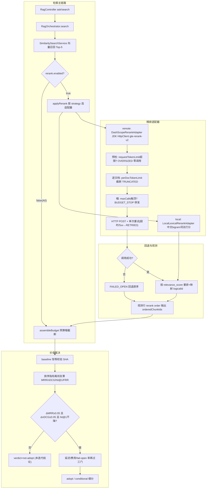

# D42-02 Rerank 价值评估技术文档与实践指南

> 迭代：D42 / R01 ｜ 定位：RAG 重排（Re-ranking，重排序）原理 + D42 实现契约 + 实验方法论 + 工程实践
> 配套：《D42-01_Rerank价值评估全量信息与操作.md》（事实与命令）；概念辨析见既有《D42-知识笔记_Rerank原理与工程定位.md》（本文不重复其定义体系，聚焦本仓实现与裁决方法）

---

## 一、是什么：Rerank 在 RAG 链路中的位置

Rerank（重排序）= 对**粗排召回**（向量相似度 Top-K）之后的候选集做二次精排，用更强的相关性函数（cross-encoder 或远程模型）重新打分换序，只改**顺序与截断**、不改**集合**。

D42 把它实现为 `RagOrchestrator.search()` 内、预算帽截断**之前**的可插拔一步：检索返回 `retrieved` → `applyRerank()`（enabled 才生效）→ `assembleBudget()`。

## 二、为什么：D42 要回答的真问题

D41 已证明表格解析能把正确 chunk 召回进 Top-5；那么**换序**（把正确 chunk 从第 2~5 位提到第 1 位）值不值每千问约 ¥0.28 的成本？这就是"价值评估"——不是实现 rerank，而是**用可证伪的实验判断它该不该被采用**。前提条件（价值空间）藏在基线质量里：A0 meanFirstRelevantRank=1.1，可提升空间仅 0.1 位次。

## 三、底层原理：本实现的四个关键机制

1. **两阶段检索（Retrieval + Re-ranking）分工**：向量召回是 bi-encoder（双塔，query/doc 独立编码，可预计算，快而粗）；rerank 是 cross-encoder（query-doc 拼合打分，不可预计算，慢而准）。远程 gte-rerank-v2 即后者，成本按输入 token 计费、每次查询实时发生——这是"费用/千问"成为决策维度的根因。
2. **恒等保序与观测通道**：identity 语义=分值 `0.0`（同分稳定排序保原序）、flags 为不可变 `EnumSet`。RagOrchestrator 在 rerank 步后输出 INFO 观测行 `rerank order 排序观测: orderedChunkIds=…`——因为 D37 评测器直连 PG 不经应用链路（架构事实，非缺陷），排序指标必须从应用日志通道复算，这是本迭代最重要的通道裁决（D-EX6）。
3. **三重预算帽**：perDocTokenLimit（每文档截断 TRUNCATED）、requestTokenLimit（请求总量预检 OVERSIZED 零调用）、maxCalls（会话累计帽 BUDGET_STOP）+ retry≤1（RETRIED）。估算口径 `estimatedTokens=ceil(chars/1.3)`（中文近似）。任何帽判定用 `>=`，且**零调用路径必须先于任何网络写**。
4. **fail-open 回退**：远程任何异常（HTTP 非 200→RerankHttpStatusException、超时、缺 Key 永久错误、SDK 类初始化缺陷）一律 `FAILED_OPEN` + **回退原序**，主链路状态仍 SUCCESS。精排是增强不是依赖——A2 首跑（SDK NPE 全军覆没）与修复轮评测通道 SHA 完全相同，即该语义的最强实证。

## 四、执行流程：Mermaid 正序（Typora 0.11.18 兼容）



## 五、核心代码（磁盘实存摘录）

```java
// RagOrchestrator：可插拔挂点（enabled=false 返回原列表，零副作用）
List<RetrievedChunk> candidates = applyRerank(query, retrieved, trace, rerankTimeNanos, budgetOut);
List<RetrievedChunk> included  = assembleBudget(candidates, budgetOut);

// 观测行（排序复算的唯一权威来源，D-EX6）
log.info("rerank order 排序观测: requestId={}, arm={}, orderedChunkIds={}", ...);

// LocalLexicalRerankAdapter：确定性=同输入必同输出（测试断言 score 全序列相等）
// identity 语义：score=0.0（非 -i，否则测试钉死失败——C01 首红根因）

// DashScopeRerankAdapter（D-EX8 后形态）：构造器内建 HttpClient，实例初始化块会 NPE
this.httpClient = HttpClient.newBuilder()
        .connectTimeout(Duration.ofMillis(props.getTimeoutMs())).build();
// 非 200 必须抛类型化异常——"200+解析失败也回退"是曾真实存在的缺陷，已修
throw new RerankHttpStatusException(status, truncatedBody, retryable);
// 缺 Key 路径零网络：classifyMissingKey → FAILED_OPEN，calls=0（E1 实证）
```

## 六、实验方法论（可迁移到其他"该不该上"类问题）

1. **预注册阈值**：决策门在任何实验前写进 protocol.json 并 SHA 留痕，禁止事后调线（本例 3/4 维达标仍判 not-adopt，就是纪律的价值）。
2. **单变量臂设计**：A1 vs A2 只换打分器，A3 只加截断；A0 兼任 C05 回归基线。
3. **指标面与记录面分开**：60 记录（3 轮）用于稳定性（inconsistent=0）与延迟分布，20 题去重面用于排序指标——两口径都落表（summary.csv 双注）。
4. **通道先于数据验证**：harness 首跑发现 EMPTY→先归因（D-EX7 strategy 误传）再重跑，EMPTY 轮不丢弃而是留证。
5. **收益天花板分析**：结论"不值 ¥0.28/千问"成立的机制解释=基线 FRR 1.1 已近满秩、三臂增益完全相同（平凡词面信号）。写决策必须带天花板论证，否则只是数字游戏。
6. **不删失败证据**：A2 首跑目录、SDK NPE 探针输出全部保留——第 3 点的 fail-open 实证正来自失败轮。

## 七、FAQ

**Q1：rerank 会不会破坏已验证的检索集合？**
不会。三臂 flag 全为换序/截断类，baseline SHA 恒等校验 + C05 双态 PASS；A3 是唯一改集合臂（max_output=3），故单独标注不与纯重排臂混算。

**Q2：SDK 通道为什么弃用？不是官方推荐吗？**
版本级实测结论：dashscope-sdk-java 2.23.6 的 TextReRank 全构造 NPE（ServiceOption 默认 null protocol，SynchronizeHalfDuplexApi 在 setProtocol 之后仍读到 null——bytecode 已核）。官方推荐不能对抗本机实证；直连 REST 是文档化公开协议（官方 URL/请求头/字段全同 SDK 封装目标），能力不降级。生产使用前应在目标 SDK 版本复测。

**Q3：为什么排序指标不用评测器现成输出？**
因为评测器 PGVECTOR 后端直连 PG，绕过了应用内 rerank 挂点——若直接采信会把"评测器没经过 rerank"误读成"rerank 无增益"。D-EX6 的教训：**先证明测量通道经过被测系统，再谈指标**。

**Q4：not-adopt 等于删掉这段代码吗？**
不等。代码默认关、零差异已证，是未来词面弱相关场景（跨文档推理/口语化提问）的现成能力。结论的边界是"当前 20 题数据集+当前语料上不值"，不是"rerank 永远无用"。

**Q5：sync 表 3→0 为什么不是实验残留失败？**
被删的是 DELETE|SYNCED 终态行（墓碑记录），保留资产是 PG 8 行指纹（复验一致）；binlog 证实是外部会话的显式 DELETE（D-EX9）；且 sync=0 与"零残留"目标同向。归因链：代码零删除路径→digest 定语句→binlog 定行→发起方窗外。

## 八、工程实践建议

1. **上线判据先于实现**：先写 decisionThresholds 再写适配器，避免"为通过而调参"。
2. **观测行是廉价而强的审计面**：一行 INFO 换来了排序指标可复算 + REORDERED/IDENTITY/FAILED_OPEN 全量分布（841 行样本），代价≈0。
3. **预算帽要在预检层**：OVERSIZED/BUDGET_STOP 的实现位置必须在网络写之前（E4a/E5 实证 calls=0/停发）。
4. **远程依赖三件套**：类型化异常 + 单次重试 + fail-open 回退，缺一即把增强变单点。本仓无 Spring Retry 依赖，自实现重试保持零新依赖（最小改动原则）。
5. **数据污染防御**：binlog 是 MySQL 场景下归因"谁删了我数据"的最后权威（general_log 默认 OFF、events_statements_history_long 会轮转，事后取证窗口极短）。
6. **迁移复用**：D41→D42 十五测试类迁移一次通过（仅 token/夹具适配），说明 D40/D41 的 sync+表格分支与 D42 rerank 分支正交——模块化挂点设计直接降低验证成本。

## 九、遗留与 D43 候选

- hybrid+rerank 组合臂（混合检索本身有排序增益时 rerank 价值假设需重测）；
- 词面弱相关新数据集（跨文档推理题）重跑本 harness，验证天花板归零假设；
- cross-encoder 本地模型替代远程计费（消除费用维度）；
- 跨机 L5 复现（本轮如实 NOT RUN）；
- D41-01/02 双文档缺失观察项（非本轮范围，遗留）。
