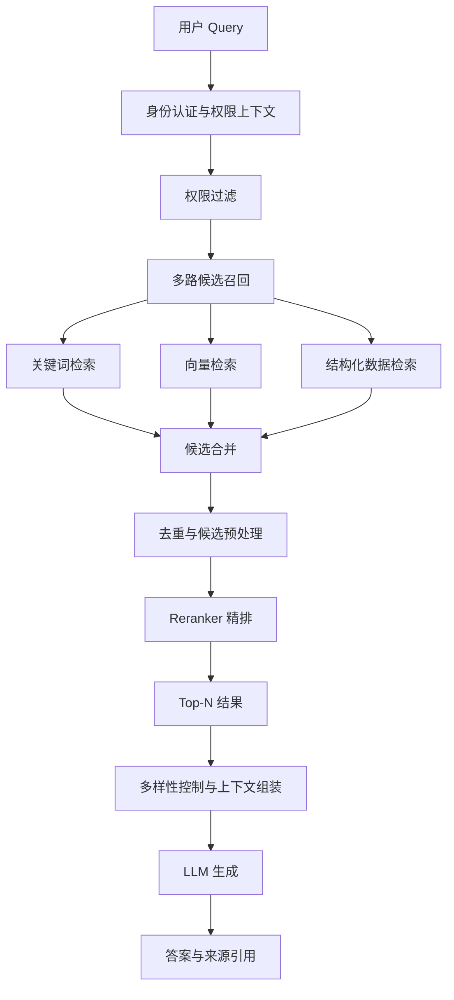
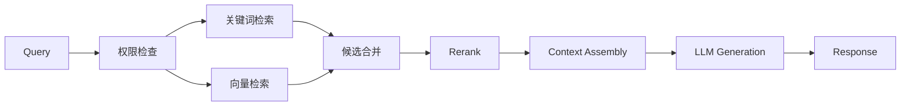
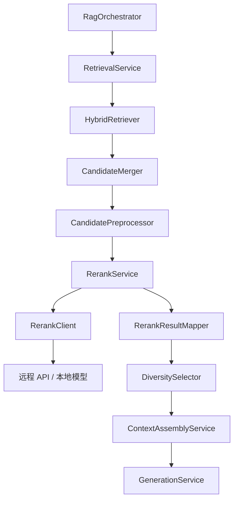

# M3 知识笔记：RAG Reranking 重排序机制与工程实践

**建议文件名：** `RAG-Reranking重排序机制与工程实践.md`

**技术基线：** JDK 21 / Spring Boot 3.5.16 / Spring AI 1.1.8 / PostgreSQL 18.7 / pgvector 0.8.7

**学习定位：** RAG 检索阶段进阶。重点研究候选召回、精排、质量评估、成本控制和工程实现，不重复展开普通 RAG、Embedding、基础向量检索知识。

---

## 一、核心概念：为什么 RAG 需要两阶段检索

### 1.1 先理解一个实际问题

假设用户查询：

> M-200 设备运行过程中出现 E001 故障码，可能是什么原因？应该如何处理？

知识库中有以下内容：

| 文档 | 内容摘要                                           |
| ---- | -------------------------------------------------- |
| A    | E001：主轴驱动器过载，可能由负载过大或机械卡滞引起 |
| B    | 主轴驱动器的工作原理及内部结构                     |
| C    | E002：主轴编码器通信异常                           |
| D    | E001：适用于 M-300，处理方法为检查驱动器电源       |
| E    | 主轴运行参数和额定转速说明                         |

向量检索可能认为 B、E 与查询具有较高语义相似度，因为它们包含大量与主轴、驱动器、设备运行相关的词汇。

但是用户真正需要的是 A，而且 D 虽然包含相同故障码，却可能不适用于 M-200。

这说明：

**语义相似不等于能够回答问题，主题相关也不等于证据相关。**

第一阶段需要尽可能找出潜在相关的候选内容；第二阶段再根据完整 Query 和候选内容判断谁真正能够回答问题。

### 1.2 两阶段检索流程



流程中有两个重要原则：

1. 权限过滤必须在候选数据进入 Reranker 之前完成，不能依赖 Reranker 判断哪些文档允许用户访问。
2. Reranker 只负责对候选内容重新排序，不负责生成最终答案。

### 1.3 两阶段检索的职责对比

| 对比维度 | 第一阶段：Retrieval               | 第二阶段：Reranking              |
| -------- | --------------------------------- | -------------------------------- |
| 核心目标 | 尽可能找到相关候选                | 从候选中找出真正有价值的内容     |
| 主要关注 | 召回覆盖率、检索效率              | 相关性、排序质量                 |
| 输入     | Query、知识库、过滤条件           | Query、候选 Chunk                |
| 输出     | Top-K 候选集合                    | 排序后的 Top-N                   |
| 常见技术 | BM25、关键词、向量、Hybrid Search | Cross-Encoder、专用 Reranker     |
| 典型模型 | Embedding Model、关键词检索引擎   | Reranker Model                   |
| 主要指标 | Recall@K、Precision@K、HitRate@K  | MRR、nDCG@K                      |
| 性能成本 | 通常较低，适合大规模搜索          | 通常更高，需要逐个或批量判断候选 |
| 典型失败 | 正确答案没有被召回                | 正确候选被错误排序               |

### 1.4 Embedding Model 与 Reranker 的区别

两者解决的是不同问题。

**Embedding Model：把文本映射成向量。**

例如：

```text
Query:
主轴驱动器为什么会过载？

Document:
主轴驱动器过载通常由切削负载过大或机械卡滞引起。
```

Embedding Model 分别将 Query 和 Document 编码为向量，再计算向量距离或相似度。

可以抽象为：

\[
q = E(Query)
\]

\[
d = E(Document)
\]

\[
Similarity(q,d)=cos(q,d)
\]

其优势是可以提前计算文档向量，查询时进行高效近邻搜索。

**Reranker：联合理解 Query 和 Candidate。**

Reranker 将 Query 和候选文本一起交给模型，判断两者之间的相关程度。

\[
Score_i=R(Query,Document_i)
\]

它更关注候选内容是否能够满足当前问题，而不只是两段文本是否具有相近的语义表示。

| 对比             | Embedding Model          | Reranker                        |
| ---------------- | ------------------------ | ------------------------------- |
| 输入             | 单段文本分别编码         | Query 与 Candidate 联合输入     |
| 主要任务         | 向量表示                 | 相关性判断                      |
| 计算方式         | 通常可以提前计算文档向量 | 通常需要针对每个 Query 重新计算 |
| 是否适合全库搜索 | 适合                     | 通常不适合                      |
| 是否适合精排     | 不直接承担精排职责       | 是                              |
| 输出             | 向量                     | 相关性分数或排序结果            |

### 1.5 Bi-Encoder 与 Cross-Encoder

这是理解 Reranker 工作原理的关键。

**Bi-Encoder：双编码器**

Query 和 Document 分别经过编码器：

```text
Query ─────── Encoder ─────── Query Vector
                                  │
                                  │ Similarity
                                  │
Document ──── Encoder ─────── Document Vector
```

文档向量可以在离线阶段预先计算并存储。

查询时只需要计算 Query 向量，再与已有向量比较。

优点：

- 可以提前计算文档向量。
- 支持大规模近邻搜索。
- 查询吞吐量高。
- 适合第一阶段候选召回。

缺点：

- Query 与 Document 在编码时没有充分交互。
- 对细粒度语义差异的判断能力通常不如 Cross-Encoder。
- 可能把主题相似但不包含答案的文本排在前面。

**Cross-Encoder：交叉编码器**

Query 与 Document 先组合，再共同输入模型：

```text
                ┌─────────────────────┐
Query ──────────┤                     │
                │  Token 拼接与编码    ├── 相关性分数
Document ───────┤                     │
                └─────────────────────┘
```

例如：

```text
[CLS]
Query: M-200 主轴驱动器 E001 故障的原因是什么？
Document: E001 表示主轴驱动器过载，可能由负载过大或机械卡滞引起。
[SEP]
```

模型能够在联合注意力计算过程中分析 Query 与 Document 中的词语和上下文关系。

因此，它通常更适合精排。

代价是每个 Query 都需要对候选内容执行额外推理，无法像 Bi-Encoder 那样直接复用所有文档的独立向量。

**注意：** Cross-Encoder 并不天然保证一定比 Bi-Encoder 效果好。具体质量取决于模型训练数据、领域适配、输入长度、任务指令和评测集。

---

## 二、Reranking 工作原理

### 2.1 模型输入与输出

典型 Rerank 请求：

```json
{
  "model": "reranker-model",
  "query": "M-200 设备 E001 故障是什么原因？",
  "documents": [
    "E001：主轴驱动器过载，可能由负载过大或机械卡滞引起。",
    "主轴驱动器主要由功率模块、控制模块组成。",
    "E002：主轴编码器通信异常。",
    "E001：适用于 M-300，检查驱动器电源。"
  ],
  "top_n": 2
}
```

典型返回结果：

```json
{
  "results": [
    {
      "index": 0,
      "relevance_score": 0.96
    },
    {
      "index": 3,
      "relevance_score": 0.71
    }
  ]
}
```

以上分数仅用于说明接口结构，不代表任何真实模型的输出。

工程上必须注意：

- `index` 必须能够映射回原始候选集合。
- Reranker 不应该只返回文本，而应保留原始文档 ID。
- 返回顺序和输入顺序可能不同。
- 不能因为返回了分数，就丢失原始 Metadata、来源信息和权限上下文。
- 供应商可能使用不同的分数字段和返回协议，需要适配层统一。

### 2.2 相关性分数到底是什么

假设：

| 候选 | Rerank 分数 |
| ---- | ----------: |
| A    |        0.96 |
| B    |        0.78 |
| C    |        0.41 |

一般可以理解为：

- A 比 B 更符合当前 Query。
- B 比 C 更符合当前 Query。
- 当前模型认为 A 的相关性最高。

但不能直接理解为：

- A 有 96% 的概率是正确答案。
- B 有 78% 的概率能够解决问题。
- 0.5 是所有模型通用的相关性合格线。

**Rerank Score 通常是模型特定的排序分数，不等于经过概率校准的正确率。**

不同模型的分数范围、分布、归一化方式可能不同。

因此：

1. 不同模型的分数不能直接比较。
2. 向量相似度和 Rerank Score 不能直接混合排序。
3. 阈值必须通过当前模型和领域数据集验证。
4. 排名指标提升不代表生成答案一定提升。

### 2.3 Recall Top-K 与 Rerank Top-N

两个参数分别控制不同阶段。

- Recall Top-K：第一阶段召回多少候选。
- Rerank Top-N：第二阶段保留多少精排结果。

例如：

```text
知识库：100,000 个 Chunk

第一阶段：
Recall Top-K = 100

召回：
100 个候选 Chunk

第二阶段：
Reranker 对 100 个候选重新评分

最终：
Rerank Top-N = 5

交给 Context Assembly：
5 个精排后的 Chunk
```

必须满足：

\[
N \leq K
\]

其中：

- \(K\)：候选数量。
- \(N\)：最终保留数量。

如果第一阶段只召回 5 条，第二阶段即使拥有再优秀的模型，也只能对这 5 条重新排序。

### 2.4 候选去重与文本截断

Rerank 前不能简单地把所有召回结果直接提交给模型。

需要处理以下问题：

**第一，重复候选。**

关键词检索和向量检索可能同时召回同一个 Chunk。

应该根据稳定的 `chunkId` 或业务唯一键去重，而不是只根据文本完全相同去重。

**第二，同一文档的相邻 Chunk。**

例如：

```text
手册 A：
Chunk 01：E001 故障定义
Chunk 02：E001 故障原因
Chunk 03：E001 处理措施
Chunk 04：E002 故障定义
```

如果前 3 条都进入 Top-N，可能占用大量上下文。

可以在精排后增加文档级多样性控制，或者将高度关联的相邻 Chunk 合并为一个上下文单元。

**第三，文本过长。**

模型通常具有最大输入 Token 限制。

如果候选文档过长，可能出现：

- 被截断。
- Query 与关键答案之间的内容被截掉。
- 模型只看到文档开头。
- 重要表格、故障码、适用机型落在截断区域之外。

因此，应在进入 Reranker 前控制候选文本长度。

建议优先保留：

1. 标题和章节路径。
2. 设备型号、手册版本。
3. 故障码或参数名称。
4. 与 Query 直接相关的段落。
5. 必要的前后文。

不要为了限制长度而直接截断字符串末尾，导致真正的答案被删除。

### 2.5 分批处理

当候选数量较多时，可以分批发送：

```text
100 个候选 Chunk

Batch Size = 20

Batch 1：20 条
Batch 2：20 条
Batch 3：20 条
Batch 4：20 条
Batch 5：20 条

合并 100 条评分结果
按统一模型分数排序
最终保留 Top-N
```

这里有两个不同的概念：

- **批量请求：** 一次 HTTP 请求中提交多条候选。
- **并发请求：** 同时执行多个 HTTP 请求。

批量请求可以减少网络往返，但单批过大可能增加单次响应时间、内存占用和超时风险。

并发请求可以提高吞吐量，但会消耗模型服务的并发额度。

具体选择取决于模型供应商接口、本地推理框架和服务端资源。

---

## 三、关键参数与效果权衡

### 3.1 参数总览

| 参数                 | 主要影响           | 设置过小                 | 设置过大                   |
| -------------------- | ------------------ | ------------------------ | -------------------------- |
| Recall Top-K         | 候选覆盖率         | 正确答案可能未进入候选集 | 精排成本和候选噪声增加     |
| Rerank Top-N         | 最终上下文数量     | 有价值的证据可能被丢弃   | 上下文冗余、LLM Token 增加 |
| Candidate Chunk 长度 | 相关性判断         | 上下文不足、语义不完整   | 截断风险、输入成本增加     |
| 相似度阈值           | 初始候选过滤       | 相关候选可能被提前过滤   | 无关候选进入精排           |
| Batch Size           | 吞吐量和请求延迟   | 请求次数增加             | 单次请求负担增加           |
| Rerank 模型          | 排序质量和推理成本 | 可能无法区分细粒度相关性 | 推理成本和资源要求增加     |

### 3.2 Recall Top-K：为什么不能盲目追求大 K

假设：

- K=10：只找到 10 个候选。
- K=50：找到 50 个候选。
- K=100：找到 100 个候选。

随着 K 增加，正确答案进入候选集合的机会通常会增加。

但并不是无限增加越好。

原因：

1. 无关候选数量可能增加。
2. Reranker 需要处理更多文本。
3. 远程 API 的输入 Token 和请求负载可能增加。
4. 本地模型推理耗时增加。
5. 候选中相似内容增多，排序结果可能出现冗余。
6. 并发请求下，计算资源竞争可能加重。

选择 K 的关键是找到召回质量与精排成本之间的平衡点。

### 3.3 Rerank Top-N：控制最终上下文

假设：

```text
Recall Top-K = 100

Rerank Top-N = 5
```

最终只有 5 个候选进入 Context Assembly。

如果设置 N=20：

- 更多证据可能进入上下文。
- LLM 输入 Token 增加。
- 可能引入更多噪声。
- 生成延迟和费用可能上升。

如果设置 N=2：

- 上下文更加精简。
- 但可能丢失故障原因、处理措施或安全注意事项等互补信息。

因此，N 不能只根据 Rerank 分数决定，还要结合问题需要的证据数量。

例如：

| 用户问题            | 可能需要的证据           |
| ------------------- | ------------------------ |
| E001 是什么故障？   | 故障码定义               |
| E001 的原因是什么？ | 故障定义和原因           |
| E001 如何排查？     | 故障原因、检查步骤       |
| E001 如何修复？     | 原因、处理措施、安全说明 |

不同类型问题可能需要不同的 Top-N。

### 3.4 Candidate Chunk 长度

Chunk 过短：

```text
主轴驱动器过载。
```

缺少原因、适用型号和处理措施，无法充分判断与 Query 的关系。

Chunk 过长：

```text
设备概述……
安装说明……
电气结构……
主轴工作原理……
运行参数……
故障代码……
维修流程……
```

可能增加推理成本，也可能因为截断而丢失关键内容。

合理的 Chunk 应围绕业务语义组织，避免将一条完整故障记录切割成互不相关的片段。

### 3.5 相似度阈值与 Rerank 阈值

两个阈值处于不同阶段。

**向量相似度阈值：**

用于第一阶段召回过滤。

**Rerank Score 阈值：**

用于第二阶段排序后过滤。

两者不能直接互换。

例如：

```text
向量相似度阈值：0.70
Rerank Score 阈值：0.50
```

这些数字仅为配置示意，不能直接作为实际项目的推荐值。

阈值验证方法：

1. 收集已知有答案的 Query。
2. 收集知识库中没有答案的 Query。
3. 统计相关与不相关候选的分数分布。
4. 计算不同阈值下的 Precision、Recall。
5. 分析误过滤和误保留案例。
6. 选择符合业务风险要求的阈值。

设备维修场景尤其需要谨慎：错误过滤一条关键安全操作说明，可能比保留一条无关文档更危险。

### 3.6 Batch Size 与并发控制

Batch Size 主要影响单次模型请求的规模。

并发数主要影响同时执行的请求数量。

两者不是同一个参数。

例如：

```text
Recall Top-K = 100
Batch Size = 20
并发数 = 2

总共 5 个批次
最多同时执行 2 个批次
```

需要关注：

- API 限流。
- 模型最大输入长度。
- 单次请求超时。
- 线程池队列长度。
- 本地推理显存。
- 远程 API 的并发额度。
- 请求取消与重试策略。

---

## 四、排序质量评估：如何判断 Reranker 是否有效

不能只凭肉眼观察排序，也不能只看模型输出分数。

必须建立固定评测集。

### 4.1 召回指标

假设某个 Query 的相关文档集合为：

```text
Relevant = {A, C, E}
```

第一阶段召回结果：

```text
Recall Top-5 = {A, B, D, F, G}
```

其中只有 A 相关。

**Recall@K**

衡量前 K 个候选找回了多少相关文档。

\[
Recall@K=
\frac{|Relevant\cap Retrieved@K|}
{|Relevant|}
\]

本例：

\[
Recall@5=\frac{1}{3}=0.3333
\]

**Precision@K**

衡量前 K 个候选中有多少是真正相关的。

\[
Precision@K=
\frac{|Relevant\cap Retrieved@K|}{K}
\]

本例：

\[
Precision@5=\frac{1}{5}=0.2
\]

**HitRate@K**

衡量前 K 个候选是否至少命中一个相关文档。

\[
HitRate@K=
\begin{cases}
1 & |Relevant\cap Retrieved@K|>0\\
0 & \text{其他情况}
\end{cases}
\]

如果一个 Query 只要找到一条正确证据就能回答，HitRate@K 很有参考价值。

注意：不同团队可能使用不同的 HitRate 统计口径，必须在评测报告中明确。

### 4.2 排序指标

**MRR：Mean Reciprocal Rank**

关注第一个相关结果出现的位置。

\[
RR_i=\frac{1}{rank_i}
\]

\[
MRR=\frac{1}{|Q|}\sum_{i=1}^{|Q|}RR_i
\]

例如：

| Query | 第一个相关结果位置 |    RR |
| ----- | -----------------: | ----: |
| Q1    |                  1 | 1.000 |
| Q2    |                  2 | 0.500 |
| Q3    |                  4 | 0.250 |

\[
MRR=\frac{1+0.5+0.25}{3}=0.5833
\]

MRR 越高，代表相关结果越靠前。

**nDCG@K：Normalized Discounted Cumulative Gain**

MRR 主要看第一个相关结果，nDCG 可以综合考虑多个结果的相关等级和位置。

\[
DCG@K=
\sum_{i=1}^{K}
\frac{2^{rel_i}-1}{\log_2(i+1)}
\]

\[
nDCG@K=\frac{DCG@K}{IDCG@K}
\]

其中：

- \(rel_i\)：第 i 个结果的相关性等级。
- \(IDCG\)：理想排序下的 DCG。
- nDCG 越接近 1，排序越接近理想结果。

设备手册可以采用分级标签：

| 相关等级 | 说明                     |
| -------- | ------------------------ |
| 3        | 直接包含问题答案         |
| 2        | 包含关键原因或处理证据   |
| 1        | 主题相关，但无法直接回答 |
| 0        | 无关、错误型号或错误版本 |

### 4.3 Rerank 前后指标对比

应该对同一组候选分别计算：

```text
Recall 原始结果
    ↓
计算 Recall@K、MRR、nDCG
    ↓
Reranker 排序
    ↓
计算 Rerank 后 MRR、nDCG
    ↓
对比改善幅度
```

重要：

**Reranker 不能增加第一阶段已经遗漏的候选。**

因此，Rerank 前后比较排序质量时，必须使用同一候选集合。

如果要评估整个检索系统，还需要单独记录第一阶段 Recall@K。

### 4.4 区分召回失败与排序失败

| 现象                         | 根本问题               | 应优先处理                         |
| ---------------------------- | ---------------------- | ---------------------------------- |
| 正确文档不在 Top-K           | 召回失败               | Query、Embedding、关键词、过滤条件 |
| 正确文档在 Top-K，但排在后面 | 排序失败               | Reranker、输入内容、模型适配       |
| 正确文档排在前面，但答案错误 | 生成或上下文问题       | Context Assembly、Prompt、生成模型 |
| 正确文档被权限过滤           | 权限策略或数据标注问题 | 授权过滤链路                       |
| 正确 Chunk 被截断            | 内容预处理问题         | Chunk 组织和输入截断策略           |

不能把所有检索失败都归因于 Reranker。

### 4.5 固定评测集

至少固定以下内容：

| 数据         | 必须固定的内容                 |
| ------------ | ------------------------------ |
| Query        | 原始问题及必要的改写策略       |
| Ground Truth | 相关文档或 Chunk ID、相关等级  |
| 数据集       | 文档版本、Chunk 版本           |
| Embedding    | 模型名称、版本、配置           |
| Retriever    | 检索方式、Top-K、过滤条件      |
| Reranker     | 模型名称、版本、输入模板       |
| 实验参数     | Top-K、Top-N、阈值、Batch Size |
| 环境         | CPU、GPU、并发数、网络环境     |

评测时至少覆盖：

1. 故障码精确查询。
2. 故障现象自然语言查询。
3. 设备型号限定查询。
4. 参数数值查询。
5. 无答案查询。
6. 多个相近故障码查询。
7. 多个版本手册存在冲突的查询。

---

## 五、设备手册案例：Rerank 前后排序变化

以下案例为模拟数据，用于说明检索机制，不代表真实设备手册或真实模型实验结果。

### 5.1 用户问题

```text
设备型号：M-200

用户 Query：
设备运行过程中出现 E001 故障码，
可能是什么原因，应该如何处理？
```

### 5.2 第一阶段候选召回

假设采用关键词 + 向量混合召回，得到 Top-K=6。

| 初始排名 | Chunk ID | 内容摘要                   | 初始排序分数（示例） |
| -------: | -------- | -------------------------- | -------------------: |
|        1 | C-101    | 主轴驱动器结构及工作原理   |                 0.91 |
|        2 | C-102    | E001：主轴驱动器过载       |                 0.88 |
|        3 | C-103    | 主轴运行参数与额定转速     |                 0.84 |
|        4 | C-104    | E002：主轴编码器通信异常   |                 0.81 |
|        5 | C-105    | M-300 的 E001 电源异常处理 |                 0.79 |
|        6 | C-106    | M-200 主轴机械卡滞检查方法 |                 0.75 |

这里的分数仅代表示意性检索排序，不代表 pgvector 的固定分数范围。

### 5.3 Rerank 后排序

Reranker 同时理解：

- Query 中的设备型号 M-200。
- 故障码 E001。
- 用户需要原因和处理措施。
- 候选内容是否真正提供对应证据。

示意结果：

| Rerank 排名 | Chunk ID | 内容摘要                         | Rerank Score（示例） | 说明           |
| ----------: | -------- | -------------------------------- | -------------------: | -------------- |
|           1 | C-102    | E001：主轴驱动器过载、原因和措施 |                 0.97 | 直接回答故障码 |
|           2 | C-106    | M-200 主轴机械卡滞检查方法       |                 0.89 | 支持原因排查   |
|           3 | C-101    | 主轴驱动器结构及工作原理         |                 0.62 | 背景相关       |
|           4 | C-103    | 主轴运行参数与额定转速           |                 0.44 | 相关性较弱     |
|           5 | C-105    | M-300 的 E001 处理方法           |                 0.31 | 设备型号不匹配 |
|           6 | C-104    | E002 故障说明                    |                 0.18 | 故障码不匹配   |

### 5.4 最终 Top-N

假设：

```text
Recall Top-K = 6
Rerank Top-N = 2
```

最终上下文：

```text
1. C-102
   E001 故障定义、可能原因及处理措施。

2. C-106
   M-200 主轴机械卡滞的检查方法。
```

这样可以优先把真正能够回答问题的证据交给 LLM。

但仍然需要检查 C-102 和 C-106 的手册版本、适用型号、来源页码及安全说明。

不能因为 Reranker 给了高分，就认定候选内容在业务上一定正确。

---

## 六、为什么不能直接对所有文档执行 Rerank

### 6.1 计算复杂度与成本

假设知识库包含：

```text
100,000 个 Chunk
```

如果每个用户请求都让 Reranker 判断全部 100,000 个 Chunk：

- 每个 Query 都要处理 100,000 条文本。
- 模型输入量巨大。
- 推理耗时不可接受。
- API Token 或本地 GPU 资源成本很高。
- 并发请求时容易形成严重的资源竞争。

第一阶段的向量索引和关键词索引可以高效缩小候选范围。

第二阶段只对少量候选进行精细判断。

### 6.2 正确答案没有进入 Recall Top-K，Reranker 能找回吗？

**不能。**

假设：

```text
真实相关文档：A

第一阶段结果：
B、C、D、E、F

A 没有进入候选集合。
```

Reranker 接收到的只有 B、C、D、E、F。

它无法对没有输入的 A 进行评分。

因此：

\[
Recall_{Rerank}\leq Recall_{Retrieval}
\]

在相同相关性定义下，Reranker 只是对已有候选重新排序，不能从候选集合之外创造正确文档。

解决方向：

- 改善 Query 处理。
- 优化关键词检索。
- 优化 Embedding 模型。
- 调整 Recall Top-K。
- 增加合理的多路召回。
- 改善设备型号、故障码等结构化过滤。

### 6.3 Recall Top-K 从 10 增加到 100 的影响

可能产生以下变化：

| 维度               | K=10     | K=100    |
| ------------------ | -------- | -------- |
| 候选数量           | 较少     | 较多     |
| 相关内容覆盖率     | 可能偏低 | 可能提高 |
| 正确答案漏召回风险 | 相对较高 | 可能降低 |
| Rerank 输入规模    | 较小     | 较大     |
| 推理成本           | 较低     | 较高     |
| 处理延迟           | 通常较低 | 通常较高 |
| 无关候选           | 相对较少 | 可能更多 |

但不能直接断言 K=100 一定比 K=10 好。

如果新增的 90 个候选都是无关内容，质量收益可能很小，成本却显著增加。

### 6.4 参数实验表：建立可重复的实验模板

下面是推荐的实验设计。

**注意：表中 `待测` 表示必须通过实际评测获得，不是已经测得的数据。**

| 实验组 | Recall Top-K | Rerank Top-N | Recall@K | MRR@N | nDCG@N | P95 延迟 | 单次费用 |
| ------ | -----------: | -----------: | -------- | ----- | ------ | -------- | -------- |
| A      |           10 |            3 | 待测     | 待测  | 待测   | 待测     | 待测     |
| B      |           10 |            5 | 待测     | 待测  | 待测   | 待测     | 待测     |
| C      |           30 |            3 | 待测     | 待测  | 待测   | 待测     | 待测     |
| D      |           30 |            5 | 待测     | 待测  | 待测   | 待测     | 待测     |
| E      |           50 |            5 | 待测     | 待测  | 待测   | 待测     | 待测     |
| F      |          100 |            5 | 待测     | 待测  | 待测   | 待测     | 待测     |
| G      |          100 |           10 | 待测     | 待测  | 待测   | 待测     | 待测     |

实验方法：

1. 使用同一批 Query。
2. 使用相同文档数据和 Ground Truth。
3. 固定 Embedding Model。
4. 固定关键词检索配置。
5. 固定 Reranker Model。
6. 分别调整 K 和 N。
7. 统计质量指标、延迟、费用。
8. 重复运行，观察波动。
9. 对不同实验组进行误差分析。

如果更换 Reranker 模型，必须单独记录模型版本，不能把不同模型的分数当作同一实验条件。

### 6.5 如何判断 Reranker 是否值得引入

至少需要回答：

| 判断维度 | 需要验证的问题                     |
| -------- | ---------------------------------- |
| 排序质量 | MRR、nDCG 是否稳定提升？           |
| 最终答案 | 答案准确率和证据引用质量是否提升？ |
| 延迟     | P95、P99 是否仍满足 SLA？          |
| 费用     | 每次请求增加多少费用？             |
| 稳定性   | 超时、限流、模型异常是否可控？     |
| 业务价值 | 是否减少人工排查时间或错误回答？   |

如果 Rerank 只让排序指标提高，但最终答案没有改善，甚至变差，就不能仅凭排序分数认定这项改造成功。

---

## 七、延迟、费用与吞吐量

### 7.1 RAG 全链路延迟



全链路耗时可以抽象为：

\[
T_{total}=
T_{auth}+
T_{retrieval}+
T_{merge}+
T_{rerank}+
T_{context}+
T_{generation}
\]

其中：

- \(T_{auth}\)：身份和权限检查。
- \(T_{retrieval}\)：候选召回。
- \(T_{merge}\)：合并、去重。
- \(T_{rerank}\)：精排推理。
- \(T_{context}\)：上下文组装。
- \(T_{generation}\)：LLM 生成。

如果关键词检索和向量检索并行执行：

\[
T_{retrieval}\approx
\max(T_{keyword},T_{vector})
\]

如果两者串行执行，则需要累加耗时。

### 7.2 Rerank 延迟

假设：

```text
Recall Top-K = 100
Batch Size = 20
总批次 = 5
```

如果批次串行执行：

\[
T_{rerank}\approx\sum_{i=1}^{5}T_i
\]

如果最多允许 2 个批次并行：

\[
T_{rerank}\approx
\max(T_1,T_2)+
\max(T_3,T_4)+T_5
\]

以上为简化模型，实际还受到网络、排队、限流、批次 Token 数量和模型服务并发能力影响。

### 7.3 本地部署与远程 API

| 对比     | 本地部署                   | 远程 API                        |
| -------- | -------------------------- | ------------------------------- |
| 模型运行 | 自己管理推理服务           | 供应商管理                      |
| 费用     | GPU、CPU、内存、电力、运维 | API 调用费用                    |
| 延迟     | 取决于硬件和并发           | 取决于网络和供应商服务          |
| 扩容     | 需要自行扩容               | 通常按供应商能力扩展            |
| 模型控制 | 可选择本地模型和推理参数   | 受供应商支持范围限制            |
| 运维     | 需要模型部署、监控、升级   | 需要 API 密钥、限流和可用性管理 |
| 数据流转 | 可以留在内部环境           | 需要评估外部数据传输            |

本地部署不等于零成本，远程 API 也不一定始终更贵。

必须根据真实请求量、候选文本长度、模型规格、硬件利用率和服务可用性进行测算。

### 7.4 费用计算

对于按 Token 计费的 API：

\[
Cost_{rerank}=
\frac{InputTokens}{10^6}\times Price_{input}
+
\frac{OutputTokens}{10^6}\times Price_{output}
\]

如果供应商按请求数或候选文档数量计费，则应使用其真实计费规则。

注意：

- 有些 Rerank API 不按普通 LLM Token 方式计费。
- 有些模型只返回索引和分数，输出 Token 成本很低。
- 有些服务按文档数量、请求量或专用计算单元计费。
- 不能把不同供应商的价格模型直接套用。

### 7.5 P50、P95、P99

| 指标 | 解释                   |
| ---- | ---------------------- |
| P50  | 50% 请求耗时不超过该值 |
| P95  | 95% 请求耗时不超过该值 |
| P99  | 99% 请求耗时不超过该值 |

平均延迟不能完整反映线上体验。

例如，平均耗时可能满足要求，但部分请求因为远程模型排队或大批量候选处理而出现严重超时。

应该同时记录：

```text
retrieval_latency_ms
rerank_latency_ms
generation_latency_ms
total_latency_ms
rerank_candidate_count
rerank_input_tokens
rerank_batch_count
rerank_timeout_count
rerank_fallback_count
```

### 7.6 降级策略

当 Reranker 超时或模型服务异常时，不应该直接丢弃所有候选。

推荐策略：

```text
正常：
Recall Top-K
    ↓
Reranker
    ↓
Top-N
    ↓
生成

Reranker 失败：
Recall Top-K
    ↓
保留原始召回排序
    ↓
按原始排序截取安全数量
    ↓
生成
```

降级时仍必须遵守：

- 权限过滤。
- 候选数量上限。
- 上下文 Token 上限。
- 来源信息保留。
- 业务安全过滤。

如果原始召回结果质量不可信，应该返回受控的无答案结果，而不是无条件把全部候选交给 LLM。

---

## 八、工程化设计：Rerank 服务如何封装

### 8.1 推荐的业务架构



建议将以下职责分开：

| 组件                   | 职责                     |
| ---------------------- | ------------------------ |
| RetrievalService       | 执行候选召回             |
| CandidateMerger        | 合并多路召回             |
| CandidatePreprocessor  | 去重、截断、候选检查     |
| RerankService          | 管理精排流程             |
| RerankClient           | 对接具体模型供应商       |
| RerankResultMapper     | 将模型结果映射回原始候选 |
| DiversitySelector      | 控制同一文档的结果冗余   |
| ContextAssemblyService | 组装最终上下文           |

不要把 HTTP 调用、业务过滤、候选排序和上下文组装全部写在一个 Service 中。

### 8.2 DTO 设计

**候选请求 DTO**

```java
public record RerankRequest(
        String query,
        List<RerankCandidate> candidates,
        Integer topN
) {
}

public record RerankCandidate(
        String candidateId,
        String documentId,
        String chunkId,
        String content,
        Map<String, Object> metadata,
        Integer retrievalRank,
        Double retrievalScore
) {
}
```

**精排结果 DTO**

```java
public record RerankItem(
        String candidateId,
        String documentId,
        String chunkId,
        Integer originalRank,
        Integer rerankRank,
        Double relevanceScore,
        String modelName,
        String modelVersion
) {
}
```

**最终精排响应**

```java
public record RerankResponse(
        String requestId,
        String query,
        String modelName,
        String modelVersion,
        List<RerankItem> results,
        boolean fallback,
        String failureReason
) {
}
```

以上是建议的项目业务 DTO，不是 Spring AI 原生 DTO。

### 8.3 为什么必须保留 candidateId

假设原始候选：

```text
索引 0 -> Chunk A
索引 1 -> Chunk B
索引 2 -> Chunk C
```

模型返回：

```text
索引 2 -> 0.95
索引 0 -> 0.90
```

正确映射：

```text
第一名：Chunk C
第二名：Chunk A
```

不能因为重新排序就丢失原始候选的：

- documentId。
- chunkId。
- sourceId。
- 页码。
- 手册版本。
- 设备型号。
- 租户信息。
- 权限过滤结果。
- 原始召回排名。

因此，应通过稳定 ID 映射，而不是依赖文本内容重新查找。

### 8.4 Java 核心接口设计

```java
public interface RerankClient {

    RerankResponse rerank(RerankRequest request);
}
```

业务层：

```java
public interface RerankService {

    List<RerankCandidate> rerank(
            String query,
            List<RerankCandidate> candidates,
            int topN
    );
}
```

核心实现逻辑：

```java
@Service
public class DefaultRerankService implements RerankService {

    private final RerankClient rerankClient;

    public DefaultRerankService(RerankClient rerankClient) {
        this.rerankClient = rerankClient;
    }

    @Override
    public List<RerankCandidate> rerank(
            String query,
            List<RerankCandidate> candidates,
            int topN) {

        if (candidates == null || candidates.isEmpty()) {
            return List.of();
        }

        if (topN <= 0) {
            throw new IllegalArgumentException(
                    "topN must be greater than zero"
            );
        }

        try {
            RerankRequest request = new RerankRequest(
                    query,
                    candidates,
                    Math.min(topN, candidates.size())
            );

            RerankResponse response =
                    rerankClient.rerank(request);

            return mapResults(response, candidates, topN);

        } catch (RuntimeException ex) {

            // 保留原始召回顺序，不能因 Rerank 故障丢弃全部候选。
            return candidates.stream()
                    .sorted(Comparator.comparing(
                            RerankCandidate::retrievalRank
                    ))
                    .limit(topN)
                    .toList();
        }
    }

    private List<RerankCandidate> mapResults(
            RerankResponse response,
            List<RerankCandidate> candidates,
            int topN) {

        // 实际实现必须根据 candidateId 映射原始对象，
        // 并验证模型返回索引、分数和候选唯一性。
        throw new UnsupportedOperationException(
                "Implement result mapping and validation"
        );
    }
}
```

这是接口与异常降级的结构示例，不是可以直接投入生产的完整实现。

生产实现还必须补齐：

- 参数校验。
- 响应字段校验。
- candidateId 唯一性。
- 分数合法性检查。
- 模型返回索引越界处理。
- 超时和取消。
- 限流。
- 并发控制。
- 监控和脱敏日志。

### 8.5 失败处理清单

| 故障             | 处理策略                               |
| ---------------- | -------------------------------------- |
| 候选列表为空     | 返回空结果                             |
| 模型超时         | 降级为原始召回排序                     |
| HTTP 429         | 遵循限流策略，有限重试或降级           |
| HTTP 5xx         | 有限重试，失败后降级                   |
| API 密钥错误     | 快速失败、告警，不无限重试             |
| 模型返回空列表   | 按策略降级，记录异常                   |
| 部分候选无分数   | 保留未评分状态，不伪造分数             |
| 返回索引越界     | 视为响应异常，降级                     |
| 重复 candidateId | 拒绝或去重，记录数据问题               |
| 文本过长         | 按可追溯规则截断或拆分                 |
| 结果全部低分     | 根据经过验证的阈值决定保留或返回无答案 |
| 权限信息缺失     | 不允许绕过权限检查                     |

特别注意：**降级不能突破权限边界。**

Rerank 失败时，原始候选也必须是已经通过授权过滤的候选。

### 8.6 日志脱敏与监控

建议记录：

```text
request_id
query_hash
candidate_count
rerank_top_n
model_name
model_version
batch_count
rerank_latency_ms
input_token_count
output_token_count
success
fallback
failure_type
```

不建议直接记录完整用户 Query 和文档全文。

设备手册中可能存在内部技术信息、客户设备信息和敏感维修记录，应根据数据安全要求进行脱敏。

---

## 九、Spring AI 1.1.8 工程落地

这一部分必须特别注意版本边界。

不能把 Spring AI 最新版本的功能直接当作 1.1.8 已有能力。

### 9.1 Spring AI 1.1.8 提供什么

Spring AI 1.1.8 提供 RAG 模块化架构，其中包括：

- `DocumentRetriever`：负责检索文档。
- `DocumentJoiner`：合并多路检索结果。
- `DocumentPostProcessor`：检索后的文档处理接口。
- `RetrievalAugmentationAdvisor`：组合 RAG 流程。

其中，`DocumentPostProcessor` 是本次 Rerank 工程集成最重要的扩展点。

其核心职责可以概括为：

```java
List<Document> process(
        Query query,
        List<Document> documents
);
```

它允许开发者对已检索的 Document 进行重新排序、过滤或压缩。

Spring AI 1.1.8 API：

DocumentPostProcessor | DocumentPostProcessor（Spring AI 1.1.8 检索后文档处理接口）：https://docs.spring.io/spring-ai/docs/1.1.x/api/org/springframework/ai/rag/postretrieval/document/DocumentPostProcessor.html

### 9.2 Spring AI 1.1.8 是否提供通用 RerankModel

需要区分三个概念：

| 能力                              | Spring AI 1.1.8 情况 | 说明                                          |
| --------------------------------- | -------------------- | --------------------------------------------- |
| RAG 后处理接口                    | 有                   | `DocumentPostProcessor`                       |
| 通用向量检索接口                  | 有                   | `VectorStore`、`VectorStoreDocumentRetriever` |
| 通用供应商无关的 RerankModel 抽象 | 不应假定存在         | 不能直接照搬其他框架的接口                    |
| 通用 Cross-Encoder 自动集成       | 不应假定存在         | 需要根据供应商或模型集成实现                  |
| 自定义 RerankClient               | 可以实现             | 使用 HTTP Client 或本地推理服务               |
| 自定义 DocumentPostProcessor      | 可以实现             | 将 Reranker 接入 RAG 后处理阶段               |

Spring AI 1.1.8 API 中可以查到 `DocumentPostProcessor`，但不能因此推导出框架已经提供了统一的 Rerank 模型接口。

同样，某个模型供应商支持 Rerank API，也不代表 Spring AI 1.1.8 自动提供了对应的通用适配器。

### 9.3 为什么不能把 VectorStore 相似度排序当成 Reranking

当前项目使用：

```text
PostgreSQL 18.7
pgvector 0.8.7
Spring AI 1.1.8
```

向量召回的职责是：

```text
Query
  ↓
Embedding Model
  ↓
Query Vector
  ↓
pgvector 近邻搜索
  ↓
候选 Chunk
```

pgvector 负责向量存储、距离计算和近邻检索。

它不会因为使用了向量索引，就自动具备 Cross-Encoder 的联合语义判断能力。

例如：

```sql
SELECT
    chunk_id,
    content,
    embedding <=> :query_embedding AS distance
FROM rag_chunk
WHERE tenant_id = :tenant_id
ORDER BY embedding <=> :query_embedding
LIMIT 100;
```

这里的 `distance` 是向量距离，不是 Rerank Score。

实际项目还应确保 SQL 的租户、部门、设备等权限条件在候选召回时生效。

### 9.4 推荐工程链路

```text
用户 Query
    ↓
权限上下文
    ↓
Hybrid Retrieval
    ├── PostgreSQL + pgvector
    └── 关键词检索
    ↓
候选合并与去重
    ↓
Candidate Preprocessor
    ↓
自定义 RerankService
    ↓
供应商 Rerank API / 本地 Cross-Encoder
    ↓
结果映射与异常降级
    ↓
Top-N
    ↓
Context Assembly
    ↓
GenerationService
```

建议在现有 RAG 工程中保留独立的 RerankService，而不是把供应商 HTTP 请求直接写进 RetrievalService。

### 9.5 使用 DocumentPostProcessor 接入

Spring AI 1.1.8 中，可以通过自定义 `DocumentPostProcessor` 将独立 Reranker 接入 `RetrievalAugmentationAdvisor`。

示意代码：

```java
@Component
public class CustomRerankDocumentPostProcessor
        implements DocumentPostProcessor {

    private final RerankService rerankService;

    public CustomRerankDocumentPostProcessor(
            RerankService rerankService) {
        this.rerankService = rerankService;
    }

    @Override
    public List<Document> process(
            Query query,
            List<Document> documents) {

        if (documents == null || documents.isEmpty()) {
            return List.of();
        }

        String queryText = query.text();

        // 1. Document 转换为内部候选 DTO
        // 2. 调用 RerankService
        // 3. 按 Document ID 映射原始 Document
        // 4. 保留原始 Metadata
        // 5. 返回排序后的 Document

        return documents;
    }
}
```

注意：

这是用于说明集成位置的代码骨架，具体构造函数、依赖注入方式和接口签名应以项目锁定的 Spring AI 1.1.8 API 为准。

### 9.6 RAG Advisor 组合

在 RAG 流程中，可以通过 `documentPostProcessors(...)` 注册后处理器。

示意：

```java
Advisor advisor =
        RetrievalAugmentationAdvisor.builder()
                .documentRetriever(documentRetriever)
                .documentPostProcessors(
                        customRerankDocumentPostProcessor
                )
                .build();
```

具体依赖需要包含 RAG 模块，例如：

```xml
<dependency>
    <groupId>org.springframework.ai</groupId>
    <artifactId>spring-ai-rag</artifactId>
</dependency>
```

版本由项目使用的 Spring AI BOM 统一管理。

注意：自定义处理器是否能直接获得完整业务 Query、权限上下文和候选 Metadata，需要结合实际链路设计。不要为了方便而把权限判断推迟到精排阶段。

### 9.7 版本资料核对

本笔记的 Spring AI 技术结论以 1.1.x / 1.1.8 API 文档为主要依据。

Spring AI 1.1.8 文档入口：

Spring AI Reference Documentation | Spring AI 参考文档（1.1.8）：https://docs.spring.io/spring-ai/reference/1.1/index.html

DocumentPostProcessor API | DocumentPostProcessor 文档处理接口：https://docs.spring.io/spring-ai/docs/1.1.x/api/org/springframework/ai/rag/postretrieval/document/DocumentPostProcessor.html

RetrievalAugmentationAdvisor Builder API | RetrievalAugmentationAdvisor 构建器 API：https://docs.spring.io/spring-ai/docs/1.1.x/api/org/springframework/ai/rag/advisor/RetrievalAugmentationAdvisor.Builder.html

DocumentJoiner API | DocumentJoiner 多路检索结果合并接口：https://docs.spring.io/spring-ai/docs/1.1.x/api/org/springframework/ai/rag/retrieval/join/DocumentJoiner.html

VectorStoreDocumentRetriever API | VectorStoreDocumentRetriever 向量检索接口：https://docs.spring.io/spring-ai/docs/1.1.x/api/org/springframework/ai/rag/retrieval/search/VectorStoreDocumentRetriever.html

### 9.8 特别注意：不要混用 Spring AI 2.x 示例

较新的 Spring AI 文档已经出现更多后处理能力和示例，例如：

- `DecisionDocumentReranker`
- `DecisionDocumentFilter`
- 后处理器组合
- 基于决策模型的相关性判断

这些内容不能直接作为 Spring AI 1.1.8 已经具备相同 API 和实现的依据。

最新版本文档：

Retrieval Augmented Generation | 检索增强生成（Spring AI 最新版本）：https://docs.spring.io/spring-ai/reference/api/retrieval-augmented-generation.html

学习时必须区分：

| 内容                   | 应采用的依据                 |
| ---------------------- | ---------------------------- |
| 项目实际代码           | 当前项目依赖版本和源码       |
| Spring AI 1.1.8 接口   | 1.1.x / 1.1.8 API 文档       |
| Spring AI 最新版本能力 | 最新版本文档，仅用于了解演进 |
| 具体 Rerank 模型 API   | 模型供应商官方文档           |
| 自定义 Rerank 业务逻辑 | 项目自行设计和测试           |

不能把 2.x 文档中的类名直接复制到 1.1.8 项目中。

---

## 十、容易遗漏的高级工程问题

### 10.1 多路召回如何合并

假设：

```text
关键词召回：
A、B、C、D

向量召回：
B、D、E、F
```

合并后：

```text
A、B、C、D、E、F
```

必须先去重，再交给 Reranker。

对于不同召回通道的分数：

- BM25 分数。
- 向量相似度。
- 结构化检索优先级。

它们的数值含义和分布可能不同，不能简单混在一起排序。

可以采用：

- Reciprocal Rank Fusion（RRF）。
- 规则化合并。
- 统一特征归一化。
- 保留各通道原始排名，交给后续排序模型。

RRF 的一种常见形式：

\[
RRF(d)=\sum_{r\in R}
\frac{1}{k_0+rank_r(d)}
\]

其中：

- \(R\)：检索结果列表。
- \(rank_r(d)\)：文档在某路召回中的排名。
- \(k_0\)：平滑参数。

RRF 是多路召回结果合并方法，不等于 Cross-Encoder Reranking。

### 10.2 Rerank 分数与向量相似度不能直接混用

例如：

```text
向量相似度：0.85
Rerank Score：0.72
```

不能简单地计算：

```java
double finalScore =
        vectorScore * 0.5 +
        rerankScore * 0.5;
```

除非经过严格的归一化、校准和实验验证。

原因：

1. 两者来源于不同模型。
2. 数值范围可能不同。
3. 分数分布可能不同。
4. 代表的语义含义不同。
5. 分数之间未必存在可直接解释的线性关系。

一般情况下，先使用 Reranker 输出确定排序，保留原始向量分数作为诊断信息即可。

### 10.3 文档级与 Chunk 级排序

**Chunk 级排序**

每个 Chunk 独立评分。

优点：

- 细粒度。
- 更容易定位具体答案。
- 适合长文档。

缺点：

- 相邻 Chunk 可能占据多个 Top-N。
- 上下文容易碎片化。

**文档级排序**

先聚合一个文档中的 Chunk，再评估整个文档。

优点：

- 可以考虑文档整体相关性。
- 减少同一文档重复出现。
- 适合需要综合多章节证据的场景。

缺点：

- 文档过长时需要额外处理。
- 可能丢失具体答案所在位置。
- 聚合后输入成本更高。

工程建议：

先进行 Chunk 级精排，再根据 `documentId`、`chunkId` 和相邻关系进行多样性控制。

### 10.4 多样性控制

假设精排结果：

```text
1. 手册 A / Chunk 01
2. 手册 A / Chunk 02
3. 手册 A / Chunk 03
4. 手册 B / Chunk 01
5. 手册 C / Chunk 01
```

如果最终只需要 3 条证据，简单截取会全部来自手册 A。

可以增加：

- 同文档最大 Chunk 数量。
- 相邻 Chunk 合并。
- 章节覆盖策略。
- 文档级去重。
- 证据类型多样性。

但不能盲目限制同一文档只能保留一条，因为某些问题确实需要同一手册中的故障定义、原因和维修步骤共同回答。

### 10.5 权限过滤必须发生在召回阶段

错误做法：

```text
召回所有文档
    ↓
Rerank
    ↓
判断哪些文档有权限
```

正确做法：

```text
身份认证
    ↓
获取租户、部门、设备权限
    ↓
候选召回时执行过滤
    ↓
Rerank 已授权候选
    ↓
上下文组装
```

原因：

- 越权内容不应进入模型服务。
- 外部 Rerank API 可能接收到候选文本。
- Reranker 不是权限引擎。
- 排序不能替代访问控制。

权限条件必须在第一阶段查询时执行，不能只依靠 Prompt 或模型判断。

### 10.6 Reranker 模型升级

模型从 V1 升级到 V2 后，不能假定：

```text
V2 Score = V1 Score
```

必须重新评估：

- Recall 候选集合是否一致。
- MRR 是否改善。
- nDCG 是否改善。
- 特定故障码是否出现排序回退。
- 长文本截断行为是否变化。
- 设备型号区分能力是否变化。
- P95 和 P99 是否变化。
- 单次调用费用是否变化。

建议使用固定评测集做版本回归。

### 10.7 Query Rewrite、Hybrid Search 与 Rerank 的职责边界

| 技术          | 解决的问题                       |
| ------------- | -------------------------------- |
| Query Rewrite | 用户问题表达不清晰、关键词不充分 |
| Hybrid Search | 单一检索方式覆盖率不足           |
| Reranking     | 已召回候选的排序质量不足         |

它们的合理协作方式：

```text
用户 Query
    ↓
Query Rewrite（必要时）
    ↓
Hybrid Search
    ↓
候选合并与去重
    ↓
Reranking
    ↓
Top-N
    ↓
Context Assembly
```

不能把所有问题都交给 Reranker。

如果 Query 中设备型号不明确，应该先处理 Query 或补充条件。

如果关键词召回和向量召回都找不到正确文档，应该改善召回。

如果正确文档已经进入候选集合但排名靠后，再考虑 Reranker。

---

## 十一、Rerank 失败模式清单

| 编号 | 失败模式     | 具体表现                          | 影响              | 建议处理              |
| ---- | ------------ | --------------------------------- | ----------------- | --------------------- |
| F01  | 召回遗漏     | 正确 Chunk 未进入 Top-K           | Reranker 无法找回 | 改善召回和 K          |
| F02  | 长文本截断   | 关键答案落在截断区域之外          | 错误排序          | 优化 Chunk 与截断策略 |
| F03  | 排序错误     | 主题相关内容排在正确答案前面      | 上下文质量下降    | 领域评测、模型适配    |
| F04  | 结果冗余     | 同一文档多个相邻 Chunk 占满 Top-N | 证据覆盖不足      | 多样性控制            |
| F05  | 模型超时     | 请求超过最大等待时间              | 请求延迟上升      | 超时与降级            |
| F06  | 模型异常     | API 错误或推理失败                | 精排不可用        | 熔断、降级、告警      |
| F07  | 权限风险     | 未授权内容进入候选                | 数据泄露风险      | 召回前强制过滤        |
| F08  | Score 误用   | 把模型分数当成概率                | 错误过滤          | 固定集校准            |
| F09  | 结果映射错误 | 模型索引映射错 Chunk              | 引用错误          | 使用稳定 candidateId  |
| F10  | 版本漂移     | 模型升级后排序变化                | 线上质量回退      | 回归评测              |
| F11  | 批次过大     | 单次请求负载过高                  | 延迟、超时        | 分批处理              |
| F12  | 并发失控     | 同时请求过多                      | 限流、资源竞争    | 全局并发控制          |
| F13  | 错误过滤     | 阈值过高丢弃有效证据              | 召回后信息损失    | 评估 Precision/Recall |
| F14  | 来源丢失     | 排序后 Metadata 不完整            | 无法追溯引用      | 保留原始 Document     |
| F15  | 模型不适配   | 通用模型不理解领域术语            | 精排效果差        | 领域测试或适配        |

---

## 十二、Rerank 与最终答案质量

### 12.1 为什么 Rerank 指标提升，最终答案可能下降

这是必须深入理解的问题。

假设：

```text
Rerank 前：
A：故障定义
B：故障原因
C：维修步骤
D：安全注意事项
```

Rerank 后：

```text
A：故障定义
B：故障原因
C：同一故障的另一段解释
D：背景知识
```

如果最终只保留 Top-3，维修步骤和安全注意事项可能被挤出上下文。

虽然排序模型认为新的结果更相关，但生成模型失去了回答问题所需的完整证据。

常见原因：

1. 精排过度偏向单一语义匹配。
2. Top-N 设置过小。
3. 相邻 Chunk 冗余。
4. 模型输入被截断。
5. 设备型号和手册版本约束没有进入 Rerank 输入。
6. Rerank 分数高，但证据并不完整。
7. 关键安全注意事项被过滤。
8. Context Assembly 破坏了原始内容关系。
9. 生成模型无法正确理解重排后的上下文。
10. 最终答案需要多条证据组合，而评测只关注单条相关性。

### 12.2 需要增加端到端评测

排序评测之外，还需要评估：

| 指标                | 评估内容                   |
| ------------------- | -------------------------- |
| Answer Correctness  | 答案是否正确               |
| Faithfulness        | 答案是否有检索证据支持     |
| Citation Accuracy   | 引用是否指向正确来源       |
| Context Precision   | 上下文中有用证据占比       |
| Context Recall      | 回答所需证据是否完整       |
| Safety Completeness | 必要的安全操作说明是否保留 |
| No-answer Accuracy  | 无答案时是否正确拒答       |

排序指标是检索层指标，不能替代最终答案质量评估。

---

## 十三、实验实施方案

### 13.1 建立固定评测数据集

建议至少准备 50～100 条高质量 Query 作为初始评测集。

这不是硬性数量要求，重点是覆盖典型问题类型，并确保人工标注可靠。

示例：

| Query 类型 | 示例                                     |
| ---------- | ---------------------------------------- |
| 故障码     | E001 表示什么故障？                      |
| 现象描述   | 主轴运行时出现异常过载，应该如何排查？   |
| 型号限定   | M-200 的额定压力是多少？                 |
| 参数范围   | 工作温度允许范围是多少？                 |
| 多证据问题 | 故障原因、检查步骤和维修方法分别是什么？ |
| 无答案问题 | 手册是否规定了某个不存在的故障码？       |

每个 Query 应记录：

```json
{
  "queryId": "Q001",
  "query": "M-200 的 E001 故障是什么原因？",
  "relevantChunks": [
    {
      "chunkId": "C-102",
      "relevance": 3
    },
    {
      "chunkId": "C-106",
      "relevance": 2
    }
  ],
  "expectedAnswerPoints": [
    "主轴驱动器过载",
    "负载过大",
    "机械卡滞"
  ]
}
```

### 13.2 记录每次实验配置

```json
{
  "experimentId": "EXP-001",
  "datasetVersion": "V1",
  "embeddingModel": "embedding-model-version",
  "retrievalMode": "HYBRID",
  "recallTopK": 50,
  "rerankModel": "reranker-model-version",
  "rerankTopN": 5,
  "batchSize": 20,
  "timeoutMs": 3000,
  "concurrency": 2
}
```

这里的模型名称是占位示例，实际记录必须填写真实使用的模型和版本。

### 13.3 指标采集

每个 Query 记录：

```text
query_id
retrieval_candidate_ids
retrieval_recall_at_k
retrieval_latency_ms

rerank_candidate_ids
rerank_scores
rerank_mrr
rerank_ndcg
rerank_latency_ms

final_context_ids
context_token_count

answer_correctness
faithfulness
citation_accuracy

total_latency_ms
estimated_cost
fallback
```

### 13.4 推荐实验顺序

**第一组：验证是否需要 Rerank**

```text
实验 A：只有候选召回
实验 B：候选召回 + Rerank
```

固定候选集合，比较 MRR 和 nDCG。

**第二组：选择 Recall Top-K**

```text
K = 10
K = 30
K = 50
K = 100
```

比较 Recall@K、Rerank 延迟和费用。

**第三组：选择 Rerank Top-N**

```text
N = 3
N = 5
N = 8
N = 10
```

比较 nDCG、Context Recall、最终答案质量和 Token 数量。

**第四组：验证模型版本**

```text
Reranker V1
Reranker V2
```

固定 Query 和候选集，进行回归测试。

**第五组：验证线上稳定性**

模拟并发请求，统计：

- 吞吐量。
- P50。
- P95。
- P99。
- 超时比例。
- 限流比例。
- 降级比例。
- CPU/GPU 利用率。
- 每次请求费用。

### 13.5 最终实验结论模板

```text
实验名称：
数据集版本：
Embedding Model：
Reranker Model：

Recall Top-K：
Rerank Top-N：

Rerank 前 Recall@K：
Rerank 前 MRR：
Rerank 前 nDCG：

Rerank 后 MRR：
Rerank 后 nDCG：

最终答案准确率：
引用准确率：

Rerank P50：
Rerank P95：
Rerank P99：

单次请求新增费用：
超时比例：
降级比例：

主要改善：
主要退化：
失败案例：

是否值得引入：
结论依据：
```

没有真实测量数据时，相关字段应保留为待测，不允许凭经验填写。

---

## 十四、四个核心问题总结

### 问题 1：为什么不直接对所有文档执行 Rerank，而要先进行候选召回？

因为全库 Rerank 需要针对大量文档重复执行 Query-Document 联合推理，成本和延迟通常不可接受。

候选召回先使用高效率的检索机制缩小范围，Reranker 再处理少量候选。

核心分工：

```text
Retrieval：从大规模知识库中找到候选。

Reranking：从候选中找出最有价值的证据。
```

### 问题 2：如果正确答案没有进入 Recall Top-K，Reranker 能否找回？

不能。

Reranker 只能重新排序输入的候选，无法对候选集合之外的文档评分。

解决方案应该优先改善第一阶段召回。

### 问题 3：Recall Top-K 从 10 增加到 100，可能带来哪些质量收益和延迟、费用变化？

潜在收益：

- 提高候选覆盖率。
- 降低正确答案漏召回概率。
- 为精排提供更多选择。

潜在代价：

- Rerank 输入量增加。
- 模型推理耗时增加。
- API 或 GPU 费用增加。
- 候选噪声增加。
- 并发请求资源竞争加剧。

是否值得，需要通过固定评测集验证 Recall@K、MRR、nDCG、P95、费用和最终答案质量。

### 问题 4：Rerank 后相关性指标提升，但最终答案质量下降，可能有哪些原因？

主要原因：

- Top-N 过小。
- 证据之间的互补关系被破坏。
- 同一文档 Chunk 冗余。
- 安全注意事项被过滤。
- 长文本截断。
- 型号和版本信息没有正确参与判断。
- Context Assembly 处理错误。
- 生成模型无法充分利用新排序的上下文。

所以必须进行端到端评测，不能只看 Rerank 指标。

---

## 十五、知识掌握检查清单

完成学习后，应能够独立完成以下任务。

### 原理理解

- [ ] 解释 Retrieval 和 Reranking 的职责区别。
- [ ] 解释 Bi-Encoder 和 Cross-Encoder 的区别。
- [ ] 解释 Embedding Model 与 Reranker 的区别。
- [ ] 解释相关性分数不等于概率。
- [ ] 解释为什么 Reranker 无法找回未召回的文档。

### 参数与评测

- [ ] 能够选择 Recall Top-K。
- [ ] 能够选择 Rerank Top-N。
- [ ] 能够解释 Chunk 长度对精排的影响。
- [ ] 能够计算 Recall@K。
- [ ] 能够解释 Precision@K 和 HitRate@K。
- [ ] 能够解释 MRR 和 nDCG@K。
- [ ] 能够建立固定评测集。
- [ ] 能够区分召回失败和排序失败。

### 工程实践

- [ ] 能够设计 Rerank DTO。
- [ ] 能够设计独立 RerankClient。
- [ ] 能够保留原始 Document ID 和 Metadata。
- [ ] 能够实现超时和异常降级。
- [ ] 能够设计 Batch Size 和并发控制。
- [ ] 能够处理重复 Chunk 和同文档冗余。
- [ ] 能够设计 P50、P95、P99 监控。
- [ ] 能够评估本地部署与远程 API 的成本。

### Spring AI 1.1.8

- [ ] 理解 `DocumentPostProcessor`。
- [ ] 理解 `RetrievalAugmentationAdvisor`。
- [ ] 能够区分框架接口与模型供应商能力。
- [ ] 不把 VectorStore 相似度排序当成 Reranking。
- [ ] 不把 Spring AI 2.x 新能力误认为 1.1.8 原生能力。
- [ ] 能够将自定义 Reranker 接入现有 RAG 链路。

---

## 十六、最终工程结论

Reranking 不是 RAG 的必选组件，而是用于改善候选排序质量的一种工程手段。

合理的架构是：

```text
权限过滤
    ↓
高效率多路召回
    ↓
候选合并与去重
    ↓
Cross-Encoder Reranking
    ↓
Top-N 与多样性控制
    ↓
Context Assembly
    ↓
LLM Generation
```

在当前技术基线下：

- PostgreSQL + pgvector 负责向量存储与候选召回。
- Spring AI 1.1.8 提供 RAG 模块化流程及 `DocumentPostProcessor` 扩展接口。
- Rerank 模型由具体供应商 API 或独立本地推理服务提供。
- RerankClient、DTO、异常处理、分批、并发控制和监控由项目自行实现。
- 通过固定评测集验证排序质量和最终答案质量。
- 通过 P95/P99、费用和吞吐量判断是否值得引入。

**最终判断标准不是 Reranker 能否给候选打分，而是它能否在可接受的额外成本下，让最终答案更准确、更完整、更可靠。**

---

## 十七、参考资料

以下资料按用途区分。Spring AI 1.1.x API 用于核对项目技术基线；最新版本资料仅用于了解框架后续演进，不作为 1.1.8 能力的直接依据。

### Spring AI 官方文档

Spring AI Reference Documentation | Spring AI 参考文档（1.1.8）：https://docs.spring.io/spring-ai/reference/1.1/index.html

DocumentPostProcessor (Spring AI Parent 1.1.8 API) | DocumentPostProcessor（Spring AI 1.1.8 检索后处理接口）：https://docs.spring.io/spring-ai/docs/1.1.x/api/org/springframework/ai/rag/postretrieval/document/DocumentPostProcessor.html

RetrievalAugmentationAdvisor.Builder (Spring AI Parent 1.1.8 API) | RetrievalAugmentationAdvisor 构建器（Spring AI 1.1.8 API）：https://docs.spring.io/spring-ai/docs/1.1.x/api/org/springframework/ai/rag/advisor/RetrievalAugmentationAdvisor.Builder.html

DocumentJoiner (Spring AI Parent 1.1.8 API) | DocumentJoiner 多路文档合并接口（Spring AI 1.1.8 API）：https://docs.spring.io/spring-ai/docs/1.1.x/api/org/springframework/ai/rag/retrieval/join/DocumentJoiner.html

VectorStoreDocumentRetriever (Spring AI Parent 1.1.8 API) | VectorStoreDocumentRetriever 向量检索接口（Spring AI 1.1.8 API）：https://docs.spring.io/spring-ai/docs/1.1.x/api/org/springframework/ai/rag/retrieval/search/VectorStoreDocumentRetriever.html

### 模型与检索研究资料

Dense Passage Retrieval for Open-Domain Question Answering | 面向开放域问答的稠密段落检索：https://arxiv.org/abs/2004.04906

Passage Re-ranking with BERT | 使用 BERT 进行段落重排序：https://arxiv.org/abs/1901.04085

Reciprocal Rank Fusion outperforms Condorcet and individual Rank Learning Methods | 倒数排名融合优于 Condorcet 与单独排序学习方法：https://plg.uwaterloo.ca/~gvcormac/cormacksigir09-rrf.pdf

### 其他技术资料

Retrieval Augmented Generation | 检索增强生成（Spring AI 最新版本，注意版本差异）：https://docs.spring.io/spring-ai/reference/api/retrieval-augmented-generation.html

以上研究论文属于学术研究资料，不是 Spring AI 官方 API 规范；具体模型接口、计费规则和输入限制，应以实际供应商对应版本的官方文档为准。

---

**笔记验收标准：** 能够独立解释两阶段检索原理，判断当前项目是否存在需要精排解决的问题，设计 Recall Top-K 和 Rerank Top-N，通过固定评测集验证排序与答案质量，并计算引入 Reranker 后的延迟和费用变化。