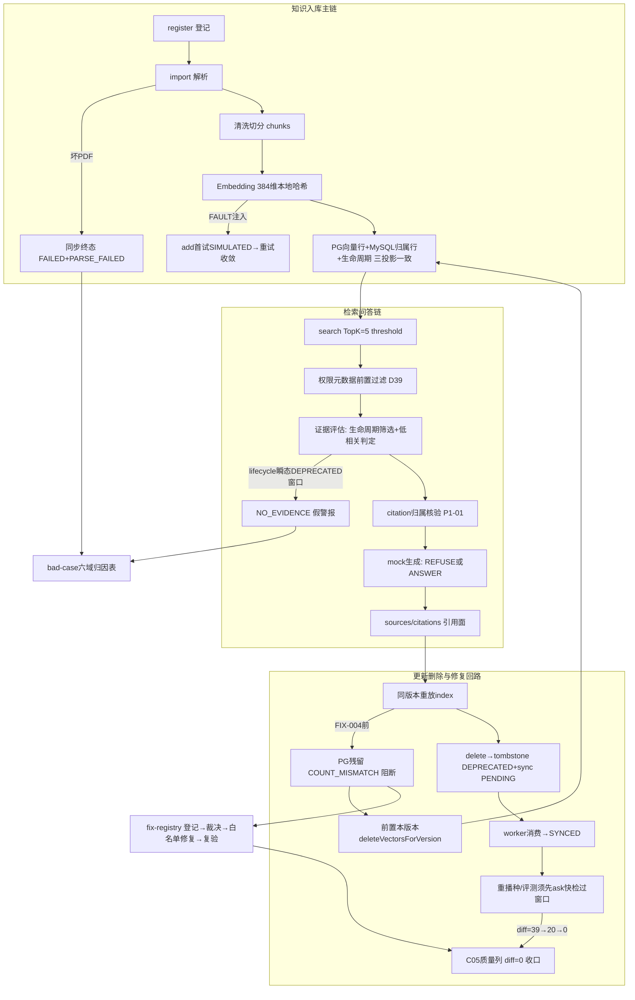

# D43-02 RAG 端到端权限与回归技术文档与实践指南

> 人设口径：12 年 Java 架构师 + 6 年 AI 工程落地。配套事实/操作文档：D43-01；本报告原理适用于 one 仓 M3-Java D35–D43 主链。

## 1. 是什么

D43 R01 不是功能迭代，而是**集成回归**：把 D35（引用核验）以来 9 个迭代分别验证过的局部能力，放到同一条真实链路（知识库管理→解析→切分→Embedding→检索→生成→引用→权限→更新删除）上做端到端交叉验证，并只修**阻断级**缺陷。三大交付=端到端报告、bad-case 六域归因表、修复记录；四条硬红线=禁新功能、基线漂移即熔断、修复走登记-裁决-白名单-复验、外部真实调用恒 0。

## 2. 为什么必须专门做这一轮

单迭代测试有**局部正确性幻觉**：每个 Dxx 都绿，不代表组合后绿。本轮实证了三类只有全链路才暴露的问题：

1. **迁移断裂**（FIX-001）：骨架 d42→d43 改名 9 夹具+truth+代码，唯独 manifest 漏重生成——单测继承即红，说明"资产闭环重生成"必须列入迁移 Definition of Done。
2. **不对称安全面**（FIX-002/003）：D39 access 上线后主轨写面逐个收口，但 D15 时代的 prompts 控制器与 D38 的 one_ 镜像从未回填 guard——权限治理是**面**不是点，需要"全端点×角色×双态"矩阵兜底（本轮 285+50 格）。
3. **通道间时序耦合**（FIX-004、BC-006/007）：PG 向量、MySQL chunk 归属、knowledge_document 生命周期是**同一资产的三个投影**，任何单表清理/重建工具都可能把三者拉到不一致窗口。

## 3. 底层原理

### 3.1 主链六域分解与归因优先级

失败案例先归**主域**（权限>解析>切分>Embedding>检索>生成），无证据支持归属=UNATTRIBUTED。优先级原则：安全域最高（一个越权样本可以解释十个下游怪行为）；同步元数据/资产态单列"流程/资产"类，避免把环境污染误判成代码回归——本轮 diff=39→20→0 三段处置就是该分类学的直接收益。

### 3.2 阻断/质量二分

阻断=链路断裂/契约破坏/安全漏洞/数据不一致，必修且修复**不得必然改变**冻结基线质量列（H2）；若改，即熔断请示（本轮唯一潜在冲突=FIX-004，实证其只作用于 index 写路径、评测只读路径不经之，diff=0 证明"非必然改质量列"）。质量型 bad-case（REFUSAL_FALSE_NEGATIVE、HIGH_NOISE 等）只登记分类，处置=列 D44，因为它们是 D37 冻结基线的已知 FAIL，重"修"=重冻基线=毁掉回归锚。

### 3.3 双锚指纹（存储不变量的廉价证明）

对全表每行构造 canonical 行 `sha256(content)|len|documentId|version|strategy|chunkIndex|splitVersion`：

- **ID 面**=含 chunkId 的指纹（本模块 NAMESPACE `…6d43` 隔离设计→必然 ≠ 前代，作模块身份锚）
- **内容面**=去 chunkId 首列后重排序聚合（与 UUID 生成器无关）→ 跨代应恒等 `c377bb2f…`

内容面等价而 ID 面不等=确定性算法换命名空间（预期内）；内容面漂移=语料真变（CORPUS_DRIFT→熔断#2）。一把 SHA 抵一次全库人工比对。

### 3.4 评测器"直连盲点"与双通道证据

run-evaluation 的 PGVECTOR 后端经 **app 真实 HTTP**（非直连 PG）。推论：评测只在 disabled 无鉴权实例上可跑（评测器不持 Bearer）；同时 app 侧任何过滤（权限、生命周期、归属核验）都真实参与评测——这是好事（端到端），但意味着**评测失败 ≠ 检索失败**，必须配 PG 直查工具（VectorProbe/D43Q*）做第二通道定界。本轮 20/20 NO_EVIDENCE 若只看评测会误判"检索崩了"，直查证明 PG 8 行完好、search API hits 正常，真凶在上游生命周期窗口。

### 3.5 fail-closed 权限代数与 guard 位置

D39 access 的语义是**默认拒绝**：ANON/USER 触 ADMIN-only 面=4030+审计 DENIED 行；guard 必须在**服务调用之前**（判别器=E46：pre 轮 USER=5000 证明请求已过控制器打到服务层，post 轮 USER=4030 且服务层零触达——"错误码不同"就是 guard 位置的活体证明）。`ObjectProvider` 装配让 disabled 态 getIfAvailable=null 直通=双态零差异（矩阵主 285 格 diff=0 兜底验证）。

### 3.6 删除闭环 tombstone 的状态机窗口

DELETE index 在 D40 设计里=文档废弃：同事务写 `lifecycle→DEPRECATED`+`sync PENDING`，随后 worker 消费转 SYNCED、INDEX 重建事务再把 lifecycle 拉回 ACTIVE。中间窗口内 ask 会全量筛除证据（REFUSE/NO_EVIDENCE）。**并发时序是资产的一部分**：修复通道（seeding）与验证通道（评测）之间必须加"快检门"（单发 ask 验证 errorCode 族），否则瞬态被当持久缺陷登记（本轮 FIX-005 即被 OBS-D43-X3 更正）。

## 4. 端到端生命周期流程图（Typora/Mermaid 兼容）

## 5. 核心代码要点

- guard 模板（三控制器同型，`DocumentController` L76–114 为母本）：`AccessPrincipalResolver p = provider.getIfAvailable(); if (p != null) { requireAdmin(p.resolve(token)) }`——disabled 直通、enabled fail-closed；`AdminAuditService.record` 8 参含 DENIED 分支，审计先于响应返回。
- FIX-004 关键：`deleteVectorsForVersion(documentId, targetVersion)` 与 `countPgForVersion` 严格同口径（metadata->>documentId/version），幂等短路路径不触达=最小改动面。
- 归属核验 `loadChunkOwners`：`IN (chunkIds)` 一次批查，同 chunkId 多归属→置 null→CITATION_OWNERSHIP_MISMATCH 剔除（宁拒不假放行）。

## 6. 常见问题（FAQ）

1. **评测 20 题全 NO_EVIDENCE，检索坏了吗？** 先分列三通道：评测 errorCode、app search hits、PG 直查行数。hits 正常+表完好=上游筛选窗口/归属数据问题，非检索故障。
2. **diff=39 要不要修代码？** 熔断纪律：先证资产纯净（E2E 行挤占 top5 会产出 null logicalId——本次即此），资产修复后复跑仍是 diff≠0 才进代码定界。
3. **为什么"全量 100/100"还会编译旧类？** Maven 增量按 mtime，恢复文件保留备份时间戳即触发；修复=touch，验证=javap 看构造器参数数。
4. **重跑 seeding 安全吗？** 会先 DELETE 后重建：评测面瞬时污染+生命周期窗口，必须错峰+快检门。

## 7. 工程实践清单（本轮固化）

- 迁移类改动：夹具、truth、manifest、代码四处**同批**重生成并跑继承测试。
- 权限治理：新写面上线检查表加"对照 DocumentController guard + 审计 + 越权矩阵格"三件事。
- 共享存储多实例：迭代窗口外部实例停机（18080 干扰两次入档）；清理工具前缀大小写口径逐一列举，不做"看着像"的通配。
- 长流程脚本：输出全量落盘再读尾；退出码语义先读契约（runExit=1 非事故）。
- 证据规范：数字必须能指到 jsonl/log 原件路径；更正用新条目 corrects 引用，不改写历史行。

## 8. 溯源

- 评测器/数据集/基线：D37 冻结资产（SHA `75cc8d83cfb2…`），《Spring AI Reference | Spring AI 参考文档》文档向量检索章节（概念口径，未引入新依赖）。
- 本轮实测出处：docs\evidence\D43\{e2e-report.md, badcase-classification.csv, fixes\, matrix\, evaluation\run-1810\, cleanup\, regression\}。
- 前代设计依据：D40 删除闭环/版本指针裁决 D2、D42 C05 双态口径与 not-adopt rerank 决策、D35 P1-01/P1-02 引用核验。
