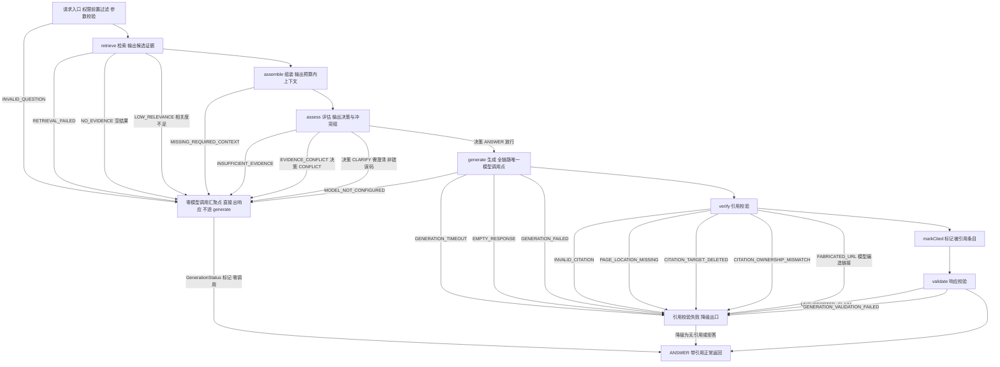
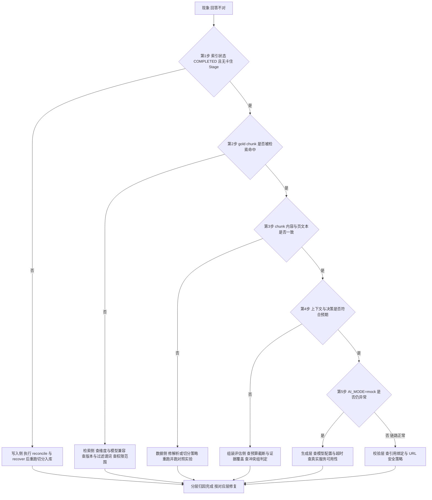

任务书 §1 为已核实基线且明令禁止重扫，我按其成文。官方链接已逐条验证（OWASP LLM02 的正确地址是 `llm022025-` 形式，已修正）。以下为笔记全文，窗口交付、不落盘。

---

# RAG 全链路复习：上传→引用回答、故障分层与调试顺序（D43 知识笔记）

> 人设：12 年 Java 架构师 + 6 年 AI 工程落地。本笔记当**排障手册**用，不当概念串讲用。
> 事实四档：`[confirmed]`（任务书 §1 已实读 D39 源码）/ `[代码推断]`（由已核实事实推出，未读到赋值点）/ `[待验证]`（§1 未覆盖，附核对路径）/ `[另一线不同实现]`。
> 证据边界：基线来自**只读扫描**，未执行编译与真实端到端调用，全文不写"已实测通过"。
> 主题边界：不展开 Agent、Tool Calling、MCP，不讨论多租户 SaaS 化改造。

## 0. 两侧分工：链路不是一个整体，是两套工程

这是本笔记的第一个结论，也是所有调试思路的入口。

|          | 写入侧（离线批处理）                                         | 问答侧（在线请求）                                           |
| -------- | ------------------------------------------------------------ | ------------------------------------------------------------ |
| 阶段     | 登记→解析→切分→向量化→入库                                   | 检索→组装→评估→生成→引用校验→响应校验                        |
| 特征     | 批量、可重试、**有状态机**                                   | 在线、有延迟预算、**无状态**                                 |
| 判据字段 | `DocumentStatus` / `VectorIndexStatus` / `IndexStage` / `ChunkRowStatus` | `RagErrorCode` + `AssessmentDecision` + `GenerationStatus` + `RetrievalStatus` |
| 失败代价 | 数据残留（悬空元数据 / 幽灵向量），可事后补偿                | 单次请求失败，无残留（历史表另议 `[待验证]`）                |
| 修复方式 | `/reconcile`、`/recover`、幂等重跑                           | 只能改参数或改代码后重放，**没有"修历史"接口**               |

**用同一套调试思路处理两侧是常见错误**：拿问答侧的"重放一次看看"去处理写入侧，会重复触发双写；拿写入侧的"补偿重试"去处理问答侧，会把超时放大成雪崩。

---

## 1. 交付物一：全链路阶段表（11 阶段）

### 1-A 阶段产物与真实锚点

| #    | 阶段             | 输入                      | 输出产物                            | 真实类 `[confirmed]`                                         | 探针接口（现成可用）                                         |
| ---- | ---------------- | ------------------------- | ----------------------------------- | ------------------------------------------------------------ | ------------------------------------------------------------ |
| 1    | 登记             | 文件元信息 + 内容哈希     | 文档主记录 + `documentId` + SHA-256 | `DocumentRegistrationService` / `Sha256ContentHasher`        | `POST /api/v1/documents/register`                            |
| 2    | 导入解析         | 原始 PDF / 基础文本       | 页面文本（页级可追溯）              | `DocumentImportService` / `PdfDocumentParser` / `BasicDocumentParser` | `POST /api/v1/documents/import`、`GET /{id}/pages`           |
| 3    | 切分             | 页面文本                  | chunk 列表 + `chunkId` + 边界类型   | `DocumentChunkService`、`FixedSizeSplitter` / `StructureSplitter` / `TextCleaner` / `ChunkBoundarySupport` | `GET /{id}/chunks`、`GET /{id}/chunks/comparison`            |
| 4    | 向量化           | chunk 文本                | 向量（维度/模型固定）               | `DocumentEmbeddingService` / `LocalHashingEmbeddingModel` / `EmbeddingRetryExecutor` / `VectorIndexCompatibilityService` | `POST /api/v1/documents/{id}/embeddings`、`GET /embeddings/model` |
| 5    | 入库（双写）     | 向量 + chunk 元数据       | PG 向量行 + MySQL 元数据行          | `DocumentVectorIndexService`（`IndexStage`）、`PgVectorStoreService` | `POST /api/v1/vector-index/documents/{id}/index`、`GET .../status`、`POST /reconcile`、`POST /recover` |
| 6    | 检索             | query + 过滤条件          | 候选证据列表                        | `RagRetrievalService` / `KnowledgeRetrievalService` / `hybrid`（18 类）/ `CitationRegistry` | `POST /api/v1/retrieval/search`、`POST /api/v1/vector-store/search`、`GET /vector-store/stats` |
| 7    | 上下文组装       | 候选证据                  | 预算内的上下文字符串 + 必需字段校验 | `ContextAssemblyService` / `EvidenceItem` / `ContextAssemblyResult` | 仅经 `/rag/ask` 间接观测 `[confirmed]`                       |
| 8    | 证据评估         | 候选 + 主张               | 决策 + 冲突组 + 缺口                | `EvidenceAssessmentService` / `FactClaimExtractor` / `ConflictGroup` | 同上                                                         |
| 9    | 生成             | 上下文 + query            | 原始回答文本                        | `GenerationService` → `ChatModelPort`（`RemoteAiChatService` / `MockAiChatService`） | `POST /api/v1/rag/ask`、`POST /api/v1/ai/chat`               |
| 10   | 引用校验         | 回答 + `CitationRegistry` | 可核验引用 / 违规拦截               | `CitationVerificationService` / `SnippetExtractor` / `UrlSafetyPolicy` / `ResponseValidationService` | 同上                                                         |
| 11   | 权限（前置横切） | 认证上下文                | 授权范围注入检索条件                | `AuthContextFilter` / `AccessPolicyService` / `DocumentScope` / `PermissionScope` / `AccessDeniedAdvice` | 过滤器链前置，无独立探针 `[待验证]`                          |

**第 11 项不是链路的最后一步，而是第 6 步的前置**：`AuthContextFilter → AccessPolicyService → DocumentScope/PermissionScope` 必须在 **PG 查询条件层生效**。若只在生成后过滤，越权内容已经进入 prompt——这是不可逆的泄露，与"回答里没显示"是两回事。OWASP 对此有明确定性：间接提示注入正是发生在"RAG 检索到的外部内容"这一环，且系统提示层面的限制"可能不被遵守并可被绕过"。

### 1-B 状态锚点与依赖崩塌点

| #    | 阶段     | 落库/写入位置                                                | 该阶段负责改写的可验证事实                                   | 删掉此阶段，下游最先崩在哪一步                               |
| ---- | -------- | ------------------------------------------------------------ | ------------------------------------------------------------ | ------------------------------------------------------------ |
| 1    | 登记     | MySQL 文档主记录 `[待验证：表名应在 document 域 po/mapper 确认]` | 新建 `documentId`；内容哈希去重锚                            | 第 2 步：无 ID，导入无处可写                                 |
| 2    | 导入解析 | 页面/内容记录 `[待验证：同上]`                               | 写入页文本；`GET /{id}/pages` 可查                           | 第 3 步：无文本可切，chunks 为空                             |
| 3    | 切分     | chunk 行 + `ChunkRowStatus`                                  | 生成 `chunkId`（`StableChunkIdGenerator` + `ContentHasher`） | 第 4 步：无 chunk，向量化空转                                |
| 4    | 向量化   | 向量列（维度锁定）                                           | 写入与库表维度一致的向量                                     | 第 5 步：维度不符，入库前就该被 `VectorIndexCompatibilityService` 拦住 |
| 5    | 入库     | PG 向量 + MySQL 元数据（**非原子双写**）                     | `IndexStage`：`SPLIT→EMBED_WRITE→SWITCH→CLEANUP`；`VectorIndexStatus` | 第 6 步：检索恒空，`RetrievalStatus=EMPTY`                   |
| 6    | 检索     | 无落库                                                       | `RetrievalStatus`；候选集                                    | 第 7 步：组装无输入，`MISSING_REQUIRED_CONTEXT`              |
| 7    | 组装     | 无落库                                                       | `ContextAssemblyResult`；预算与截断计数                      | 第 9 步：空/畸形上下文直送模型 → 幻觉                        |
| 8    | 评估     | 无落库                                                       | `AssessmentDecision`（4 值）；`ConflictGroup`                | 第 9 步：该拒答该澄清的照样生成，成本+安全双失               |
| 9    | 生成     | 会话历史（若有）`[待验证]`                                   | `GenerationStatus`（8 值）                                   | 第 10 步：无回答可校验，引用链路空跑                         |
| 10   | 引用校验 | `CitationRegistry` 关联                                      | 每条引用绑定 `documentId + version`；标记被引用              | 第 11 步（validate）：无法判"主张是否有据"                   |
| 11   | 权限     | 无落库                                                       | 检索过滤谓词                                                 | 第 6 步即失效（越权召回），且不可事后补救                    |

### 1-C 稳定 ID：链路的缝合点

`StableChunkIdGenerator` + `ContentHasher` 决定 `chunkId` 跨版本可追踪 `[confirmed：类名]`，**引用溯源、对账、幂等三件事全部依赖它**。

chunkId 生成口径一旦变化（例如把 `split_version` 纳入 ID 构成），连带后果按顺序发生：

1. 重跑切分 → 同一内容的 chunkId 全变 → MySQL 元数据与 PG 向量在自然键上**不再对得上**；
2. `POST /reconcile` 把旧向量全判为"孤儿向量"、新元数据全判为"缺失向量"，一次性误报成数据损坏；
3. `CitationRegistry` 中历史引用指向的 chunkId 在新版本中不存在 → 触发 `CITATION_TARGET_DELETED`（或口径不匹配类错误），**用户看到的旧引用集体失效**；
4. 幂等失效 → 重跑变重复写入。

结论：**chunkId 口径属于链路契约，不属于实现细节**。任何改动必须同时回答"历史引用如何迁移"，否则不得改。

---

## 2. 交付物二：主流程图（编排顺序 + 失败出口 + 零模型调用汇聚）

真实编排顺序 `[confirmed]`：`retrieve → assemble → assess → generate → verify → markCited → validate`。

**零模型调用分支的完整清单**（共 8 条出口汇入 `ZR`，均不进 `generate`）：

| 出口码/决策                | 归属阶段   | `GenerationStatus` 落值 |
| -------------------------- | ---------- | ----------------------- |
| `INVALID_QUESTION`         | 入口校验   | `NOT_ATTEMPTED`         |
| `RETRIEVAL_FAILED`         | 检索       | `NOT_ATTEMPTED`         |
| `NO_EVIDENCE`              | 检索空结果 | `SKIPPED_NO_EVIDENCE`   |
| `LOW_RELEVANCE`            | 检索/评估  | `SKIPPED_NO_EVIDENCE`   |
| `MISSING_REQUIRED_CONTEXT` | 组装       | `SKIPPED_NO_EVIDENCE`   |
| `INSUFFICIENT_EVIDENCE`    | 评估       | `SKIPPED_NO_EVIDENCE`   |
| `EVIDENCE_CONFLICT`        | 评估       | `CONFLICT`              |
| 决策 `CLARIFY`             | 评估       | `CLARIFY`               |

> `MODEL_NOT_CONFIGURED` 特殊：它出现在**已进入 generate 但适配器未装配**的路径上，落 `GenerationStatus=NOT_CONFIGURED`，同样不产生模型 token。它是配置态失败，不是逻辑态失败。

**图的两条硬事实**：

1. `generate` 是**唯一模型调用点**，因此"零模型调用"是可核验不变量，而不是优化目标。这与既有 RAG 决策约定一致：检索失败/无证据/澄清/冲突/拒答五类分支均须零模型调用。
2. 出口分三类**语义不可合并**：`RETRIEVAL_FAILED`（检索挂了）、`NO_EVIDENCE`（检索成功但没命中）、`GENERATION_*`（模型侧问题）。Spring AI 官方 `ContextualQueryAugmenter` 默认**不允许上下文为空并指示模型不要回答**，需显式开 `allowEmptyContext` 才会照答——这从框架侧印证了"空证据默认不送模型"是安全默认值。

---

## 3. 交付物三：故障分层表

### 3-A 三层归属

| 层                                            | 本层异常类 `[confirmed]`                                     | 收敛到的 `ResultCode`                                       | 是否可重试                                                   | 是否产生数据残留                                             | 修复入口                                                     |
| --------------------------------------------- | ------------------------------------------------------------ | ----------------------------------------------------------- | ------------------------------------------------------------ | ------------------------------------------------------------ | ------------------------------------------------------------ |
| **L1 数据写入层**（解析/向量/入库）           | `DocumentValidationException`、`DocumentParseException`、`EmbeddingServiceException`、`OneEmbeddingException`、`VectorIndexException` | `PARAM_INVALID(4001)` 或 `SYSTEM_ERROR(5000)` `[代码推断]`  | **分层看**：解析类是确定性失败，重试无意义；向量类有 `EmbeddingRetryExecutor`，仅瞬时错误重试；入库类走补偿而非重试 | **是**。双写非原子 → 悬空元数据或幽灵向量                    | `POST /api/v1/vector-index/documents/{id}/index`、`POST /reconcile`、`POST /recover` |
| **L2 在线问答层**（检索/组装/评估/生成/校验） | `ModelInvocationException`；其余以 `RagErrorCode` 在响应体内表达，**不抛异常** `[代码推断]` | `AI_UNAVAILABLE(5002)`、`PARAM_INVALID(4001)` `[代码推断]`  | 同步链超时/瞬时错误可重试一次；**流式首片段发出后不可重放、不可重试** | 基本否（无状态）；会话历史是否落库 `[待验证：应在 history 域确认]` | 无补偿接口，只能调参或改代码后重放                           |
| **L3 横切配置与安全层**                       | `AiConfigurationException`、`AccessDeniedException`          | `AI_CONFIG_ERROR(5001)`、`PARAM_INVALID(4001)` `[代码推断]` | **永不重试**：配置态与鉴权态失败是永久错误                   | 否                                                           | 改环境变量/配置后重启；权限问题改授权范围                    |

重试口径统一遵循既有韧性约定：仅瞬时错误可重试，鉴权/参数/余额类永久错误不重试；流式首片段后不重放。

### 3-B 内部 20 码逐项归层（无遗漏）

| 归层                                      | `RagErrorCode`（共 20）                                      | 计数   |
| ----------------------------------------- | ------------------------------------------------------------ | ------ |
| **L2-入口/参数**                          | `INVALID_QUESTION`                                           | 1      |
| **L2-检索**                               | `RETRIEVAL_FAILED`、`NO_EVIDENCE`、`LOW_RELEVANCE`           | 3      |
| **L2-组装**                               | `MISSING_REQUIRED_CONTEXT`                                   | 1      |
| **L2-评估**                               | `INSUFFICIENT_EVIDENCE`、`EVIDENCE_CONFLICT`                 | 2      |
| **L2-生成**                               | `MODEL_NOT_CONFIGURED`、`GENERATION_TIMEOUT`、`EMPTY_RESPONSE`、`GENERATION_FAILED` | 4      |
| **L1-数据可得性（问答侧回读写入侧失败）** | `LIFECYCLE_LOOKUP_FAILED`、`PAGE_LOCATION_MISSING`、`CITATION_TARGET_DELETED` | 3      |
| **L2/L3-引用与主张校验**                  | `INVALID_CITATION`、`CITATION_OWNERSHIP_MISMATCH`、`FABRICATED_URL`、`UNSUPPORTED_CLAIM`、`GENERATION_VALIDATION_FAILED` | 5      |
| **非故障哨兵**                            | `NONE`（成功占位，不属于任何故障层）                         | 1      |
| 合计                                      |                                                              | **20** |

> `CITATION_OWNERSHIP_MISMATCH` 横跨 L2 与安全语义：它检的是"引用是否属于当前请求可访问范围"，因此其修复动作在 L3（权限/归属口径）。此处归入校验层并显式标注跨界，不做含混归类。

### 3-C 内部码 → 外部码：为什么要两套粒度

| 粒度                 | 载体                                               | 消费者                       | 生命周期                     |
| -------------------- | -------------------------------------------------- | ---------------------------- | ---------------------------- |
| `ResultCode` 5 值    | HTTP 响应外壳（`GlobalExceptionHandler` 统一映射） | 网关、前端、监控告警、SLA    | 对外契约，**改动即破坏兼容** |
| `RagErrorCode` 20 值 | 业务响应体内字段                                   | 排障人员、评测脚本、回归基线 | 域内自由演进                 |

**判定规则（明确，不视情况而定）**：

1. **只有当客户端需要据此走不同代码分支、且该分支跨版本稳定时，才允许新增对外 `ResultCode`**。例：需要前端把"配置缺失"和"服务不可用"引导到不同页面 → 已有的 5001/5002 够用；若出现需要客户端区分"该问题用户可自解 vs 只能等运维"的新语义，才谈新增。
2. **纯粹服务于内部定位的，只能加内部码**。例：`FABRICATED_URL` 与 `INVALID_CITATION` 对外都可以是 5000/4001，但内部必须分开——否则无法判断是模型行为异常还是引用装配 bug。
3. 对外码一旦发布**不删除、不改值、不复用语义**；内部码可增可合并。

**映射断裂的具体后果**（三条，按严重度排）：

| 后果             | 表现                                                         | 触发条件                       |
| ---------------- | ------------------------------------------------------------ | ------------------------------ |
| **告警失真**     | 幽灵向量、双写卡住这类 L1 事故，被折叠成 `SYSTEM_ERROR(5000)`，与"数据库连接串写错"共用一个告警 | 多对一映射 + 无内部码落日志    |
| **重试放大**     | 客户端只见 5000，按"服务错误"重试；实际是不可重试的配置/永久错误 | 外部码丢掉了"是否瞬时"这一维度 |
| **评测不可复现** | 回归报告按外部码统计"失败率"，`NO_EVIDENCE`（正常拒答）与 `RETRIEVAL_FAILED`（真故障）混计 | 拒答与故障未在外层区分         |

**规避要求**：内部码必须随外部码一起落到日志/响应体的可关联字段（配合 `TraceIdFilter` 的 traceId），否则 20→5 的压缩就是不可逆的信息销毁。`[结论]`

---

## 4. 交付物四：调试顺序 SOP（从外到内 5 步）

### 4.1 为什么不能先看模型

三个可验证理由，不是经验主义：

1. **模型是链路最后一个环节**，它只能"根据给定上下文回答"。第 6/7/8 步送错了东西，模型再强也答错——此时改 prompt 是拿症状当病因。
2. **本项目有零成本判据**：`MockAiChatService` 让链路零 Key 可跑通。`AI_MODE=mock` 下若问题仍复现，直接排除生成层；这是免费的二分法。**不用它就等于放弃一次决定性实验**。
3. **最贵的假设排在最后**：真实模型调用按 token 计费，逐条"试试看模型是不是抽风"的排障方式，既慢又花钱，还不可复现。

### 4.2 标准定位顺序

| 步               | 判什么                           | 用哪个现成接口                                               | 看哪个字段                                                   | 判定阈值                                                     | 准入门槛（此步正常才进下一步）                               |
| ---------------- | -------------------------------- | ------------------------------------------------------------ | ------------------------------------------------------------ | ------------------------------------------------------------ | ------------------------------------------------------------ |
| **1 侧向二分**   | 故障在写入侧还是问答侧           | `GET /api/v1/vector-index/documents/{id}/status` + `POST /api/v1/rag/ask` | `VectorIndexStatus`、`IndexStage`、`RagErrorCode`            | 索引状态非 `COMPLETED` 或 `IndexStage` 停在中间态            | 状态 `COMPLETED` → 判为问答侧，进第 2 步；否则**停在第 1 步**，走 `/reconcile`、`/recover` |
| **2 检索层**     | 期望证据到底有没有被召回         | `POST /api/v1/retrieval/search`、`POST /api/v1/vector-store/search`；旁证 `GET /vector-store/stats` | `RetrievalStatus`、命中列表的 `chunkId`/`documentId`、score  | 已知 gold chunk 不在返回集中 = 检索问题                      | gold chunk 命中 → 进第 3 步；未命中 → 查维度/版本/过滤，**禁止进入第 4、5 步** |
| **3 数据层**     | 召回了但内容不对，还是本来就存错 | `GET /{id}/pages`、`GET /{id}/chunks`、`GET /{id}/chunks/comparison`、`GET /embeddings/model` | 页文本、chunk 边界与数量、生效 embedding 模型与维度          | 页文本正确但 chunk 断裂/串页 = 切分问题；维度或模型与库表不符 = 兼容问题 | chunk 内容与库表维度一致 → 进第 4 步                         |
| **4 组装与评估** | 上下文对不对、决策对不对         | `POST /api/v1/rag/ask` 的响应体（组装无独立探针 `[confirmed]`） | `AssessmentDecision`、`MISSING_REQUIRED_CONTEXT`、`LOW_RELEVANCE`、`INSUFFICIENT_EVIDENCE`、预算与截断计数 `[待验证：应在 RagBudgetView 确认字段]` | 候选对但上下文里缺关键 chunk = 预算/截断问题；决策与预期不符 = 评估问题 | 上下文与决策均正确 → 进第 5 步                               |
| **5 生成与引用** | 才是模型的锅                     | 先 `AI_MODE=mock` 重放 `POST /api/v1/rag/ask`，再 `POST /api/v1/ai/chat` 单测裸模型；引用看 `RagErrorCode` | `GenerationStatus`、`GENERATION_*`、`INVALID_CITATION`、`FABRICATED_URL`、`UNSUPPORTED_CLAIM` | mock 正常、真实异常 → 生成层；真实正常、引用码报错 → 校验层  | 前四步全部正常，才允许把结论写成"模型问题"                   |

**关键准入门槛的对称表述**：任一步判为异常即**终止向下**，修复后从第 1 步重跑。理由——链路是串联依赖，下游观测在上游损坏时不可信。

### 4.3 二分式排障决策图

### 4.4 六道必答题的结论（逐条，不视情况而定）

| #    | 问题                         | 明确结论                                                     |
| ---- | ---------------------------- | ------------------------------------------------------------ |
| 1    | 阶段职责与崩塌点             | 见 §1-A/1-B。补充一条：**每个阶段只对"自己新建的可验证事实"负责**——登记新建 `documentId`、切分新建 `chunkId`、入库新建 `IndexStage`/`VectorIndexStatus`、生成新建 `GenerationStatus`、引用校验新建 `documentId+version` 绑定。删任何一步，下游最先崩在"需要读取该步产物"的那一步 |
| 2    | 零模型调用的必要性与违反后果 | 必须零调用。**两类后果同时发生**：① **成本类**——为"本不该回答"的请求支付 token，且费用无法归因（`ModelCallRecorder` 记录到调用，但业务上这笔钱是纯浪费），日均量放大后退化为预算事故；② **安全类**——无证据仍生成 → 答案看起来"格式正确且有引用"，实际是无据幻觉；越权/冲突内容进入 prompt → 触发 LLM01 间接提示注入与 LLM02 敏感信息泄露的既有风险面，且拒答门禁被绕过 |
| 3    | 两套粒度与新增判定规则       | 见 §3-C。规则一句话：**改变客户端行为才动对外码；只改变定位效率一律加内部码** |
| 4    | 调试顺序                     | 见 §4.2。不看模型的论证是三条可验证理由，其中 `AI_MODE=mock` 二分是本项目现成能力 |
| 5    | `RagTimingView` 缺口         | 见 §5                                                        |
| 6    | `RetrievalStatus` 无 FAILED  | 见 §4.5                                                      |

### 4.5 `RetrievalStatus` 只有 SUCCESS / EMPTY 的影响分析

**事实**：PG 不可达等真失败**不通过 `RetrievalStatus` 表达**——它走异常通道，由 `RagErrorCode.RETRIEVAL_FAILED` 承载，再经 `GlobalExceptionHandler` 收敛到 `ResultCode`（映射细节 `[代码推断]`，应在 `RagErrorCode` 与 `ResultCode` 的映射处确认）。即：`RetrievalStatus` 描述"检索正常完成后的结果集形态"，是**结果域**；失败是**异常域**。二者正交。

**两种解释**：

| 解释             | 立论                                                         | 弱点                                           |
| ---------------- | ------------------------------------------------------------ | ---------------------------------------------- |
| **(a) 有意为之** | 状态枚举只刻画业务结果；故障用异常与错误码表达，避免"状态枚举无限膨胀"（每加一种失败就加一个枚举值） | 依赖调用方同时看两个字段，约定必须在文档里写明 |
| **(b) 设计缺陷** | 若调用方偷懒只读 `RetrievalStatus`，PG 挂了可能读到的仍是默认/上一次的值，被误判为 `EMPTY` → 对外表现为"正常拒答"，**真故障伪装成合理行为** | 这种伪装比报错更难发现，属于静默失败           |

**我的取舍**：**接受 (a) 的建模，但必须补一条硬约束才算安全**——`RetrievalStatus` 不得作为唯一判据；任何读取方必须以"`RETRIEVAL_FAILED` 与 `NO_EVIDENCE` 互斥"为验收项，即空结果与失败在响应上可区分（一个带 `EMPTY`+`NO_EVIDENCE`，一个带失败码且 `RetrievalStatus` **不被赋值**或赋值前即抛出）。**必须核对**：`RetrievalStatus` 的默认值是否为 `null`；若给的是非 null 默认 `EMPTY`，(b) 成立，属缺陷，应改为 `Optional`/`null` 或补 `FAILED` 值。核对路径：`RetrievalStatus` 枚举定义处 + 其在响应 DTO 中的初始化处。

---

## 5. 交付物五：埋点与观测清单

### 5-A 现状

`RagTimingView` 现有 4 字段 `[confirmed]`：`retrievalMs` / `assemblyMs` / `generationMs` / `totalMs`。

**缺口 3 项**：无 `assessMs`、无 `verifyMs`、无 `validateMs`。

**导致的误判（这是考点）**：`totalMs − (retrievalMs + assemblyMs + generationMs)` 存在**无法归因的残差**。由此产生两类具体错误决策：

1. **把评估/校验耗时算进生成** → 误调模型超时阈值，实际瓶颈在引用校验侧的元数据/生命周期查询（`LIFECYCLE_LOOKUP_FAILED` 正是这一段的失败码），结果是超时调小、正常请求被误杀；
2. **把引用校验延迟误读成"检索变慢"** → 去调 pgvector 的 HNSW 检索参数（如 `ef_search`），而检索阶段本身早已返回。

补充一条**反向误判**：残差偏大也可能是权限前置过滤与请求体缓存（`CachedBodyAccessLogFilter`）的开销，这两项同样不在四个计时字段内。

### 5-B 最小补充方案（只列字段与采集点，不写代码）

| 新增字段              | 采集点                                                       | 覆盖的 `RagErrorCode`                                        |
| --------------------- | ------------------------------------------------------------ | ------------------------------------------------------------ |
| `assessMs`            | `EvidenceAssessmentService` 调用前后（含 `FactClaimExtractor` + `ConflictGroup`） | `INSUFFICIENT_EVIDENCE`、`EVIDENCE_CONFLICT`、`LOW_RELEVANCE` |
| `verifyMs`            | `CitationVerificationService` + `SnippetExtractor` + `UrlSafetyPolicy` 整段 | `INVALID_CITATION`、`PAGE_LOCATION_MISSING`、`CITATION_TARGET_DELETED`、`FABRICATED_URL` |
| `validateMs`          | `ResponseValidationService` 段                               | `UNSUPPORTED_CLAIM`、`GENERATION_VALIDATION_FAILED`          |
| （建议）`markCitedMs` | `markCited` 步骤                                             | 无专属码，但与 `verifyMs` 同段可先合并 `[待验证]`            |
| （建议）`permMs`      | `AccessPolicyService` 前置段                                 | `AccessDeniedException` 路径                                 |

约束：补完后必须满足 `totalMs ≥ Σ各段Ms`，且残差（框架/序列化开销）应单独成项，否则只是把缺口换个位置。**可采纳的既有实现范式**：本项目 D41 混合检索已落过分段计时（`vectorMs` / `keywordMs` / `fusionMs` / `totalMs`，各段独立 `System.nanoTime()` 且取实测墙钟下界），照此口径扩展到 assess/verify 即可。`[本会话实读 two 线 D41 源码]`

### 5-C 模型侧观测能回答哪类成本问题

| 组件 `[confirmed]`                                           | 能回答的问题                                                 |
| ------------------------------------------------------------ | ------------------------------------------------------------ |
| `ModelCallRecorder` / `ModelCallRecord`                      | 每请求模型调用次数（**这是"零模型调用"不变量的唯一可核验证据**）；单次调用的成功/失败分布（配合 `CallOutcome`） |
| `TokenUsageSnapshot` / `UsageStatus`                         | 输入/输出 token 量 → 折算单次费用；`UsageStatus` 可区分"未使用"与"使用失败"，避免把失败调用当零成本 |
| `TraceIdFilter` + `ControllerAccessLogAspect` + `CachedBodyAccessLogFilter` | traceId 串联内部码与外部码；请求体需被缓存后才可记录，**代价是大文件上传占用内存**（写入侧上传尤其要留意） |
| `LogMaskingUtils`                                            | 保证密钥与敏感字段不落日志；本项目约定密钥只经环境变量注入，禁硬编码/日志/Git `` |

**三类成本问题 → 对应数据源**：

1. "日均模型费用涨了多少来自哪个阶段" → `TokenUsageSnapshot` 按阶段聚合（**当前无阶段维度，需与 5-B 同时补**）；
2. "拒答率上升是成本下降还是可用性下降" → `GenerationStatus=SKIPPED_NO_EVIDENCE/NOT_ATTEMPTED` 与 `RETRIEVAL_FAILED` 分开统计，**不可合并**；
3. "超时是模型侧还是我们侧" → `GENERATION_TIMEOUT` 计数 + `ModelCallRecord` 调用耗时分布。

### 5-D 回归基线不可跳（B12）

改切分、改 Embedding、改检索参数后**必须跑固定问题集前后对照**：D36 检索参数对照实验 + D37 评测脚本基线是链路的现成回归手段 `[confirmed 存在]`，本项目 D36 证据文件（`docs/evidence/D36/experiment-summary.json`）本会话已实读，含 `hitRate`/`averageRecall`/`microPrecision`/`averageNoise` 与 P95 五类指标。`[实测]`

**禁止用单条样例判断"没变差"**——本会话实测到的反例可直接引为论据：D36 G3 组把 `topK` 从 5 调到 10，所有指标**完全不变**，原因不是"参数无影响"，而是索引只有 3 个 chunk，`reasonCodes` 明确记为 `K_EXCEEDS_INDEXED_CHUNKS`。**实验设计先于实验结果**：候选数必须与语料规模匹配，否则测的是噪声。

---

## 6. 两线分叉：命名映射表（读他人代码的第一步）

| 语义        | one 线 `M3-Java\D39`（8080）`[confirmed]`                    | two 线 `M3-Java-ds\D39`（9090）`[confirmed]`                 |
| ----------- | ------------------------------------------------------------ | ------------------------------------------------------------ |
| 域根包      | `document`（101 类：chunk 23 / embedding 21 / vectorindex 16 / vectorstore 8 / retrieval 5） | `knowledge`（107 类）                                        |
| rag 包结构  | `rag` 36 类，**分 11 个子包**                                | `rag` 21 类，**扁平无子包**                                  |
| 错误码载体  | `RagErrorCode`                                               | `RagReasonCode`                                              |
| 检索态      | `RetrievalStatus`                                            | 无同名枚举，走 `RagStatus.RETRIEVAL_FAILED` `[代码推断]`     |
| 生成态      | `GenerationStatus`                                           | `GenerationOutcome`                                          |
| 决策        | `AssessmentDecision`                                         | `RagDecision` + `RagDecisionDetail`                          |
| 对外总状态  | —（`ResultCode` 5 值承载 HTTP 层）                           | `RagStatus` 七态（双轴：`RagDecision` 决策轴 + `RagStatus` 状态轴） |
| 规模        | main 类 308                                                  | main 类 280                                                  |
| 独有能力    | `one` 25（百炼隔离轨）、`resilience` 6                       | `experiment` 18（检索实验框架）、`model` 9                   |
| 韧性/模型包 | `resilience`                                                 | `model`（重试与失败分类对应位置）                            |

**使用规则**：跨仓库定位问题时**先建映射表再读代码**。两线 `rag` 包**语义等价、命名不同构**，把 one 线的 `RagErrorCode` 直接当 two 线的 `RagReasonCode` 去 grep 会命中失败，进而误判"two 线没有错误码体系"。two 线 D41 实际观测到 `RagStatus` + `RagDecision` + `RagReasonCode.NO_EVIDENCE/UNSUPPORTED_CLAIM` 的同构实现，可作映射证据。`[本会话实读 two 线 D41 源码]`

---

## 7. 必须补充的 15 项知识点（逐条落结论）

| #    | 知识点                       | 结论（不重复正文处只补增量）                                 |
| ---- | ---------------------------- | ------------------------------------------------------------ |
| 1    | 链路分两侧责任不同           | 见 §0。增量：写入侧的"有状态机"意味着**任何修复都要沿状态机推进**，直接改库跳过 `IndexStage` 会把状态与真实数据拆开 |
| 2    | 每阶段可验证锚点             | 写入侧四套状态字段 + 问答侧错误码/决策，见 §1-A/1-B          |
| 3    | 稳定 ID 是缝合点             | 见 §1-C                                                      |
| 4    | 双写一致性与幽灵向量         | MySQL 元数据 + PG 向量**非原子**。两类残留：① **悬空元数据**——MySQL 有 chunk 记录、PG 无向量，表现为"检索恒空但后台看着正常"；② **幽灵向量**——PG 有向量、MySQL 已删/未切，表现为**已下线文档仍被召回**。第 ② 类不只是数据脏：**它绕过元数据层的可见性判断，构成越权可见风险**，与 D39 主题同源（不能只让模型决定可见性）。修复入口 `/reconcile`（先 `dryRun` 报告，非 dryRun 才补偿）、`/recover`。`[confirmed：IndexStage 与接口]`，具体写入顺序 `[待验证：应在 DocumentVectorIndexService 中确认]` |
| 5    | 维度与模型兼容性             | 384 维（本地哈希 COSINE）与 1024 维（百炼隔离轨）**不可混查**，两轨表前缀隔离 ``。`VectorIndexCompatibilityService` 与 `IndexCompatibilityValidator` `[待验证：后者未在 §1 出现，应在 vectorindex 域确认]` 的职责是**入库前拦住**，不是检索时容错——拦在检索时意味着错误向量已进入候选集并可能进 prompt。pgvector 的距离运算要求同维度向量，维度不符直接报错而非降级 `` |
| 6    | 版本切换与引用时效性         | 引用必须绑 `documentId + version`。三类错误构成完整失败谱：`CITATION_TARGET_DELETED`（目标已删）、`CITATION_OWNERSHIP_MISMATCH`（归属不符）、`PAGE_LOCATION_MISSING`（页级定位丢失）→ **引用校验是链路终点而非附加项**：删掉它，前三类错误无处产生，系统会把不可核验的内容当有效引用返回。`FABRICATED_URL` 单独拦模型编造链接，属生成侧不可信输出的收口 |
| 7    | 证据充分性是决策不是分数阈值 | `FactClaimExtractor` + `ConflictGroup` 表明评估做的是"**主张—证据覆盖**"判断：CLARIFY 需要"缺哪个必要条件"、CONFLICT 需要"哪几条证据互相冲突"，这两类输出**无法由相似度阈值产出**（阈值只能二分为过/不过）。纯 score 阈值的天花板：Spring AI `SearchRequest` 的 `similarityThreshold` 只过滤候选，不产生决策 `` |
| 8    | 上下文预算                   | `RagBudgetView` `[待验证：应在 rag 域确认字段名]` 对应 `MISSING_REQUIRED_CONTEXT`。硬约束：**截断策略必须有依据**（按分数序/按必需字段优先），否则被截掉的内容仍可能出现在引用列表里 → 引用指向 prompt 中不存在的内容，第 10 步必然报 `INVALID_CITATION` |
| 9    | 流式链路故障分层不同         | `ChatStreamController`（SSE）下首片段发出后**不可重放、不可重试**，失败只能以事件形式下发；同步 `/chat` 可整体失败重来。SSE 规范本身提供 `Last-Event-ID` 续传语义——**本项目未用该续传能力 `[待验证]`**，故不能声称"客户端可自动续传" `` |
| 10   | 权限是前置不是后置           | 已在 §1、§1-A 第 11 项论证。补一条判定：**权限生效点可通过 `POST /api/v1/retrieval/search` 的返回集验证**——越权 chunk 出现在返回里就已经泄露，与回答是否提及无关 |
| 11   | mock / real 双模             | `MockAiChatService` 使链路零 Key 可跑通；调试必须先 mock 二分再切真实模型（§4.2 第 5 步）。真实模型调用无需改源码，只注入 `AI_MODE` 与 Key 环境变量 |
| 12   | 回归基线不可跳               | 见 §5-D                                                      |
| 13   | 混合检索的位置               | `hybrid` 包（one 18 类 / two 15 类 `[以 §1 与 B13 口径为准]`）位于**第 6 步检索阶段**，形态是**多路召回 + RRF 融合**，不是 rerank、不是生成层能力。本会话实读 two 线 D41：`HybridSearchService` 串行执行"向量路→关键词路→RRF 融合"，`rrf-k=60`、两路等权、**不使用原始分数**，且明确"并行化会破坏计时分段语义，实验期禁止"；`HybridRagRetrievalService` 把 RRF 分与余弦分**语义隔离**（回填向量路原始余弦，`KEYWORD_ONLY` 命中 `score=null` 由 `relevant-score=0.15` 门禁自然过滤）。影响指标：召回 `Recall@N` 与排序 `NDCG@k`/排名位次，**不影响模型 token 费用**。`[本会话实读 D41 源码]` |
| 14   | 日志脱敏是链路属性           | `LogMaskingUtils` + `CachedBodyAccessLogFilter`：请求体**先缓存后记录**，大文件上传有内存代价；密钥只经环境变量注入，禁出现于日志与文档 |
| 15   | 两线分叉的复习价值           | 见 §6。核心动作：跨仓库排障先建映射表，否则 grep 失败会被误读为"能力缺失" |

---

## 8. 复习自测题（10 题，含 3 类跨阶段题）

1. **【跨阶段·引用】** 引用校验为什么必须放在生成**之后**？如果把它挪到生成之前，能拦住哪类错误、会漏掉哪类错误？
 *要点：* `UNSUPPORTED_CLAIM`、`FABRICATED_URL`、`INVALID_CITATION` 的判定对象是**模型输出**，生成前无输入可判；前置只能校验候选证据合法性，等价于检索过滤，于是幻觉与编造链接两类彻底失去拦截点。

2. **【跨阶段·ID】** `chunkId` 生成口径加入 `splitVersion` 递增后，按顺序列出受影响的四个机制，并说明为什么"重跑一遍"不能自愈。
 *要点：* 见 §1-C 四步连带（自然键对不上 → `/reconcile` 集体误判 → 历史引用失效 → 幂等失效）。重跑只会让新旧两套 ID 并存，反而扩大孤儿向量集合。

3. **【跨阶段·权限】** "越权内容进入 prompt"发生在链路的哪一步？说明为什么第 10 步的引用校验救不回来，以及判据接口是什么。
 *要点：* 发生在上游第 6 步（权限谓词必须在 PG 查询条件层生效）。泄露在生成前已经发生，事后校验只影响响应展示；判据 `POST /api/v1/retrieval/search` 返回集。

4. `NO_EVIDENCE`、`RETRIEVAL_FAILED`、`GENERATION_FAILED` 三者的语义边界各是什么？哪两个若被合并统计会导致"费用下降被误报成可用性提升"？

5. 为什么 `CLARIFY` 不在 20 个 `RagErrorCode` 里？它靠什么表达？这反映错误码与决策枚举怎样的分工？

6. `totalMs` 比 `retrievalMs + assemblyMs + generationMs` 大 180ms，本项目当前能否归因？给出你会检查的三个具体来源（不许写"大概是 GC"）。

7. 幽灵向量与悬空元数据分别会让用户观察到什么现象？为什么前者风险更高、后者更难发现？

8. 384 维本地哈希与 1024 维百炼轨混查会发生什么？为什么兼容性拦截要放在入库前而不是检索时？

9. 线上反馈"回答不对"，你打算直接调 prompt。请按 §4.2 说明你跳过了哪几步、每步本应使用哪个接口做判据、以及为什么这次调参无法复现。

10. 两线 `rag` 包一个分 11 子包、一个扁平；同名概念一边叫 `RagErrorCode` 一边叫 `RagReasonCode`。给出一条**跨仓库定位的失败案例**（grep 什么、为什么误判、正确动作是什么）。

---

## 9. 官方溯源

- Spring AI Reference — Retrieval Augmented Generation（`VectorStoreDocumentRetriever` 过滤/阈值/top-k；`ContextualQueryAugmenter` 默认不允许空上下文并指示模型不答）| 检索增强生成：[https://docs.spring.io/spring-ai/reference/1.1/api/retrieval-augmented-generation.html](https://docs.spring.io/spring-ai/reference/1.1/api/retrieval-augmented-generation.html)
- Spring AI API — Vector Store API（可移植 SQL-like metadata filter API）| 向量存储 API：[https://docs.spring.io/spring-ai/reference/1.1/api/index.html](https://docs.spring.io/spring-ai/reference/1.1/api/index.html)
- Spring AI 1.1.8 Javadoc — `SearchRequest`（topK 与 similarityThreshold 仅过滤候选，不产出决策）| 检索请求：[https://docs.spring.io/spring-ai/docs/1.1.8/api/org/springframework/ai/vectorstore/SearchRequest.html](https://docs.spring.io/spring-ai/docs/1.1.8/api/org/springframework/ai/vectorstore/SearchRequest.html)
- pgvector 官方 README（距离度量与向量维度约束）| pgvector：[https://github.com/pgvector/pgvector](https://github.com/pgvector/pgvector)
- WHATWG HTML 规范 §9.2 Server-sent events（`Last-Event-ID` 续传语义、事件流格式）| 服务器推送事件：[https://html.spec.whatwg.org/multipage/server-sent-events.html](https://html.spec.whatwg.org/multipage/server-sent-events.html)
- OWASP LLM01:2025 Prompt Injection（间接注入源于 RAG 检索到的外部内容；系统提示限制可被绕过）| 提示注入：[https://genai.owasp.org/llmrisk/llm01-prompt-injection/](https://genai.owasp.org/llmrisk/llm01-prompt-injection/)
- OWASP LLM02:2025 Sensitive Information Disclosure（限制条款"不一定被遵守"，须依赖数据脱敏与配置）| 敏感信息泄露：[https://genai.owasp.org/llmrisk/llm022025-sensitive-information-disclosure/](https://genai.owasp.org/llmrisk/llm022025-sensitive-information-disclosure/)

