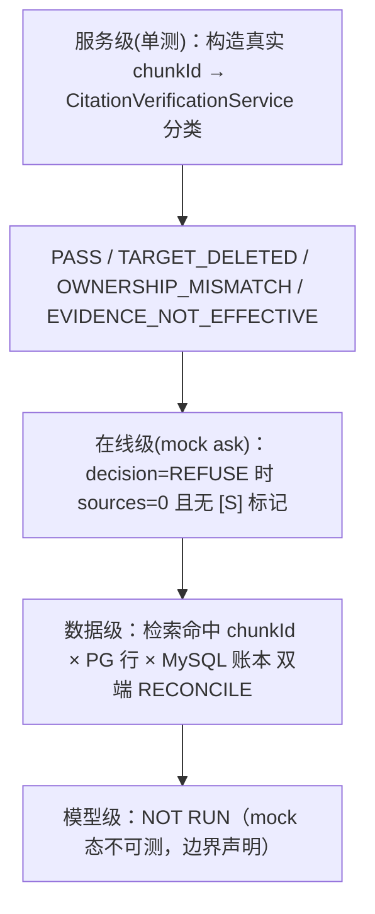

# D44-02｜RAG 阶段答辩与里程碑——技术文档与实践指南

> 人设口径：12 年 Java 架构 + 6 年 AI 工程落地。按"是什么→为什么→底层原理→执行流程→核心代码→常见问题→工程实践"展开；全部结论锚定本地源码/证据。
> 配套：D44-01（全量信息/操作手册）；本册聚焦原理链与可迁移经验。

## 1. 是什么：阶段收官答辩的技术内涵

D44 不新增业务能力，交付的是**质量主张的证据链**：主链冻结（SHA256 manifest）、四关键能力复验（引用真实/删除同步/权限过滤/无证据拒答）、评测逐字节回归（diff=0）、以及把 19 代迭代沉淀为可答辩/可复现/可交接的文档资产（里程碑/失败案例/优化清单/架构/API/数据/演示）。

## 2. 为什么冻结主链也能产生工程价值

回归测试的最大敌人不是 Bug，而是**"看起来没变"与"真的没变"的语义鸿沟**。三条机制把鸿沟变成可机检事实：

1. **文件级**：freeze-manifest.json 对 352 main + 35 test 记 SHA256；`git status` 终态仅 1 个豁免 M（FIX-D44-001）——冻结声明从"我记得没改"升级为"任何字节差异可指认"。
2. **数据级**：双锚体系——内容锚（chunk 规范化文本+embedding 输入的集合 SHA256，跨代恒定）证明语料面等价；ID 锚（chunkId 集合哈希，每代因库表重灌而新锚）证明集合构成。两锚分工原因：chunkId 含时间/UUID 因子不可跨代恒定，而内容可。
3. **行为级**：20 题评测 baseline.csv 逐字节 diff=0（含 chunk-id 列）——检索排序、决策分支、标签三族全链等价，比"指标相等"强一个数量级（指标碰撞可能掩盖排序漂移）。

## 3. 底层原理：三条关键机制链

### 3.1 引用真实的三层断言结构



核心洞察：**"零伪造引用"是可测的负命题，"引用真实内容"需要模型在场**。结构断言只能证伪（有 sources 而无 chunk 实体=伪造），不能证实语义忠实——把这条边界写进答辩口径，比伪造一个"100% 真实"数字有价值得多。

### 3.2 权限代数的矩阵化验证

D39 三元组（tenant/dept/device）+ ADMIN 面构成谓词代数；验证=**身份×端点×资源**三维全组合（285 格主矩阵+50 格 one_ 臂）逐格断言"预期可见集合"。三轮定界史本身就是方法论：

- 轮1 假阳性 44 MM → 实例臂 live 但断言仍按 BEAN_ABSENT 写 → **断言口径须与部署形态同步**；
- 轮2 资产名冲突 → 前轮残留资产撞 UK → **改名+换 stamp 隔离重跑**；
- 轮3 全绿 + disabled 侧 25 项零差异 → enabled/disabled 双态互证（H7）。

过期 token 探针（A6）的对照设计：拒绝面统一 4030 时，**"全拒绝"与"服务坏了"不可分辨**——必须用同窗合法 token 非 4030 作对照排除服务故障；且对照端点权限要匹配（X7-sync ADMIN-only 用 userA 对照=误判 FAIL 教训）。

### 3.3 删除同步的状态机与闭环边界

```
register → import → index(v1) → index(v2)      → vi-delete → vi-delete(重复)
              │           │ UPDATE_CLEANUP 旧版本  │ DELETE 四步     │ 幂等
              │           │ (FIX-004: 同版本就地覆盖 │ 标记→PG 清→关联清 │ 状态不变
              │           │  不再 COUNT_MISMATCH)   │ →SYNCED+审计     │
```

**边界事实（OBS-D44-X4）**：闭环清理范围=向量域+表格域+chunk 账本+文档状态，**不含 knowledge_document 登记行与 sync 历史行**（软删留痕语义 vs 物理清库的契约空白）。答辩价值在于：把"删除"拆成可枚举的四域状态迁移，每一域给出独立断言位——残留不是玄学，是谓词可指认的行。

## 4. 执行流程：可复现演示的状态设计

d44_demo.ps1 的 S0→S9 结构值得复用为模板：

1. **S0 预清**（幂等前提，允许任何前次异常退出）→ S1–S7 只读面 → S8 唯一写面（自建夹具全链）→ S9 终清回冻结面+断言。
2. 每节 PASS/FAIL 独立记账（ArrayList 聚合），异常中断有 ERR 兜底节——失败可定位到节，非整跑报废。
3. 边界声明随 transcript 落盘（mock 形态/NOT RUN 面/复跑命令）——演示输出即答辩材料，不需要事后补叙事。

## 5. 常见问题（本轮真实踩坑，按出现频率）

| 症状 | 根因 | 处方 |
|---|---|---|
| PG `Unsupported auth type 10` | 驱动解析到 42.1.4 | 精确引用 42.7.11.jar，禁通配 |
| 直落密码 123456 认证失败 | PG 真实密码在 User 级 env | `[Environment]::GetEnvironmentVariable('PG_VECTOR_PASSWORD','User')` |
| java 报 ClassNotFound | 用了类名直调/空 -cp | `java -cp jars 路径\X.java` source 式 |
| 表名被静默改错（d43→d44 大小写混改） | PS `-replace` 不敏感 | 一律 `-creplace` |
| 空响应断言 `@($null).Count -eq 1` | PS null 数组化 | 先判 `$null -ne $data` |
| 评测大面积 NO_EVIDENCE | tombstone 瞬态窗×并发 | 评测与 seeding 错峰+disabled 窗 |
| 矩阵重跑 DB 漂移 | 参数解析期展开 | PLACEHOLDER 循环内替换+活取 |
| reconcile 5000"系统繁忙" | 路径不存在被 GlobalExceptionHandler 包装 | 405/404 家族先查端点实扫表，别查业务 |
| 清单报夹具缺失 | 双份真相（清单+物理文件）漂移 | 清单应由脚本生成（O14） |
| Maven 增量跳过改动 | Move-Item 保 mtime | touch 或 clean |

## 6. 工程实践迁移清单

1. **冻结-复验-豁免三件套**适合一切"阶段交付审计"：manifest（机检）+ drift 复验（终态）+ 豁免登记（裁决过的例外带证据链）。豁免不是污点，无登记的漂移才是。
2. **回归断言优先级**：逐字节 diff > 指标相等 > 抽样人工看。chunk-id 列能进 diff=0，说明清理谓词精确到行级。
3. **跨代工具迁移**：机械替换（-creplace）只保证字符正确；**枚举值/语义/路径展开**三处必小步实跑（OBS-D44-X2 三坑全在此）。
4. **测试红先定界探针**：本轮 C09 的 4 FAIL 与 C08 轮 1 的 44 MM 全是断言口径错——先证"尺子对"，再证"东西直"。
5. **预算纪律**：重启 ≤6 实耗 3、评测与 seeding 错峰、长输出全量落盘——共享实例环境的三大生存法则。
6. **失败即资产**：15 条案例六域归因 UNATTRIBUTED=0 的诀窍=每条现场留"差值口径"（前后快照 diff），事后归因从推测变对照。

## 7. 已知边界与后续（索引，勿在此展开）

模型级引用验证/真实臂/故障注入 NOT RUN；L5 单机；O1/O2/O3 为 P1/裁决项——全量见 `docs\evidence\D44\optimization-backlog.md`（O1–O15）与 `milestone-report.md` §3。

## 8. 官方文档溯源

- 《Spring AI Reference — Retrieval Augmented Generation | Spring AI 检索增强生成》：https://docs.spring.io/spring-ai/reference/api/retrieval-augmented-generation.html
- 《Spring Boot Reference — Testing | Spring Boot 测试》：https://docs.spring.io/spring-boot/3.5/reference/testing.html
- 《pgvector — README | pgvector 向量检索》：https://github.com/pgvector/pgvector
- 《PostgreSQL JDBC Driver — Documentation | PG JDBC 驱动》：https://jdbc.postgresql.org/documentation/ （42.7.x SCRAM 依据）
- 《Mermaid — Flowchart Syntax | Mermaid 流程图语法》：https://mermaid.js.org/syntax/flowchart.html
- 本地权威链：D43_state_R01.md / fix-registry.jsonl（两代）/ D37 冻结资产 / defense-protocol.json（本轮执行期权威）
