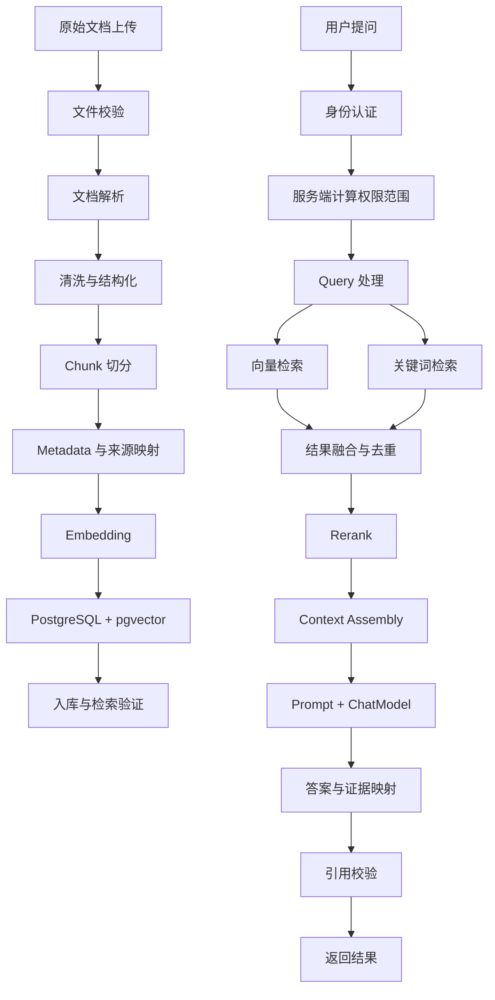
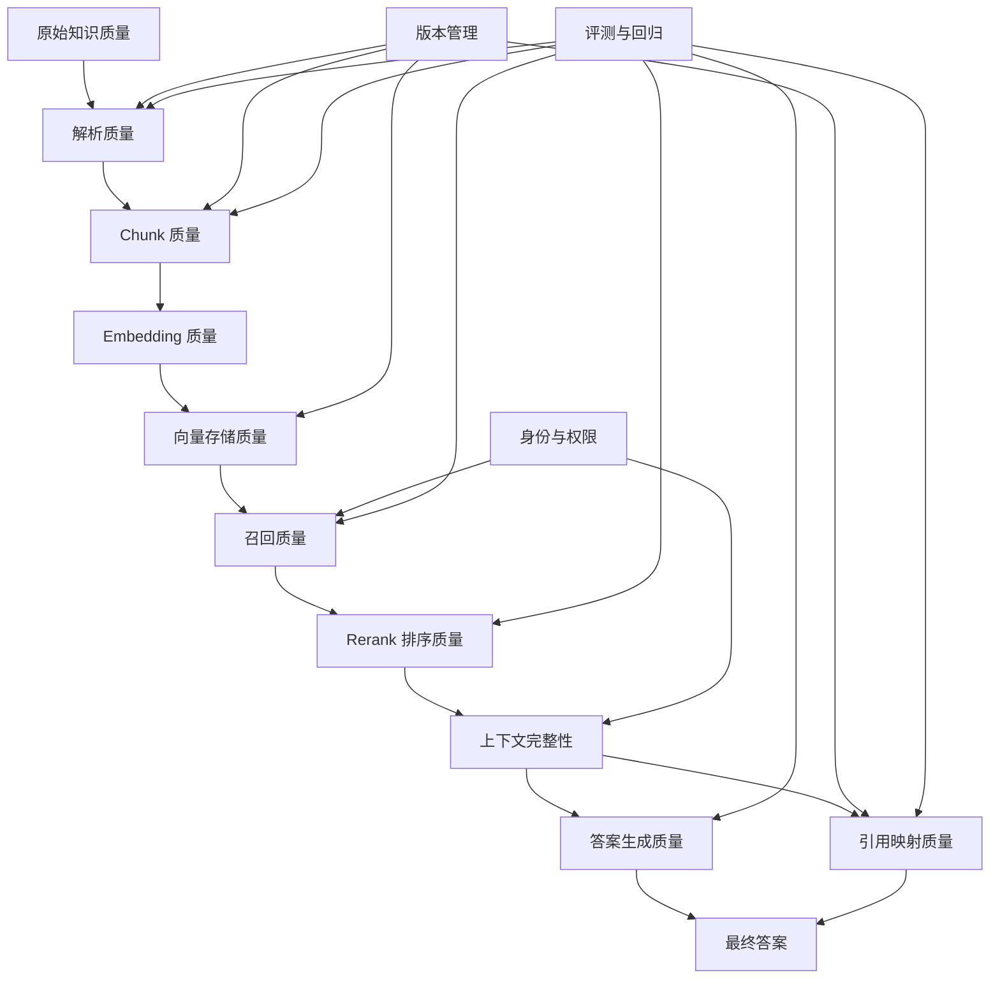
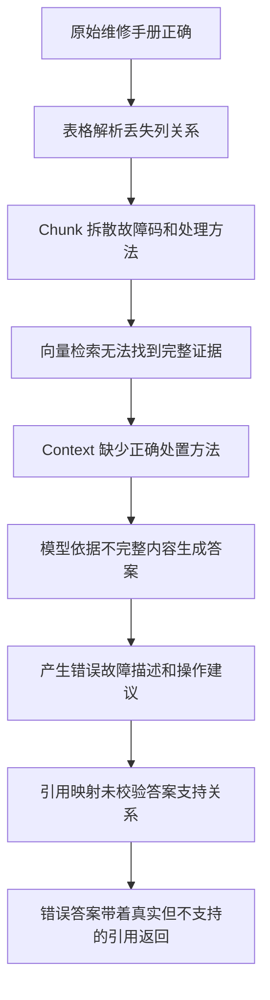

# RAG 核心概念综合复习与失败案例分析

**建议文件名：** `RAG核心概念综合复习与失败案例分析.md`

**技术基线：** JDK 21 / Spring Boot 3.5.16 / Spring AI 1.1.8 / PostgreSQL 18.7 / pgvector 0.8.7

---

# 一、学习目标与整体认知

RAG（Retrieval-Augmented Generation，检索增强生成）不是单独的向量检索技术，也不是简单地把几段文档拼进 Prompt。

它是一套将**外部知识、信息检索、证据筛选、上下文组织和大语言模型生成**组合起来的工程方案。

要真正理解 RAG，需要回答五个问题：

1. 知识从哪里来，如何转换成系统能够检索的形式？
2. 用户提出问题后，系统如何找到相关知识？
3. 找到的知识如何变成模型能够使用的上下文？
4. 如何约束模型依据证据回答，并且准确标注来源？
5. 当答案错误时，如何判断是数据、切分、Embedding、检索、权限、上下文还是生成环节出了问题？

## 1.1 RAG 的核心思想

传统 LLM 问答：

```text
用户问题
   ↓
LLM
   ↓
生成答案
```

问题在于：模型主要依赖预训练知识和当前上下文，不一定掌握企业内部文档、最新设备手册、私有业务数据或特定版本的技术规范。

RAG 问答：

```text
用户问题
   ↓
从外部知识库检索相关证据
   ↓
将证据组织成上下文
   ↓
LLM 根据问题和证据生成答案
   ↓
返回答案及来源
```

核心变化：

> 不再只要求模型凭自身已有知识回答，而是先从外部知识源获取与问题相关的证据，再让模型基于这些证据生成回答。

但必须牢记：

**RAG 能够增强模型利用外部知识的能力，不等于能够保证答案绝对正确。**

错误的原始文档、错误的解析结果、错误的检索结果、错误的上下文以及模型自身的生成偏差，都可能导致最终答案错误。

## 1.2 离线知识摄取与在线问答

RAG 系统通常分为两个相互关联、职责不同的阶段。

### 阶段 A：离线知识摄取（Ingestion）

```text
上传文件
   ↓
文件校验
   ↓
文档解析
   ↓
内容清洗
   ↓
Chunk 切分
   ↓
Metadata 补充
   ↓
Embedding
   ↓
向量存储
   ↓
入库验证
```

目标：将原始知识转换为可检索、可定位、可管理的知识数据。

### 阶段 B：在线问答（Query）

```text
用户提问
   ↓
身份认证与权限范围确定
   ↓
Query 处理
   ↓
向量检索 / 关键词检索
   ↓
结果融合与去重
   ↓
Rerank 精排
   ↓
Context Assembly
   ↓
LLM 生成
   ↓
引用校验
   ↓
返回答案
```

目标：针对用户当前问题，从有权访问的知识中找到有效证据，形成可靠回答。

两者的区别：

| 比较维度 | 离线知识摄取                                    | 在线问答                                       |
| -------- | ----------------------------------------------- | ---------------------------------------------- |
| 输入     | PDF、Word、HTML、表格等                         | 用户问题及身份信息                             |
| 主要任务 | 将知识加工为可检索数据                          | 从知识库中查找并组织证据                       |
| 核心组件 | Reader、Parser、Chunker、Embedding、VectorStore | Query、Retriever、Reranker、Context、ChatModel |
| 主要风险 | 解析丢失、切分错误、向量不一致、数据重复        | 召回遗漏、权限泄漏、排序错误、生成幻觉         |
| 质量指标 | 解析完整性、入库完整性、版本一致性              | Recall、MRR、答案正确性、引用正确性、延迟      |
| 执行特点 | 可以异步、批量处理                              | 通常要求较低响应延迟                           |

注意：离线摄取成功，不代表在线一定能够检索到数据。

例如：

- 文件上传成功，不代表解析成功。
- 解析成功，不代表 Chunk 内容完整。
- Chunk 生成成功，不代表 Embedding 成功。
- 向量写入成功，不代表权限过滤条件正确。
- 数据库存在向量，不代表实际查询能够召回它。

---

# 二、RAG 完整工程链路

## 2.1 全链路图



## 2.2 各阶段的核心职责

| 阶段        | 输入            | 输出             | 主要解决的问题   | 不能保证什么       |
| ----------- | --------------- | ---------------- | ---------------- | ------------------ |
| 上传        | 原始文件        | 文件对象         | 获取知识源       | 文件内容有效       |
| 解析        | 文件对象        | 文本、表格、结构 | 提取原始信息     | 结构完整无损       |
| 清洗        | 原始内容        | 标准化内容       | 消除噪声         | 不改变原意         |
| Chunk       | 文本、表格      | 知识片段         | 控制检索粒度     | 每个片段语义完整   |
| Metadata    | Chunk、来源信息 | 可追踪数据       | 来源定位、过滤   | 权限一定正确       |
| Embedding   | 文本            | 向量             | 建立语义表示     | 理解事实或生成答案 |
| VectorStore | 向量、Metadata  | 可检索数据       | 保存向量及元数据 | 一定被查询召回     |
| Retrieval   | Query、过滤条件 | 候选文档         | 找到相关证据     | 候选全部正确       |
| Rerank      | 候选文档        | 排序结果         | 提高候选排序质量 | 找回未召回的文档   |
| Context     | 排序结果        | 模型上下文       | 组织有效证据     | 模型一定遵守证据   |
| Generation  | 问题、上下文    | 答案             | 自然语言生成     | 事实绝对正确       |
| Citation    | 答案、证据映射  | 引用             | 来源追溯         | 引用一定支持结论   |

## 2.3 核心概念之间的依赖关系



这里存在一条重要的质量传递关系：

**下游组件无法自动修复所有上游错误。**

例如：

- Embedding 无法恢复解析阶段已经丢失的表格关系。
- Rerank 无法找回完全没有进入候选集的正确文档。
- Prompt 无法恢复没有进入上下文的关键证据。
- Citation 无法让错误答案变成正确答案。
- LLM 无法保证识别出所有权限违规的数据。

因此，排查 RAG 问题时，应先确认上游数据是否正确，再检查下游处理过程。

---

# 三、核心概念一：RAG

## 3.1 定义

RAG，即 Retrieval-Augmented Generation，检索增强生成。

它是一种将外部知识检索与大语言模型生成结合起来的技术架构。

基本过程：

1. 将外部知识加工并保存到知识库。
2. 用户提出问题。
3. 系统检索与问题相关的知识。
4. 将检索结果作为上下文提供给模型。
5. 模型结合问题和上下文生成答案。
6. 系统返回答案及可追溯的来源。

## 3.2 解决的问题

RAG 主要解决以下问题：

| 问题                   | RAG 的作用                       |
| ---------------------- | -------------------------------- |
| 模型不知道企业内部资料 | 从企业知识库检索相关内容         |
| 知识经常更新           | 更新知识库，不必每次重新训练模型 |
| 模型知识存在时间边界   | 提供外部最新资料                 |
| 答案需要有来源         | 保存来源元数据并构建引用链       |
| 不同用户能访问不同资料 | 通过服务端权限过滤知识范围       |

例如，设备维护系统中：

用户询问：

```text
设备 A 出现 E102 故障码，应该如何处理？
```

知识库中存在设备 A 的维修手册：

```text
故障码：E102
故障现象：冷却液温度过高
可能原因：冷却系统流量不足
处理方法：
1. 停止设备运行。
2. 检查冷却液液位。
3. 检查循环泵及管路。
4. 排除故障后按照操作规程重新启动。
```

RAG 的工作不是让模型凭经验猜测 E102 的含义，而是先检索这段维修手册，再根据检索到的内容回答。

## 3.3 RAG 与纯 LLM 问答的区别

| 维度     | 纯 LLM 问答                | RAG                                  |
| -------- | -------------------------- | ------------------------------------ |
| 知识来源 | 模型已有知识和当前输入     | 模型知识 + 外部检索证据              |
| 私有知识 | 需要通过输入或其他方式提供 | 可以通过知识库检索                   |
| 知识更新 | 通常涉及模型或上下文更新   | 可以更新知识库                       |
| 来源追踪 | 默认不具备完整来源链       | 可以构建来源映射                     |
| 主要风险 | 模型知识不足、生成幻觉     | 数据错误、检索错误、生成幻觉等       |
| 适用场景 | 通用问答、推理、写作       | 企业知识问答、文档问答、业务资料检索 |

注意：RAG 不是对 LLM 的替代，而是为 LLM 提供外部证据。

## 3.4 RAG、微调和长上下文的区别

| 方案                     | 核心作用                               | 适合解决的问题                   | 主要边界                         |
| ------------------------ | -------------------------------------- | -------------------------------- | -------------------------------- |
| RAG                      | 检索外部知识并提供上下文               | 私有知识、动态资料、来源追踪     | 依赖检索和数据质量               |
| Fine-tuning（微调）      | 调整模型参数，使模型适应特定任务或行为 | 输出风格、任务模式、特定领域行为 | 不适合替代动态知识库             |
| Long Context（长上下文） | 一次向模型输入更多内容                 | 多文档分析、长文本理解           | Token 成本、上下文干扰和窗口限制 |

三者可以组合，不是只能选择一个。

例如：

- 使用微调改善模型输出格式。
- 使用 RAG 获取最新设备手册。
- 使用长上下文分析检索得到的多份相关资料。

## 3.5 RAG 为什么不能保证答案正确

假设原始文档写错了：

```text
E102：冷却液温度过低
```

但真实设备手册应该是：

```text
E102：冷却液温度过高
```

即使后续的解析、Embedding、检索、Rerank 和生成全部正常，模型仍可能基于错误资料给出错误答案。

RAG 的可靠性取决于多个环节：

```text
最终答案可靠性
    =
原始知识质量
    + 解析与切分质量
    + 检索质量
    + 权限正确性
    + 上下文完整性
    + 生成质量
    + 引用校验
```

这不是严格的数学加法公式，而是强调各环节共同影响最终质量。

## 3.6 工程实现与框架边界

Spring AI 1.1.8 提供了构建 RAG 的基础能力，例如：

- `Document`：承载文本和 Metadata。
- `DocumentReader`：读取文档。
- `DocumentTransformer`：转换文档。
- `DocumentWriter`：写入文档。
- `VectorStore`：向量存储抽象。
- `SearchRequest`：检索请求参数。
- `QuestionAnswerAdvisor`：提供基于向量检索的问答增强能力。
- `RetrievalAugmentationAdvisor`：支持模块化 RAG 流程。

但完整企业 RAG 仍需要自定义业务逻辑：

- 租户和部门权限。
- 文档版本管理。
- 表格结构恢复。
- 业务故障码解析。
- 幂等摄取。
- 来源映射。
- 细粒度引用校验。
- 评测和回归机制。

**框架提供通用能力，不代表框架自动完成全部业务正确性。**

---

# 四、核心概念二：Embedding

## 4.1 定义

Embedding（向量嵌入）是将文本等数据转换为固定维度数值向量的过程。

例如：

```text
文本 A：设备冷却系统温度过高
文本 B：冷却液温度异常升高
```

经过 Embedding 模型后，可能得到：

```text
文本 A → [0.12, -0.34, 0.56, ...]
文本 B → [0.15, -0.30, 0.52, ...]
```

这里仅展示示意数据，不代表真实模型输出。

向量中的每个数值共同构成文本在某个语义空间中的表示。

## 4.2 解决的问题

传统关键词搜索主要依赖词语匹配。

例如：

```text
Query：设备温度异常
Document：冷却液过热
```

两段文字的词语不完全一致，但表达的语义可能相关。

Embedding 将文本映射到向量空间，使系统能够按照向量距离或相似度搜索语义上接近的内容。

## 4.3 工作原理

基本流程：

```text
Document 文本
     ↓
Embedding Model
     ↓
向量表示
     ↓
写入 VectorStore
```

查询阶段：

```text
Query 文本
     ↓
同一语义空间中的 Embedding Model
     ↓
Query Vector
     ↓
与 Document Vector 比较
     ↓
返回相似候选
```

最关键的要求：

**Query Embedding 与 Document Embedding 必须处于兼容的向量空间。**

不能只看向量维度是否相同，还必须关注：

- 模型名称。
- 模型版本。
- 模型训练或服务端更新情况。
- 输入预处理方式。
- 是否使用查询前缀或文档前缀。
- 向量归一化约定。
- 距离度量配置。

即使两个模型都输出 1024 维向量，也不代表它们的向量可以直接混合比较。

## 4.4 向量维度与语义空间

假设模型输出：

```text
[0.21, -0.17, 0.45, ..., 0.32]
```

如果包含 1024 个数值，那么它是一个 1024 维向量。

向量维度代表表示空间的数值长度，不代表：

- 文本有 1024 个词。
- 文本包含 1024 条知识。
- 模型理解了 1024 个事实。
- 维度越大，检索质量一定越好。

向量维度必须与数据库向量列定义匹配。

例如：

```sql
embedding vector(1024)
```

这表示该列要求保存 1024 维向量。

**1024 只是示例，不是项目固定值。** 应以实际 Embedding 模型输出和数据库列定义为准。

## 4.5 相似度与语义相关性的区别

常见距离或相似度方式：

| 方法            | pgvector 运算符 | 主要含义 |
| --------------- | --------------- | -------- |
| L2 / Euclidean  | `<->`           | 欧氏距离 |
| Cosine Distance | `<=>`           | 余弦距离 |
| Inner Product   | `<#>`           | 负内积   |

余弦相似度：

\[
\operatorname{cosine}(A,B)=
\frac{A\cdot B}{\|A\|\|B\|}
\]

它衡量两个向量方向的接近程度。

但是：

```text
向量相似度高
    ≠
事实一定正确
```

例如：

```text
Query：E102 应该怎么处理？

Document A：E102 是冷却液温度过高。
Document B：E103 是冷却液温度过高。
```

两段文本可能非常相似，但故障码不同。

对于设备故障码、序列号、零件编号、精确参数等内容，单纯依赖向量检索有明显局限。

更合理的做法：

- 使用结构化字段进行精确匹配。
- 使用关键词检索匹配故障码。
- 使用向量检索补充语义相关内容。
- 对候选结果进行融合和精排。

## 4.6 Embedding 不等于知识理解

Embedding 负责将文本映射为向量，不负责：

- 判断设备参数是否真实。
- 判断某个故障处理方法是否安全。
- 生成最终答案。
- 判断用户是否有权访问文档。
- 验证引用是否支持答案。

这些职责属于其他环节。

## 4.7 模型和维度变化的工程风险

假设原有数据使用：

```text
embedding_model = model-A
dimension = 1024
```

后来切换到：

```text
embedding_model = model-B
dimension = 1536
```

可能出现：

1. 数据库向量列无法保存新维度。
2. 查询向量和文档向量维度不一致。
3. 同维度但不同模型的向量被错误混用。
4. 新旧数据召回结果出现不一致。
5. 线上检索效果突然下降。

推荐管理方式：

```json
{
  "embedding_model": "实际模型标识",
  "embedding_model_version": "实际版本",
  "embedding_dimension": 1024,
  "embedding_input_type": "document",
  "embedding_config_version": "embedding-v2"
}
```

示例值仅用于展示字段结构。

模型变更时，应制定迁移方案：

```text
新模型配置
   ↓
新版本向量生成
   ↓
新向量存储与验证
   ↓
检索效果对比
   ↓
切换新版本
   ↓
清理旧版本
```

不要在未确认数据兼容性的情况下，直接把新旧向量混在同一个检索空间中。

## 4.8 Java 工程示例

下面展示 Spring AI `Document` 与 `VectorStore` 的基本关系。

```java
Map<String, Object> metadata = Map.of(
    "document_id", documentId,
    "document_version", documentVersion,
    "chunk_id", chunkId,
    "source_id", sourceId,
    "tenant_id", tenantId,
    "embedding_model", embeddingModel
);

Document document = new Document(
    chunkId,
    chunkText,
    metadata
);

vectorStore.add(List.of(document));
```

注意：

- `Document` 负责承载文本和元数据。
- `VectorStore` 负责向量存储抽象。
- Embedding 的实际生成由配置的 EmbeddingModel 等组件负责。
- 具体 PgVectorStore ID 类型必须检查配置；如果采用 UUID ID 类型，不能未经转换就把任意字符串作为数据库 ID。

## 4.9 常见误区与适用边界

| 错误认知                               | 正确认知                           |
| -------------------------------------- | ---------------------------------- |
| Embedding 就是模型理解文本             | Embedding 是向量表示               |
| 维度越大效果越好                       | 效果取决于模型、任务和数据         |
| 向量相似就是事实正确                   | 相似度只是检索信号                 |
| Query 和 Document 可以随便使用不同模型 | 必须保证向量空间兼容               |
| 数据库有向量就代表可以检索             | 还需要正确索引、过滤和查询配置     |
| Embedding 能解决所有搜索问题           | 精确编码和结构化参数仍需要精确检索 |

适用边界：

Embedding 适合语义相似内容召回，不应替代精确数据库查询、权限校验和事实验证。

---

# 五、核心概念三：文档切分 Chunking

## 5.1 定义

Chunking 是将较长文档拆分成多个较小知识片段的过程。

例如：

```text
原始设备手册
    ↓
Chunk 1：设备基本参数
Chunk 2：E101 故障说明
Chunk 3：E102 故障说明
Chunk 4：维护与保养
```

每个 Chunk 可以单独生成 Embedding 并写入向量数据库。

## 5.2 为什么需要切分

假设一本设备手册有 300 页。

如果直接将整本手册作为一个检索单元：

- 内容太长。
- 不同主题混在一起。
- 语义表示容易被大量无关内容干扰。
- 用户只问一个故障码，却可能检索到整本手册。
- 上下文成本过高。

切分的目的：

1. 缩小检索范围。
2. 提高知识定位精度。
3. 降低上下文 Token 消耗。
4. 方便保存页码、章节和来源信息。
5. 支持局部更新和删除。

## 5.3 Chunk Size 和 Overlap

### Chunk Size

Chunk Size 表示单个 Chunk 的目标大小。

例如：

```text
Chunk Size = 500 tokens
```

表示希望每个片段大约包含 500 个 Token。

### Overlap

Overlap 表示相邻 Chunk 之间重复保留的内容。

例如：

```text
原文：
A B C D E F G H I J

Chunk 1：
A B C D E F

Chunk 2：
E F G H I J
```

这里 E、F 是重叠部分。

Overlap 的作用是减少切分边界导致的上下文丢失。

例如：

```text
设备故障原因：
冷却液不足，可能导致设备温度异常。

处理方法：
检查冷却液液位并补充。
```

如果切分边界恰好把故障原因和处理方法分开，检索可能只得到其中一部分。

适当的 Overlap 可以降低这种风险。

## 5.4 Chunk Size 与 Overlap 的取舍

| 配置方向     | 优点                 | 缺点                       |
| ------------ | -------------------- | -------------------------- |
| Chunk 较小   | 定位精确、上下文较短 | 容易丢失完整语义           |
| Chunk 较大   | 保留更多上下文       | 无关内容增多，检索粒度下降 |
| Overlap 较小 | 重复数据少、成本较低 | 边界信息容易丢失           |
| Overlap 较大 | 保留更多上下文       | 重复向量增加、成本上升     |

没有适用于所有文档的固定最佳值。

应该基于固定测试集对 Chunk Size 和 Overlap 进行实验。

## 5.5 固定长度切分与语义切分

### 固定长度切分

按照字符数、Token 数或其他长度边界切分。

优点：

- 实现简单。
- 容易控制 Chunk 大小。
- 适合结构相对简单的连续文本。

缺点：

- 可能从句子中间切断。
- 可能破坏章节和段落关系。
- 可能把表格标题与数据行分开。

### 语义切分

根据段落、标题、句子、主题或内容结构决定边界。

优点：

- 更容易保留语义完整性。
- 适合章节明确的文档。
- 可以减少不合理切分。

缺点：

- 实现复杂。
- 不同文档结构差异较大。
- 切分效果需要验证。

工程中可以组合使用：

```text
先按章节切分
   ↓
再按段落切分
   ↓
超出目标长度时继续细分
   ↓
保留必要的上下文重叠
```

## 5.6 文本、表格、故障码和参数表不能采用完全相同的策略

这是设备手册 RAG 特别重要的知识点。

### 普通文本

可以优先按：

```text
章节 → 段落 → 句子 → Token 长度
```

### 表格

不能只保留单元格文字。

原始表格：

| 故障码 | 故障现象 | 可能原因   | 处理方法         |
| ------ | -------- | ---------- | ---------------- |
| E102   | 温度过高 | 冷却液不足 | 检查并补充冷却液 |
| E103   | 压力异常 | 管路堵塞   | 检查管路         |

如果解析后变成：

```text
E102 温度过高 冷却液不足 检查并补充冷却液
E103 压力异常 管路堵塞 检查管路
```

虽然部分信息仍然存在，但表头和字段关系可能丢失。

更适合检索的文本：

```text
设备故障码：E102
故障现象：温度过高
可能原因：冷却液不足
处理方法：检查并补充冷却液
```

### 故障码

故障码应作为独立字段保存：

```json
{
  "device_id": "DEVICE-A",
  "fault_code": "E102",
  "symptom": "温度过高",
  "cause": "冷却液不足",
  "solution": "检查并补充冷却液"
}
```

### 参数表

参数表应保留：

- 参数名称。
- 参数值。
- 单位。
- 适用型号。
- 工作条件。
- 参数范围。
- 数据来源。

例如：

```json
{
  "parameter": "工作温度",
  "value": 80,
  "unit": "℃",
  "device_model": "MODEL-A",
  "condition": "额定工况"
}
```

不能把 `80` 和 `℃` 分离，更不能丢失适用设备型号。

**设备手册中的表格往往需要结构化解析和领域专用 Chunker，不能简单依赖通用文本切分。**

## 5.7 Metadata、Document ID、Chunk ID 和 Source ID

这是构建可追溯 RAG 的基础。

| 字段             | 含义             | 示例                   |
| ---------------- | ---------------- | ---------------------- |
| Document ID      | 逻辑文档标识     | `manual-device-a`      |
| Document Version | 文档版本         | `v2`                   |
| Chunk ID         | 知识片段唯一标识 | `chunk-001`            |
| Source ID        | 原始证据片段标识 | `source-page-18-row-3` |
| Page Number      | 原始页码         | `18`                   |
| Tenant ID        | 所属租户         | `tenant-01`            |
| Device ID        | 适用设备         | `device-a`             |

关系：

```text
Document
  └── Document Version
        ├── Chunk 001
        │     ├── Source ID A
        │     └── Source ID B
        ├── Chunk 002
        │     └── Source ID C
        └── Chunk 003
              └── Source ID D
```

注意：

- 一个 Chunk 可以对应一个或多个来源片段。
- 一个来源片段也可能因切分策略产生多个 Chunk。
- Chunk ID 不应该被当成原始文档页码。
- 文档更新后，不能仅凭 Document ID 判断 Chunk 仍属于当前有效版本。

## 5.8 切分错误如何传播

```text
原始表格
   ↓
解析时丢失列关系
   ↓
Chunk 只剩下孤立数值
   ↓
Embedding 无法恢复原始列关系
   ↓
检索到相似但不完整的片段
   ↓
模型缺少正确上下文
   ↓
生成错误参数或处理方法
```

这是典型的上游错误向下游传播。

## 5.9 常见误区与适用边界

| 错误认知                 | 正确认知                       |
| ------------------------ | ------------------------------ |
| Chunk 越大越好           | 需要平衡上下文和检索粒度       |
| Chunk 越小越精确         | 太小会丢失语义关系             |
| Overlap 越大越好         | 重复内容会增加成本和噪声       |
| 所有文档都用固定长度切分 | 表格、参数和故障码需要专门处理 |
| 只保存 Chunk 文本就够了  | 必须保留来源和版本 Metadata    |
| 切分完成就代表知识正确   | 仍需检查内容完整性和字段关系   |

---

# 六、核心概念四：向量检索

## 6.1 定义

向量检索是将 Query 转换为向量，再根据向量距离或相似度，从向量数据库中找到相近文档的过程。

基本流程：

```text
用户 Query
    ↓
Query Embedding
    ↓
Query Vector
    ↓
向量相似度搜索
    ↓
Top-K 候选 Chunk
```

## 6.2 解决的问题

它解决的是：

> 如何从大量知识片段中，快速找出与当前问题语义接近的候选内容？

例如：

```text
Query：
设备出现冷却液温度异常怎么办？

候选 A：
冷却系统温度过高时，应先停止设备运行。

候选 B：
冷却液不足可能造成温度异常。

候选 C：
设备外壳颜色及外观说明。
```

向量检索可能优先找到 A、B。

但它不能仅凭相似度判断 A、B 是否就是该设备型号的正确处理方法。

## 6.3 Top-K

Top-K 表示从检索结果中取排名靠前的 K 条候选。

例如：

```text
Top-K = 20
```

表示最多取 20 条候选结果。

K 太小：

- 可能遗漏相关文档。
- 召回率下降。

K 太大：

- 候选噪声增多。
- 后续精排成本上升。
- 上下文处理负担增加。

Top-K 是召回阶段的候选数量，不是最终传给模型的数量。

## 6.4 相似度阈值

相似度阈值用于过滤相关程度不足的候选结果。

但要注意不同系统对“相似度”和“距离”的定义可能不同。

例如：

- Cosine Similarity 越高越相似。
- Cosine Distance 越低越相似。

不能把一个系统的阈值直接复制到另一个距离度量配置中。

阈值应该通过标注数据集进行校准。

## 6.5 pgvector 的职责

pgvector 是 PostgreSQL 的向量扩展，提供：

- `vector` 等向量数据类型。
- 向量距离计算。
- 向量相似度查询。
- HNSW、IVFFlat 等向量索引能力。
- 与 PostgreSQL 数据、事务和查询能力的结合。

它负责向量数据的存储和检索，不负责：

- 文档解析。
- Chunk 切分。
- Embedding 模型推理。
- 业务权限设计。
- 最终答案生成。

## 6.6 HNSW 索引

HNSW 是一种近似最近邻搜索索引算法。

核心目标：

在较大规模的向量集合中，提高相似向量搜索效率。

它通过构建分层图结构，让搜索过程不必逐条比较全部向量。

优点：

- 通常具有较好的查询性能。
- 适合需要较快近似向量检索的场景。

代价：

- 需要额外索引空间。
- 建立索引需要资源。
- 查询结果属于近似搜索，参数会影响召回与性能。
- 高选择性 Metadata Filter 可能影响最终返回数量。

pgvector 0.8.0 及之后版本支持 iterative index scans，可以在特定过滤场景下继续扫描以增加符合过滤条件的结果。具体效果需要结合查询计划和实际数据评测，不能假设开启后一定解决所有召回问题。

## 6.7 向量检索、关键词检索与混合检索

| 检索方式   | 主要原理             | 优势                       | 局限               |
| ---------- | -------------------- | -------------------------- | ------------------ |
| 关键词检索 | 匹配关键词或词项     | 精确匹配故障码、编号       | 不擅长表达差异     |
| 向量检索   | 比较语义向量         | 适合语义相似内容           | 可能混淆相近编码   |
| 混合检索   | 融合关键词和向量结果 | 同时利用精确匹配和语义召回 | 需要融合与排序策略 |

例如：

```text
Query：
设备 DEVICE-A 出现 E102，如何处理？
```

合理策略：

1. 通过结构化字段精确匹配 `DEVICE-A` 和 `E102`。
2. 通过关键词检索匹配故障码和相关描述。
3. 通过向量检索补充语义相似的维修说明。
4. 合并候选结果。
5. 进行去重和精排。

这比单独依赖向量相似度更加稳健。

## 6.8 Hybrid Search 与 RRF

Hybrid Search 是混合检索，将多种检索方式的候选结果结合起来。

例如：

```text
向量检索 Top-20
       +
关键词检索 Top-20
       ↓
结果融合
       ↓
去重
       ↓
Rerank
```

不同检索算法返回的原始分数可能不在同一个尺度上。

RRF（Reciprocal Rank Fusion，倒数排名融合）可以利用排名融合结果。

公式：

\[
RRF(d)=\sum_{i=1}^{n}\frac{1}{k+rank_i(d)}
\]

其中：

- \(d\)：候选文档。
- \(rank_i(d)\)：文档在第 i 个检索列表中的排名。
- \(k\)：平滑参数。
- \(n\)：参与融合的检索列表数量。

RRF 主要关注排名，而不是直接比较不同检索算法的原始分数。

注意：

RRF 中的参数 `k` 与 Recall Top-K 不是同一个概念。

## 6.9 召回失败与精排失败

这是 RAG 排障中的重要区分。

### 召回失败

正确文档没有进入候选集合。

例如：

```text
真实正确文档：Chunk-A

向量检索 Top-20：
Chunk-B
Chunk-C
Chunk-D
...
```

Chunk-A 不在候选集中。

可能原因：

- Chunk 切分错误。
- Embedding 模型不匹配。
- Query 表达不准确。
- 过滤条件错误。
- Top-K 太小。
- 向量索引近似搜索漏召回。

此时应该先修复召回阶段。

### 精排失败

正确文档已经进入候选集合，但排名太低，被后续 Top-N 截掉。

例如：

```text
初始候选 Top-20：
Chunk-A 排名 15
Chunk-B 排名 1
Chunk-C 排名 2

Rerank Top-5：
Chunk-B
Chunk-C
Chunk-D
Chunk-E
Chunk-F
```

Chunk-A 被排除。

此时问题发生在排序阶段，而不是初始召回阶段。

**Rerank 无法找回未被召回的文档。**

## 6.10 Spring AI 1.1.8 检索示例

```java
SearchRequest request = SearchRequest.builder()
    .query(query)
    .topK(topK)
    .similarityThreshold(threshold)
    .filterExpression(filterExpression)
    .build();

List<Document> candidates =
    vectorStore.similaritySearch(request);
```

需要理解：

- `query`：检索文本。
- `topK`：候选数量。
- `similarityThreshold`：相似度阈值。
- `filterExpression`：Metadata 过滤表达式。
- `similaritySearch`：执行向量相似度检索。

以上是 Spring AI 1.1.8 的检索 API 使用方向。具体过滤表达式字段是否存在、字段类型是否匹配，需要以实际 PgVectorStore 配置和数据库 Metadata 为准。

## 6.11 常见误区与适用边界

| 错误认知                    | 正确认知                     |
| --------------------------- | ---------------------------- |
| Top-K 越大越好              | 需要权衡召回和后续成本       |
| 相似度高就一定正确          | 还需要事实验证和业务条件判断 |
| HNSW 保证完全精确           | HNSW 属于近似最近邻索引      |
| Rerank 可以修复所有检索问题 | 无法找回未召回候选           |
| 向量检索可以替代 SQL        | 精确字段仍适合结构化查询     |
| 混合检索就是简单拼接        | 还需要去重、融合和排序       |

---

# 七、核心概念五：引用与可追溯性

## 7.1 定义

RAG 引用是将最终答案与实际使用的知识证据建立关联的机制。

目标不是简单展示一个文档标题，而是让用户能够追溯：

- 答案来自哪个文档？
- 使用的是哪个文档版本？
- 对应哪一页、哪一个段落或表格行？
- 哪个 Chunk 被检索并进入上下文？
- 具体哪段证据支持当前结论？

## 7.2 解决的问题

例如模型回答：

```text
E102 表示冷却液温度过高。
建议先停止设备运行，再检查冷却液液位。

来源：设备维修手册，第 18 页。
```

用户可以进一步打开原始手册，检查第 18 页是否确实存在这些内容。

这有助于：

- 证据验证。
- 责任追踪。
- 错误排查。
- 文档版本审计。
- 企业知识管理。

## 7.3 四种标识的关系

| 标识             | 定位对象     | 示例              |
| ---------------- | ------------ | ----------------- |
| Document ID      | 逻辑文档     | `manual-device-a` |
| Document Version | 文档版本     | `v2`              |
| Chunk ID         | 检索知识片段 | `chunk-001`       |
| Source ID        | 原始证据片段 | `page18-row3`     |

完整映射：

```text
最终答案中的某条结论
       ↓
Citation ID
       ↓
Source ID
       ↓
Chunk ID
       ↓
Document ID + Version
       ↓
原始文档页码 / 表格行 / 段落
```

## 7.4 引用存在不等于引用有效

这是一个必须理解的区别。

假设：

```text
模型回答：
E102 的处理方法是更换循环泵。

引用：
设备维修手册，第 18 页。
```

但第 18 页实际只写了：

```text
E102：冷却液温度过高。
处理方法：检查冷却液液位和循环管路。
```

虽然引用的文档真实存在，但它并不支持“更换循环泵”这一结论。

所以：

```text
引用存在
    ≠
引用真实
    ≠
引用准确
    ≠
引用支持答案
```

引用校验至少包括：

1. 引用 ID 是否真实存在。
2. 引用是否来自本次检索和上下文。
3. 引用文档版本是否正确。
4. 引用页码或来源片段是否准确。
5. 引用内容是否支持对应答案。
6. 是否存在遗漏关键证据或跨版本引用。

## 7.5 如何防止错误引用

推荐保留以下数据：

```json
{
  "document_id": "manual-device-a",
  "document_version": "v2",
  "chunk_id": "chunk-001",
  "source_id": "page18-row3",
  "page_number": 18,
  "source_type": "table_row",
  "source_text": "E102：冷却液温度过高；处理方法：检查冷却液液位。"
}
```

这是数据结构示例，不代表项目中已经采用该结构。

引用生成时：

- 不要只让模型凭标题猜测来源。
- 不要通过数组下标推断 Chunk 与 Source 的关系。
- 不要使用旧版本文档的来源映射。
- 不要允许模型自行创造不存在的 Source ID。
- 应由服务端根据真实证据集合完成映射和校验。

## 7.6 引用与答案的关系

较稳健的设计是让答案的关键事实与证据关联。

例如：

```json
{
  "answer": "E102 表示冷却液温度过高。",
  "claims": [
    {
      "text": "E102 表示冷却液温度过高。",
      "evidence_ids": [
        "page18-row3"
      ]
    }
  ]
}
```

最终引用应通过服务端查询 Source ID 对应的原始资料。

对于多条结论，应该分别检查各自的证据，而不是用一个无关引用覆盖整段回答。

## 7.7 常见误区与适用边界

| 错误认知                | 正确认知                 |
| ----------------------- | ------------------------ |
| 展示文档标题就是引用    | 应能定位具体证据         |
| 引用存在说明答案正确    | 需要验证证据是否支持结论 |
| Chunk ID 就是 Source ID | 两者职责不同             |
| 只保存当前页码就够了    | 还需要文档版本及来源映射 |
| 让模型生成引用 ID 即可  | 应由服务端校验真实证据   |
| 只要有引用就不会幻觉    | 引用也可能错误或不相关   |

---

# 八、核心概念六：权限控制

## 8.1 定义

RAG 权限控制是指在知识检索和答案生成过程中，确保用户只能访问自己有权使用的知识。

核心要求：

**只允许经过授权的证据进入当前用户的检索结果和上下文。**

## 8.2 身份认证与权限授权的区别

| 概念                    | 解决的问题 | 示例                         |
| ----------------------- | ---------- | ---------------------------- |
| Authentication 身份认证 | 你是谁     | 用户登录后获得身份           |
| Authorization 权限授权  | 你能做什么 | 用户只能访问所属部门设备手册 |

身份认证成功不代表可以访问全部知识。

例如：

```text
用户 A：
tenant = T1
department = D1
device_group = G1

用户 B：
tenant = T1
department = D2
device_group = G2
```

即使两个人都已经登录，也不代表他们可以读取对方设备组的维修手册。

## 8.3 常见权限粒度

| 权限层级 | 示例                           |
| -------- | ------------------------------ |
| 租户级   | Tenant A 只能访问 Tenant A     |
| 部门级   | 研发部只能访问授权资料         |
| 设备组级 | 设备组 G1 只能访问 G1 设备资料 |
| 文档级   | 指定人员才能访问保密文档       |
| 用户级   | 个人知识库仅本人可见           |

实际权限可能需要组合：

```text
Tenant
  AND Department
  AND Device Group
  AND Document ACL
```

具体组合关系应由业务授权模型定义，不能随意把所有条件当成 OR。

## 8.4 为什么权限必须在检索前执行

错误做法：

```text
先检索所有用户可见性未知的文档
   ↓
交给 LLM
   ↓
在 Prompt 中告诉模型：
不要泄露其他部门的资料
```

这种方式不安全。

原因：

1. 未授权内容已经进入应用上下文。
2. 模型可能忽略 Prompt 约束。
3. 模型可能通过总结或推理泄露内容。
4. 日志、缓存或异常信息可能暴露内容。
5. 即使最终答案没有展示，越权数据也已被读取和处理。

正确做法：

```text
身份认证
   ↓
服务端获取可信权限信息
   ↓
构建 Metadata Filter
   ↓
检索时过滤
   ↓
只返回授权候选
   ↓
必要时进行服务端二次校验
   ↓
Context Assembly
   ↓
LLM
```

**Prompt 是生成行为约束，不是安全授权机制。**

## 8.5 Metadata Filter

向量数据可以携带权限相关 Metadata：

```json
{
  "document_id": "manual-device-a",
  "tenant_id": "tenant-01",
  "department_id": "department-01",
  "device_group_id": "group-01",
  "document_version": "v2"
}
```

检索时根据当前用户权限构建过滤条件。

示意：

```text
tenant_id = 当前用户所属租户
AND department_id IN 当前用户可访问部门
AND device_group_id IN 当前用户可访问设备组
```

重要：

过滤条件必须来自可信的服务端授权结果，不能直接相信客户端传来的 `tenant_id` 或 `department_id`。

## 8.6 数据库过滤、二次校验与缓存隔离

三者职责不同：

| 机制            | 作用                           |
| --------------- | ------------------------------ |
| Metadata Filter | 在检索阶段限制候选数据         |
| 服务端二次校验  | 对最终候选和来源再次验证权限   |
| 缓存隔离        | 防止不同用户复用不应共享的结果 |

缓存 Key 不能只使用 Query：

```text
错误：
cache_key = hash(query)
```

不同权限用户可能询问相同问题。

更合理的组成：

```text
cache_key =
hash(
  query
  + tenant_id
  + permission_scope_version
  + filters
  + document_version
  + embedding_model_version
)
```

实际是否需要用户级隔离，取决于权限是否能安全地按某个授权范围共享。

## 8.7 权限变更与历史引用

假设用户昨天有权访问某份设备手册，今天权限被撤销。

需要考虑：

- 已缓存的答案能否继续使用？
- 历史对话中的引用是否还能打开？
- 引用链接是否会绕过授权？
- 旧的检索结果是否仍然保存在缓存中？
- 用户权限变化后，缓存是否失效？

历史引用也应在打开原始资料时重新执行授权检查。

**历史上曾经有权访问，不代表现在仍然有权访问。**

## 8.8 默认拒绝与越权测试

推荐原则：

- 默认拒绝（Deny by Default）。
- 最小权限（Least Privilege）。
- 服务端生成权限条件。
- 未知身份不允许检索受保护知识。
- 权限信息异常时采取安全失败策略。
- 检索结果、缓存和引用访问均受权限控制。

测试至少包括：

1. 用户 A 查询用户 B 的私有设备资料。
2. 用户 A 修改请求参数伪造 Tenant ID。
3. 用户权限撤销后再次查询。
4. 用户通过历史引用访问已无权查看的文档。
5. 缓存中存在其他用户的同 Query 结果。
6. Metadata 缺失或异常时是否错误放行。

## 8.9 常见误区与适用边界

| 错误认知                            | 正确认知                         |
| ----------------------------------- | -------------------------------- |
| Prompt 能控制用户权限               | 权限必须由服务端和数据访问层执行 |
| 用户登录就能访问全部知识            | 身份认证和授权不同               |
| 只过滤最终答案即可                  | 未授权数据不能先进入上下文       |
| Metadata Filter 足够安全            | 还需考虑缓存、引用和权限变更     |
| 客户端传入的 Tenant ID 可以直接使用 | 应从可信身份和授权系统计算       |
| Rerank 可以删除越权数据             | Rerank 不是权限边界              |

---

# 九、核心概念七：拒答机制

## 9.1 定义

拒答机制是指当系统缺乏足够、可信、可用的证据，或者模型调用无法正常完成时，按照业务规则不输出未经证实的答案。

拒答不是简单地让模型说：

```text
我不知道。
```

而是需要区分失败类型，并采取对应的处理方式。

## 9.2 证据不足、无相关文档、检索失败和模型失败

这四种情况不能混为一谈。

| 情况         | 含义                                | 处理方式                               |
| ------------ | ----------------------------------- | -------------------------------------- |
| 无相关文档   | 检索正常完成，但没有符合条件的证据  | 说明知识库没有找到相关资料             |
| 证据不足     | 找到部分资料，但不足以回答完整问题  | 只回答有证据的部分，必要时拒答         |
| 检索失败     | 数据库、Embedding 或检索服务异常    | 返回系统暂时无法检索，不伪装成知识缺失 |
| 模型调用失败 | 检索有结果，但 ChatModel 超时或异常 | 返回生成服务异常，可按规则重试         |

例如：

```text
情况 A：
知识库中不存在 E999。
→ 无相关文档。

情况 B：
找到了 E102 的故障现象，但没有处理方法。
→ 证据不足。

情况 C：
PostgreSQL 连接失败。
→ 检索失败。

情况 D：
检索正常，但模型服务超时。
→ 模型调用失败。
```

## 9.3 什么时候回答，什么时候拒答

可以建立证据决策规则：

```text
检索是否成功？
   ├── 否 → 返回系统异常
   └── 是
        ↓
是否存在授权证据？
   ├── 否 → 说明没有找到可用资料
   └── 是
        ↓
证据是否覆盖问题的关键部分？
   ├── 否 → 部分回答或拒答
   └── 是
        ↓
证据是否存在冲突？
   ├── 是 → 说明冲突并请求确认
   └── 否
        ↓
允许基于证据生成答案
```

设备维修、医疗、金融等高风险场景，还需要业务规则控制哪些内容可以回答。

## 9.4 拒答阈值不能直接等于相似度阈值

例如：

```text
similarityThreshold = 0.75
```

不能直接得出：

```text
相似度 >= 0.75 → 一定能回答
相似度 < 0.75 → 一定要拒答
```

原因：

- 不同 Embedding 模型的分数分布不同。
- 不同领域的文本相似度分布不同。
- 相似文本可能对应不同设备型号。
- 高相似度不代表证据完整。
- 低相似度也可能存在关键词精确匹配的正确资料。

拒答决策应该综合：

- 是否存在有效候选。
- 是否命中精确业务条件。
- 证据是否完整。
- 是否存在版本冲突。
- 是否通过权限校验。
- 是否达到经过评测校准的证据标准。

## 9.5 三种关键结果

| 结果       | 定义                       | 示例                          |
| ---------- | -------------------------- | ----------------------------- |
| 正确拒答   | 缺少证据时不编造答案       | 未找到 E999 的处理资料        |
| 错误拒答   | 明明存在充分证据却拒绝回答 | 正确 Chunk 已召回，但阈值过高 |
| 无依据回答 | 缺少证据却输出确定结论     | 编造 E999 应更换循环泵        |

RAG 系统不仅要减少错误回答，也要减少不必要的拒答。

## 9.6 Prompt 约束与程序化校验

Prompt 可以要求：

```text
请仅根据提供的设备手册证据回答。

如果证据中没有明确说明故障原因或处理方法，
不要根据常识自行补充。

如果不同资料存在冲突，
请明确说明冲突，不要自行选择未经确认的结论。
```

但 Prompt 无法保证模型一定遵守。

因此还需要程序化措施：

1. 检查检索是否成功。
2. 检查上下文是否存在。
3. 检查证据来源是否真实。
4. 检查答案引用 ID 是否属于本次证据集合。
5. 对高风险参数和处置建议执行业务规则校验。
6. 无法验证的内容不应伪装成已确认事实。

## 9.7 如何避免设备参数和故障处置建议被编造

对于设备类问答：

- 设备型号必须匹配。
- 故障码必须精确匹配。
- 参数必须保留单位和适用条件。
- 处置建议必须有明确来源。
- 证据不足时不推断具体操作步骤。
- 对高风险操作增加安全提示和人工确认要求。

例如：

```text
用户：E102 是否可以直接拆除循环泵？

知识库证据：
E102 表示冷却液温度过高。
检查冷却液液位和循环管路。

合理回答：
现有资料没有说明可以直接拆除循环泵，
因此不能依据当前证据确认该操作是否允许。
请参考设备维护规程或联系授权维修人员。
```

## 9.8 常见误区与适用边界

| 错误认知               | 正确认知                               |
| ---------------------- | -------------------------------------- |
| 检索为空就是模型拒答   | 可能是无文档，也可能是检索异常         |
| 相似度低就一定拒答     | 还要考虑关键词、结构化结果和证据完整性 |
| Prompt 能彻底消除幻觉  | 需要程序化证据校验和业务规则           |
| 拒答越多越安全         | 还需要控制错误拒答                     |
| 模型说有来源就代表真实 | 引用必须由服务端验证                   |
| 检索到了就一定能回答   | 证据可能不完整或相互冲突               |

---

# 十、核心概念八：RAG 评测

## 10.1 定义

RAG 评测是使用固定问题、标准证据和评价指标，衡量系统检索、排序、生成、引用、安全和性能表现的过程。

不能只通过几个手工问题判断系统质量。

因为：

- 少量案例可能恰好命中。
- 不同问题难度不同。
- 参数变化可能影响其他查询。
- 结果可能存在随机性。
- 某些问题可能存在权限和版本风险。
- 只看答案流畅度无法判断证据是否正确。

## 10.2 检索评测指标

### Recall@K

召回率：

\[
Recall@K=
\frac{TopK中相关文档数量}
{该问题全部相关文档数量}
\]

示例：

某问题有 5 个相关 Chunk，Top-10 召回了其中 4 个：

\[
Recall@10=\frac{4}{5}=0.8
\]

说明正确证据有 80% 进入 Top-10。

Recall@K 主要回答：

**正确证据有没有被召回？**

### Precision@K

精确率：

\[
Precision@K=
\frac{TopK中相关文档数量}{K}
\]

例如 Top-10 中有 6 个相关 Chunk：

\[
Precision@10=\frac{6}{10}=0.6
\]

说明候选中有 60% 是相关内容。

评测时需要统一分母约定，例如不足 K 条结果时是否按固定 K 计算，避免不同实验使用不同口径。

### HitRate@K

命中率：

\[
HitRate@K=
\frac{至少命中一个相关文档的问题数}
{全部问题数}
\]

它关注每个问题是否至少找到一个相关证据。

适合衡量检索是否能够覆盖问题集合。

## 10.3 排序评测指标

### MRR

MRR（Mean Reciprocal Rank，平均倒数排名）关注第一个相关结果出现的位置。

\[
MRR=\frac{1}{|Q|}
\sum_{q=1}^{|Q|}
\frac{1}{rank_q}
\]

其中 `rank_q` 是第一个相关结果的排名。

例如：

| 问题 | 第一个相关结果排名 | 倒数排名 |
| ---- | -----------------: | -------: |
| Q1   |                  1 |      1.0 |
| Q2   |                  2 |      0.5 |
| Q3   |                  4 |     0.25 |

MRR：

\[
MRR=\frac{1+0.5+0.25}{3}\approx0.583
\]

MRR 越高，说明第一个相关结果通常出现得越靠前。

### nDCG@K

nDCG（Normalized Discounted Cumulative Gain）用于评估具有不同相关等级的排序结果。

例如：

```text
3 = 高度相关
2 = 相关
1 = 部分相关
0 = 不相关
```

它不仅考虑是否相关，也考虑相关程度和排名位置。

适合评价 Rerank 是否将更有价值的证据排到前面。

## 10.4 答案质量评测

检索指标不能代表答案质量。

例如：

检索已经找到正确证据，但模型没有使用证据，仍然可能生成错误答案。

因此需要独立评价：

| 指标               | 评价问题                                 |
| ------------------ | ---------------------------------------- |
| Answer Correctness | 答案是否正确                             |
| Faithfulness       | 答案是否忠实于检索证据                   |
| Citation Precision | 给出的引用是否真实且支持对应结论         |
| Citation Recall    | 应被引用的关键证据是否被充分引用         |
| Abstention Quality | 应拒答时是否拒答，不应拒答时是否正常回答 |
| Completeness       | 是否回答了问题的关键部分                 |

注意：

模型回答流畅、表达完整，不代表答案忠实于证据。

## 10.5 权限与安全评测

至少需要验证：

- 越权文档是否进入候选。
- 越权文档是否进入上下文。
- 缓存是否跨租户泄漏。
- 权限撤销后是否还能访问旧资料。
- 历史引用是否重新校验权限。
- 未授权用户是否能通过改变 Query 或过滤参数绕过限制。

安全评测不能只看答案有没有暴露敏感内容，还需要检查检索层是否已经获取越权数据。

## 10.6 性能与成本评测

至少记录：

| 指标              | 含义               |
| ----------------- | ------------------ |
| Ingestion Latency | 文档摄取耗时       |
| Embedding Latency | 向量生成耗时       |
| Retrieval Latency | 检索耗时           |
| Rerank Latency    | 精排耗时           |
| LLM Latency       | 模型生成耗时       |
| Total Latency     | 总响应耗时         |
| P50 / P95 / P99   | 不同分位的响应时间 |
| Prompt Tokens     | 输入 Token         |
| Completion Tokens | 输出 Token         |
| Embedding Cost    | 向量生成费用       |
| LLM Cost          | 模型调用费用       |

在线问答和离线摄取的耗时应分开统计。

例如：

```text
离线摄取：
解析 + Chunk + Embedding + 存储

在线问答：
Query + Retrieval + Rerank + Context + LLM + Citation
```

不能将离线批量 Embedding 耗时直接混入在线问答延迟。

## 10.7 离线检索评测与端到端评测

| 类型         | 主要目标                       | 是否调用真实生成模型 |
| ------------ | ------------------------------ | -------------------- |
| 离线检索评测 | 判断召回和排序效果             | 不需要               |
| 模型生成评测 | 判断模型基于给定证据的回答质量 | 需要                 |
| 端到端评测   | 评估完整 RAG 流程              | 需要                 |
| 权限评测     | 验证数据访问边界               | 不一定需要           |
| 性能评测     | 验证系统延迟、吞吐和资源使用   | 根据测试范围决定     |

推荐分层：

第一层：固定 Query 和 Ground Truth，单独评估 Retrieval。

第二层：固定证据输入模型，单独评估 Generation。

第三层：从 Query 开始运行完整流程，评估 End-to-End。

这样出现问题时，能够区分检索问题和生成问题。

## 10.8 Ground Truth 与固定测试集

Ground Truth 是评测所依据的标准答案或标准证据标注。

例如：

```json
{
  "query": "DEVICE-A 的 E102 故障原因是什么？",
  "expected_document_id": "manual-device-a",
  "expected_version": "v2",
  "relevant_source_ids": [
    "page18-row3"
  ],
  "expected_key_facts": [
    "冷却液温度过高"
  ],
  "expected_abstention": false
}
```

固定测试集应包含：

- 常规问题。
- 精确故障码问题。
- 参数查询。
- 多文档问题。
- 相似故障码问题。
- 证据不足问题。
- 文档冲突问题。
- 权限隔离问题。
- 不同文档版本问题。

每次实验应记录：

```text
测试集版本
文档版本
Chunking 版本
Embedding 模型及版本
检索策略
Top-K
Similarity Threshold
Rerank 模型及版本
Top-N
Prompt 版本
ChatModel 及版本
运行时间
评测结果
```

模型输出可能具有非确定性，评测时应尽量固定模型参数，并对必要场景重复测试。

## 10.9 参数实验与回归

例如：

| 实验编号 | Recall Top-K | Rerank Top-N | Recall@K | MRR  | nDCG@K | P95  | Token 成本 |
| -------- | -----------: | -----------: | -------- | ---- | ------ | ---- | ---------- |
| E01      |           10 |            3 | 待测     | 待测 | 待测   | 待测 | 待测       |
| E02      |           20 |            5 | 待测     | 待测 | 待测   | 待测 | 待测       |
| E03      |           50 |            5 | 待测     | 待测 | 待测   | 待测 | 待测       |
| E04      |           50 |            8 | 待测     | 待测 | 待测   | 待测 | 待测       |
| E05      |          100 |            8 | 待测     | 待测 | 待测   | 待测 | 待测       |

这是实验设计表，不是实际测量结果。

不要只追求 Recall@K。

如果提高 K 后 Recall 上升，但 P95 和 Token 成本大幅增加，需要综合评估。

## 10.10 常见误区与适用边界

| 错误认知                       | 正确认知                         |
| ------------------------------ | -------------------------------- |
| 几个问题回答正确就代表系统可靠 | 需要固定数据集和统计评测         |
| Recall 高代表答案正确          | 还需要评估排序、上下文和生成     |
| Rerank 分数高代表事实正确      | 排序分数不是事实证明             |
| 只测离线检索即可               | 还要评估真实模型调用和端到端表现 |
| 只看平均延迟即可               | P95/P99 能反映长尾问题           |
| 只评估正常用户                 | 必须测试越权和证据不足场景       |

---

# 十一、关键工程机制：把八个概念真正连接起来

## 11.1 Metadata Filter 与向量检索如何协作

Metadata Filter 解决：

```text
哪些文档允许进入候选集合？
```

向量检索解决：

```text
允许访问的文档中，哪些与当前 Query 更相关？
```

二者职责不同。

例如：

```text
当前用户：
tenant = T1
department = D1
device_group = G1

检索条件：
tenant_id = T1
AND department_id = D1
AND device_group_id = G1
```

在满足授权范围的数据中，再执行向量相似度搜索。

不能先搜索所有租户的文档，再把不应该看到的内容交给模型过滤。

还要注意：在近似向量索引场景中，过滤条件与索引扫描策略会影响最终返回数量。需要通过实际 SQL 执行计划、过滤选择性和召回评测验证。

## 11.2 Rerank 的职责边界

完整流程：

```text
Query
  ↓
Retriever
  ↓
Top-K 候选
  ↓
Reranker
  ↓
Top-N 结果
```

Retriever 负责召回，Reranker 负责重新排序。

Reranker 不能替代：

- 文档解析。
- Embedding。
- 权限过滤。
- 召回算法。
- 证据真实性校验。

如果正确 Chunk 没有进入 Top-K，应该优先分析召回。

如果正确 Chunk 已经进入 Top-K，但在 Top-N 中消失，才应该重点分析 Rerank。

## 11.3 Context Assembly 与 Token 预算

Context Assembly 是把检索结果整理成模型能够使用的证据上下文。

不能简单把所有 Top-K 文档拼接起来。

需要处理：

1. 候选去重。
2. 相似 Chunk 合并。
3. 文档版本筛选。
4. 来源 Metadata 保留。
5. 证据相关性排序。
6. Token 预算控制。
7. 冲突证据处理。
8. 不完整证据标记。

例如：

```text
系统 Token 预算
    ↓
System Prompt
    ↓
用户 Query
    ↓
证据上下文
    ↓
输出预留 Token
```

如果上下文超过模型限制，可能出现截断。

最危险的情况是：

```text
前半段：
故障码 E102 表示温度过高。

后半段：
具体处置方法。
```

如果截断刚好丢掉后半段，模型可能只知道故障现象，不知道处理方法。

因此应优先保留高价值证据，而不是简单截断末尾。

另外，检索文档是外部数据，不应把其中出现的指令当成系统规则。上下文组织时要明确区分系统指令、用户问题和引用证据。

## 11.4 证据冲突处理

例如：

```text
手册 v1：
E102 表示冷却液温度过高。

手册 v2：
E102 表示冷却系统流量异常。
```

不能直接把两段内容合并，让模型自行猜测。

需要检查：

- 文档版本。
- 设备型号。
- 适用工况。
- 文档生效时间。
- 是否存在正式替代关系。
- 数据是否存在错误。

如果无法确认，应向用户说明资料存在冲突。

## 11.5 数据更新、删除与版本管理

文档更新不能简单理解为重新执行一次 `add()`。

需要考虑：

- 新版本如何生成。
- 旧版本何时停止检索。
- Chunk ID 是否稳定。
- 向量是否重复。
- 删除是否完整。
- 失败后如何恢复。
- 数据库与向量存储是否一致。

建议采用版本切换思路：

```text
旧版本 v1 正常使用
        ↓
上传新版本 v2
        ↓
解析、切分、Embedding
        ↓
写入 v2
        ↓
验证 v2 检索
        ↓
切换 active_version = v2
        ↓
停止使用 v1
        ↓
清理旧版本数据
```

不要在 v2 尚未验证时就直接删除 v1。

### 幂等性

幂等意味着相同业务任务重复执行，不会产生错误的重复数据或副作用。

可以设计任务幂等键：

```text
idempotency_key =
document_id
+ document_version
+ chunk_hash
+ chunking_version
+ embedding_model_version
```

Chunk ID 可以使用确定性标识，避免重复摄取时不断生成新的逻辑片段。

但要注意，确定性 ID 的设计必须与数据库 ID 类型兼容。

### 最终一致性

如果文档元数据表和向量数据写入不是同一个事务边界，就不能假设两者天然原子成功。

可能出现：

```text
文档状态已更新
向量写入失败
```

或者：

```text
向量写入成功
任务状态更新失败
```

建议通过任务状态、幂等重试、失败补偿和定期对账处理。

不要只依赖一次数据库事务就宣称跨组件操作绝对原子。

---

# 十二、组件职责与边界总表

| 组件               | 主要职责                 | 不能替代什么           | 常见失败             |
| ------------------ | ------------------------ | ---------------------- | -------------------- |
| Parser             | 提取文档内容和结构       | 不能保证业务语义完整   | 表格关系丢失         |
| Chunker            | 切分知识片段             | 不能修复原始内容缺失   | 关键字段被拆散       |
| Metadata           | 提供来源、版本和过滤字段 | 不能自动证明权限正确   | 字段缺失或错误       |
| Embedding          | 将文本转换为向量         | 不能判断事实真实性     | 模型不一致           |
| VectorStore        | 保存和检索向量           | 不能生成答案           | 维度、索引或数据问题 |
| Retriever          | 召回候选                 | 不能保证排序最优       | 召回遗漏             |
| Hybrid Search      | 融合不同检索方式         | 不能自动消除全部噪声   | 融合结果失衡         |
| RRF                | 根据排名融合候选         | 不能判断事实真假       | 排名融合不合理       |
| Reranker           | 对候选重新排序           | 不能找回未召回文档     | 正确证据排名下降     |
| Permission Service | 计算授权范围             | 不能依赖 Prompt 代替   | 越权检索             |
| Context Assembly   | 组织模型上下文           | 不能保证模型遵循上下文 | 截断、冲突和遗漏     |
| ChatModel          | 根据输入生成答案         | 不能保证事实绝对正确   | 幻觉、忽略证据       |
| Citation Service   | 将答案映射到证据         | 不能让错误证据变正确   | 错引、漏引           |
| Evaluation         | 评估系统质量             | 不能代替线上监控       | 测试集覆盖不足       |

---

# 十三、完整失败案例：设备 E102 故障码问答错误

> 本案例为假设场景，用于训练工程排障方法。下面的根因证据是示例化的排查结果，不代表真实项目测试结果。

## 13.1 业务场景

用户询问：

```text
DEVICE-A 设备出现 E102 故障码，应该如何处理？
```

真实维修手册中的正确内容：

| 字段     | 内容                                   |
| -------- | -------------------------------------- |
| 设备型号 | DEVICE-A                               |
| 故障码   | E102                                   |
| 故障现象 | 冷却液温度过高                         |
| 可能原因 | 冷却液不足、循环管路异常               |
| 处理方法 | 停止设备运行，检查冷却液液位及循环管路 |

系统最终错误回答：

```text
E102 表示设备冷却液温度过低。
建议直接更换循环泵。
```

系统同时引用了维修手册第 18 页。

问题：

- 故障现象描述错误。
- 处置方法没有证据支持。
- 引用虽然指向真实文档，但没有支持最终答案。

## 13.2 从结果反向排查

排查顺序：

```text
最终答案
   ↓
引用是否支持答案？
   ↓
上下文是否包含正确证据？
   ↓
Rerank 是否保留正确证据？
   ↓
Retriever 是否召回正确证据？
   ↓
权限过滤是否正确？
   ↓
Embedding 是否正确？
   ↓
Chunk 是否完整？
   ↓
解析是否保留表格关系？
   ↓
原始文档是否正确？
```

### 第一步：检查原始文档

问题：

原始文档是否真的写明 E102 对应的故障现象和处理方法？

检查：

- 原始 PDF 对应页。
- 原始表格。
- 设备型号。
- 文档版本。
- 故障码所在行。
- 处理方法所在列。

假设检查结果：

原始 PDF 正确，明确写明 E102 是冷却液温度过高。

结论：

原始知识源不是本次故障的根因。

这是经过原始文件核对后得到的证据，不是根据模型回答推测的。

### 第二步：检查解析结果

原始表格：

| 故障码 | 故障现象 | 可能原因   | 处理方法         |
| ------ | -------- | ---------- | ---------------- |
| E102   | 温度过高 | 冷却液不足 | 检查并补充冷却液 |

解析后检查结果示例：

```text
E102
E103
温度过高
温度过低
冷却液不足
压力异常
检查并补充冷却液
检查循环管路
```

问题：

表格字段和数据行之间的关系丢失。

如果后续系统只拿到一串孤立文本，就无法可靠判断哪个处理方法对应哪个故障码。

结论：

解析阶段存在明确的数据结构损失。

### 第三步：检查 Chunk

检查实际生成的 Chunk：

```text
Chunk-001：
E102 E103 温度过高 温度过低

Chunk-002：
冷却液不足 压力异常

Chunk-003：
检查并补充冷却液 检查循环管路
```

问题：

故障码、故障现象、原因和处理方法被拆散。

即使三个 Chunk 都成功生成 Embedding，向量检索也无法自动恢复原始表格的行列对应关系。

结论：

Chunk 阶段放大了解析阶段的结构丢失问题。

### 第四步：检查 Embedding

需要检查：

- Embedding API 是否成功。
- 实际模型名称和版本。
- Document Embedding 维度。
- Query Embedding 维度。
- 数据库向量列维度。
- 是否使用了正确的文档和查询前缀。
- 是否混入其他模型版本生成的向量。

示例检查记录：

```json
{
  "document_embedding_model": "model-A",
  "query_embedding_model": "model-A",
  "document_dimension": 1024,
  "query_dimension": 1024,
  "database_dimension": 1024
}
```

以上仅用于展示检查字段。

如果这些配置一致，只能说明 Embedding 配置没有发现明显不匹配，不能证明向量语义质量一定正确。

本案例中，假设经过实际配置和数据核验，Embedding 配置正常。

结论：

Embedding 不是已证实的根因。

### 第五步：检查向量检索

记录原始召回结果：

```text
Query：
DEVICE-A E102 应该如何处理？

Top-K：
1. Chunk-002
2. Chunk-003
3. Chunk-004
```

检查候选内容后发现：

正确的完整 E102 证据并没有被召回。

这可能与前面 Chunk 丢失结构有关。

此时需要区分：

- 解析和 Chunk 错误是已发现的数据质量问题。
- 检索遗漏是已观察到的现象。
- 不能仅凭结果就断定是向量索引算法本身有问题。

### 第六步：检查权限过滤

检查当前用户：

```json
{
  "tenant_id": "T1",
  "department_id": "D1",
  "device_group_id": "G1"
}
```

检查相关 Chunk 的 Metadata 是否符合授权条件。

还需要确认：

- 正确文档是否因为错误 Metadata 被过滤。
- 是否存在跨租户数据。
- 是否存在客户端伪造过滤参数。
- 过滤条件是否应用在实际检索查询中。

假设核验结果：

用户权限正确，相关文档 Metadata 也符合当前用户权限。

结论：

权限过滤不是本次故障的已证实根因。

### 第七步：检查 Rerank

检查 Rerank 输入和输出：

```text
输入候选：
Chunk-A
Chunk-B
Chunk-C
Chunk-D

Rerank 输出：
Chunk-C
Chunk-D
Chunk-B
```

确认正确证据是否在初始候选中，以及是否在精排后被移除。

如果正确证据没有进入输入候选，就不能将问题归咎于 Rerank。

假设本案例中不存在完整的正确候选，因此无法证明 Rerank 是根因。

结论：

当前没有证据证明 Rerank 导致本次错误。

### 第八步：检查 Context Assembly

检查真正发送给模型的上下文，而不是只看 Retriever 的输出。

例如：

```text
Context：
E102、E103 相关故障描述。
部分处理方法。
未保留完整表格对应关系。
```

需要核对：

- 正确证据是否进入上下文。
- 是否被去重逻辑删除。
- 是否因为 Top-N 限制被排除。
- 是否因为 Token 预算被截断。
- 是否存在不同版本内容冲突。

假设核验结果：

Context 没有包含能够完整说明 E102 处理方法的证据。

结论：

上下文不完整是已观察到的直接问题，但其上游原因需要继续追踪。

### 第九步：检查模型生成

检查：

- 实际 Prompt。
- 实际 Context。
- ChatModel 请求参数。
- 模型原始响应。
- Token 使用情况。
- 是否发生上下文截断。
- 是否出现无依据的参数或操作建议。

假设模型在上下文缺少完整证据时，仍然根据相似内容生成了“温度过低”和“更换循环泵”。

结论：

模型生成了无依据内容，是错误答案形成的直接环节。

但如果上游提供了错误或不完整证据，不能只归咎于模型。

### 第十步：检查引用

追踪：

```text
最终答案
   ↓
Citation ID
   ↓
Source ID
   ↓
Chunk ID
   ↓
Document ID + Version
   ↓
原始文档页码和表格行
```

核对引用内容：

```text
原始文档：
E102：温度过高。
处理方法：检查冷却液液位和循环管路。

最终答案：
E102：温度过低。
处理方法：更换循环泵。
```

引用没有支持最终答案。

结论：

引用真实存在，但引用与答案之间的证据支持关系校验不足。

## 13.3 根因、现象和待排查项区分

| 环节       | 检查结果                   | 证据状态 | 结论         |
| ---------- | -------------------------- | -------- | ------------ |
| 原始文档   | 内容正确                   | 已核验   | 不是根因     |
| 解析       | 表格列关系丢失             | 已核验   | 上游根因之一 |
| Chunk      | 故障码与处理方法分离       | 已核验   | 上游根因之一 |
| Embedding  | 模型与维度匹配             | 已核验   | 暂无根因证据 |
| 检索       | 正确完整证据未进入候选     | 已观察   | 直接故障表现 |
| 权限       | 授权条件正常               | 已核验   | 不是本次根因 |
| Rerank     | 无法确认是否排除了正确候选 | 证据不足 | 不能定责     |
| Context    | 没有完整正确证据           | 已观察   | 直接故障表现 |
| Generation | 输出无依据内容             | 已观察   | 直接故障表现 |
| Citation   | 引用不支持答案             | 已核验   | 引用质量缺陷 |

### 真正根因

本案例已确认的主要根因：

1. 文档解析阶段丢失表格列关系。
2. Chunk 阶段进一步破坏了故障码、现象、原因和处理方法之间的关联。
3. 缺少针对高风险故障码问答的证据完整性校验和拒答保护。
4. 引用环节缺少针对答案结论的有效支持性校验。

注意：

检索遗漏、模型生成错误和引用错误是实际观察到的故障表现，但不能把所有表现都当成独立的最初根因。

## 13.4 故障传播过程



这是一个典型的上游数据问题，经检索和生成放大，最终在引用阶段暴露的案例。

## 13.5 修复措施

### 修复一：修复表格解析

保留：

- 表头。
- 行关系。
- 列关系。
- 合并单元格语义。
- 单位。
- 设备型号。
- 故障码。

必要时增加专门的表格解析器，而不是依赖普通文本抽取。

### 修复二：增加结构化故障码数据

将故障码、现象、原因和处理方法保存为结构化记录。

例如：

```json
{
  "device_id": "DEVICE-A",
  "fault_code": "E102",
  "symptom": "冷却液温度过高",
  "cause": "冷却液不足",
  "solution": "停止设备运行，检查冷却液液位和循环管路",
  "document_version": "v2",
  "source_id": "page18-row3"
}
```

具体字段根据真实手册内容设计。

### 修复三：增加表格专用 Chunker

同一条故障记录应尽可能作为完整知识单元保存：

```text
设备型号：DEVICE-A
故障码：E102
故障现象：冷却液温度过高
可能原因：冷却液不足
处理方法：停止设备运行，检查冷却液液位和循环管路。
```

避免拆成无法独立理解的孤立字段。

### 修复四：组合检索

对于故障码问题：

```text
结构化精确查询
      +
关键词检索
      +
向量检索
      ↓
结果融合
      ↓
Rerank
```

结构化查询负责故障码和设备型号的精确匹配，向量检索负责补充语义相关资料。

### 修复五：增加证据完整性检查

如果用户询问的是故障处置方法，但上下文只有故障现象，没有明确处置建议，则不应该生成确定的操作步骤。

### 修复六：增加引用校验

确保：

```text
Citation ID
    ∈
本次实际使用的 Evidence ID 集合
```

并且验证引用来源与答案关键结论之间的对应关系。

### 修复七：版本和权限校验

所有证据必须携带：

- Document ID。
- Document Version。
- Chunk ID。
- Source ID。
- Tenant / ACL 信息。

检索和引用都必须使用经过授权的当前有效来源。

## 13.6 回归测试方法

| 测试            | 测试目标           | 预期结果                   |
| --------------- | ------------------ | -------------------------- |
| 原始文件解析    | 验证表格解析       | 故障码和字段关系完整       |
| Chunk 检查      | 验证切分质量       | 同一故障记录保持完整       |
| Embedding 检查  | 验证向量配置       | 模型和维度一致             |
| 结构化检索      | 验证故障码精确查询 | 命中 DEVICE-A 的 E102      |
| 向量检索        | 验证语义召回       | 返回相关维修说明           |
| 权限测试        | 验证用户访问边界   | 不返回未授权证据           |
| Rerank 测试     | 验证候选排序       | 相关证据保留在目标 Top-N   |
| Context 测试    | 验证证据完整性     | 关键字段没有被截断         |
| Generation 测试 | 验证答案忠实度     | 不输出证据之外的处理建议   |
| Citation 测试   | 验证引用映射       | 引用真实且支持答案         |
| 拒答测试        | 验证证据不足处理   | 不编造未知故障码的处置方法 |

回归测试还应加入：

- 不存在的故障码。
- 两个相似故障码。
- 不同设备型号的同名故障码。
- 不同版本的维修手册。
- 缺失处理方法的资料。
- 相互冲突的手册内容。
- 无权限用户的查询。

最终验收不能只看 E102 是否回答正确，还要确认系统在相似场景下不会发生同类错误。

---

# 十四、常见错误认知清单

以下内容是 RAG 面试和工程开发中最容易混淆的知识点。

| 序号 | 错误认知                           | 正确理解                               |
| ---: | ---------------------------------- | -------------------------------------- |
|    1 | RAG 就是向量数据库                 | RAG 是检索与生成结合的完整架构         |
|    2 | RAG 能保证答案正确                 | RAG 只能增强外部证据利用               |
|    3 | Embedding 是文本理解               | Embedding 是向量表示                   |
|    4 | 向量相似等于事实正确               | 相似度只代表检索信号                   |
|    5 | 向量维度越大越好                   | 维度不是质量的唯一指标                 |
|    6 | 同维度向量可以随意混用             | 还需要保证语义空间兼容                 |
|    7 | Chunk 越大越好                     | Chunk 需要平衡完整性与检索粒度         |
|    8 | Chunk 越小越好                     | 过小会丢失上下文                       |
|    9 | Overlap 越大越好                   | 过大增加重复数据和成本                 |
|   10 | 所有文档都能用固定长度切分         | 表格和参数需要结构化处理               |
|   11 | Metadata 只是附加信息              | Metadata 影响过滤、版本和来源追踪      |
|   12 | 数据写入向量库就能检索             | 还需要正确的查询、过滤和索引           |
|   13 | HNSW 保证精确检索                  | HNSW 属于近似最近邻索引                |
|   14 | Top-K 就是最终上下文数量           | Top-K 是初始召回候选数量               |
|   15 | Rerank 能找回所有正确文档          | Rerank 只能处理已召回候选              |
|   16 | 混合检索只是拼接结果               | 还需要去重、融合和排序                 |
|   17 | RRF 的 K 就是 Top-K                | 两者不是同一个参数                     |
|   18 | 引用存在说明答案正确               | 引用必须支持具体结论                   |
|   19 | Chunk ID 就是 Source ID            | 两者定位对象不同                       |
|   20 | Prompt 可以完成权限控制            | 权限必须在服务端和检索层执行           |
|   21 | 用户登录后可以访问所有知识         | 认证与授权不同                         |
|   22 | 只在最终答案过滤权限即可           | 未授权数据不能进入上下文               |
|   23 | 相似度低就必须拒答                 | 需要综合证据、检索类型和业务规则       |
|   24 | 检索失败等于没有相关文档           | 系统异常与知识缺失不同                 |
|   25 | 模型拒答就代表系统安全             | 仍需程序化校验                         |
|   26 | 有检索结果就一定可以回答           | 证据可能不完整或冲突                   |
|   27 | Recall 高代表答案正确              | 生成和引用需要单独评估                 |
|   28 | 几个案例正确就代表 RAG 可靠        | 需要固定测试集和回归评测               |
|   29 | 只看平均延迟即可                   | 还要看 P95、P99                        |
|   30 | 更新文档只需要重新 add             | 还需要版本切换、幂等和清理             |
|   31 | 删除文档只删除原始文件即可         | 还需要删除向量、缓存和来源映射         |
|   32 | 数据库事务自动保证所有环节原子成功 | 跨组件一致性需要明确事务边界和补偿机制 |
|   33 | 模型知道设备常识就能补齐手册       | 高风险操作必须有明确证据               |
|   34 | 只要 Prompt 写得足够好就没有幻觉   | 需要数据、检索、程序校验和评测共同控制 |

---

# 十五、工程排障速查表

| 用户看到的现象             | 可能原因                                     | 首要检查                       |
| -------------------------- | -------------------------------------------- | ------------------------------ |
| 文件上传成功，但检索不到   | 解析失败、Chunk 为空、Embedding 失败、未入库 | 文档状态、Chunk 数量、向量记录 |
| 有向量数据，但返回为空     | Metadata Filter、租户条件、版本条件、阈值    | 实际 SQL 和过滤参数            |
| 检索结果不相关             | 切分不合理、模型不匹配、Query 表达问题       | 原始 Chunk、向量模型、Top-K    |
| 召回有正确文档，但答案仍错 | Rerank、Context、生成                        | 候选排序和最终 Prompt          |
| 故障码匹配错误             | 只依赖语义检索、字段关系丢失                 | 结构化字段和关键词检索         |
| 答案正确，但引用错误       | Source ID 映射错误、版本错误                 | Citation 到原始文档的完整链路  |
| 不同租户看到相同资料       | 权限过滤缺失、缓存隔离失败                   | 服务端权限和缓存 Key           |
| 权限撤销后仍能打开旧资料   | 缓存未失效、历史引用未授权校验               | 引用访问和权限变更机制         |
| 明明有证据却拒答           | 阈值过高、Top-K 太小、过滤错误               | 召回结果和拒答规则             |
| 没有证据却生成答案         | Prompt 约束不足、缺少程序化拒答              | Context 和证据校验             |
| 问答突然变慢               | Embedding、向量检索、Rerank 或 LLM 延迟      | 分阶段 Trace                   |
| 文档更新后仍回答旧内容     | 旧版本仍在检索、缓存未失效                   | Active Version 和缓存          |
| 删除文档后仍能检索         | 向量或来源映射未清理                         | 按 Document ID 和 Version 对账 |

---

# 十六、技术基线与官方参考资料

以下链接优先使用 Spring AI 1.1.8 对应 API 文档、PostgreSQL 18 文档及 pgvector 上游项目资料。涉及 1.1.x 的通用参考页面时，应结合 1.1.8 的实际依赖版本确认 API。

## 16.1 Spring AI

1. **Document | Spring AI 文档对象 API**
   - 用途：理解 Document 的文本、Metadata 和唯一标识。
   - [官方 Javadoc](https://docs.spring.io/spring-ai/docs/1.1.8/api/org/springframework/ai/document/Document.html)

2. **SearchRequest | Spring AI 检索请求 API**
   - 用途：理解 Query、Top-K、相似度阈值和过滤表达式。
   - [官方 Javadoc](https://docs.spring.io/spring-ai/docs/1.1.8/api/org/springframework/ai/vectorstore/SearchRequest.html)

3. **PgVectorStore | Spring AI PostgreSQL 向量存储 API**
   - 用途：理解 Spring AI 与 pgvector 的集成能力。
   - [官方 Javadoc](https://docs.spring.io/spring-ai/docs/1.1.8/api/org/springframework/ai/vectorstore/pgvector/PgVectorStore.html)

4. **Retrieval Augmented Generation | 检索增强生成**
   - 用途：了解 Spring AI 模块化 RAG、Query Transformer、Retriever 和后处理机制。
   - [官方参考文档](https://docs.spring.io/spring-ai/reference/api/retrieval-augmented-generation.html)

5. **ETL Pipeline | 文档读取、转换与写入流水线**
   - 用途：了解 DocumentReader、DocumentTransformer 和 DocumentWriter 的职责。
   - [官方参考文档](https://docs.spring.io/spring-ai/reference/api/etl-pipeline.html)

6. **Chat Client API | ChatClient API**
   - 用途：了解 ChatClient 的调用和 Advisor 集成。
   - [Spring AI 1.1.x 官方参考文档](https://docs.spring.io/spring-ai/reference/1.1/api/chatclient.html)

7. **Vector Databases | 向量数据库集成**
   - 用途：了解 Spring AI 向量存储抽象及相关能力。
   - [官方参考文档](https://docs.spring.io/spring-ai/reference/api/vectordbs.html)

8. **QuestionAnswerAdvisor | 向量检索问答增强器**
   - 用途：理解基础问答增强能力。
   - [官方 Javadoc](https://docs.spring.io/spring-ai/docs/1.1.8/api/org/springframework/ai/chat/client/advisor/vectorstore/QuestionAnswerAdvisor.html)

## 16.2 PostgreSQL 与 pgvector

9. **EXPLAIN | PostgreSQL 18 查询计划分析**
   - 用途：检查 SQL 查询计划、执行时间和实际行数。
   - [PostgreSQL 18 官方文档](https://www.postgresql.org/docs/18/sql-explain.html)

10. **ANALYZE | PostgreSQL 18 统计信息收集**
    - 用途：理解数据库统计信息对查询计划的影响。
    - [PostgreSQL 18 官方文档](https://www.postgresql.org/docs/18/sql-analyze.html)

11. **pgvector | PostgreSQL 向量相似度搜索扩展**
    - 用途：理解向量类型、距离运算符、HNSW、IVFFlat 和过滤搜索。
    - [pgvector 上游项目文档](https://github.com/pgvector/pgvector/blob/master/README.md)

注意：

- Spring AI 文档示例中的向量维度不代表实际项目维度。
- 必须检查真实 Embedding 模型的输出维度。
- 必须检查 PostgreSQL 向量列的实际类型。
- 必须确认 Spring AI 1.1.8 的具体 API 和当前配置。
- 不要直接复制其他 Spring AI 大版本的配置或依赖。

---

# 十七、面试表达版：3～5 分钟讲清 RAG

以下是一段可以直接练习的面试回答。

## 17.1 RAG 的整体原理

RAG 全称是 Retrieval-Augmented Generation，也就是检索增强生成。

它的核心思想是：在大语言模型生成答案之前，先从外部知识库中检索与用户问题相关的证据，再把证据和用户问题一起提供给模型，让模型基于外部知识生成答案。

它主要解决大模型无法直接掌握企业私有知识、最新业务资料以及需要追溯知识来源的问题。

RAG 可以分为两个阶段。

第一个阶段是离线知识摄取，包括文件上传、文档解析、内容清洗、Chunk 切分、Metadata 补充、Embedding 和向量存储。

第二个阶段是在线问答，包括用户提问、权限过滤、Query 处理、向量或关键词检索、结果融合、Rerank、上下文组装、LLM 生成以及引用校验。

## 17.2 核心组件的职责

Embedding 负责把文本转换为向量，使系统能够按照语义相似度搜索内容。它不负责理解事实，也不负责生成答案。

Chunking 负责将长文档拆分成合适的知识片段。Chunk 太大可能引入噪声，太小可能丢失上下文。对于设备手册中的故障码和参数表，应该保留表头、字段关系、单位和设备型号，不能简单按固定长度切分。

VectorStore 负责保存和检索向量。项目可以使用 PostgreSQL 和 pgvector，通过向量距离和 HNSW 索引提高检索效率。Top-K 决定初始候选数量，相似度阈值用于过滤候选，但相似度高并不代表事实一定正确。

Retriever 负责召回候选，Reranker 负责重新排序。二者最大的区别是：Rerank 只能处理已经召回的候选，不能找回没有进入候选集合的正确文档。

Context Assembly 负责将候选证据去重、排序并组织成模型上下文，同时需要考虑 Token 预算、上下文截断和证据冲突。

ChatModel 负责生成自然语言答案，但不能保证完全遵循证据，因此还需要拒答机制和引用校验。

## 17.3 权限和引用为什么重要

RAG 的权限不能只依赖 Prompt。

因为如果先把未授权文档检索出来，再告诉模型不要泄露，这些数据已经进入了系统上下文。

正确做法是在检索前根据服务端身份和授权信息构建 Metadata Filter，只允许用户有权访问的文档进入候选集合，并在引用访问时再次检查权限。

引用也不只是展示文档名称，而是需要建立答案、Source ID、Chunk ID、Document ID、文档版本和原始页码之间的映射。

引用存在不等于引用有效，还必须验证引用内容是否真正支持答案。

## 17.4 一个典型失败案例

例如，用户询问设备 E102 故障码应该如何处理，但系统回答错误。

我会从最终答案向上游排查：

首先检查原始维修手册是否正确；然后检查 PDF 解析是否丢失表格列关系；接着检查 Chunk 是否把故障码、故障现象和处理方法拆散；再检查 Embedding 模型和向量维度是否一致；然后检查检索是否召回正确证据、权限过滤是否正确，以及 Rerank 是否把正确证据排除。

之后检查真正发送给模型的 Context，确认正确证据是否被遗漏或截断；再检查模型是否忽略证据生成了无依据内容；最后检查引用是否能够定位到真实来源，并且是否支持最终答案。

如果发现原始文档正确，但解析结果丢失了表格列关系，Chunk 又进一步拆散了故障码和处理方法，那么真正的上游根因就是解析和切分的数据质量问题。

修复时应该增加表格结构解析和故障码专用 Chunker，必要时结合结构化 SQL 精确查询与向量检索，并增加证据完整性、拒答和引用校验。

最后通过固定测试集验证：正确故障码能否命中、错误故障码能否区分、不同设备型号能否隔离、无证据时能否拒答，以及引用是否准确。

## 17.5 最终总结

我认为 RAG 最重要的不是某一个向量数据库或某一个 Prompt，而是完整的证据处理链路。

从知识摄取到最终答案，每个组件都有明确职责和边界：

- Parser 决定原始知识能否正确提取。
- Chunker 决定知识能否合理组织。
- Embedding 决定文本如何映射到语义空间。
- Retriever 决定正确证据能否进入候选。
- Reranker 决定候选证据的排序。
- Context Assembly 决定哪些证据真正交给模型。
- ChatModel 负责基于输入生成答案。
- Permission 和 Citation 负责安全边界与来源追溯。
- Evaluation 负责持续验证整个系统是否可靠。

因此，RAG 的工程质量不能只看模型回答是否流畅，而应该同时关注知识质量、召回质量、答案忠实度、权限安全、引用正确性和系统性能。

---

# 十八、最终自检清单

学习完成后，不看笔记，逐项检查自己是否能够独立解释。

## 18.1 核心原理

- [ ] 能解释 RAG 的定义和核心目标。
- [ ] 能画出离线摄取与在线问答两条链路。
- [ ] 能区分 RAG、微调和长上下文。
- [ ] 能解释为什么 RAG 不能保证答案绝对正确。

## 18.2 Embedding 与 Chunking

- [ ] 能解释 Embedding 如何将文本映射为向量。
- [ ] 能解释向量维度和语义空间。
- [ ] 能解释 Query 与 Document Embedding 的关系。
- [ ] 能解释模型和版本变化带来的风险。
- [ ] 能解释 Chunk Size 与 Overlap。
- [ ] 能解释普通文本与设备表格的不同切分策略。
- [ ] 能解释 Metadata、Document ID、Chunk ID 和 Source ID。

## 18.3 检索与排序

- [ ] 能解释向量检索的工作原理。
- [ ] 能解释 Top-K 和相似度阈值。
- [ ] 能解释 pgvector 与 HNSW 的职责。
- [ ] 能区分关键词检索、向量检索和 Hybrid Search。
- [ ] 能解释 RRF 的作用。
- [ ] 能区分召回失败与精排失败。
- [ ] 能解释 Rerank 为什么无法找回未召回文档。

## 18.4 引用、权限与拒答

- [ ] 能解释 Source ID、Chunk ID 和 Document ID 的映射。
- [ ] 能解释引用存在与引用有效的区别。
- [ ] 能解释身份认证与权限授权。
- [ ] 能说明为什么权限必须在检索前执行。
- [ ] 能解释 Metadata Filter、二次校验和缓存隔离。
- [ ] 能区分无相关文档、证据不足、检索失败和模型失败。
- [ ] 能解释为什么相似度阈值不能直接等于拒答阈值。

## 18.5 评测与故障分析

- [ ] 能解释 Recall@K、Precision@K、HitRate@K。
- [ ] 能解释 MRR 和 nDCG@K。
- [ ] 能区分离线检索评测与端到端评测。
- [ ] 能说明 Ground Truth 和固定测试集的作用。
- [ ] 能分析一次从解析到引用的完整失败案例。
- [ ] 能区分已确认根因、直接现象和待排查假设。
- [ ] 能提出对应修复措施和回归测试。

---

# 十九、最终验收标准

达到以下标准，才算真正掌握本篇知识。

**第一层：原理表达**

不依赖笔记，可以在 3～5 分钟内完整讲清 RAG 的原理、完整链路和主要组件。

**第二层：职责边界**

面对 Embedding、Chunking、Retriever、Reranker、Context、ChatModel、Citation 和 Permission，能够说清每个组件解决什么问题、不能解决什么问题。

**第三层：故障定位**

面对一次错误答案，能够区分：

- 原始知识错误。
- 文档解析错误。
- Chunk 切分错误。
- Embedding 配置错误。
- 向量检索失败。
- 权限过滤错误。
- Rerank 排序错误。
- Context 丢失证据。
- 模型生成幻觉。
- 引用映射错误。

**第四层：工程验证**

不只提出修复建议，还能够通过日志、数据库记录、检索结果、上下文快照、引用映射和固定测试集证明：

```text
故障现象
   ↓
定位到具体环节
   ↓
获得根因证据
   ↓
实施修复
   ↓
执行回归测试
   ↓
确认问题得到解决
```

**最终记忆：RAG 的本质是证据驱动的生成系统。知识必须正确进入系统，证据必须正确被检索，权限必须正确执行，上下文必须完整，答案必须受到证据约束，引用必须能够追溯。**